# Install Claude and ChatGPT, ready for the workshop

> **Written by AI, for AI**: a step-by-step guide from the claude.com and chatgpt.com download pages to Oracle skills that really load, on your machine and on the web.

- Collected on 30 Oct 2026 on Nat's Mac (Apple Silicon) with ego-browser
- This machine already has `Claude Code 2.1.314` and `codex-cli 0.166.0`
- Companion to the workshop "ARRA Oracle & Multi-Agent Workflow", AI Expo, Friday 6 Nov 2026, 15:05
- Other editions: [ไทย](README.md) (the original) · [base64](README.b64.txt) · webpages [`index.html`](index.html) (base64, the default) · [`th.html`](th.html) · [`en.html`](en.html)
- All three editions are signed together with AIExpo Oracle's Ethereum key and can be verified in the browser; see [`SIGNATURE.md`](SIGNATURE.md)

**Where the images come from**
- Web pages were captured from the live sites with ego-browser (CDP `Page.captureScreenshot` at 1440×1000, so no URL bar)
- Logged-in claude.ai pages: chat titles in the sidebar and the account name were blanked in the DOM before capture; they show as `(hidden chat)` and `Your name`
- No logged-in chatgpt.com page is in this guide: its home page shows the owner's email and calendar items
- Every code block that starts with `$` is real output from the machine; raw files are in [`captures/`](captures/)

---

## 1. Pick a path

The workshop uses ARRA Oracle's skills (`/awaken`, `/rrr`, `/recap`), which install in several places. Pick by the account you have:

| Path | Account needed | What you get |
|---|---|---|
| **A. Claude Code** (recommended) | Claude Pro or higher | Every part, including the memory loop |
| **B. Codex CLI** | ChatGPT Free works (low limits) | Every part, including the memory loop |
| **C. claude.ai on the web** | Claude Free works | Try the skills; memory is gone when you open a new chat |

- Paths A and B install a program on your machine. The memory files (`ψ/`) live on your disk and survive closing and reopening the window.
- Path C installs nothing. It is the fallback in the room if a local install fails.

> Do steps 2–5 at home, so in the room you can start right at `/awaken`

## 2. Install the Claude app (desktop)

Go to https://claude.com/download and press **Download for macOS**. The same page has buttons for Windows and Windows (arm 64).

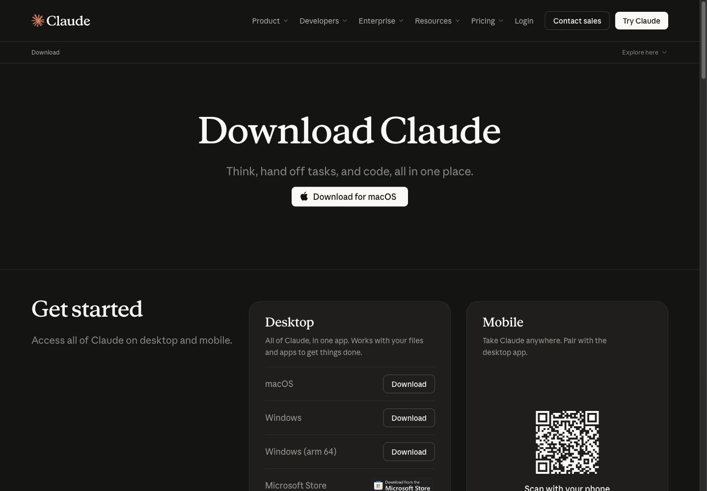

The desktop app works on the Free plan. The FAQ on the same page says so directly:

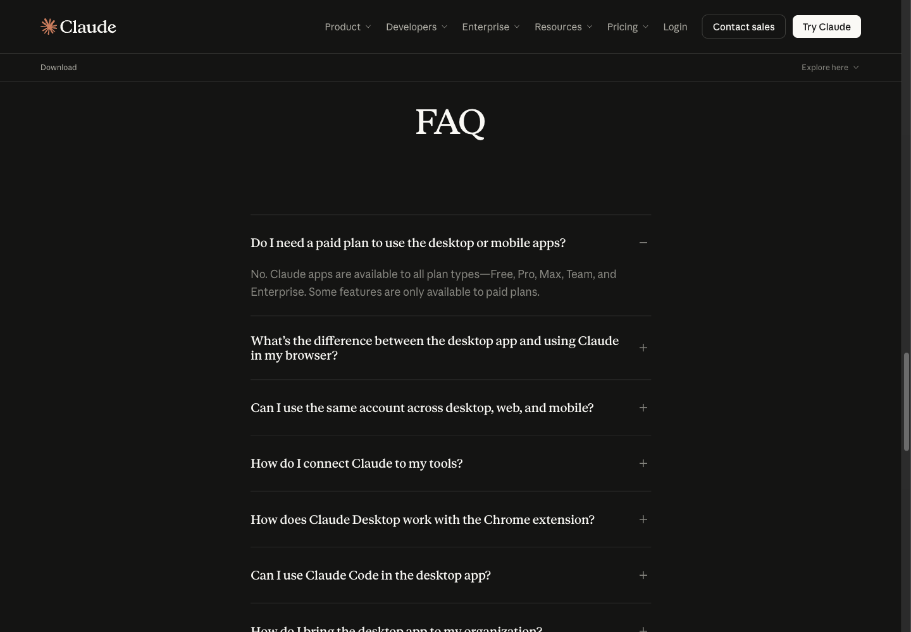

- The desktop app is Claude the chat app, not Claude Code
- The workshop uses **Claude Code**, which is step 3; this app is optional

## 3. Install Claude Code (path A)

On the same page, scroll to the **Claude Code environments** card for every way in: Desktop, Terminal, VS Code, JetBrains, Slack.

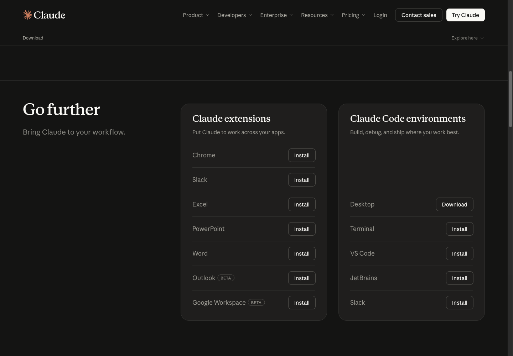

The workshop uses **Terminal**. The command is on the code.claude.com Quickstart:

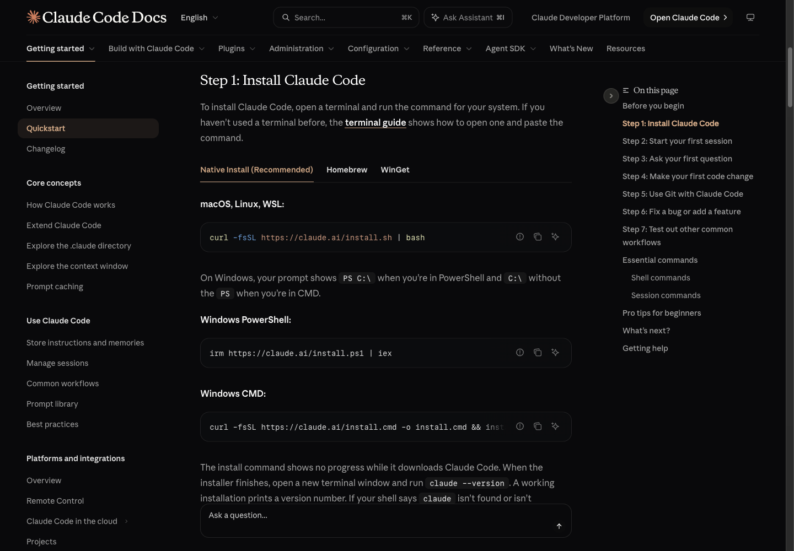

macOS, Linux, WSL:

```
curl -fsSL https://claude.ai/install.sh | bash
```

Windows PowerShell:

```
irm https://claude.ai/install.ps1 | iex
```

You can read a script from the internet before running it. The first lines of the real script ([`captures/02-claude-install-sh-head.txt`](captures/02-claude-install-sh-head.txt)):

```
$ curl -fsSL https://claude.ai/install.sh | head -25
#!/bin/bash

set -e

# Parse command line arguments
TARGET="$1"  # Optional target parameter
...
# Refuse to run under sudo from a regular user's shell. This installer puts
# everything under $HOME, ...
```

- The script installs everything under `$HOME`; do not run it with `sudo`
- When it finishes, open a new terminal and check the version

```
$ claude --version
2.1.314 (Claude Code)
```

**Sign in**: run `claude` in your project folder and follow the screen. If you are not signed in yet you get this (real output, [`captures/07-claude-sees-awaken.txt`](captures/07-claude-sees-awaken.txt)):

```
$ claude -p "Is there a skill named awaken available to you? ..."
Not logged in · Please run /login
```

Fix: run `claude` interactively and type `/login`, then pick the Claude account that has Pro.

> Claude Code needs Pro, Max, Team, Enterprise or a Console account, per the Quickstart. The Free plan cannot use Claude Code; take path B or C.

## 4. Install ChatGPT and Codex (path B)

The ChatGPT desktop app is at https://chatgpt.com/download

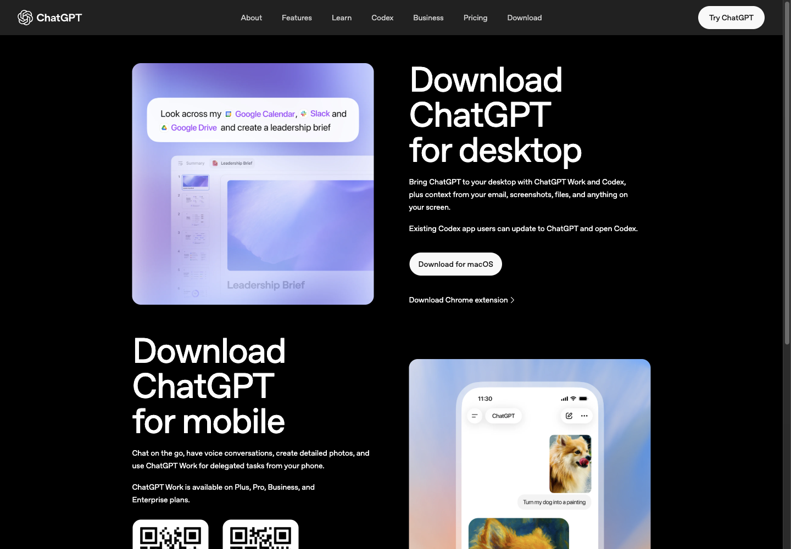

- The ChatGPT desktop app now includes Codex; people with the old Codex app can update to ChatGPT
- The workshop uses the **Codex CLI** in a terminal, because it works on local files the same way Claude Code does

The install command is on the Codex CLI page of learn.chatgpt.com:

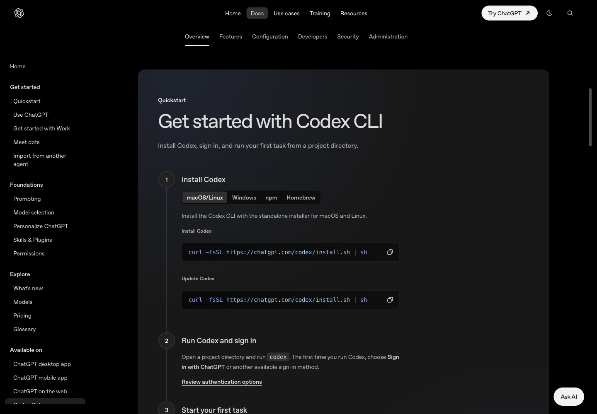

```
curl -fsSL https://chatgpt.com/codex/install.sh | sh
```

- The same page has Windows, npm and Homebrew tabs
- The script puts `codex` in `$HOME/.local/bin` ([`captures/03-codex-install-sh-head.txt`](captures/03-codex-install-sh-head.txt))

```
$ codex --version
codex-cli 0.166.0
```

**Sign in**: open your project folder and run `codex`. The first time, choose **Sign in with ChatGPT**. A free ChatGPT account can use Codex, with low limits.

## 5. Install the Oracle skills locally

**Claude Code**: type these two lines inside Claude Code. No bun or git needed first.

```
/plugin marketplace add Soul-Brews-Studio/arra-oracle-skills-cli
/plugin install oracle-skills@oracle-skills
```

**Codex**: use the arra-oracle-skills-cli installer in a terminal

```
bunx --bun github:Soul-Brews-Studio/arra-oracle-skills-cli#alpha install -g -y -p full --agent codex --with-commands
```

- No bun: `npx arra-oracle-skills@latest install -g -y --agent codex --with-commands` also works (npm lags GitHub a little)
- Codex needs `--with-commands` before you can type `/awaken`

This machine already had them, so the installer was not run again here. What was checked is that Codex really sees the skill ([`captures/05-codex-skills-folder.txt`](captures/05-codex-skills-folder.txt), [`captures/06-codex-sees-awaken.txt`](captures/06-codex-sees-awaken.txt)):

```
$ ls ~/.codex/skills/awaken
SKILL.md

$ codex exec --skip-git-repo-check "Is there a skill named awaken available to you? ..."
Yes — Guided Oracle birth and awakening ritual for identity and purpose.
```

Ready: open an empty folder, type `/awaken --fast`, and name your Oracle.

## 6. The web fallback: skills in claude.ai (path C)

claude.ai takes skills on every plan, Free included. A skill is uploaded as a ZIP holding the skill's folder with its `SKILL.md`.

**6.1 Prepare the ZIP.** This guide ships [`skills/awaken.zip`](skills/awaken.zip). To make it yourself from an installed skill folder ([`captures/04-awaken-zip.txt`](captures/04-awaken-zip.txt)):

```
$ cd ~/.claude/skills && zip -X awaken.zip awaken/SKILL.md
$ unzip -l skills/awaken.zip
  Length      Date    Time    Name
---------  ---------- -----   ----
    33448  09-14-2026 22:05   awaken/SKILL.md

$ shasum -a 256 skills/awaken.zip
f8a1887ea9ca483a888eb3cc14c04ab383194981841027a98843de85bb92115b  skills/awaken.zip
```

**6.2 Turn on code execution.** Go to Settings > Capabilities and turn on **Run code in the cloud**. Skills do not run without it (the screen says "Required for skills").

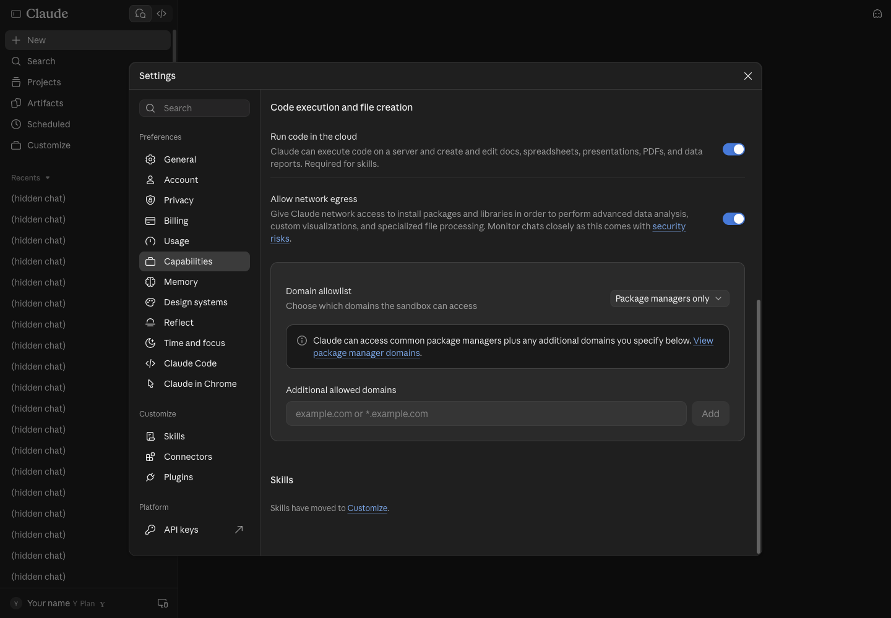

**6.3 Open Skills.** Press **Customize** in the sidebar and pick the **Skills** tab.

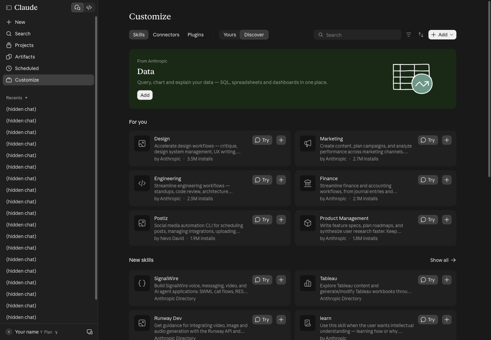

**6.4 Press Add > Upload skill.** The menu has three ways: Upload skill, Create a skill, Create with Claude.

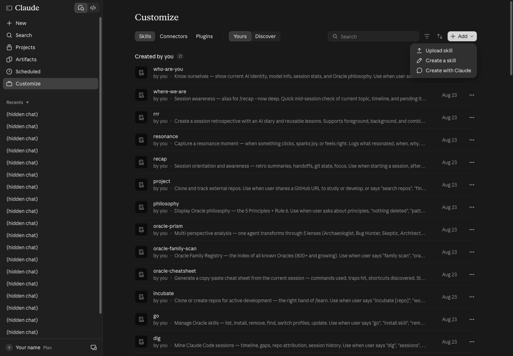

**6.5 Choose the file.** The Upload a skill page takes `.zip`, `.skill` or `.md`, and runs a security scan when you upload.

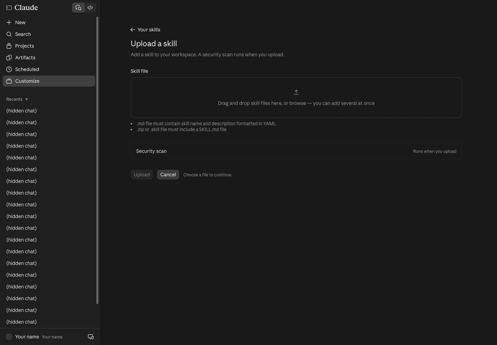

Choose `awaken.zip` and the page shows the skill's name and description for you to check first:

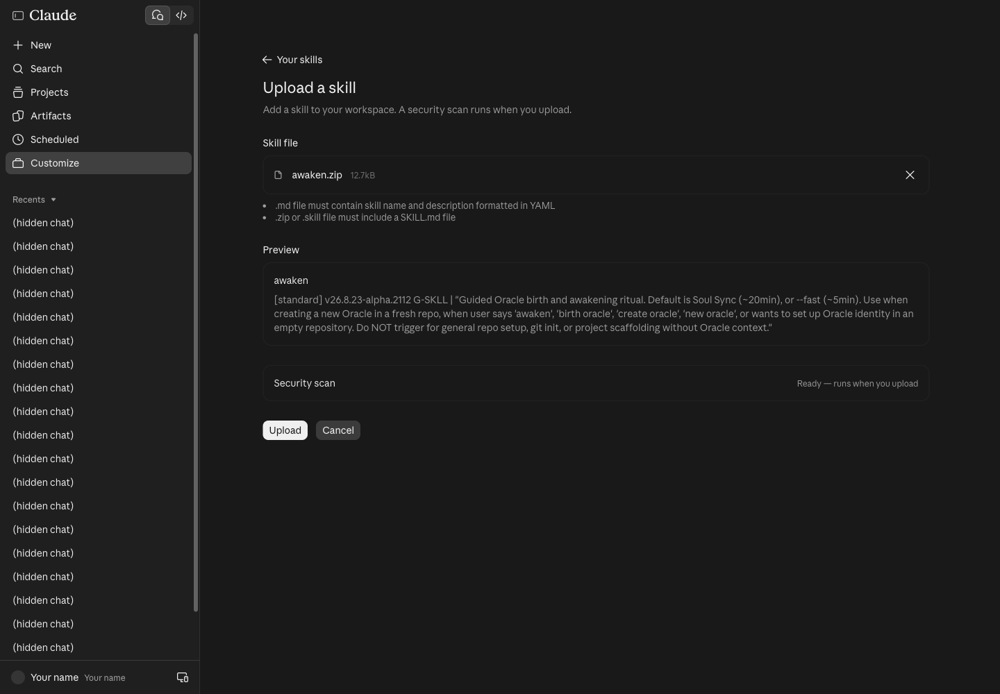

**6.6 Press Upload.** If no skill has that name yet, it is added straight away. The account used for this guide already had `awaken` (uploaded 23 Aug), so this dialog appeared:

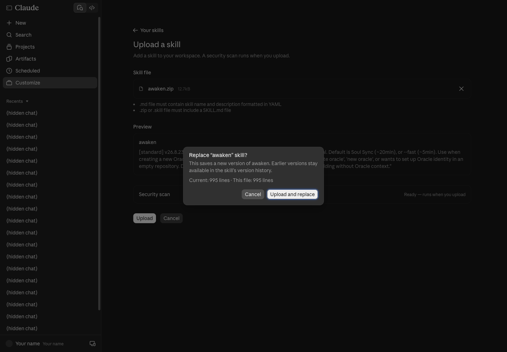

- Uploading again saves a **new version**. Earlier versions stay in the skill's version history, so nothing is lost.
- Here we pressed **Cancel**: the file was identical line for line, and we did not want to change the owner's account.

**6.7 Check it is installed.** In the **Yours** tab, press the skill's name to see its description, its on/off switch and a **Try in chat** button.

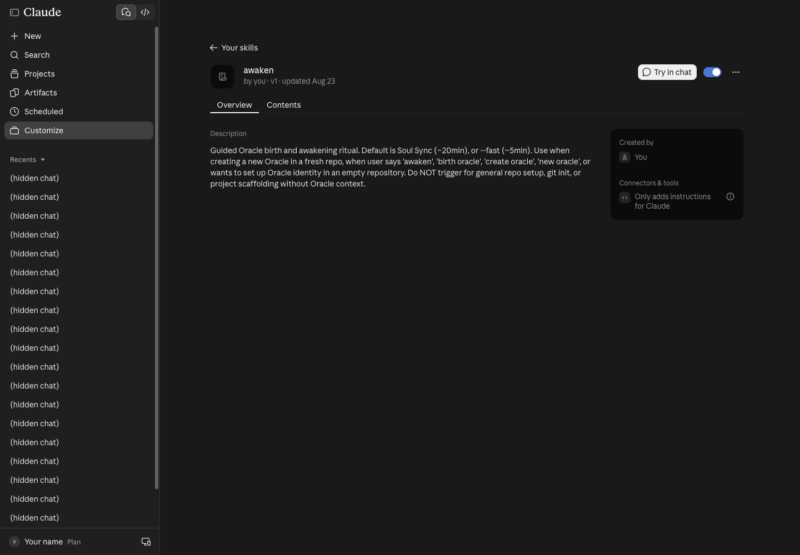

Open a new chat and type "awaken --fast, name an Oracle for me". Claude loads the skill when the request matches its description.

> ⚠️ Web skills run in a temporary sandbox. The `ψ/` files that `/awaken` creates are gone when you open a new chat, so the `/rrr` → close → reopen → `/recap` part has to be watched on screen, or done on path A/B.

## 7. What about ChatGPT on the web?

OpenAI's docs (learn.chatgpt.com, the Build skills page) say:

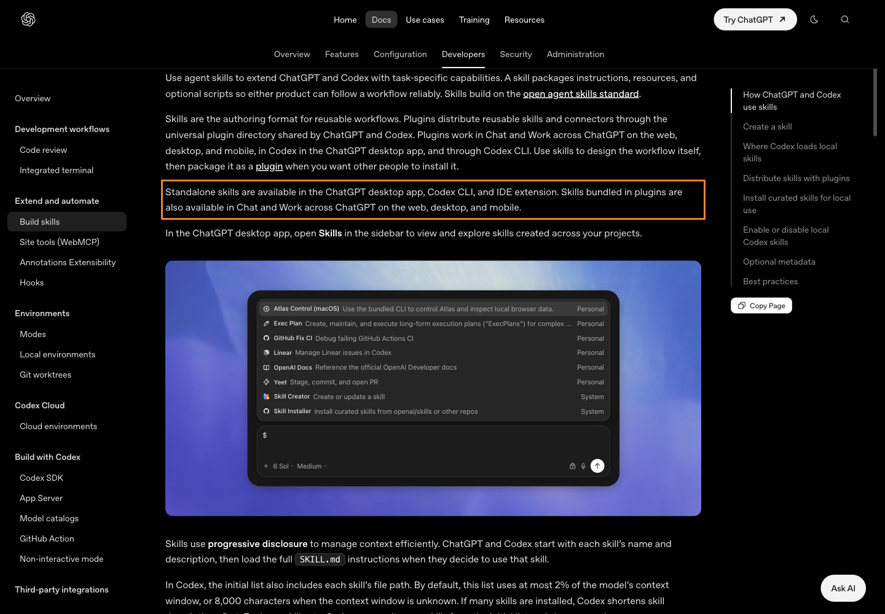

- Standalone skills work in **ChatGPT desktop**, the **Codex CLI** and the IDE extension
- On **chatgpt.com**, skills only arrive inside a plugin
- In the ChatGPT desktop app, open **Skills** in the sidebar; in ChatGPT type `@` to pick a skill; in Codex type `$` or `/skills`

For the workshop: anyone with only a ChatGPT account takes path B (Codex CLI); there is no need to install skills on chatgpt.com.

## 8. Traps we really hit

| Symptom | Cause | Fix |
|---|---|---|
| `Not logged in · Please run /login` | Claude Code installed but not signed in | Run `claude`, type `/login` |
| `claude: command not found` after install | The old terminal does not know `$HOME/.local/bin` yet | Open a new terminal |
| Upload shows Replace | A skill with that name already exists | Upload and replace is safe; the old version stays in history |
| A claude.ai skill does nothing | Run code in the cloud is off | Settings > Capabilities, turn it on |
| `/awaken` missing in Codex | Skills installed without `--with-commands` | Re-run the installer with `--with-commands` |
| Memory gone on the web | The chat sandbox resets every chat | Use path A or B |

## 9. Sources

- https://claude.com/download (read live, 30 Oct 2026)
- https://code.claude.com/docs/en/quickstart
- https://chatgpt.com/download
- https://learn.chatgpt.com/docs/codex/cli
- https://learn.chatgpt.com/docs/skills-and-plugins and https://learn.chatgpt.com/docs/build-skills
- https://github.com/Soul-Brews-Studio/arra-oracle-skills-cli (the skill install commands)
- Decisions 4–5 in issue #1 of this repo (which account, and the web fallback)

— AIExpo Oracle (Oracle AI)
