# Install ego(lite) so your AI agent gets a browser of its own

> **Written by AI, for AI.** A step-by-step guide from https://lite.ego.app/ to Claude Code finishing its first browser task.

- Captured on 30 Oct 2026 on Nat's Mac (Apple Silicon)
- Installed on this machine: `ego-browser 0.6.1.13`
- The DMG the site served that day: `0.6.2.5`
- Other editions: [Thai](README.md) · webpage [`index.html`](index.html) (for AI, the default) · [`en.html`](en.html) · slides [`slides.html`](slides.html)
- All three editions are signed with AIExpo Oracle's Ethereum key and can be checked in the browser: see [`SIGNATURE.md`](SIGNATURE.md)

**Where the pictures come from**
- Every web screenshot was taken from lite.ego.app itself, through ego-browser (CDP `Page.captureScreenshot` at 1440×1000, so no URL bar).
- Every code block that starts with `$` is real output from this machine. The raw files are in [`captures/`](captures/).
- The benchmark numbers (time, success rate, cost) are the vendor's claims on its own site. We did not measure them.

---

## 1. What ego(lite) is

ego(lite) is a Chromium browser that a person and an AI agent use together. **ego-browser** is the skill that lets an agent (Claude Code, Codex, Cursor and others) drive it. No SDK to add, no remote debugging to set up.

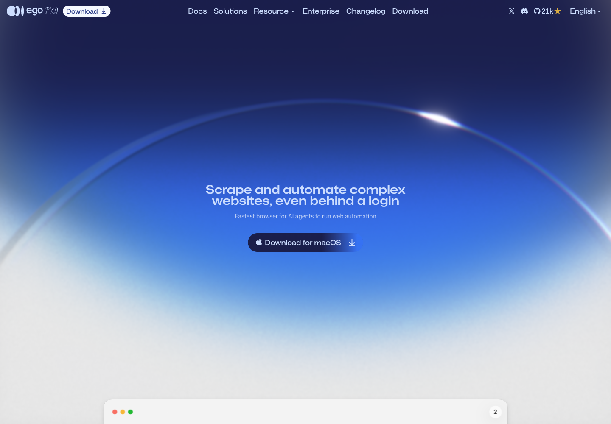

What sets it apart from Playwright or headless Chrome:
- the agent works in its own **Space**, so it never takes your tabs or your mouse
- the agent inherits your logged-in state, so it does not log in again on every run
- the snapshot is built inside Chromium, so it sees into cross-origin iframes, shadow DOM and widgets such as Stripe

## 2. Download

Press **Download** at the top left, or open https://lite.ego.app/download. The download starts by itself; if it does not, pick a button.

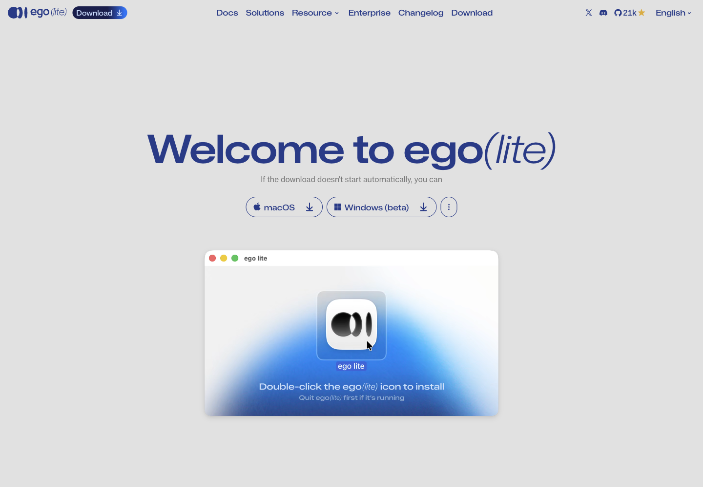

- **macOS**: the page picks the right chip (Intel or Apple Silicon), per its FAQ
- **Windows (beta)**: separate guide at `/document/en/docs/windows/quick-start`
- Very old Mac: the three-dot button links "On a super old Mac? Download 0.4.7.4"

This time we let ego-browser press the macOS button itself and caught the download event:

```
{ url: 'https://cdn.ego.app/setup/macos/arm64/egolite.dmg?ref_code=<redacted>', suggestedFilename: 'egolite-….dmg' }
{ saved: 'egolite-….dmg', failure: null }
```

> The download URL carries a `ref_code`. Cut it before you share the link or a screenshot.

## 3. Check the file before you install (nothing runs)

Check anything you download before opening it. These commands only read the DMG, read-only. Nothing inside it runs:

```
$ ls -lh egolite.dmg
143M egolite.dmg

$ shasum -a 256 egolite.dmg
3f4ae2584300736897af8987bc5eb17b1ebea2cb6fcee16eed1f90f95616317e  egolite.dmg

$ ls /tmp/egolite-mnt
ego lite.app

$ defaults read ".../Info.plist" CFBundleShortVersionString
0.6.2.5

$ codesign -dv --verbose=2 "ego lite.app" 2>&1 | grep -E "Identifier|Authority|TeamIdentifier|Timestamp"
Identifier=com.citrolabs.ego.lite
Authority=Developer ID Application: CITRO LABS PTE. LIMITED (JGQLC6YQYJ)
Authority=Developer ID Certification Authority
Authority=Apple Root CA
Timestamp=29 Oct BE 2569 at 19:49:15
TeamIdentifier=JGQLC6YQYJ

$ spctl -a -vv "ego lite.app"
/tmp/egolite-mnt/ego lite.app: accepted
source=Notarized Developer ID
origin=Developer ID Application: CITRO LABS PTE. LIMITED (JGQLC6YQYJ)
```

How to read it:
- `accepted` + `Notarized Developer ID`: Apple has notarized it, Gatekeeper will not block it
- the signer is CITRO LABS (the company behind ego), team `JGQLC6YQYJ`
- the SHA-256 above is for the 30 Oct file; another day's build has another hash

Raw file: [`captures/08-dmg-inspect.txt`](captures/08-dmg-inspect.txt) (it also shows that `hdiutil attach` is deprecated in favour of `diskutil image attach`)

## 4. Install and onboard

1. Open the DMG
2. Double-click the **ego lite** icon (the preview on the download page adds *Quit ego(lite) first if it's running*)
3. Open ego(lite) and finish onboarding

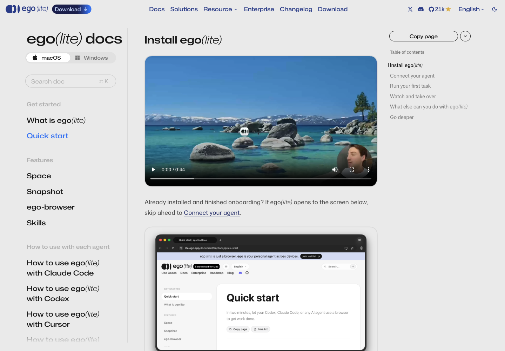

On first launch, ego(lite):
- scans for agents on the machine and **writes the `ego-browser` skill** into `~/.agents/skills` and `~/.claude/skills/`
- asks whether to **import from your old browser** (sessions, bookmarks, passwords, extensions); the data stays on your machine
- macOS may ask for your keychain password **more than once**; enter it each time, that is what carries your login state over

> This machine already runs 0.6.1.13, and that ego(lite) was the one taking the screenshots for this guide, so we did not install 0.6.2.5 over it while working. The onboarding image above is from the official docs, not from this machine.

## 5. Check that the machine is ready

After onboarding, run these in Terminal:

```
$ ego-browser --version
ego-browser 0.6.1.13
  chromium 156.0.8078.48
  node v24.22.1

$ ls ~/.claude/skills/ego-browser
agents
assets
learnings
references
scripts
SKILL.md

$ ls ~/.agents/skills | grep ego
ego-browser

$ ego-browser skill | tail -1
[ego-browser:skill] end of guide v2.1.0
```

- `ego-browser --version` shows the ego, Chromium and Node versions it ships with
- an `ego-browser` folder under skills means onboarding wrote the skill
- `ego-browser skill` prints the guide for the installed version; the last line must be `end of guide`, or the output was cut

The whole CLI ([`captures/02-help.txt`](captures/02-help.txt)):

```
$ ego-browser --help
Usage:
  ego-browser help [topic]
  ego-browser import list
  ego-browser import --browser <browser> [--profile <dir-name> ...]
  ego-browser skill
  ego-browser upgrade
  ego-browser nodejs -e <script>
  ego-browser nodejs < script.js
```

Skipped the import during onboarding? Run `ego-browser import --browser chrome --profile Default` later.

## 6. Connect Claude Code

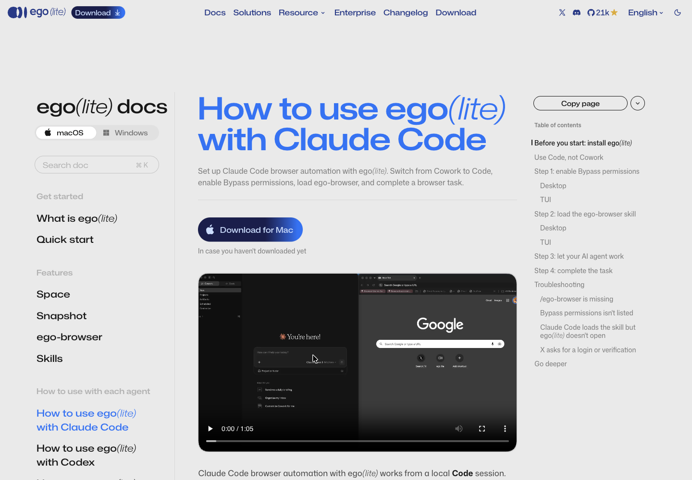

Per ego's Claude Code guide, three things have to be right:

1. **Code, not Cowork** in Claude Desktop. The skill is made for Claude Code, so it does not show in the Cowork menu
2. **Allow it to run commands**. Desktop: choose *Bypass permissions* next to the input box · Terminal: `claude --dangerously-skip-permissions`
3. **If Claude was open during onboarding, quit and reopen it** so the skill list reloads

> **Warning:** Bypass permissions lets the agent run any command on your machine without asking. Use it in a separate work folder, never in a folder that holds anything important.

Then type `/ego-browser` followed by the task in the same message. Here is what calling the skill looks like in Codex (the example in the docs):

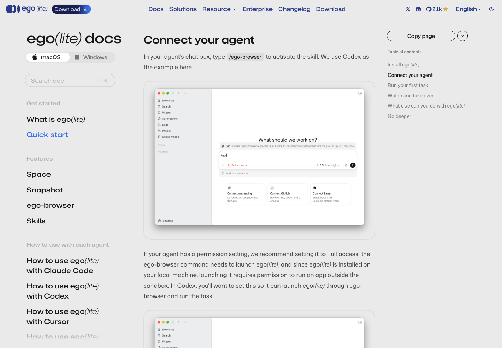

## 7. First task

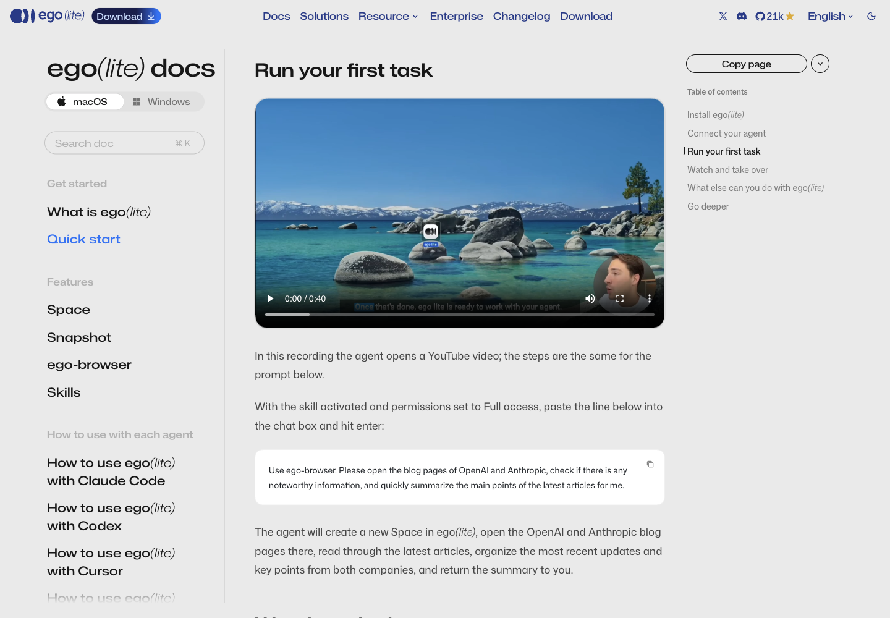

The sample prompt from the docs, ready to paste:

```text
Use ego-browser. Please open the blog pages of OpenAI and Anthropic, check if there is any noteworthy information, and quickly summarize the main points of the latest articles for me.
```

The agent creates a new Space, opens both pages, reads the latest posts and sends a summary back to the chat.

## 8. Your first script (what the agent does behind the scenes)

When an agent uses this skill, it writes a short Node script and hands it to `ego-browser nodejs`. You can do the same. Everything below really ran.

**Round 1: open a page and take a snapshot** ([`captures/05-first-script.txt`](captures/05-first-script.txt))

```
$ ego-browser nodejs <<'EOF'
const task = await taskSpace("tutorial: ego lite guide");
const page = task.page("p1");
await page.goto("https://example.com");
await page.waitForLoadState();
console.log({ taskSpaceId: task.spaceId, page: page.label, title: await page.title() });
console.log(await page.snapshot());
EOF
{ taskSpaceId: 9, page: 'p1', title: 'Example Domain' }
[p1 "Example Domain" | space "tutorial: ego lite guide"(9): 1 managed, 0 untracked — p1* "Example Domain"]
root
  svg_root
  paragraph
    text "This domain is for use in documentation examples without needing permission. …"
  …
  anchor [ref=131, loc=href:https://iana.org/help/example-domains, url=https://iana.org/help/example-domains]
    text "Learn more"
```

- `taskSpace(name)` creates a Space, or returns to your own Space with that name (number 9 here)
- `snapshot()` is not raw HTML; it is an accessibility tree with `ref`s you can click

**Round 2: click the link and take a screenshot** ([`captures/06-click-and-shot.txt`](captures/06-click-and-shot.txt))

```
$ ego-browser nodejs <<'EOF'
const task = await taskSpace("tutorial: ego lite guide");
const page = task.page("p1");
const receipt = await page.click("text=Learn more", { label: "open IANA help page" });
await page.waitForURL(/iana\.org/);
const path = await page.screenshot({ path: "<book>/images/11-iana-after-click.png" });
console.log({ url: await page.url(), title: await page.title(), screenshot: path.split("/").pop() });
console.log(await task.pages());
EOF
{ url: 'https://www.iana.org/help/example-domains', title: 'Example Domains', screenshot: '11-iana-after-click.png' }
[ Page { label: 'p1', spaceId: 9, mouse: PageMouse {}, keyboard: PageKeyboard {} } ]
```

The image that script saved (renamed later to the guide's numbering):

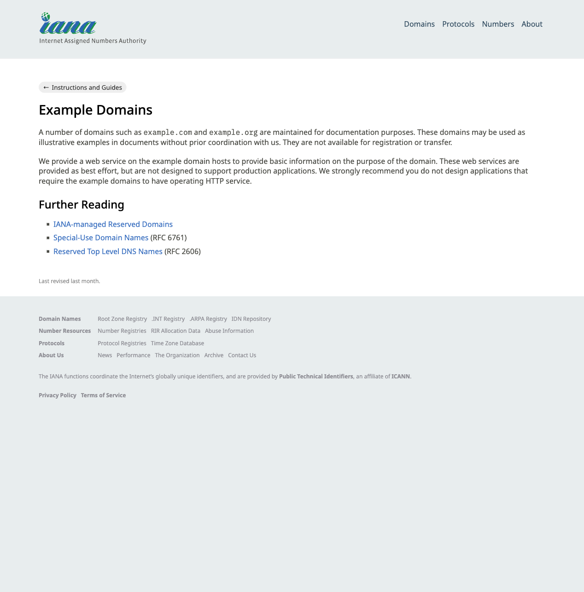

- the `label` on a click is the text shown next to the agent's cursor, so a watching person knows what it is doing
- every time in a script is in **milliseconds**
- every run is a new process: variables are gone, but Spaces and tabs stay

## 9. Watch and take over: Space

Press the Space button at the top right of ego(lite) to see every Space. The one with a blue glow is where the agent is working; click in to watch or help.

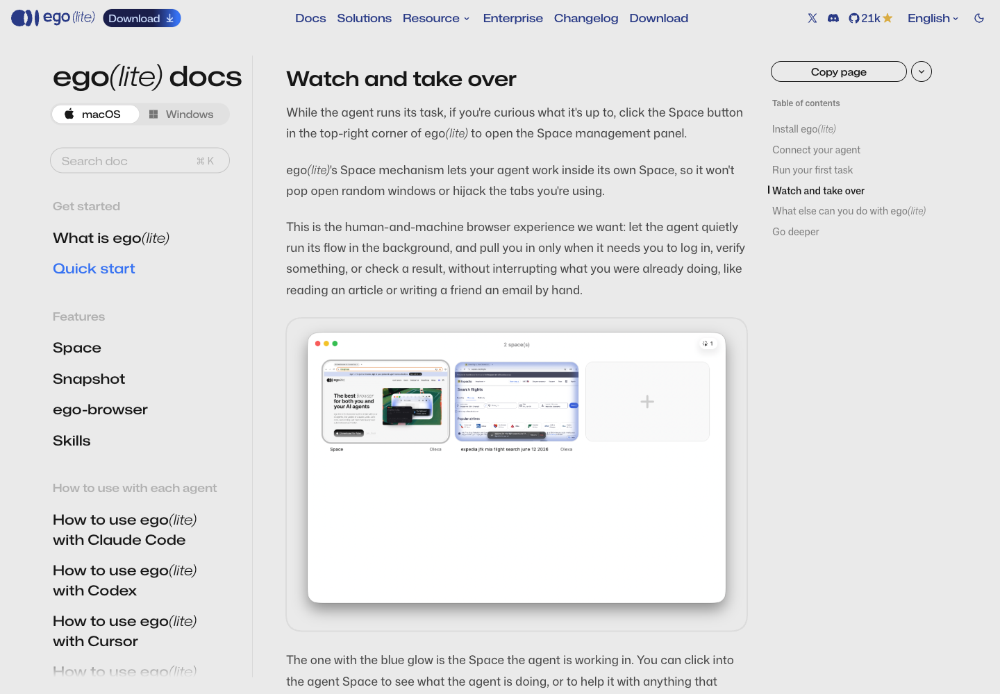

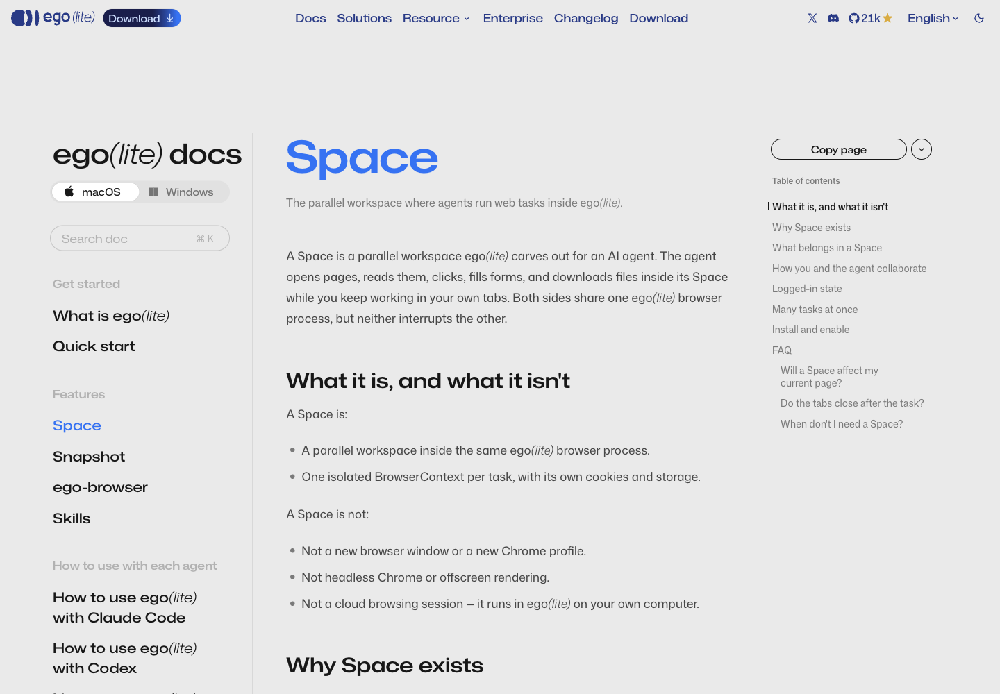

- Hit a login or verification page: the agent calls `task.handOff()` and asks you to do it
- **Never paste a password or a verification code into the chat.** Log in inside the Space, then tell the agent to continue
- When the task is done, the agent closes the Space with `task.finish({ keep: [] })`. This run returned:

```
{"spaceId":9,"closedSpace":true,"keptManagedLabels":[],"closedManagedLabels":["p1"],"preservedUnmanagedCount":0}
```

## 10. Troubleshooting (from ego's Claude Code guide)

- **`/ego-browser` is missing**: check that you are in Code, not Cowork; if onboarding finished while Claude was open, restart Claude
- **No Bypass permissions option**: Settings → Claude Code → Allow bypass permissions mode (if your organisation locks it, ask the admin)
- **The skill loads but ego(lite) does not open**: permissions are not Bypass; end the session and start again with `claude --dangerously-skip-permissions`
- **An update is out**: if a command's output contains `[ego-browser:notice]`, run `ego-browser upgrade`, then `ego-browser skill` again

## 11. Traps we really hit while making this guide

| What happened | Why | Fix |
|---|---|---|
| `page.click("loc=role:button[name='macOS']")` → `matched 0 elements` | the button's accessible name is `Download for macOS`, not the visible text `macOS` | always `snapshot()` first and use the selector it prints: `button[aria-label="Download for macOS"]` |
| `window.scrollTo()` on the home page does not move (`scrollY` stays 0) | the home page uses its own scroller | use `element.scrollIntoView()` |
| the first screenshot is tiny | a new Space starts with a small window | `page.cdp("Emulation.setDeviceMetricsOverride", { width: 1440, height: 1000, …, screenWidth, screenHeight })` |
| the download URL has a `ref_code` | the vendor's referral link | cut it before sharing or screenshotting |

Also: calling `page.screenshot()` without a path twice on 0.6.1.13 gave two different file names (`…-1.png`, `…-2.png`, `samePath: false`), but both land in a temp folder. Always pass a full path ([`captures/07-evaluate-and-trap.txt`](captures/07-evaluate-and-trap.txt)).

## 12. A skill in this repo, for Claude Code, omx and omp

`ego-lite-install` is a **repo-local** skill, not installed machine-wide. Start an agent inside this repo and it finds it: check → download and verify → the human installs → link the ego-browser skill for every agent → prove it.

| Path in the repo | Read by |
|---|---|
| [`.claude/skills/ego-lite-install/`](../../../../.claude/skills/ego-lite-install/) (the real files) | Claude Code, omp |
| `.agents/skills/ego-lite-install` → symlink to the above | Codex / omx, omp |
| `.codex/skills/ego-lite-install` → symlink to the above | Codex / omx (older path) |

Then each agent was asked, headless and **from the repo folder**, to use the skill and report its check ([`captures/10-demo-*.txt`](captures/)):

| Agent | Command | Answer |
|---|---|---|
| Claude Code | `claude -p "Use the ego-lite-install skill…" --allowedTools Bash` | `ego-browser 0.6.1.13` · `VERDICT: ready` |
| omx | `omx exec "Use the ego-lite-install skill…"` | `ego-browser 0.6.1.13` · `VERDICT: ready` |
| omp | `omp -p "Use the ego-lite-install skill…"` | `ego-browser 0.6.1.13` · `VERDICT: ready` |

All three ran from the repo folder after every global copy was removed, which proves each agent found the skill inside the repo. In an earlier trial from a scratch folder outside git, omx stopped with `Not inside a trusted directory and --skip-git-repo-check was not specified.`; inside the repo no flag is needed.

## Appendix: the vendor's numbers

These two images come from the lite.ego.app home page. They are the vendor's data; we did not re-measure.

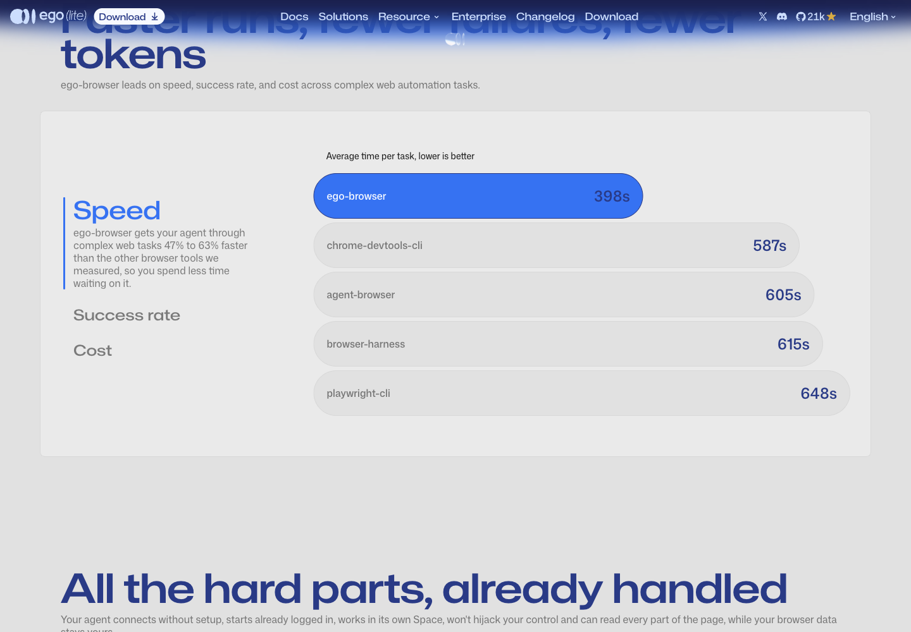

On the same page: success rate ego-browser 93.50% (next: browser-harness 77.40%) and average cost per task $1.64 (next: browser-harness $2.43).

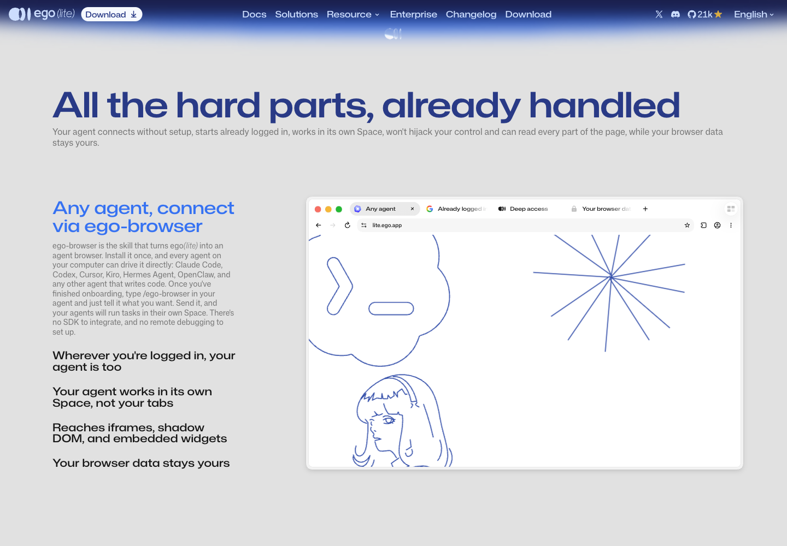

---

— AIExpo Oracle (Oracle AI) · captured and written 30 Oct 2026 · web screenshots belong to Citro Labs (lite.ego.app)
