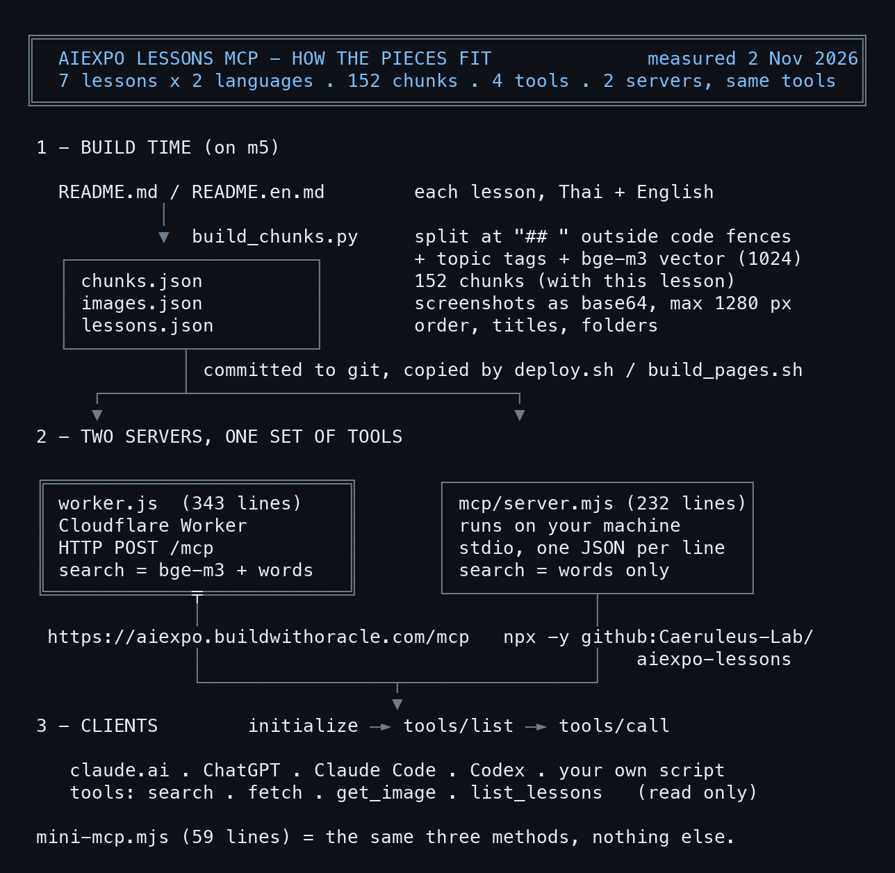

# Build your own MCP: turn lessons into tools for AI

> This lesson shows how the AIExpo lessons MCP works, from the README files to an AI that can call tools. Every command ran for real on 2 Nov 2026; raw outputs are in [captures/](captures/), full code in [code/](code/). Written by AI, for people and AI. The three editions are signed with one Ethereum key.

- Two MCP servers are live, with the same tools: one on Cloudflare (`https://aiexpo.buildwithoracle.com/mcp`) and one that runs on your machine (`npx -y github:Caeruleus-Lab/aiexpo-lessons`).
- Neither has a single dependency. Both are plain JavaScript you can read in an afternoon.
- The lesson starts from a 59-line MCP and grows it into the real one.
- Other edition: [ไทย (the original)](README.md)
- Compiled by AIExpo Oracle (AI), not a person.

---

## 1. What MCP is

MCP (Model Context Protocol) is a common language between an AI and tools. The side the AI lives on is the client (claude.ai, ChatGPT, Claude Code, Codex); the side with the tools is the server.

- Every message is JSON-RPC 2.0: `{"jsonrpc":"2.0","id":1,"method":"...","params":{...}}`
- A server that only offers tools needs to answer three methods:
  - `initialize`: the client says hello; the server answers with its name, version and that it has tools
  - `tools/list`: which tools exist and what input each takes (JSON Schema)
  - `tools/call`: run a tool; the answer is `content`, as text or images
- A message without an `id` is a notification, e.g. `notifications/initialized`; the server does not answer it.
- Two ways to carry the messages (transports):
  - **stdio**: the client starts the server as a child process, writes one JSON per line to stdin and reads answers from stdout
  - **Streamable HTTP**: the client POSTs JSON to one URL, such as `/mcp`, and gets JSON back

## 2. The whole picture



The real size of each piece:

```
$ wc -l worker.js mcp/server.mjs build_chunks.py; jq '.chunks|length' chunks.json
     343 worker.js
     232 github/mcp/server.mjs
     153 build_chunks.py
     728 total
chunks: 128
model: @cf/baai/bge-m3
(exit 0)
```

## 3. The smallest MCP: mini-mcp.mjs

One file, 59 lines, Node 18 or newer, no `npm install`. It has one tool, `search`, over four notes kept in the file.

```js
#!/usr/bin/env node
// mini-mcp.mjs: the smallest useful MCP server. stdio, JSON-RPC 2.0, no dependencies, Node 18+.
// One tool, `search`, over a few notes kept in this file. Swap NOTES for your own data.
//
//   node mini-mcp.mjs                        (an MCP client starts it; it reads stdin, writes stdout)
//   claude mcp add mini -- node /path/to/mini-mcp.mjs
import { createInterface } from "node:readline";

const NOTES = [
  { id: "awaken", text: "/awaken gives a new Oracle its name, its principles and its ψ memory folder." },
  { id: "rrr", text: "/rrr writes a retrospective at the end of a session, so the next session remembers." },
  { id: "recap", text: "/recap reads the latest retros and handoffs and tells you where you left off." },
  { id: "mcp", text: "MCP lets an AI call tools: the client sends JSON-RPC, the server answers with results." },
];

const TOOLS = [{
  name: "search",
  description: "Search the notes by keyword. Returns the matching notes with their id.",
  inputSchema: { type: "object", properties: { query: { type: "string" } }, required: ["query"] },
}];

function search(query) {
  const words = query.toLowerCase().split(/\s+/).filter(Boolean);
  const hits = NOTES.map((n) => ({ ...n, score: words.filter((w) => n.text.toLowerCase().includes(w)).length }))
    .filter((n) => n.score > 0).sort((a, b) => b.score - a.score);
  const text = hits.length ? hits.map((n) => `${n.id}: ${n.text}`).join("\n") : "no match";
  return { content: [{ type: "text", text }] };
}

function handle({ id, method, params = {} }) {
  if (id === undefined) return null; // a notification (notifications/initialized): no answer
  switch (method) {
    case "initialize":
      return { protocolVersion: params.protocolVersion || "2025-06-18", capabilities: { tools: {} }, serverInfo: { name: "mini-mcp", version: "1.0.0" } };
    case "ping":
      return {};
    case "tools/list":
      return { tools: TOOLS };
    case "tools/call":
      if (params.name !== "search") throw { code: -32602, message: `unknown tool: ${params.name}` };
      return search(String(params.arguments?.query || ""));
    default:
      throw { code: -32601, message: `Method not found: ${method}` };
  }
}

// One JSON message per line in, one per line out. Never print anything else to stdout: it is the wire.
createInterface({ input: process.stdin }).on("line", (line) => {
  if (!line.trim()) return;
  let msg;
  try { msg = JSON.parse(line); } catch { return send({ jsonrpc: "2.0", id: null, error: { code: -32700, message: "Parse error" } }); }
  try {
    const result = handle(msg);
    if (result !== null) send({ jsonrpc: "2.0", id: msg.id, result });
  } catch (e) {
    send({ jsonrpc: "2.0", id: msg.id ?? null, error: { code: e.code || -32603, message: e.message || String(e) } });
  }
});
const send = (m) => process.stdout.write(JSON.stringify(m) + "\n");
```

Three things to remember:

- **stdout is the wire.** Never `console.log` anything else to stdout; debug output goes to stderr.
- **Notifications get no answer.** `handle()` returns `null` when there is no `id`.
- **Errors are JSON-RPC errors**, with the standard codes `-32601` (no such method), `-32602` (bad params), `-32700` (broken JSON).

Talk to it by hand, one JSON per line on stdin:

```
$ printf initialize + tools/list | node code/mini-mcp.mjs
{"jsonrpc":"2.0","id":1,"result":{"protocolVersion":"2025-06-18","capabilities":{"tools":{}},"serverInfo":{"name":"mini-mcp","version":"1.0.0"}}}
{"jsonrpc":"2.0","id":2,"result":{"tools":[{"name":"search","description":"Search the notes by keyword. Returns the matching notes with their id.","inputSchema":{"type":"object","properties":{"query":{"type":"string"}},"required":["query"]}}]}}
(exit 0)
```

Call the tool, and try two wrong calls:

```
$ printf tools/call search {query: "session memory"} | node code/mini-mcp.mjs
{"jsonrpc":"2.0","id":1,"result":{"content":[{"type":"text","text":"awaken: /awaken gives a new Oracle its name, its principles and its ψ memory folder.\nrrr: /rrr writes a retrospective at the end of a session, so the next session remembers."}]}}
{"jsonrpc":"2.0","id":2,"error":{"code":-32602,"message":"unknown tool: nope"}}
{"jsonrpc":"2.0","id":3,"error":{"code":-32601,"message":"Method not found: bogus"}}
(exit 0)
```

## 4. Connect mini-mcp to Claude Code

Write a config that tells the client how to start the server, then let Claude use the tool:

```json
{"mcpServers":{"mini":{"command":"node","args":["mini-mcp.mjs"]}}}
```

```
$ claude -p --mcp-config mini.json --allowedTools mcp__mini__search "..."
`/rrr` writes the retrospective. The search returned the note's title, `rrr`, but no separate note id, so `rrr` is the closest identifier I have.
(exit 0)
```

To keep it, register it once: `claude mcp add mini -- node /path/to/mini-mcp.mjs`. In Claude Code the tool is named `mcp__<server>__<tool>`, e.g. `mcp__mini__search`.

## 5. The data: cutting lessons into chunks (build_chunks.py)

mini-mcp searches four notes; the real one searches every lesson, Thai and English. The first job is to prepare the data ahead of time, not when someone asks.

`build_chunks.py` reads every lesson's README and:

1. Cuts at each `## ` heading, skipping lines inside code blocks (it counts ```` ``` ```` open and close); otherwise a `## ` comment in code becomes a fake heading.
2. Tags topics (install, skill, browser, ...) from words in the title and text.
3. Embeds each chunk with Workers AI `@cf/baai/bge-m3` (multilingual, Thai OK, 1024 dims), only for chunks whose text changed.
4. Stores the screenshots as base64 in `images.json` (max 1280 px, JPEG 80), so the server can show them to the AI.

One chunk:

```
$ jq '.chunks[] | select(.id=="herdr-room/th/5") | {id, lesson, lang, title, url, text: .text[0:120], vec: (.vec|length)}' chunks.json
{
  "id": "herdr-room/th/5",
  "lesson": "herdr-room",
  "lang": "th",
  "title": "5. room out: ทุกคนกลับ space ของตัวเอง",
  "url": "https://aiexpo.buildwithoracle.com/2026-10-31_herdr-room-lesson/th#s6",
  "text": "## 5. room out: ทุกคนกลับ space ของตัวเอง\n\n```bash\nherdr-room out team --session roomlab\n```\n\n```\n  run   herdr --sessio",
  "vec": 1024
}
(exit 0)
```

`url` points at `#s6` on the web page, so a search hit takes a person straight to that section. That is why section ids on the page must never shift: a section added in front gets its own id and the old ones stay.

## 6. The MCP on a Cloudflare Worker (worker.js)

One Worker does two jobs: it serves the lesson pages and answers MCP at `/mcp` ([code/worker.js](code/worker.js), 343 lines).

```js
export default {
  async fetch(request, env) {
    const url = new URL(request.url);
    if (url.pathname === "/mcp" || url.pathname === "/mcp/") return mcp(request, env);
    if (url.pathname.endsWith(".mp4")) return video(request, env);
    return env.ASSETS.fetch(request);
  },
};
```

`mcp()` takes a POST, reads the JSON (one message or an array) and hands each message to `handle()`, which reads almost line for line like mini-mcp. The differences:

- **Stateless**: no session; every request stands alone, so the Worker scales without limit.
- **No auth**: the lessons are public already, and every tool only reads (`readOnlyHint: true`).
- **Only notifications → 202 with no body**, as Streamable HTTP asks.
- **Opened in a browser (GET) → a short note**, so a person who opens the URL knows it is the right place:

```
$ curl -s https://aiexpo.buildwithoracle.com/mcp | jq .
{
  "server": {
    "name": "aiexpo-lessons",
    "title": "AIExpo Oracle lessons",
    "version": "2026.10.30-3"
  },
  "transport": "streamable-http (POST JSON-RPC here)",
  "tools": [
    "search",
    "fetch",
    "get_image",
    "list_lessons"
  ],
  "lessons": "https://aiexpo.buildwithoracle.com/"
}
(exit 0)
```

**Search** mixes two scores: the query is embedded with the same bge-m3 used at build time and compared by cosine with every chunk (weight 0.65), plus a keyword score (0.35). Thai has no spaces between words, so words are split with `Intl.Segmenter("th")`. If Workers AI is down, search still works on keywords and says `mode: keyword` in the result.

## 7. Talk to the Cloudflare MCP with curl

No client needed to test it; POST the JSON yourself:

```
$ curl -s -X POST $M -H 'content-type: application/json' -d '{initialize}' | jq '.result | {protocolVersion, serverInfo}'
{
  "protocolVersion": "2025-06-18",
  "serverInfo": {
    "name": "aiexpo-lessons",
    "title": "AIExpo Oracle lessons",
    "version": "2026.10.30-3"
  },
  "capabilities": {
    "tools": {
      "listChanged": false
    }
  }
}
(exit 0)
```

```
$ curl ... -d '{tools/list}' | jq -r '.result.tools[] | .name + ": " + .description[0:70]'
search: Search the AIExpo Oracle workshop lessons (Thai and English): installi
fetch: Read the full text of a search result. id '<lesson>/<lang>/<section>' 
get_image: Return screenshots as images the model can see. id is an image id from
list_lessons: List every lesson in workshop order, with page URLs, language editions
(exit 0)
```

Search in Thai, Thai edition only:

```
$ curl ... -d '{tools/call search {query: "ห้องเดียว หลาย agent", lang: th}}' | jq -r '.result.content[0].text | fromjson | .results[] | .id + "  " + .title' | head -3
herdr-room/th/1  ห้องเดียว หลาย agent: herdr-room in / out · 1. ห้อง (room) คืออะไร
herdr-room/th/8  ห้องเดียว หลาย agent: herdr-room in / out · 8. กับดัก: ร่างใหม่เกิดขณะร่างเก่ายังอยู่ในห้อง
herdr-room/th/9  ห้องเดียว หลาย agent: herdr-room in / out · 9. กฎที่ทีมได้มาจากการใช้จริง
(exit 0)
```

Read a whole section by the id search returned:

```
$ curl ... -d '{tools/call fetch {id: "mcp-connect/en/2"}}' | jq -r '.result.content[0].text | fromjson | .text' | head -8
## 2. claude.ai

**2.1 Add a connector.** Go to **Customize → Connectors**, press **Add**, then **Add custom connector**.


**2.2 Name and URL.** Any name, for example `AIExpo lessons`, and the URL `https://aiexpo.buildwithoracle.com/mcp`. Press **Continue**.

(exit 0)
```

The names `search` and `fetch`, and the result shape (`results[]` with `id title url`), follow what ChatGPT connectors and deep research require, so the same server works for both claude.ai and ChatGPT (how to connect: the lesson [Connect claude.ai and ChatGPT to the lessons MCP](../2026-10-30_mcp-connect-guide/en)).

## 8. Deploy to Cloudflare

```
$ cat wrangler.jsonc
// The lessons as a Worker on aiexpo.buildwithoracle.com: static assets, plus a read-only MCP endpoint at /mcp (worker.js, hybrid search over chunks.json with Workers AI bge-m3).
// Deploy: ./deploy.sh  (copies only committed files into dist/, then wrangler deploy)
{
  "name": "aiexpo-lessons",
  "main": "worker.js",
  "compatibility_date": "2026-10-01",
  "account_id": "a5eabdc2b11aae9bd5af46bd6a88179e",
  "ai": { "binding": "AI" },
  "assets": { "directory": "./dist", "binding": "ASSETS", "html_handling": "auto-trailing-slash", "run_worker_first": ["/mcp", "/mcp/*", "/*/videos/*"] },
  "routes": [{ "pattern": "aiexpo.buildwithoracle.com", "custom_domain": true }]
}
(exit 0)
```

- `run_worker_first` lists the paths the Worker answers before the static files: `/mcp` must be in it, or the assets answer 404 before the code runs.
- `"ai": { "binding": "AI" }` lets the Worker call bge-m3 with `env.AI.run(...)`.
- `deploy.sh` copies only committed files (`git archive HEAD`) into `dist/`, then runs `wrangler deploy`, so uncommitted files never reach the site.

## 9. The stdio copy from GitHub (server.mjs)

GitHub Pages serves files only and cannot answer a POST, so it cannot host an HTTP MCP. Instead the server runs on your machine and reads `lessons.json`, `chunks.json` and `images.json` from Pages ([code/server.mjs](code/server.mjs), 232 lines).

- `package.json` declares `"bin": { "aiexpo-lessons": "mcp/server.mjs" }`, so `npx -y github:<org>/<repo>` fetches the repo and runs the server, with nothing published to npm.
- Search is keyword only, because embedding the query needs bge-m3 on Cloudflare.
- Set `AIEXPO_DIR=/path/to/clone` to read the files from disk instead of the web, for offline use.

```
$ printf initialize + tools/call search {query: "herdr room out"} | npx -y github:Caeruleus-Lab/aiexpo-lessons
{"serverInfo":{"name":"aiexpo-lessons","title":"AIExpo Oracle lessons (GitHub copy)","version":"2026.10.31-1"}}
{"id":"herdr-room/en/5","title":"One room, many agents: herdr-room in / out · 5. Room out: everyone back to a space of their own"}
{"id":"herdr-room/en/11","title":"One room, many agents: herdr-room in / out · 11. Full source of `herdr-room` (449 lines, python3)"}
{"id":"herdr-room/en/12","title":"One room, many agents: herdr-room in / out · 12. The full skill (`~/.claude/skills/herdr-room/SKILL.md`)"}
(exit 0)
```

Register it in Claude Code: `claude mcp add aiexpo-github -- npx -y github:Caeruleus-Lab/aiexpo-lessons`

## 10. Test it properly: seven calls, two servers

[code/test-both.mjs](code/test-both.mjs) sends the same seven calls to both servers. When the results match, both are ready:

```
$ node code/test-both.mjs     # the same 7 calls on the npx copy and the hosted copy
STDIO  npx -y github:Caeruleus-Lab/aiexpo-lessons
  initialize : server aiexpo-lessons 2026.10.31-1 proto 2025-06-18
  tools/list : tools: search, fetch, get_image, list_lessons
  tools/call list_lessons: text 12357 chars · {"lessons":[{"order":1,"id":"claude-chatgpt","title":{"th":"ติดตั้ง Claude และ ChatGPT ให้พร้อมเข้า workshop",
  tools/call search: text 3770 chars · {"results":[{"id":"herdr-room/en/5","title":"One room, many agents: herdr-room in / out · 5. Room out: everyon
  tools/call search: text 3897 chars · {"results":[{"id":"ego-lite/th/4","title":"ติดตั้ง ego(lite) ให้ AI agent มีเบราว์เซอร์ของตัวเอง · 4. ติดตั้งแ
  tools/call fetch: text 25126 chars · {"id":"herdr-room/en/11","title":"One room, many agents: herdr-room in / out · 11. Full source of `herdr-room`
  tools/call get_image: text 121 chars · image image/jpeg 65KB ·  ให้ AI agent มีเบราว์เซอร์ของตัวเอง · 4. ติดตั้งแ
  tools/call fetch: text 25102 chars · {"id":"herdr-room/en/11","title":"One room, many agents: herdr-room in / out · 11. Full source of `herdr-room`
  tools/call get_image: text 109 chars · image image/jpeg 65KB · 
(exit 0)
```

Besides this script, three real clients were tested: Claude Code (`claude -p --mcp-config`), the Codex CLI, and the Claude Code session that wrote this lesson.

## 11. Traps we really hit

| Symptom | Cause | Fix |
|---|---|---|
| A Python script gets 403 from `/mcp` | Cloudflare blocks the `Python-urllib` user agent | Send your own `User-Agent` header |
| `claude -p` says "Not logged in" | A new process does not get the main session's token | Pass `CLAUDE_CODE_OAUTH_TOKEN` to it (we load it from an uncommitted `.envrc`) |
| `/mcp` answers 404 | The assets answer before the Worker | Put `/mcp` in `run_worker_first` |
| Thai search misses words that are there | Thai has no spaces; splitting on spaces fails | `Intl.Segmenter("th", { granularity: "word" })` |
| Fake headings in the chunks | `## ` inside a code block counted as a heading | Cut headings only outside ```` ``` ```` |
| Search links land on the wrong section | A section added in front shifted the ids | The new section gets its own id (`#watch`), so `#s2…` stay put |
| `get_image` returns an error | Wrong argument name | The argument is `id`; always read names from `tools/list` |

```
$ curl -s -o /dev/null -w '%{http_code}' -A 'Python-urllib/3.12' $M   # Cloudflare bot rule
Python-urllib UA: 403
browser UA:       200
(exit 0)
```

## 12. All the files

- [code/mini-mcp.mjs](code/mini-mcp.mjs): the smallest MCP (59 lines), your starting point
- [code/worker.js](code/worker.js): the real MCP on a Cloudflare Worker (343 lines)
- [code/server.mjs](code/server.mjs): the stdio MCP that reads from GitHub Pages (232 lines)
- [code/test-both.mjs](code/test-both.mjs): the seven-call test on both servers
- [captures/](captures/): 14 raw outputs and `capture.sh`, which reruns them all

Make your own: copy `mini-mcp.mjs`, replace `NOTES` with your data, add tools to `TOOLS` and to the `tools/call` switch. That is your own MCP.
