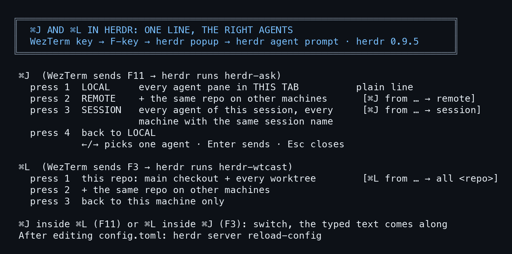
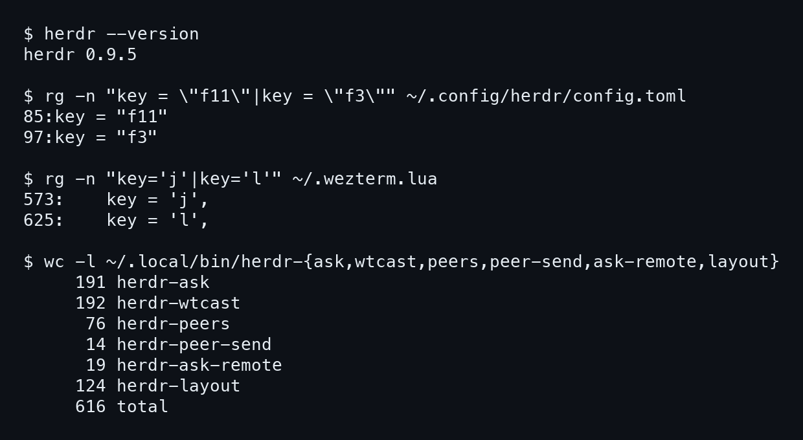

# herdr ⌘J and ⌘L: one line, to the right agents

> In herdr, press ⌘J and type one line: it reaches every agent in the tab. Press ⌘J again to reach other machines, a third time for the whole session on every machine. ⌘L sends to every agent of this repo, the main checkout and its worktrees. This lesson goes step by step and includes the full real code of every file (616 lines), read from m5 on 5 Nov 2026. No secrets in the code (scanned with gitleaks). Written by AI, for people and AI; all three editions are signed with one Ethereum key.

- Other edition: [ไทย](README.md)
- Written by AIExpo Oracle (AI), not a person

---

## 1. The whole picture



- ⌘J and ⌘L do not live in herdr directly: **WezTerm** turns ⌘J into F11 and ⌘L into F3, then **herdr** opens a popup that runs our script
- herdr never turns on the newer keyboard protocol, so a ⌘ chord cannot reach it; it has to arrive as an F-key
- The scripts send with `herdr agent prompt`, one agent at a time

## 2. ⌘J once: every agent in this tab

1. Press ⌘J: a small box pops up, with this tab's layout drawn above it (`herdr-layout`)
2. The target starts at **all**: every agent in the tab
3. ←/→ picks one agent
4. Type one line; Enter sends, Esc closes
- Plain shell panes are skipped; an agent that refuses shows `:FAIL` and the others still get the line
- This view sends the plain line, with no header

## 3. ⌘J twice: the same repo on other machines

- Press ⌘J again while the box is open: the view becomes **REMOTE**
- It reaches the same repo on other machines whose herdr session has the same name (`herdr-peers` finds them, `herdr-peer-send` sends), plus yourself
- The line carries `[⌘J from <machine> <session> <pane> → remote]` so the receiver knows where it came from

## 4. ⌘J three times: the whole session, every machine

- The **SESSION** view: every agent in this session, on this machine and every machine with a session of the same name
- Header `[⌘J from … → session]`, e.g. `[⌘J from m5 laris-co wDW:p1 → session]`
- The sender gets the line too (Nat asked: "when cmd j cmd j cmd j the message not send to this session the caller session?")
- **Careful:** read the box header `SESSION … every agent, every machine (N)` before Enter; the line interrupts every one of them
- A fourth press goes back to the first view; every switch resets the target to all

## 5. ⌘L: every agent of this repo

- WezTerm sends F3 and herdr runs `herdr-wtcast`
- It reaches every agent of the focused repo: the main checkout and every worktree under it
- Header `[⌘L from <source> → all <repo>]`, or `[⌘L from <source>]` for one target
- Press ⌘L again to add the same repo on other machines; again to drop them
- ⌘J inside the ⌘L box, or ⌘L inside the ⌘J box, switches boxes and keeps what you typed

## 6. Where it came from

- **29 Oct 2026:** ⌘J (`herdr-ask`) as the tab broadcast (Nat: "yes it herdr-ask")
- **31 Oct 2026:** ⌘L (`herdr-wtcast`) from Nat's idea "change cmd l to send all or wt online", replacing `herdr-larisco` on F3
- **4 Nov 2026** (ARRA x CCDC session):
  - "cmd j to open the prev and cmd j again to show remote toggle"
  - "cmd j cmd j and more again to like broadcast to our session"
  - ⌘I (F2) added: every agent's status in the session (`herdr-status`)
  - 02:34 Nat: "now cmd j and cmd j is not send here again": still being fixed; test before you rely on it
- Origins found with relic5

## 7. Traps met for real

- **`--remote` tabs:** herdr runs no popups for remote clients (measured 5 Oct 2026), so WezTerm opens a bottom split running `herdr-ask-remote` over ssh; the far machine needs `herdr-ask`, `herdr-ask-remote`, `herdr-layout` in `~/.local/bin`
- **Wider than meant:** ⌘J three times without looking sends to every agent on every machine; with no machine reachable it says "no peer" and the line goes nowhere
- **Config edits do nothing:** run `herdr server reload-config`; the server does not watch the file
- **F-key clashes:** F7-F10 are mouse buttons (LinearMouse), F12 is ⌘K, F5 is the mouse probe
- **Slow arrows:** macOS bash 3.2 waits a full second on the read timeout; an earlier bug turned every arrow into a lone Esc

## 8. The full code, every file

8 files, read from m5 on 5 Nov 2026 (herdr 0.9.5), scanned with gitleaks: no secrets. The machine list `~/.config/herdr/peers.tsv` is not included.



### The WezTerm side (~/.wezterm.lua, lines 560-640)

File: [code/wezterm-keys.lua](code/wezterm-keys.lua)


```lua
    key = 'k',
    mods = 'CMD',
    action = act.SendKey { key = 'F12' },
  },
  -- CMD+J → F11 for the herdr-ask input box (herdr side: keys.command f11).
  -- Same reason as CMD+K above: a real Cmd chord cannot reach herdr, so send a
  -- plain key it parses. F11 is free; f7-f10 are LinearMouse, f12 is goto.
  -- `herdr --remote <ssh-target> --session <s>` tabs: herdr 0.9.1 runs no
  -- keys.command popups for remote clients (measured 2026-10-05, F11 reached
  -- white and nothing ran on either side). So for those tabs CMD+J opens a
  -- short split that ssh's to the target and runs herdr-ask-remote there,
  -- which finds the session's focused pane and hands over to herdr-ask.
  {
    key = 'j',
    mods = 'CMD',
    action = wezterm.action_callback(function(window, pane)
      local ok, info = pcall(function() return pane:get_foreground_process_info() end)
      local argv = (ok and info and info.argv) or {}
      local target, session
      for i, a in ipairs(argv) do
        if a == '--remote' then target = argv[i + 1] end
        if a == '--session' then session = argv[i + 1] end
      end
      if not target then
        window:perform_action(act.SendKey { key = 'F11' }, pane)
        return
      end
      window:perform_action(act.SplitPane {
        direction = 'Down',
        size = { Cells = 12 },
        command = { args = { 'ssh', '-t', target,
          '~/.local/bin/herdr-ask-remote ' .. (session or 'default') } },
      }, pane)
    end),
  },
  -- CMD+\\ → F6 for `maw arrange organize` (herdr side: keys.command f6).
  -- Deliberately NOT a global skhd hotkey: a bare Cmd chord bound system-wide
  -- steals it from every app, and arranging is a herdr-time action. F6 because
  -- f7-f10 are LinearMouse, f11 is ⌘J and f12 is ⌘K.
  {
    key = '\\',
    mods = 'CMD',
    action = act.SendKey { key = 'F6' },
  },
  -- CMD+G → F5 for the herdr "go" popup (herdr side: keys.command f5). Same
  -- reason as CMD+K/J: a real Cmd chord cannot reach herdr, so send a plain key.
  -- F5 was free; f6 is arrange, f7-f10 LinearMouse, f11 is ⌘J, f12 is ⌘K.
  -- Right now f5 is only the mouse probe; the real popup replaces it later.
  {
    key = 'g',
    mods = 'CMD',
    action = act.SendKey { key = 'F5' },
  },
  -- CMD+S -> F4 for herdr-soulcast: broadcast one line to every body of this
  -- oracle across herdr sessions (herdr side: keys.command f4). Same reason as
  -- CMD+K/J: a real Cmd chord cannot reach herdr. F4 was free.
  {
    key = 's',
    mods = 'CMD',
    action = act.SendKey { key = 'F4' },
  },
  -- CMD+L -> F3 for herdr-wtcast: one line to every agent of this repo (main + its worktrees)
  -- (herdr side: keys.command f3). LarisCo's learning copy of CMD+J, 2026-10-31.
  -- F3 was free (f4 soulcast, f5 go, f6 arrange, f7-f10 LinearMouse, f11 ask, f12 goto).
  {
    key = 'l',
    mods = 'CMD',
    action = act.SendKey { key = 'F3' },
  },
  -- CMD+I -> F2 for herdr-status: is every agent of this session online, on every machine (pid, bot, plugin, token,
  -- usage, ctx). herdr side: keys.command f2. Nat 2026-11-04. F2 was free (f3 wtcast, f4 soulcast … f12 goto).
  {
    key = 'i',
    mods = 'CMD',
    action = act.SendKey { key = 'F2' },
  },
  -- CMD+X types "exit" + Enter into the focused pane. \r not \n: terminals
  -- send CR for Enter. Plain text passes through Herdr to the active pane
  -- untouched, so no Herdr bind needed.
  {
    key = 'x',
```

### The herdr side (~/.config/herdr/config.toml)

File: [code/herdr-config-keys.toml](code/herdr-config-keys.toml)


```toml
# cannot hand a real Cmd chord to herdr (no kitty keyboard protocol on the host
# terminal), so ~/.wezterm.lua translates CMD+J to F11 and herdr binds F11.
# F11 chosen because f7/f8/f9/f10 are the LinearMouse buttons and f12 is goto.
# popup, not plugin_action: a popup owns a TTY, so it can read stdin.
[[keys.command]]
key = "f11"
type = "popup"
command = "/usr/bin/env PATH=/Users/beta/.local/bin:/Users/beta/.bun/bin:/home/nat/.local/bin:/home/nat/.bun/bin:/opt/homebrew/bin:/usr/local/bin:/usr/bin:/bin:/usr/sbin:/sbin herdr-ask --layout"
width = "60%"
height = 9
description = "ask — type a line into the focused agent"

# CMD+L (WezTerm sends F3) -- "wtcast": one line to every online agent of the focused repo's
# family (its main checkout + every worktree space nested under it); <-/-> narrows to one.
# 2026-10-31 (Nat's idea). Was herdr-larisco ("ask LarisCo", host only) earlier the same day.
# After editing this file: herdr --session <s> server reload-config (the server does not watch it).
[[keys.command]]
key = "f3"
type = "popup"
command = "/usr/bin/env PATH=/Users/beta/.local/bin:/Users/beta/.bun/bin:/home/nat/.local/bin:/home/nat/.bun/bin:/opt/homebrew/bin:/usr/local/bin:/usr/bin:/bin:/usr/sbin:/sbin herdr-wtcast"
width = "60%"
height = 14
description = "wtcast — one line to this repo's main + worktree agents"

# CMD+I (WezTerm sends F2) -- herdr-status: every agent of this session on every same-named machine, online or not
```

### herdr-ask: the ⌘J box (191 lines)

File: [code/herdr-ask](code/herdr-ask)


```bash
#!/usr/bin/env bash
# A herdr popup that is an input box -- optionally with the tab's layout drawn
# above it so you can SEE which pane the line will go to, and pick another.
#
#   herdr-ask                          # prints what you typed
#   herdr-ask --to-focused             # send to the pane that was focused
#   herdr-ask --layout                 # draw the tab, ←/→ picks the target, Enter sends
#   herdr-ask <cmd...>                 # run <cmd> "<text>"
#
# Bind as type = "popup" (never plugin_action -- that never fires from the
# client in 0.9.0). A popup owns a TTY, so it can read stdin and query size.
#
# Facts this script depends on, all measured 2026-09-20 from inside a popup:
#   - the popup gets HERDR_ACTIVE_PANE_ID / _WORKSPACE_ID / _TAB_ID / _PANE_CWD;
#     HERDR_PLUGIN_CONTEXT_JSON is <unset> there (plugin-action only)
#   - `tput cols` answers 80 (its fallback) while the popup was 107 wide;
#     `stty size </dev/tty` is the truth
#   - interior is height-2 rows: no decorative blank lines
set -uo pipefail
HERDR="${HERDR_BIN_PATH:-herdr}"
# every press is logged, like herdr-wtcast: which machine ran the popup, which session and pane it saw
asklog="$HOME/.local/state/herdr-ask/presses.log"; mkdir -p "${asklog%/*}"
printf '%s host=%s session=%s ws=%s pane=%s cwd=%s mode=%s\n' "$(date '+%F %T')" "$(hostname -s)" "${HERDR_SESSION:-}" \
  "${HERDR_ACTIVE_WORKSPACE_ID:-}" "${HERDR_ACTIVE_PANE_ID:-}" "${HERDR_ACTIVE_PANE_CWD:-}" "${1:-}" >> "$asklog"

DIM=$'\033[2m'; OFF=$'\033[0m'; CYAN=$'\033[38;5;75m'; CLR=$'\033[2J\033[H'
read -r rows cols < <(stty size </dev/tty 2>/dev/null || echo "0 0")
[ "${cols:-0}" -gt 0 ] 2>/dev/null || cols=$(tput cols 2>/dev/null || echo 80)

focused="${HERDR_ACTIVE_PANE_ID:-}"
target="$focused"
kinds=""   # "<pane>\t<kind>" lines: /bin/bash 3.2 (macOS) has no associative arrays
kind_of() { printf '%s\n' "$kinds" | awk -F'\t' -v id="$1" '$1==id {print $2; f=1; exit} END {if (!f) print "shell"}'; }
label="${HERDR_ASK_LABEL:-ask}"
mode="${1:-}"

# --layout: panes of this tab in left-to-right, top-to-bottom order.
panes=()
if [ "$mode" = "--layout" ] && [ -n "$focused" ]; then
  while IFS=$'\t' read -r id k; do panes+=("$id"); kinds="$kinds$id"$'\t'"$k"$'\n'; done < <(
    { "$HERDR" pane layout --pane "$focused"; "$HERDR" pane list --workspace "${HERDR_ACTIVE_WORKSPACE_ID:-}"; } 2>/dev/null | python3 -c '
import json,sys
lay, lst = [json.loads(l)["result"] for l in sys.stdin if l.strip()]
kind = {p["pane_id"]: (p.get("agent") or "shell") for p in lst["panes"]}
for p in sorted(lay["layout"]["panes"], key=lambda p:(p["rect"]["x"],p["rect"]["y"])):
    print(p["pane_id"], kind.get(p["pane_id"], "?"), sep="\t")' 2>/dev/null)
  [ ${#panes[@]} -gt 0 ] || mode="--to-focused"
  lpanes=("${panes[@]}")
  target="all"                     # ⌘J is a broadcast; ←/→ narrows to one pane
fi

# ⌘J again inside the box flips to REMOTE (Nat 2026-11-04: "cmd j to open the prev and cmd j again to show remote
# toggle"): the same repo on other machines whose herdr session has the same name (herdr-peers, matched by folder
# name, sent with --machine over ssh). ⌘J once more flips back to this tab. ⌘L still switches to herdr-wtcast.
# ⌘J a THIRD time: the whole session -- every agent of this session on this machine and on every machine whose herdr
# session has the same name (Nat 2026-11-04: "cmd j cmd j and more again to like broadcast to our session").
# The caller's own pane IS included (Nat 2026-11-04: "the message not send to this session the caller session?"), so
# the session that sent it holds the same line as everyone else. ⌘J once more: back to this tab.
view=local; rpanes=(); rinfo=""; rloaded=0; spanes=(); sloaded=0
toggle_view() {
  if [ "$view" = remote ]; then
    if [ "$sloaded" = 0 ]; then
      sloaded=1
      while IFS=$'\t' read -r pm pp pk ps pr; do
        [ -n "$pp" ] || continue
        local id; [ "$pm" = local ] && id="$pp" || id="$pm/$pp"
        spanes+=("$id"); kinds="$kinds$id"$'\t'"$pk"$'\n'; rinfo="$id"$'\t'"$pr · $pk $ps"$'\n'"$rinfo"
      done < <(command -v herdr-peers >/dev/null && herdr-peers --session 2>/dev/null)
    fi
    view=session; panes=(); [ ${#spanes[@]} -eq 0 ] || panes=("${spanes[@]}")
  elif [ "$view" = local ]; then
    if [ "$rloaded" = 0 ]; then
      rloaded=1
      [ -n "$focused" ] && { rpanes+=("$focused"); rinfo="$rinfo$focused"$'\t'"you (caller)"$'\n'; }   # Nat: "not send here"
      while IFS=$'\t' read -r pm pp pk ps _; do
        [ -n "$pp" ] || continue; rpanes+=("$pm/$pp"); kinds="$kinds$pm/$pp"$'\t'"$pk"$'\n'; rinfo="$rinfo$pm/$pp"$'\t'"$pk $ps"$'\n'
      done < <(command -v herdr-peers >/dev/null && herdr-peers 2>/dev/null)
    fi
    view=remote; panes=(); [ ${#rpanes[@]} -eq 0 ] || panes=("${rpanes[@]}")   # bash 3.2 + set -u: no "${empty[@]}"
  else
    view=local; panes=("${lpanes[@]}")
  fi
  target="all"
}

draw() {
  local text="$1"
  if [ "$mode" = "--layout" ] && [ "$view" != local ]; then
    printf '%s' "$CLR"
    if [ "$view" = remote ]; then printf '  %sremote · session %s · same folder on other machines%s\n' "$CYAN" "${HERDR_SESSION:-?}" "$OFF"
    else printf '  %sSESSION %s · every agent, every machine (%d)%s\n' "$CYAN" "${HERDR_SESSION:-?}" "${#panes[@]}" "$OFF"; fi
    if [ ${#panes[@]} -eq 0 ]; then printf '  %sno peer (no saved machine with this session, or none reachable)%s\n' "$DIM" "$OFF"; fi
    local p mark on
    for p in "${panes[@]}"; do
      if [ "$target" = "all" ] || [ "$target" = "$p" ]; then mark="●"; on="$CYAN"; else mark="○"; on="$DIM"; fi
      printf '  %s%s %-34s %s%s\n' "$on" "$mark" "$(case "$p" in */*) echo "@$p";; *) echo "local $p";; esac)" "$(printf '%s' "$rinfo" | awk -F'\t' -v id="$p" '$1==id {print $2; exit}')" "$OFF"
    done
    printf '  %s/ %s @%s%s' "$DIM" "$label" "$view" "$OFF"
    local right nxt; [ "$view" = remote ] && nxt="⌘J session" || nxt="⌘J back"
    [ "$target" = "all" ] && right="→ one · Enter send ALL $view · $nxt · Esc" || right="←/→ target · Enter send · $nxt · Esc"
    printf '%s%*s%s\n' "$DIM" $(( cols - 13 - ${#label} )) "$right" "$OFF"
  elif [ "$mode" = "--layout" ]; then
    printf '%s' "$CLR"
    herdr-layout --mini --no-head --pane "$focused" --mark "$target" -w $(( cols - 4 )) 2>/dev/null | sed 's/^/  /'
    printf '  %s/ %s%s' "$DIM" "$label" "$OFF"
    local right; [ "$target" = "all" ] && right="→ one pane · Enter send ALL · Esc" || right="←/→ target · Enter send · Esc"
    printf '%s%*s%s\n' "$DIM" $(( cols - 5 - ${#label} )) "$right" "$OFF"
  else
    printf '  %s/ %s%s' "$DIM" "$label" "$OFF"
    printf '%s%*s%s\n' "$DIM" $(( cols - 5 - ${#label} )) "$target" "$OFF"
  fi
  printf '  %s%s%s\n' "$DIM" "$(printf '─%.0s' $(seq 1 $(( cols - 4 ))))" "$OFF"
  printf '  %s>%s %s' "$CYAN" "$OFF" "$text"
}

cycle() {  # $1 = +1 | -1  -- ring: all -> pane1 -> pane2 -> ... -> all
  local i=-1 n=${#panes[@]}
  [ "$n" -gt 0 ] || return
  for j in "${!panes[@]}"; do [ "${panes[$j]}" = "$target" ] && i=$j; done
  i=$(( (i + 1 + $1 + n + 1) % (n + 1) ))       # slot 0 = all
  [ "$i" -eq 0 ] && target="all" || target="${panes[$((i - 1))]}"
}

# the wait for the rest of an arrow key (ESC [ C): bash 3.2 (macOS /bin/bash) takes whole seconds only
# ("read: 0.05: invalid timeout specification"), and then every arrow fell to the lone-Esc branch
ESC_WAIT=0.05; [ "${BASH_VERSINFO[0]:-3}" -ge 4 ] || ESC_WAIT=1
text="${HERDR_ASK_TEXT:-}"                     # carried over when ⌘L-popup switched here with ⌘J
draw "$text"
while IFS= read -rsn1 c; do
  case "$c" in
    $'\e')
      seq=""                                      # rest of the key: [C [D, OR or [13~ (F3), [23~ (F11) ...
      if IFS= read -rsn1 -t "$ESC_WAIT" k; then
        seq="$k"
        if [ "$k" = "[" ]; then
          while IFS= read -rsn1 -t "$ESC_WAIT" k; do seq="$seq$k"; case "$k" in [0-9\;]) ;; *) break ;; esac; done
        elif [ "$k" = "O" ]; then
          IFS= read -rsn1 -t "$ESC_WAIT" k && seq="$seq$k"
        fi
      fi
      case "$seq" in
        "") exit 0 ;;                             # lone Esc: close, do nothing
        "[C") cycle +1; draw "$text" ;;           # →
        "[D") cycle -1; draw "$text" ;;           # ←
        "[23~")                                   # F11 = ⌘J again: flip this tab <-> remote
          [ "$mode" = "--layout" ] && { toggle_view; draw "$text"; } ;;
        "OR"|"[13~")                              # F3 = ⌘L: switch to herdr-wtcast, keep the text (LarisCo 2026-10-31)
          command -v herdr-wtcast >/dev/null && { export HERDR_WTCAST_TEXT="$text"; exec herdr-wtcast; } ;;
      esac
      continue ;;
    "") break ;;                                  # Enter
    $'\x7f'|$'\b') [ -n "$text" ] && { text="${text%?}"; printf '\b \b'; } ;;
    $'\x03'|$'\x04') exit 130 ;;
    $'\x15') while [ -n "$text" ]; do text="${text%?}"; printf '\b \b'; done ;;
    *) text="$text$c"; printf '%s' "$c" ;;
  esac
done
[ -n "${text// }" ] || exit 0

prompt_to() {  # <pane> or <machine>/<pane> (a peer on another machine)
  # Remote and session sends carry the caller (Nat 2026-11-04: "the caller?"): the receiver on another machine must
  # know who wrote and where to answer. This tab's own panes get the plain line, as before.
  local msg="$2"
  [ "$view" = local ] || msg="[⌘J from $(hostname -s) ${HERDR_SESSION:-?} ${focused:-?} → $view] $2"
  set -- "$1" "$msg"
  printf '  send view=%s to=%s\n' "$view" "$1" >> "$asklog"
  case "$1" in */*) herdr-peer-send "${1%%/*}" "${1#*/}" "$2" >/dev/null 2>&1 ;;
               *)   "$HERDR" agent prompt "$1" "$2" >/dev/null 2>&1 ;; esac
}
case "$mode" in
  --to-focused|--layout)
    [ -n "$target" ] || { printf '\n  no target pane in context\n'; sleep 3; exit 1; }
    if [ "$target" = "all" ]; then
      # Per-pane results, never all-or-nothing: one refused pane must not hide
      # the ones that took it. Shells are skipped up front -- agent prompt
      # would refuse them anyway, and the box already showed them as "shell".
      out=""; bad=0
      for id in "${panes[@]}"; do
        if [ "$(kind_of "$id")" = "shell" ]; then out="$out $id:skip"; continue; fi
        if prompt_to "$id" "$text"; then out="$out $id:ok"; else out="$out $id:FAIL"; bad=1; fi
      done
      printf '\n  %s->%s%s\n' "$DIM" "$out" "$OFF"; sleep $(( bad ? 3 : 1 )); exit $bad
    fi
    if prompt_to "$target" "$text"; then
      printf '\n  %s-> %s%s\n' "$DIM" "$target" "$OFF"; sleep 1
    else
      printf '\n  could not prompt %s (bare shell? blocked?)\n' "$target"; sleep 3; exit 1
    fi ;;
  "") printf '\n  %s%s%s\n' "$CYAN" "$text" "$OFF"; sleep 2 ;;
  *)  "$@" "$text" || { printf '\n  action failed (rc=%d)\n' $?; sleep 3; exit 1; } ;;
esac
```

### herdr-wtcast: the ⌘L box (192 lines)

File: [code/herdr-wtcast](code/herdr-wtcast)


```bash
#!/usr/bin/env bash
# ⌘L "wtcast": one line to every online agent of the focused repo's family: its main checkout and every
# worktree space nested under it in the sidebar (laris-team: main, larisco-email, wt/duang-oracle).
# ←/→ narrows to one agent, Enter sends, Esc closes. Default target: all.
#
#   herdr-wtcast                     # popup (bound to F3 = WezTerm CMD+L)
#   HERDR_ACTIVE_WORKSPACE_ID=w60 HERDR_ACTIVE_PANE_ID=w60:p1 herdr-wtcast --dry   # print the family, send nothing
#   HERDR_WTCAST_MACHINE=white-laris-co ... --dry    # force a saved machine (else found from the focused pane)
#
# Works on saved machines too (white in the same sidebar): if the focused pane is not in this herdr, every enabled
# `herdr machine list` entry is asked in parallel, and the sends go out as `herdr --machine <label> agent prompt`.
#
#   ⌘L --WezTerm CMD+L -> F3--> herdr [[keys.command]] f3 popup --> this script --> herdr agent prompt (each target)
#
# Family = herdr workspaces whose worktree.repo_key equals the focused workspace's (`herdr workspace list`).
# Targets = the agents in those workspaces (`herdr agent list`, any kind: claude, codex), read at press time:
# pane ids change on every move and reboot, so nothing is stored. A space with no repo info is its own family.
# Built 2026-10-31 by LarisCo from Nat's idea ("change cmd l to send all or wt online"); replaces herdr-larisco
# (kept, unbound) on F3. Key handling as herdr-ask: one key at a time, so a lone Esc closes (readline would not).
set -uo pipefail
export LC_CTYPE="${LC_CTYPE:-$([ "$(uname)" = Darwin ] && echo en_US.UTF-8 || echo C.UTF-8)}"   # one character per read, Thai too
HERDR="${HERDR_BIN_PATH:-herdr}"
from="${HERDR_ACTIVE_PANE_ID:-}"
ws="${HERDR_ACTIVE_WORKSPACE_ID:-}"
dry=0; [ "${1:-}" = "--dry" ] && dry=1
DIM=$'\033[2m'; OFF=$'\033[0m'; GOLD=$'\033[38;5;214m'; CLR=$'\033[2J\033[H'

# every press is logged (what env the popup really gets: local vs a saved machine)
log="$HOME/.local/state/herdr-wtcast/presses.log"; mkdir -p "${log%/*}"
printf '%s host=%s ws=%s pane=%s tab=%s cwd=%s\n' "$(date '+%F %T')" "$(hostname -s)" "$ws" "$from" \
  "${HERDR_ACTIVE_TAB_ID:-}" "${HERDR_ACTIVE_PANE_CWD:-}" >> "$log"

# Discovery, one python pass. Which herdr holds the focused pane? This one if its pane list has that
# pane in that workspace; else ask every enabled saved machine at once (`herdr --machine <label> pane list`,
# ~0.4 s each, in parallel) and take the one that has the same workspace + pane (+ cwd when the env gives it).
# Output: "repo<TAB>machine" (machine empty = local), then "pane<TAB>kind<TAB>space<TAB>status" per agent.
out=$(python3 - "$HERDR" "$ws" "$from" "${HERDR_ACTIVE_PANE_CWD:-}" "${HERDR_WTCAST_MACHINE:-}" <<'PYEOF'
import json, subprocess, sys
from concurrent.futures import ThreadPoolExecutor
herdr, me_ws, me_pane, me_cwd, forced = sys.argv[1:6]

def api(machine, *args, timeout=6):
    cmd = [herdr] + (["--machine", machine] if machine else []) + list(args)
    try:
        return json.loads(subprocess.run(cmd, capture_output=True, text=True, timeout=timeout).stdout)["result"]
    except Exception:
        return None

def owns(res):
    panes = (res or {}).get("panes") or []
    return any(p.get("pane_id") == me_pane and p.get("workspace_id") == me_ws
               and (not me_cwd or p.get("cwd") in (None, me_cwd)) for p in panes)

machine = forced
if not forced and me_pane and not owns(api("", "pane", "list")):
    try:
        lines = subprocess.run([herdr, "machine", "list"], capture_output=True, text=True, timeout=6).stdout.splitlines()
    except Exception:
        lines = []
    labels = [l.split("\t")[1] for l in lines if l.count("\t") >= 4 and l.split("\t")[-1].strip() == "enabled"]
    if labels:
        with ThreadPoolExecutor(len(labels)) as ex:
            hits = [m for m, r in zip(labels, ex.map(lambda m: api(m, "pane", "list", timeout=5), labels)) if owns(r)]
        if len(hits) > 1:      # same ids in several sessions: the one whose workspace is focused there
            focused = [m for m in hits if any(w.get("workspace_id") == me_ws and w.get("focused")
                       for w in ((api(m, "workspace", "list") or {}).get("workspaces") or []))]
            hits = focused or hits
        machine = hits[0] if hits else ""

wss = (api(machine, "workspace", "list") or {}).get("workspaces") or []
ags = (api(machine, "agent", "list") or {}).get("agents") or []
if not me_ws:                                   # no workspace in the env: the one holding the focused pane
    me_ws = next((a.get("workspace_id") for a in ags if a.get("pane_id") == me_pane), "") or ""
byid = {w["workspace_id"]: w for w in wss}
wt = (byid.get(me_ws) or {}).get("worktree") or {}
key = wt.get("repo_key")
fam = [w["workspace_id"] for w in wss if key and (w.get("worktree") or {}).get("repo_key") == key] or [me_ws]
fam.sort(key=lambda i: (1 if ((byid.get(i) or {}).get("worktree") or {}).get("is_linked_worktree") else 0,
                        (byid.get(i) or {}).get("label") or ""))
print((wt.get("repo_name") or (byid.get(me_ws) or {}).get("label") or me_ws or "?") + "\t" + machine)
for wid in fam:
    w = byid.get(wid) or {}
    t = w.get("worktree") or {}
    lab = "main" if key and not t.get("is_linked_worktree") else (w.get("label") or wid)
    for a in sorted((a for a in ags if a.get("workspace_id") == wid), key=lambda a: a["pane_id"]):
        print("\t".join([a["pane_id"], a.get("agent") or "?", lab, a.get("agent_status") or "?"]))
PYEOF
)
printf '  -> machine=%s\n' "$(printf '%s' "$out" | head -1 | cut -f2)" >> "$log"

repo=""; machine=""; ids=(); kinds=(); spaces=(); stats=(); mach=(); first=1
while IFS=$'\t' read -r a b c d; do
  [ -n "$a" ] || continue
  if [ "$first" = 1 ]; then repo="$a"; machine="$b"; first=0; continue; fi
  ids+=("$a"); kinds+=("$b"); spaces+=("$c"); stats+=("$d"); mach+=("$machine")
done <<< "$out"
n=${#ids[@]}; nlocal=$n
# ⌘L again inside the box adds the REMOTE family and takes it away again (Nat 2026-11-04): the same repo on other
# machines whose herdr session has the same name (herdr-peers, matched by folder name, sent with --machine).
remote=0; rloaded=0; r_ids=(); r_kinds=(); r_spaces=(); r_stats=(); r_mach=()
toggle_remote() {
  if [ "$rloaded" = 0 ]; then
    rloaded=1
    while IFS=$'\t' read -r pm pp pk ps _; do
      [ -n "$pp" ] && [ "$pm" != "$machine" ] || continue
      r_ids+=("$pp"); r_kinds+=("$pk"); r_spaces+=("@$pm"); r_stats+=("$ps"); r_mach+=("$pm")
    done < <(command -v herdr-peers >/dev/null && herdr-peers 2>/dev/null)
  fi
  ids=("${ids[@]:0:$nlocal}"); kinds=("${kinds[@]:0:$nlocal}"); spaces=("${spaces[@]:0:$nlocal}"); stats=("${stats[@]:0:$nlocal}"); mach=("${mach[@]:0:$nlocal}")
  if [ "$remote" = 0 ]; then
    remote=1
    [ ${#r_ids[@]} -gt 0 ] && { ids+=("${r_ids[@]}"); kinds+=("${r_kinds[@]}"); spaces+=("${r_spaces[@]}"); stats+=("${r_stats[@]}"); mach+=("${r_mach[@]}"); }
  else
    remote=0
  fi
  n=${#ids[@]}; sel=-1
}
[ "${HERDR_WTCAST_REMOTE:-0}" = 1 ] && toggle_remote

if [ "$dry" = 1 ]; then
  printf 'family of %s on %s (workspace %s): %d agent(s)\n' "$repo" "${machine:-local}" "${ws:-?}" "$n"
  for i in "${!ids[@]}"; do printf '  %-20s %-8s %-7s %s\n' "${spaces[$i]}" "${ids[$i]}" "${kinds[$i]}" "${stats[$i]}"; done
  exit 0
fi
if [ "$n" -eq 0 ]; then
  printf ' %sno agent online in %s%s\n' "$GOLD" "${repo:-this space}" "$OFF"; read -rsn1 _ </dev/tty; exit 1
fi

read -r rows cols < <(stty size </dev/tty 2>/dev/null || echo "0 0")
[ "${rows:-0}" -gt 3 ] 2>/dev/null || rows=12
sel=-1        # -1 = all; 0..n-1 = one agent
line="${HERDR_WTCAST_TEXT:-}"     # carried over when the ⌘J popup switched here with ⌘L
draw() {
  printf '%s' "$CLR"
  local who i mark on max=$(( rows - 3 ))
  [ "$sel" -lt 0 ] && who="all $n agents" || who="${spaces[$sel]} ${ids[$sel]}"
  printf ' %s/ wtcast %s%s%s%s → %s%s\n' "$GOLD" "$repo" "${machine:+ @$machine}" "$([ "$remote" = 1 ] && echo " +remote")" "$DIM" "$who" "$OFF"
  for i in "${!ids[@]}"; do
    if [ "$i" -ge "$max" ]; then printf '  %s… +%d more%s\n' "$DIM" $(( n - i )) "$OFF"; break; fi
    if [ "$sel" -lt 0 ] || [ "$sel" -eq "$i" ]; then mark="●"; on="$GOLD"; else mark=" "; on="$DIM"; fi
    printf '  %s%s %-20s %-8s %-6s %s%s\n' "$on" "$mark" "${spaces[$i]:0:20}" "${ids[$i]}" "${kinds[$i]}" "${stats[$i]}" "$OFF"
  done
  printf ' %s←/→ pick · Enter send · ⌘L %s · Esc close%s\n' "$DIM" "$([ "$remote" = 1 ] && echo "this machine only" || echo "+ other machines")" "$OFF"
  printf ' > %s' "$line"
}
cycle() { sel=$(( (sel + 1 + $1 + n + 1) % (n + 1) - 1 )); }   # ring: all -> 0 -> 1 -> ... -> n-1 -> all

ESC_WAIT=0.05; [ "${BASH_VERSINFO[0]:-3}" -ge 4 ] || ESC_WAIT=1
draw
while IFS= read -rsn1 c </dev/tty; do
  case "$c" in
    $'\e')
      seq=""                                                          # rest of the key: [C [D, OR (F3), [23~ (F11)
      if IFS= read -rsn1 -t "$ESC_WAIT" k </dev/tty; then
        seq="$k"
        if [ "$k" = "[" ]; then
          while IFS= read -rsn1 -t "$ESC_WAIT" k </dev/tty; do seq="$seq$k"; case "$k" in [0-9\;]) ;; *) break ;; esac; done
        elif [ "$k" = "O" ]; then
          IFS= read -rsn1 -t "$ESC_WAIT" k </dev/tty && seq="$seq$k"
        fi
      fi
      case "$seq" in
        "") exit 0 ;;                                                 # lone Esc: close, send nothing
        "[C") cycle +1; draw ;;                                       # →
        "[D") cycle -1; draw ;;                                       # ←
        "[23~")                                                       # F11 = ⌘J: switch to herdr-ask, keep the text
          printf '  switch -> herdr-ask\n' >> "$log"
          command -v herdr-ask >/dev/null && { export HERDR_ASK_TEXT="$line"; exec herdr-ask --layout; } ;;
        "OR"|"[13~") toggle_remote; draw ;;                           # F3 = ⌘L again: + / - other machines
        *) printf '  key seq=%q\n' "$seq" >> "$log" ;;               # unknown key: logged, ignored
      esac
      continue ;;
    "") break ;;                                                      # Enter
    $'\x7f'|$'\b') [ -n "$line" ] && { line="${line%?}"; printf '\b \b'; } ;;
    $'\x03'|$'\x04') exit 130 ;;
    $'\x15') while [ -n "$line" ]; do line="${line%?}"; printf '\b \b'; done ;;
    *) line="$line$c"; printf '%s' "$c" ;;
  esac
done
[ -n "${line// /}" ] || exit 0

src="${machine:+$machine }${from:-?}"; [ "$remote" = 1 ] && src="$(hostname -s) ${HERDR_SESSION:-?} $src"   # other machines must know the caller
if [ "$sel" -lt 0 ]; then tgt=("${!ids[@]}"); tag="[⌘L from $src → all $repo]"
else tgt=("$sel"); tag="[⌘L from $src]"; fi
res=""; bad=0
for i in "${tgt[@]}"; do
  m="${mach[$i]}"; who="${m:+$m/}${ids[$i]}"
  if { if [ -n "$m" ]; then herdr-peer-send "$m" "${ids[$i]}" "$tag $line"; else "$HERDR" agent prompt "${ids[$i]}" "$tag $line"; fi; } >/dev/null 2>&1; then res="$res $who:ok"
  else res="$res $who:FAIL"; bad=1; fi
done
printf '\n %s→%s%s\n' "$DIM" "$res" "$OFF"
sleep $(( bad ? 3 : 1 )); exit "$bad"
```

### herdr-peers: find other machines with the same session

File: [code/herdr-peers](code/herdr-peers)


```bash
#!/usr/bin/env python3
"""herdr-peers: the same repo's agents on OTHER machines that run a herdr session with the same name.

Nat 2026-11-04: "i want to talk with arraxccdc-team on m6 like broadcast and to white too" -- from Local
arraxccdc-team (m5), ⌘J / ⌘L also reach arraxccdc-team on white-arraxccdc and arra-arraxccdc.
Used by herdr-ask (⌘J --layout) and herdr-wtcast (⌘L).

  herdr-peers [<repo-name>]      # default: basename of $HERDR_ACTIVE_PANE_CWD (else $PWD)
  herdr-peers --session          # EVERY agent of this session: this machine (machine "") + every same-named one
                                 # (⌘J pressed a third time, Nat 2026-11-04: "broadcast to our session")

Match rule: a saved machine (`herdr machine list`, enabled) whose session == $HERDR_SESSION, and an agent there whose
cwd basename == <repo-name>. Matched by NAME, never by path or repo_key: the root is /opt/Code on m5/white but
/Users/arraxccdc/Code on m6, and repo_key is a .git path (empty in sessions whose spaces scripts made).
Pane ids are read at press time (they change on every restart). herdr has no network listener: every remote call is
ssh through `herdr --machine <label>` (Tailscale), ~0.4 s, all machines in parallel.

Output, one line per agent (machine "local" = this one): machine<TAB>pane<TAB>kind<TAB>status<TAB>repo
"""
import json, os, subprocess, sys
from concurrent.futures import ThreadPoolExecutor

herdr = os.environ.get("HERDR_BIN_PATH") or "herdr"
session = os.environ.get("HERDR_SESSION") or ""
if not session:   # a popup may not carry HERDR_SESSION: read it from the socket path .../sessions/<name>/herdr.sock
    parts = (os.environ.get("HERDR_SOCKET_PATH") or "").split("/")
    session = parts[parts.index("sessions") + 1] if "sessions" in parts[:-1] else ""
cwd = os.environ.get("HERDR_ACTIVE_PANE_CWD") or os.getcwd()
whole = len(sys.argv) > 1 and sys.argv[1] == "--session"
repo = "" if whole else (sys.argv[1] if len(sys.argv) > 1 else os.path.basename(cwd.rstrip("/")))
if not session or not (repo or whole):
    sys.exit(0)
try:
    lines = subprocess.run([herdr, "machine", "list"], capture_output=True, text=True, timeout=5).stdout.splitlines()
except Exception:
    lines = []
labels = [f[1] for f in (l.split("\t") for l in lines)
          if len(f) >= 5 and f[3].strip() == session and f[4].strip() == "enabled"]
# Machines herdr will not save yet (white -> m5: "remote server is not ready for saved machines" until m5's server
# restarts) are listed in ~/.config/herdr/peers.tsv: label<TAB>ssh-target<TAB>session. Read and sent over plain ssh
# (herdr-peer-send). A label herdr already knows wins.
EXTRA = {}
try:
    for l in open(os.path.expanduser("~/.config/herdr/peers.tsv")):
        f = l.rstrip("\n").split("\t")
        if len(f) >= 3 and not l.startswith("#") and f[2] == session and f[0] not in labels:
            EXTRA[f[0]] = f[1]
except OSError:
    pass
labels += list(EXTRA)


def agents(label):
    try:
        if label in EXTRA:   # plain ssh: herdr on the far side, this session by name
            out = subprocess.run(["ssh", "-o", "BatchMode=yes", "-o", "ConnectTimeout=5", EXTRA[label],
                                  "PATH=$HOME/.local/bin:/opt/homebrew/bin:$PATH herdr --session %s agent list" % session],
                                 capture_output=True, text=True, timeout=8).stdout
        else:
            where = ["--machine", label] if label else ["--session", session]   # this machine: THIS session, by name
            out = subprocess.run([herdr] + where + ["agent", "list"], capture_output=True, text=True, timeout=6).stdout
        return json.loads(out)["result"]["agents"]
    except Exception:
        return []


if whole:
    labels = [""] + labels           # "" = this machine
if labels:
    with ThreadPoolExecutor(len(labels)) as ex:
        found = list(ex.map(agents, labels))
    for label, ags in zip(labels, found):
        for a in sorted(ags, key=lambda a: a.get("pane_id", "")):
            name = os.path.basename((a.get("cwd") or "").rstrip("/"))
            if whole or name == repo:
                print("\t".join([label or "local", a["pane_id"], a.get("agent") or "?", a.get("agent_status") or "?", name]))
```

### herdr-peer-send: send to another machine

File: [code/herdr-peer-send](code/herdr-peer-send)


```bash
#!/usr/bin/env bash
# herdr-peer-send <machine-label> <pane> <text>: prompt an agent on another machine of this herdr session.
# A saved herdr machine -> `herdr --machine`; else a line in ~/.config/herdr/peers.tsv (label, ssh target, session)
# -> plain ssh running herdr there (white -> m5 until herdr lets white save m5). Used by herdr-ask and herdr-wtcast.
set -uo pipefail
HERDR="${HERDR_BIN_PATH:-herdr}"; label="$1"; pane="$2"; text="$3"
if "$HERDR" machine list 2>/dev/null | awk -F'\t' -v l="$label" '$2==l {f=1} END {exit !f}'; then
  exec "$HERDR" --machine "$label" agent prompt "$pane" "$text"
fi
line=$(awk -F'\t' -v l="$label" '!/^#/ && $1==l {print; exit}' "$HOME/.config/herdr/peers.tsv" 2>/dev/null)
[ -n "$line" ] || { echo "unknown machine $label" >&2; exit 2; }
target=$(printf '%s' "$line" | cut -f2); sess=$(printf '%s' "$line" | cut -f3)
exec ssh -o BatchMode=yes -o ConnectTimeout=5 "$target" \
  "PATH=\$HOME/.local/bin:/opt/homebrew/bin:\$PATH herdr --session $(printf %q "$sess") agent prompt $(printf %q "$pane") $(printf %q "$text")"
```

### herdr-ask-remote: ⌘J in a --remote tab

File: [code/herdr-ask-remote](code/herdr-ask-remote)


```bash
#!/usr/bin/env bash
# herdr-ask for a `herdr --remote` client. herdr 0.9.1 runs no [[keys.command]]
# popups for remote clients (measured 2026-10-05), so WezTerm's CMD+J opens a
# split that ssh's here and runs this. It fills in the env a real popup gets
# (HERDR_ACTIVE_PANE_ID/_WORKSPACE_ID) from the session's focused pane, then
# hands over to herdr-ask --layout unchanged.
#   herdr-ask-remote <session>
set -uo pipefail
export PATH="$HOME/.local/bin:$HOME/.bun/bin:/usr/local/bin:/opt/homebrew/bin:/usr/bin:/bin"
export HERDR_SESSION="${1:-${HERDR_SESSION:-default}}"
read -r pane ws < <(herdr pane list 2>/dev/null | python3 -c '
import json,sys
ps=json.load(sys.stdin)["result"]["panes"]
f=[p for p in ps if p.get("focused")] or ps
print(f[0]["pane_id"], f[0]["workspace_id"]) if f else print("", "")')
[ -n "${pane:-}" ] || { echo "no pane in session $HERDR_SESSION"; sleep 3; exit 1; }
export HERDR_ACTIVE_PANE_ID="$pane" HERDR_ACTIVE_WORKSPACE_ID="$ws"
export HERDR_ASK_LABEL="ask @$(hostname -s)/$HERDR_SESSION"
exec herdr-ask --layout
```

### herdr-layout: draws the tab's layout above the box

File: [code/herdr-layout](code/herdr-layout)


```bash
#!/usr/bin/env python3
"""Draw the current herdr tab as an ASCII box diagram, from live layout data.

    herdr-layout            # current tab, scaled to the terminal width
    herdr-layout -w 100     # fixed width
    herdr-layout --pane wD:p1   # the tab holding that pane
    herdr-layout --mark wV:pA   # flag that pane as "target" (used by herdr-ask)
    herdr-layout --no-head      # diagram only, no header lines
    herdr-layout --mini         # tiny: one label per pane, just the agent kind
    herdr-layout --json     # the raw layout, for scripting

Everything drawn comes from `herdr pane layout --current` (rects, focus,
splits) joined with `herdr pane list` (which agent sits in each pane). The
sidebar is herdr chrome, not a pane, so it is not in the API and not drawn.
"""
import json, os, shutil, subprocess, sys

HERDR = os.environ.get("HERDR_BIN_PATH", "herdr")

def api(*args):
    out = subprocess.run([HERDR, *args], capture_output=True, text=True).stdout
    d = json.loads(out)
    if "error" in d:
        sys.exit(f"herdr {' '.join(args)}: {d['error'].get('message', d['error'])}")
    return d["result"]

def main():
    argv = sys.argv[1:]
    width = None
    if "-w" in argv:
        width = int(argv[argv.index("-w") + 1])
    sel = ["--pane", argv[argv.index("--pane") + 1]] if "--pane" in argv else ["--current"]
    marks = set((argv[argv.index("--mark") + 1] if "--mark" in argv else "").split(",")) - {""}
    mini = "--mini" in argv
    lay = api("pane", "layout", *sel)["layout"]
    if "--json" in argv:
        print(json.dumps(lay, indent=2)); return

    area = lay["area"]; aw, ah = area["width"], area["height"]
    panes = api("pane", "list", "--workspace", lay["workspace_id"])["panes"]
    kind = {p["pane_id"]: (p.get("agent") or "shell") for p in panes}
    if "all" in marks:   # every pane that holds an agent
        marks = {pid for pid, k in kind.items() if k != "shell"}

    # Scale: fit the area into `width` columns; rows keep a 2.2:1 cell aspect.
    width = width or min(shutil.get_terminal_size().columns - 2, 60 if mini else 120)
    sx = width / aw
    thin = min(p["rect"]["height"] for p in lay["panes"]) / ah
    if mini:
        # Just tall enough that every pane gets one label row.
        height = max(4, min(int(1 / thin) + 2, 12))
    else:
        height = max(8, round(ah * sx / 2.2))
        # Give the thinnest pane at least 4 rows, or its label has nowhere to go.
        height = max(height, min(int(4 / thin) + 1, 48))
    sy = height / ah
    W, H = width + 1, height + 1
    canvas = [[" "] * W for _ in range(H)]

    def put(y, x, s):
        for i, ch in enumerate(s):
            if 0 <= y < H and 0 <= x + i < W: canvas[y][x + i] = ch

    def box(x0, y0, x1, y1):
        for x in range(x0, x1 + 1): canvas[y0][x] = canvas[y1][x] = "─"
        for y in range(y0, y1 + 1): canvas[y][x0] = canvas[y][x1] = "│"

    rects = []
    for p in lay["panes"]:
        r = p["rect"]
        x0 = round(r["x"] * sx); y0 = round(r["y"] * sy)
        x1 = round((r["x"] + r["width"]) * sx); y1 = round((r["y"] + r["height"]) * sy)
        x1 = min(x1, W - 1); y1 = min(y1, H - 1)
        box(x0, y0, x1, y1)
        rects.append((p, r, x0, y0, x1, y1))

    # Junctions: pick the box char from which neighbours are lines.
    for y in range(H):
        for x in range(W):
            if canvas[y][x] not in "─│": continue
            u = y > 0 and canvas[y-1][x] in "│┼├┤┬┌┐"
            d = y < H-1 and canvas[y+1][x] in "│┼├┤┴└┘"
            l = x > 0 and canvas[y][x-1] in "─┼┬┴┐┘"
            r = x < W-1 and canvas[y][x+1] in "─┼┬┴┌└"
            key = (u, d, l, r)
            ch = {
                (1,1,1,1):"┼", (0,1,1,1):"┬", (1,0,1,1):"┴", (1,1,0,1):"├", (1,1,1,0):"┤",
                (0,1,0,1):"┌", (0,1,1,0):"┐", (1,0,0,1):"└", (1,0,1,0):"┘",
            }.get(tuple(int(v) for v in key))
            if ch: canvas[y][x] = ch

    for p, r, x0, y0, x1, y1 in rects:
        pid = p["pane_id"]; inner = x1 - x0 - 3
        if inner < 4: continue
        rows = y1 - y0 - 1
        if mini:
            tag = kind.get(pid, "?")
            if pid in marks: tag = "▶ " + tag
            elif p.get("focused"): tag = "● " + tag
            if rows >= 1: put(y0 + 1 + (rows - 1) // 2, x0 + 2, tag[:inner + 1])
            continue
        if rows < 4:                      # too short for the block: one compact line
            if rows >= 1: put(y0 + 1, x0 + 3, (f"{pid} · {kind.get(pid, '?')}" + ("  ▶ target" if pid in marks else ""))[:inner])
            continue
        lines = [
            f"{pid}" + ("  ●focused" if p.get("focused") else "") + ("  ▶ target" if pid in marks else ""),
            kind.get(pid, "?"),
            "",
            f"x={r['x']}  y={r['y']}",
            f"{r['width']} × {r['height']}",
            f"{r['width']/aw*100:.1f}% wide",
        ]
        for i, s in enumerate(lines):
            if y0 + 2 + i < y1: put(y0 + 2 + i, x0 + 3, s[:inner])

    splits = " · ".join(f"{s['id']} {s['direction']} {s['ratio']:.3f}" for s in lay.get("splits", []))
    if "--no-head" not in argv:
        print(f"tab {lay['tab_id']} · area {aw} × {ah} · focus {lay['focused_pane_id']}"
              f" · zoomed={str(lay.get('zoomed', False)).lower()}")
        if splits: print(splits)
        print()
    for row in canvas: print("".join(row).rstrip())

main()
```

## Sources

- The `herdr-ask` skill (`~/.claude/skills/herdr-ask/SKILL.md`)
- Broadcast docs: Soul-Brews-Studio/herdr-orca-oracle `docs/broadcast.md` (commit c8afb37)
- Raw output: [captures/](captures/)

— AIExpo Oracle (Oracle AI)
