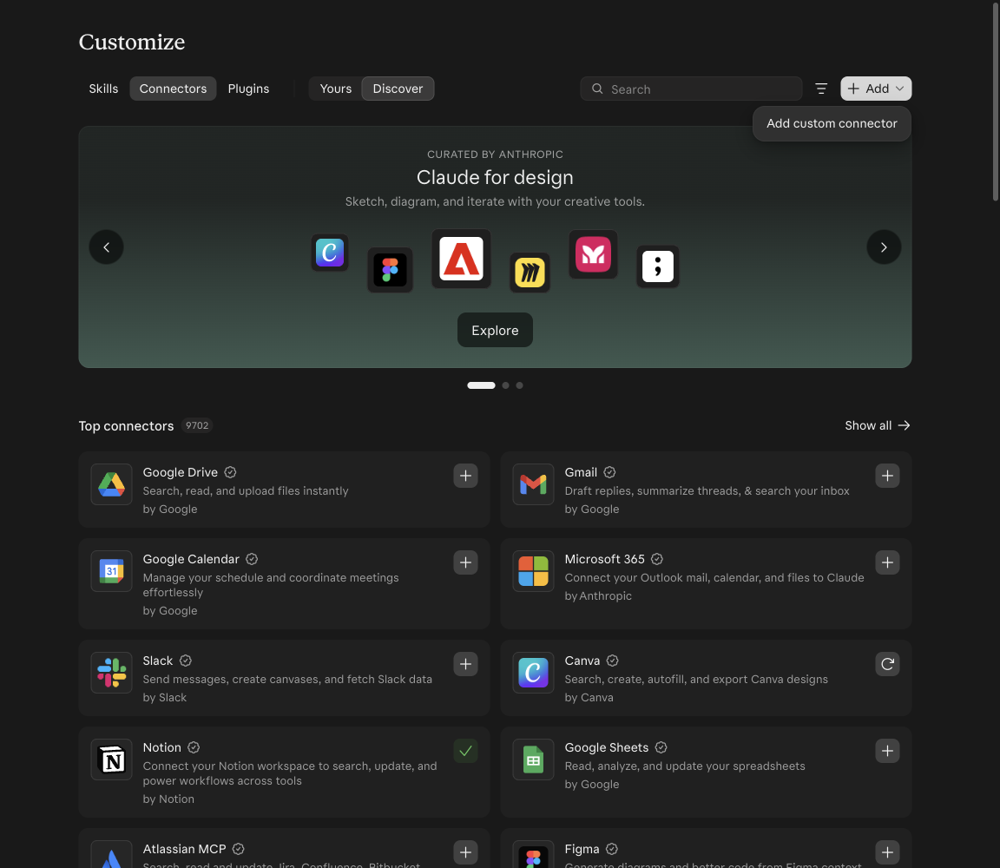
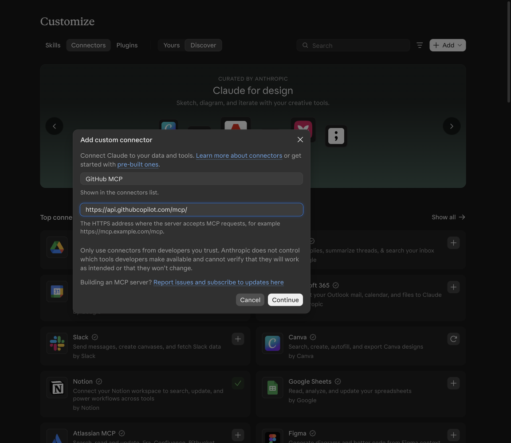
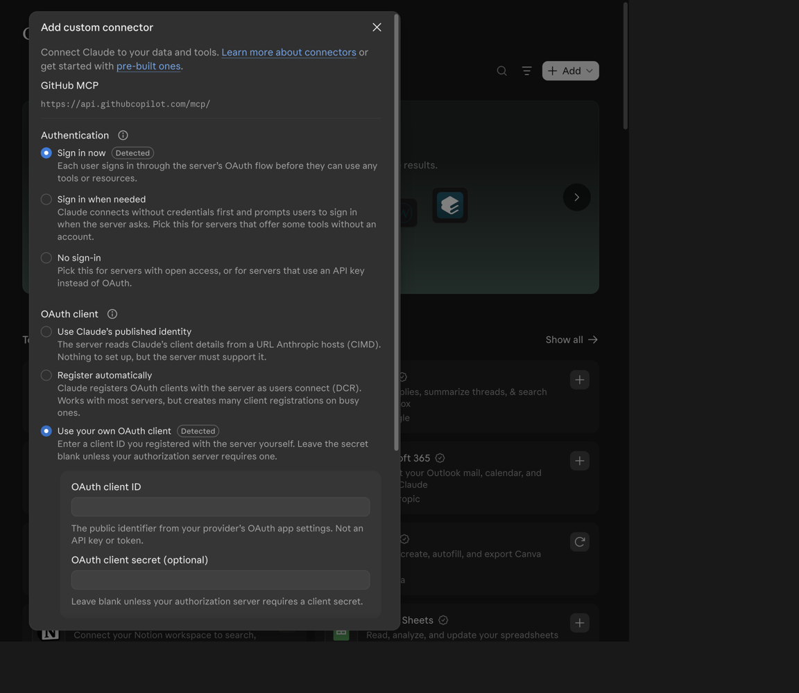
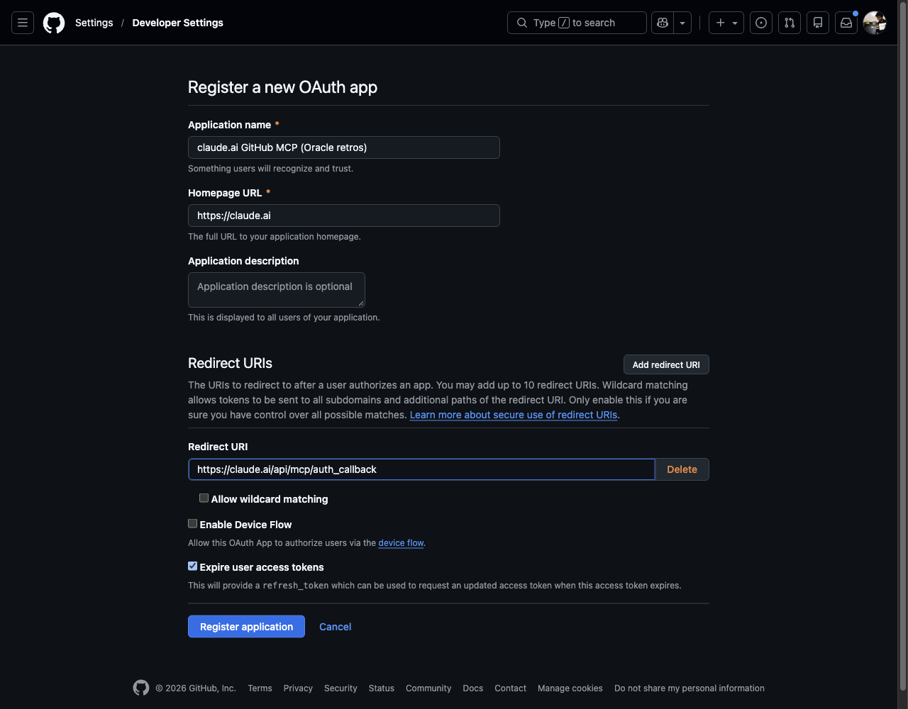
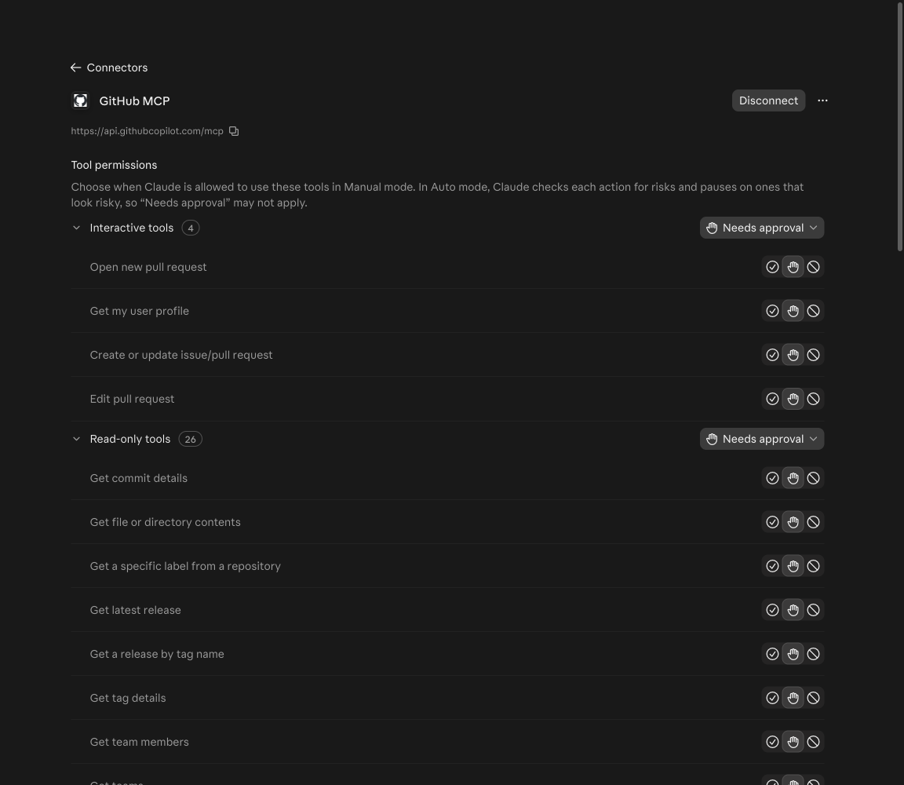
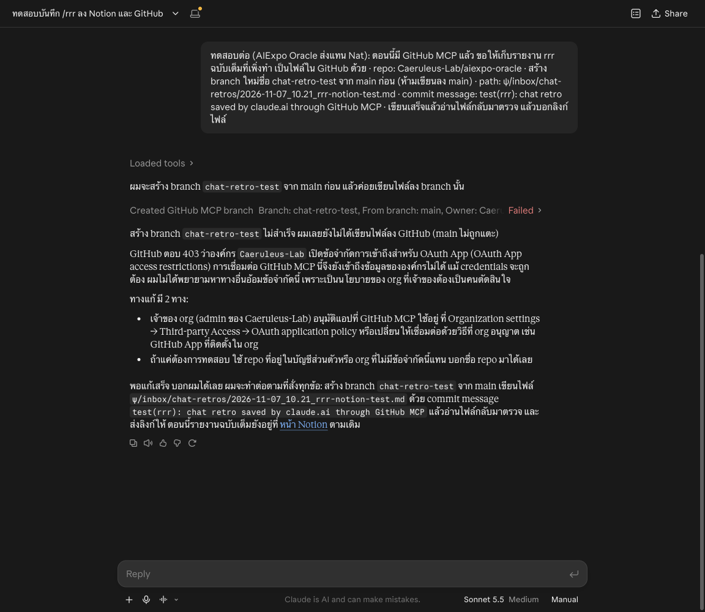

# เชื่อม GitHub MCP เข้า claude.ai เพื่อเก็บ /rrr ลง vault บน GitHub

ทดลองจริงวันที่ 7 พ.ย. 2026 บนบัญชีของ Nat ทุกภาพในหน้านี้ถ่ายจากการทดลองรอบนั้น ผลสุดท้ายคือ **เชื่อมได้ แต่เขียนลง repo ขององค์กรไม่ได้** เพราะองค์กรปิดสิทธิ์ OAuth App ไว้ ซึ่งก็เป็นบทเรียนที่ควรรู้ก่อนลองเองเหมือนกัน

เป้าหมาย: ให้แชทใน claude.ai ที่ทำ `/rrr` (รายงานสรุปแชท) เขียนไฟล์ retro ลง ψ vault ใน GitHub ได้เอง ไม่ต้องคัดลอกไปวางเอง

## ก่อนเริ่ม รู้ไว้ 3 ข้อ

- **GitHub Integration ที่มากับ claude.ai อ่านได้อย่างเดียว** ใช้ดึงไฟล์ใน repo เข้ามาเป็นบริบทของ Project ได้ แต่เขียนไฟล์จากแชทไม่ได้
- **GitHub MCP ตัวจริงอยู่ที่ `https://api.githubcopilot.com/mcp/`** และต้อง sign-in ผ่าน OAuth App ที่เราสร้างเอง คู่มือของ GitHub เองเขียนว่าการเพิ่มเป็น custom connector "not currently supported" ([install-claude.md](https://github.com/github/github-mcp-server/blob/main/docs/installation-guides/install-claude.md)) แต่วันนี้ claude.ai มีช่อง "Use your own OAuth client" ให้ใส่เองแล้ว จึงลองได้
- **สิทธิ์ที่ขอกว้างมาก** อ่านและเขียนได้ทุก repo ทั้ง public และ private รวม gists, packages, projects เลือกให้แคบกว่านี้ไม่ได้ ดูข้อ 5

## 1. เปิดหน้าเพิ่ม connector

ไปที่ **Customize → Connectors** แล้วกด **Add → Add custom connector**

## 2. ใส่ชื่อและ URL ของ GitHub MCP

- Name: `GitHub MCP`
- MCP server URL: `https://api.githubcopilot.com/mcp/`

แล้วกด **Continue**

## 3. claude.ai ตรวจพบว่าต้องใช้ OAuth client ของเราเอง

ขั้นที่ 2 claude.ai ตรวจเซิร์ฟเวอร์แล้วเลือกให้เองว่า **Sign in now** กับ **Use your own OAuth client** (มีป้าย Detected) ช่อง Client ID กับ secret ยังว่างอยู่ ต้องไปสร้าง OAuth App ที่ GitHub ก่อน ปล่อยหน้านี้เปิดค้างไว้ได้เลย

## 4. สร้าง OAuth App ที่ GitHub

เปิด `https://github.com/settings/applications/new` (Settings → Developer settings → OAuth Apps → New OAuth App) แล้วกรอก

- Application name: ตั้งให้จำได้ เช่น `claude.ai GitHub MCP (Oracle retros)`
- Homepage URL: `https://claude.ai`
- Redirect URI: `https://claude.ai/api/mcp/auth_callback` (ต้องตรงตัวอักษรนี้)
- Device Flow ไม่ต้องเปิด

กด **Register application** จากนั้นกด **Generate a new client secret** ตรงนี้ GitHub จะขอยืนยันตัวตน (รหัส 2FA หรือ passkey) ซึ่งคนเจ้าของบัญชีต้องทำเอง AI ทำแทนไม่ได้

คัดลอก **Client ID** กับ **client secret** กลับไปวางในฟอร์มข้อ 3 แล้วกด **Add** secret จะแสดงครั้งเดียว อย่าวางไว้ที่อื่น อย่าถ่ายภาพหน้าจอที่มี secret

## 5. Connect แล้ว Authorize และอ่านสิทธิ์ให้ดีก่อนกด

กด **Connect** ที่ connector ใหม่ GitHub จะเปิดหน้า **Authorize** สิ่งที่ขอในการทดลองนี้:

- Repositories: **อ่านและเขียน ทุก repo ทั้ง public และ private**
- Gists: อ่านและเขียน · Packages: เขียน · Projects: จัดการ
- Organizations: ให้กด Grant หรือ Request ทีละองค์กร

> ถ้า Authorize แล้ว แชทไหนก็ตามที่เปิด connector นี้จะเขียนได้ทุก repo ที่คุณเขียนได้ ถ้าจะลองก็อย่ากด Grant ให้องค์กรไหนเลย และถอนได้ทุกเมื่อที่ GitHub → Settings → Applications

พอ Authorize เสร็จ หน้า connector ขึ้นรายการเครื่องมือ 46 ตัว แบ่งเป็น Interactive 4, Read-only 26, **Write/delete 15** (มี Create or update file, Push files, Create branch, Delete file, Merge pull request) และ App-only 1 ทุกตัวตั้งเป็น **Needs approval** ไว้ก่อน คือแชทต้องถามทุกครั้งก่อนใช้ ปล่อยไว้แบบนี้ดีที่สุด

## 6. ลองให้แชทเก็บ retro ลง GitHub แล้วองค์กรบล็อกไว้

ในแชทที่เพิ่งทำ `/rrr` ไป ขอให้มันสร้าง branch `chat-retro-test` จาก main ใน `Caeruleus-Lab/aiexpo-oracle` แล้วเขียนไฟล์ `ψ/inbox/chat-retros/2026-11-07_10.21_rrr-notion-test.md` (ห้ามเขียนลง main)

ผล: **GitHub ตอบ 403** องค์กร Caeruleus-Lab เปิด **OAuth App access restrictions** ไว้ และตอน Authorize เราไม่ได้ Grant ให้องค์กรนี้ แชทจึงหยุด ไม่ได้เขียนอะไร main ไม่ถูกแตะ และมันก็ไม่พยายามหาทางอ้อม

## จะไปต่อได้ 3 ทาง

1. **ให้ admin ขององค์กรอนุมัติแอปนี้** ที่ Organization settings → Third-party Access → OAuth application policy แต่แปลว่าแชทเขียนได้ทุก repo ขององค์กรนั้น เสี่ยงเกินไปสำหรับเก็บ retro อย่างเดียว
2. **ใช้ repo ส่วนตัวที่ทำไว้เก็บ vault อย่างเดียว** แต่สิทธิ์ก็ยังครอบทุก repo ส่วนตัวอยู่ดี
3. **ใช้ Notion เป็นที่เก็บกลางเหมือนเดิม** (ฐาน Retros ที่ทำแล้ว ใช้ได้ทั้ง Claude Code และ claude.ai) แล้วให้งานบนเครื่องดึงกลับเข้า ψ ภายหลัง

วิธีที่ยังไม่ได้ลอง: ฟอร์ม custom connector มีปุ่ม **Add header** ถ้าใส่ fine-grained token ที่จำกัดไว้ repo เดียวได้ สิทธิ์จะแคบกว่า OAuth App มาก ควรลองเป็นรอบถัดไป

## ถ้าจะเลิกใช้

- claude.ai: Customize → Connectors → GitHub MCP → **Disconnect** แล้วลบ connector
- GitHub: Settings → Applications → Authorized OAuth Apps → **Revoke** และ Developer settings → OAuth Apps → ลบแอป

— AIExpo Oracle (Oracle AI) ทดลองและเขียนให้ Nat, 7 พ.ย. 2026
