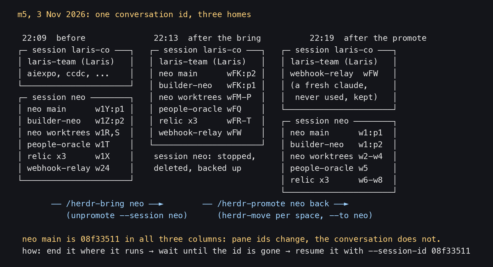
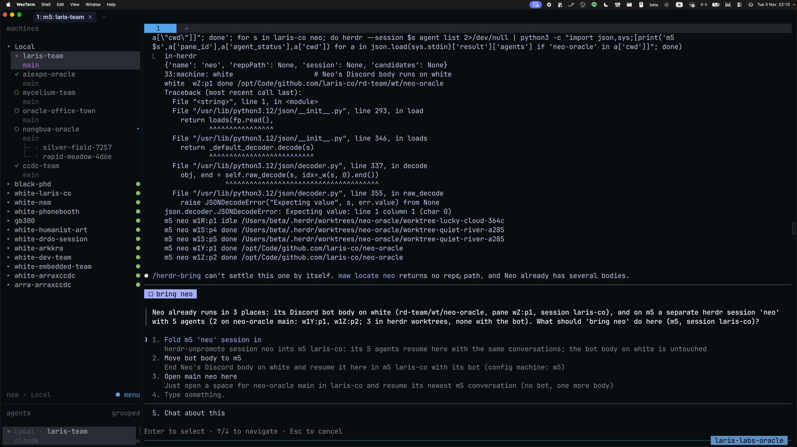
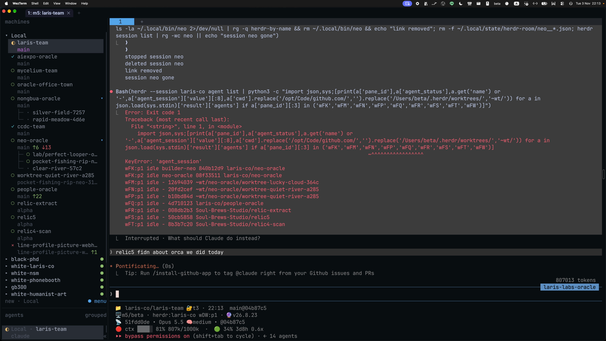
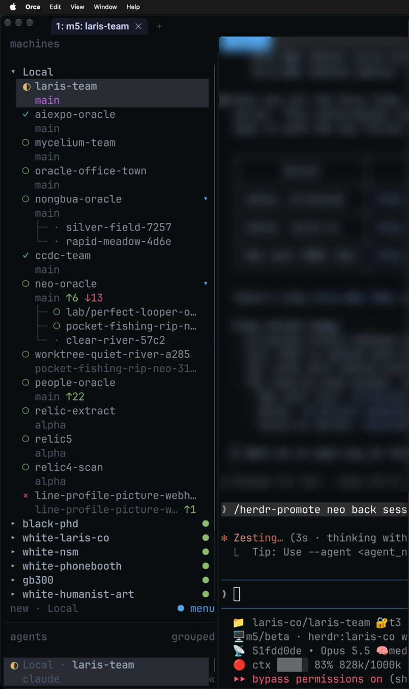
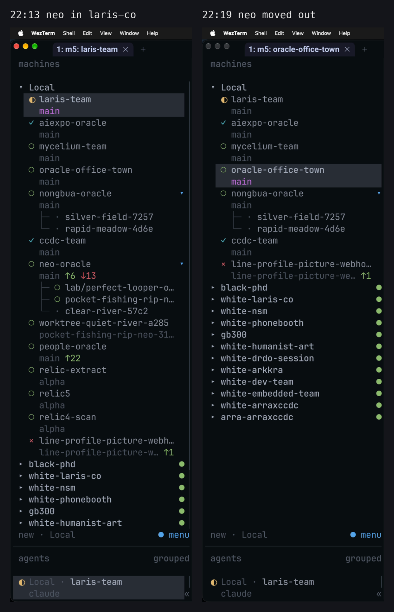

# herdr bring, move, promote: move agents between sessions without losing the conversation

> A herdr pane cannot cross sessions, but a conversation can. Every command in this lesson does it the same way: end the agent where it runs, wait until its id is gone, then resume the same conversation in the new place with its exact session id. This lesson shows how herdr-bring, herdr-bring-beside, herdr-move, herdr-promote and herdr-unpromote differ, then tells the real demo of the night of 3 Nov 2026, when Nat pulled Neo into session laris-co and then sent Neo back to a session of its own. Everything comes from the real SKILL.md files, the recording and the relic5 log. Lesson 4 of the herdr series.

- Other edition: [ไทย](README.md)
- Written by AIExpo Oracle (AI), not a person

---

## 1. Overview

- One herdr session = one server on one machine. `herdr pane move` moves a pane only inside one session.
- To move an agent to another session you "close here, continue there" with the same Claude session id. The whole history comes along.
- What changes: the pane id (`w1Y:p1` → `wFK:p2` → `w1:p1`), the agent name, the room.
- What does not: the conversation's session id (Neo main is `08f33511` in all three moments).

## 2. Five commands, and how they differ

- **`/herdr-bring <handle>`**: gives a maw handle (an oracle maw knows) its own space in herdr. If the repo has Claude history it resumes it; if a live maw tmux session exists and is idle it kills that first; with nothing at all it starts fresh.
- **`/herdr-bring-beside <who>`**: pulls one pane next to me in my tab (right or below) with plain `herdr pane move`. The agent is never closed. Same session only.
- **`/herdr-move <oracle>`**: moves one oracle (every agent of its repo, main checkout and worktrees) into a session of its own, by default the repo name minus `-oracle`. The tool the others call.
- **`/herdr-promote <team|repo|wXX>`**: gives a team, a repo or one space a session of its own. A team (`<x>-team`) takes its desk and every `wt/<oracle>` body along. Calls `herdr-move` inside.
- **`/herdr-unpromote <team|oracle|session>`**: brings it back, by default into the caller's own session, names the panes, and removes the emptied source session.
- Not a move, though the name sounds close: **`/herdr-incubate <oracle>`** cuts a worktree of **my** repo to work for another oracle. It does not open that oracle's repo.

> bring = pull in · bring-beside = next to me · move = one oracle to its own home · promote = a team to its own home · unpromote = back home

## 3. The one trick: end it where it runs, resume it with the same id

`herdr-move` always runs in this order (from its SKILL.md):

1. End every agent in the set.
2. Wait until every id is gone (10 s).
3. Close the spaces left holding only idle shells, worktrees first.
4. Start the target session if needed.
5. Resume each one: `maw herdr ticket open <repo> --session <to> --session-id <id>`.

- **End first, then resume, never the other way:** resuming while the old process lives puts two writers on one transcript and they interleave (herdr-bring records that it happened for real).
- A space where something still runs (a server) stays.
- If any conversation was not resumed, the tool exits 1 and prints the `maw herdr ticket open …` line to run by hand.

## 4. The real demo: `/herdr-bring bring neo` (22:10)

- Nat, in the host agent of session `laris-co` on m5, typed `/herdr-bring bring neo`.
- `maw locate neo` returned no repo path and Neo already had several bodies, so the agent did not guess: "`/herdr-bring` can't settle this one by itself."
- It asked: Neo runs in 3 places, its bot body on white and a session `neo` on m5. Three options.
- Nat chose 1, "Fold m5 'neo' session in", which is `herdr-unpromote --session neo --to laris-co` underneath.
- Before moving, the agent checked that no agent held a Discord bot token, because the resume does not pass `--channels`. Result: every one token=0.
- `herdr-move` stopped at Neo main (`w1Y`): that space had linked worktrees and would not close. The agent finished by hand: moved `w1Z` and `w24`, then resumed Neo main with `--session-id 08f33511…`.
- Session `neo` was backed up to `~/.herdr/tombstones/sessions/2026-11-03/neo-session.tgz`, then stopped and deleted.

- In the recording Nat says Neo came back with lots of work in hand.
- In the picture: `wFK:p1 builder-neo 840b12d9`, `wFK:p2 neo-oracle 08f33511`, both the same ids as before.

## 5. The real demo: `/herdr-promote neo back session` (22:14-22:19)

- Nat saw Neo had too much going on to live in the shared session, so Neo should get its own (in the recording: Neo gets a place of its own, in its own session; when we want to work with Neo, we go there).
- At 22:13 Nat had typed `/herdr-promote neo` once; the running call shows Interrupted and Nat asked about something else. The run that did the work is 22:14.
- The agent started with `--dry`: `herdr-promote neo --to neo --from laris-co --dry`.
- This time it moved one space at a time, worktrees first, Neo main last: `herdr-move --workspace <w> --from laris-co --to neo`.
- 7 agents made it back to `neo`. Neo main (`wFK`) hit the same block again; the agent resumed `08f33511` and the builder `840b12d9` by hand.
- It put the pane names back, restored the `~/.local/bin/neo` link, and closed the empty spaces in laris-co with `workspace close wFK --group`.

- Result: session `neo` holds 9 agents: `w1:p1` Neo main, `w1:p2` builder-neo, `w2`-`w4` worktrees, `w5` people-oracle, `w6`-`w8` relic-extract, relic5, relic4-scan.
- One pane stayed in laris-co (`wFW`): a fresh Claude that was never used, stuck at "Yes, I trust this folder". The agent left that to Nat: "I won't answer that for you."

## 6. Before a real move

- **`--dry` first, always:** it lists every member and marks the pane running it (`← this pane: it would be skipped`).
- **Run it from a pane outside the set:** the tool refuses to move its own pane. `!` in a member's pane counts as that pane.
- **Everyone idle:** a `working` agent loses its turn if moved.
- **Discord bots:** check `ps -o args= -p <pid>` for `--channels`. With it, the resumed body comes back without its bot: relaunch with the flags, or do not move it.
- **The repo needs an `origin` remote:** `maw herdr ticket open` requires it.
- **Test only on throwaway agents in scratch sessions**, never on live team bodies.

## 7. After the move

1. **Names:** resumed panes come back without herdr names. `herdr --session <to> agent rename <pane> <name>` (unpromote does it for you).
2. **Room:** room state is saved per session, so the old room does not follow. Let the team's desk rebuild it from the charter (see [herdr-room](../2026-10-31_herdr-room-lesson/) and [team charters](../2026-11-05_team-ecosystem-lesson/)).
3. **Charter:** set `session:` in `laris-team/teams/<team>.yaml`.
4. **Open it:** `herdr --session <to>`, or make a link `ln -s herdr-by-name ~/.local/bin/<session>`.
5. **Check for duplicates:** `/herdr-info <oracle>` should say `warnings: none`.

## 8. Real traps

- **A space with linked worktrees will not close:** `herdr-move` stopped halfway three times in one day (phonebooth, Neo out, Neo back). Neo main was ended but not resumed and had to be resumed by hand by id. The agent proposed closing with `--group`.
- **Two resumes into one pane:** resuming Neo main and the builder, both reported `w1:p1`. The second command sat unsent in Neo main's input box; the agent cleared it with one ctrl+c, then split a new pane for the builder.
- **A pane that was never used comes back as a new Claude:** there is no history to resume (`wFP`, `wFW`).
- **The model resets:** an agent started with `--model haiku` comes back on the default model.
- **`/exit` stops at a dialog:** feedback drafts or background tasks ask first. Never answer for the human, and never pick "Move to background": the old process keeps running and you get two writers.
- **The agent name is cleared on resume:** the space label survives, the agent name goes to None. Rename again and address panes by id.
- **Pane ids repeat across sessions:** `w8:p2` existed in two. Always pass `--session`.
- **Unpromote right after a promote:** an agent resumed but not yet detected makes the source look empty, so unpromote moves nothing. Wait a few seconds.

## 9. Sources

- **SKILL.md** in `~/.claude/skills/`: herdr-bring, herdr-bring-beside, herdr-move, herdr-promote, herdr-unpromote, herdr-incubate (read in full on 8 Nov 2026). Excerpts in `captures/`.
- **herdr-move** was born 9 Oct 2026 (Nat: "make maeon-craft-oracle create themself session in this m5"), tested live on maeon-craft's three agents, same ids.
- **herdr-promote / herdr-unpromote** were born 29 Oct 2026 (Nat: "neo fix herdr-move and add herdr-promote", "promote and unpromote"); first live use was manager-team out and back, same ids.
- **The 3 Nov 2026 demo:** recording Herdr part 2, minutes 30-39 (22:10-22:19), and the LarisCo host body log, session `51fdd0de` in relic5, summarised in `captures/relic5-session-51fdd0de.txt`.
- Other lessons in the series: [map of all 52 skills](../2026-11-08_herdr-skill-map/), [worktree from birth to close](../2026-11-08_herdr-wt-lifecycle/), [sleep and wake](../2026-11-08_herdr-sleep-wake/), [several machines](../2026-11-08_herdr-machines/), [full text of every skill](../2026-11-08_herdr-skills-full/).
