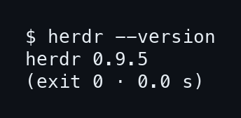
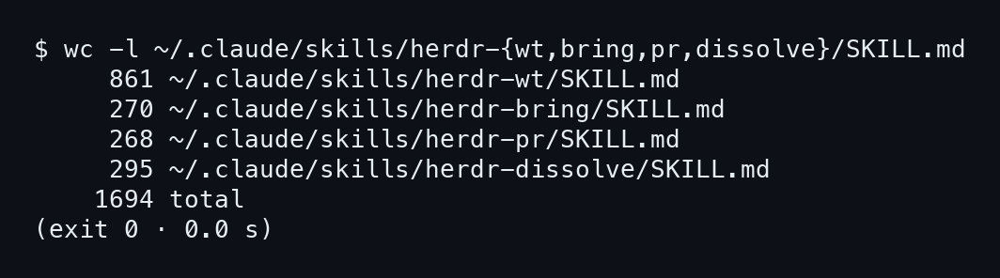
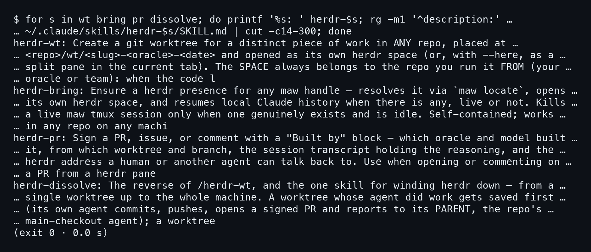
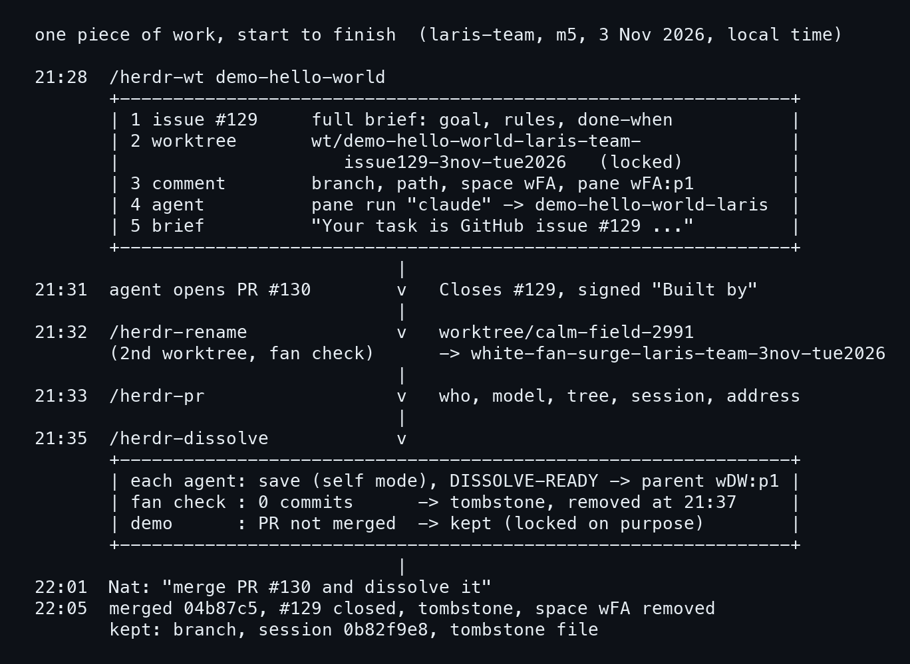

# บทที่ 1: สี่สกิล หนึ่งชิ้นงาน

บทนี้ยังไม่ต้องพิมพ์อะไรหนัก แค่ดูของจริงสามอย่างบนเครื่อง m5 ว่า herdr เป็นรุ่นไหน สกิลทั้งสี่อยู่ตรงไหน ยาวแค่ไหน แล้วแต่ละตัวบอกเองว่าทำอะไร จากนั้นดูคืนวันที่ 3 พฤศจิกายนที่ wt, rename, การเซ็น PR และ dissolve ทำงานจริงบนงานชิ้นเดียว ส่วน bring เป็นอีกเรื่องของคืนเดียวกัน จะเล่าในบทที่ 3

## 1.1 รุ่นของ herdr และสกิลอยู่ที่ไหน

### ขั้นที่ 1 — ดูรุ่นของ herdr

พิมพ์ `herdr --version` ก่อนเริ่มอะไรทั้งนั้น เพราะ capture ที่ถ่ายเมื่อ 8 พฤศจิกายนรันบนรุ่นเดียวกัน ถ้าเครื่องคุณรุ่นอื่น ผลอาจต่างได้เล็กน้อย

```bash
herdr --version
```



บรรทัดเดียวสั้นๆ

```
herdr 0.9.5
```

**รุ่นที่ใช้ถ่ายภาพคือ 0.9.5** และคำสั่งจบด้วย exit 0 ไม่มีอะไรผิดปกติ

### ขั้นที่ 2 — นับบรรทัดของ SKILL.md ทั้งสี่

สกิลของ Claude Code คือโฟลเดอร์ใน `~/.claude/skills/` แต่ละโฟลเดอร์มีไฟล์ `SKILL.md` เป็นตัวหลัก สั่ง `wc -l` ทีเดียวให้ครบทั้งสี่ โดยใช้ brace ของ shell ย่อชื่อโฟลเดอร์

```bash
wc -l ~/.claude/skills/herdr-{wt,bring,pr,dissolve}/SKILL.md
```



พอดูตัวเลขจะเห็นว่าสี่ตัวไม่เท่ากัน `herdr-wt` ยาวที่สุด ส่วนอีกสามตัวอยู่แถว 270 บรรทัด

```
     861 ~/.claude/skills/herdr-wt/SKILL.md
     270 ~/.claude/skills/herdr-bring/SKILL.md
     268 ~/.claude/skills/herdr-pr/SKILL.md
     295 ~/.claude/skills/herdr-dissolve/SKILL.md
    1694 total
```

**รวมกัน 1,694 บรรทัด** และ `herdr-wt` เดียวกินไปครึ่งหนึ่ง

## 1.2 หนึ่งบรรทัดจากแต่ละสกิล

### ขั้นที่ 1 — อ่าน description ที่สกิลเขียนเอง

ทุก SKILL.md ขึ้นต้นด้วยบรรทัด `description:` ซึ่งเป็นสิ่งที่ Claude เห็นก่อนตัดสินใจว่าจะเรียกสกิลไหน ดึงมาทีละสกิลด้วย `rg -m1` แล้วตัดเหลือถึงตัวที่ 300 ให้พออ่านในภาพเดียว

```bash
for s in wt bring pr dissolve; do printf '%s: ' herdr-$s; \
  rg -m1 '^description:' ~/.claude/skills/herdr-$s/SKILL.md \
  | cut -c14-300; done
```



ข้อความเป็นภาษาอังกฤษเพราะสกิลเขียนไว้แบบนั้น ถอดความได้ดังนี้ โดยทุกข้อมาจากบรรทัดในภาพ

- `/herdr-wt` สร้าง git worktree ให้งานชิ้นหนึ่งในรีโปไหนก็ได้ วางที่ `<repo>/wt/<slug>-<oracle>-<date>` แล้วเปิดเป็น herdr space ของมันเอง
- `/herdr-bring` หา presence ใน herdr ให้ maw handle ด้วย `maw locate` เปิด space ของตัวเอง แล้ว resume ประวัติ Claude ในเครื่อง
- `/herdr-pr` เซ็น PR, issue หรือ comment ด้วยบล็อก "Built by" ว่า oracle ตัวไหน โมเดลอะไร สร้างจาก worktree กับ branch ไหน
- `/herdr-dissolve` คือด้านกลับของ `/herdr-wt` ใช้ปิดตั้งแต่ worktree เดียวไปถึงทั้งเครื่อง

**ทั้งสี่เป็นของชิ้นเดียวกัน** เปิด ดึงเข้ามา เซ็น ปิด ตามลำดับที่สกิลออกแบบไว้ ไม่ใช่ลำดับของคืนวันที่ 3 พฤศจิกายน เพราะคืนนั้น bring ไม่ได้อยู่ในงาน demo

## 1.3 คืนวันที่ 3 พฤศจิกายนในภาพเดียว

### ขั้นที่ 1 — ตามเส้นเวลาของงาน demo-hello-world

งานจริงที่ใช้ตัวอย่างตลอดเล่มคือ `/herdr-wt demo-hello-world` ในรีโป laris-team บน m5 เวลา 21:28 ตามเวลาไทย ภาพนี้วางเหตุการณ์ของงาน demo เรียงเวลาลงมา (ช่วง 21:33 คือ agent ของ demo เซ็น PR เองด้วย herdr-sign.sh ส่วนอีกต้นตอบว่า "nothing to sign yet")  ส่วนบทที่ 2 ถึง 5 จะแตกแต่ละช่วงให้ดูทีละขั้น



กรอบแรกคือการเปิดงาน ห้าอย่างต่อกัน issue #129, worktree, comment บอกที่อยู่, agent และ brief ที่บอกว่า "Your task is GitHub issue #129" พอ 21:31 agent เปิด PR #130 เอง

ช่วงกลางมีเรื่อง**ที่ไม่ได้วางแผนไว้** เวลา 21:32 `/herdr-rename` ทำงานใน worktree ที่สอง (เช็ก fan บน white) ส่วนต้น demo ไม่ถูกเปลี่ยนชื่อ

### ขั้นที่ 2 — ดูว่าปิดงานแล้วเหลืออะไร

พอ 21:35 `/herdr-dissolve` ทำกับสองต้น ต้น fan check ถูกลบตอน 21:37 ส่วนต้น demo ยังอยู่ เพราะ PR ยังไม่ merge และ worktree ถูกล็อกไว้ รายละเอียดอยู่ในบทที่ 2

```
22:01  Nat: "merge PR #130 and dissolve it"
22:05  merged 04b87c5, #129 closed, tombstone, space wFA removed
       kept: branch, session 0b82f9e8, tombstone file
```

**ปิดงานแล้วยังเหลือสามอย่าง** คือ branch, session และไฟล์ tombstone ตั้งแต่ issue เปิดจนถึง merge ใช้เวลา 35 นาที บทถัดไปเริ่มจากต้นทาง คือ `/herdr-wt` และ 861 บรรทัดของมัน
