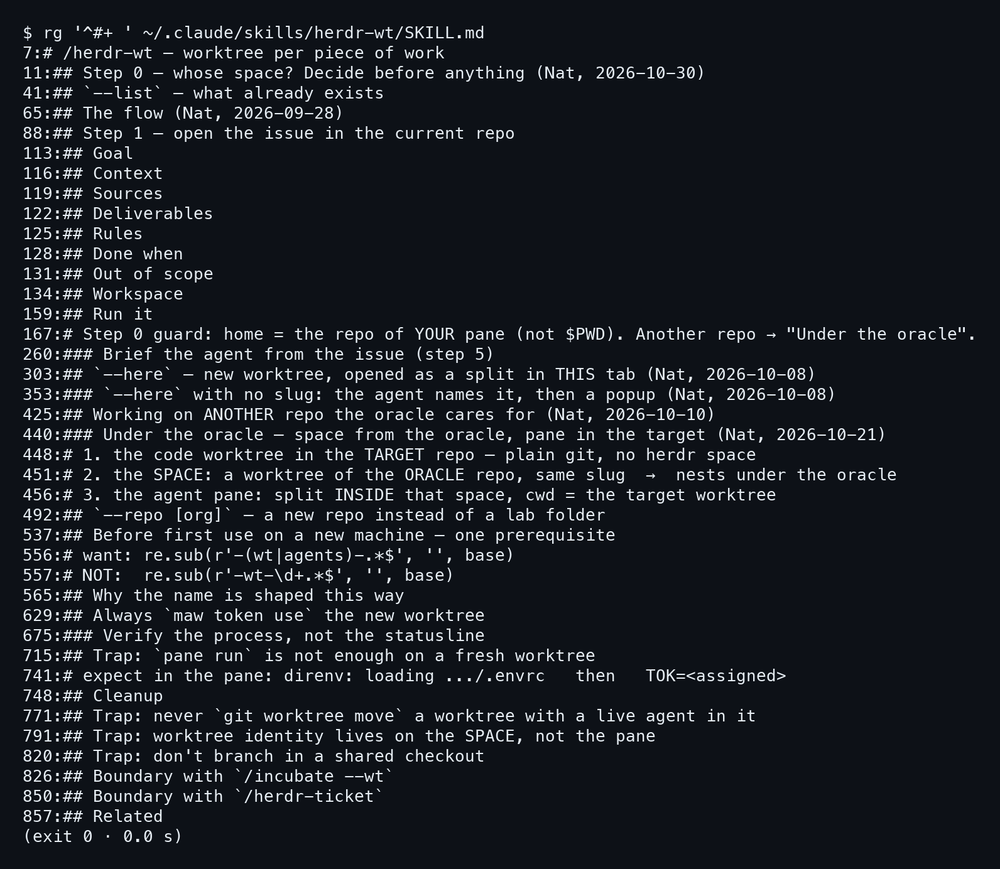
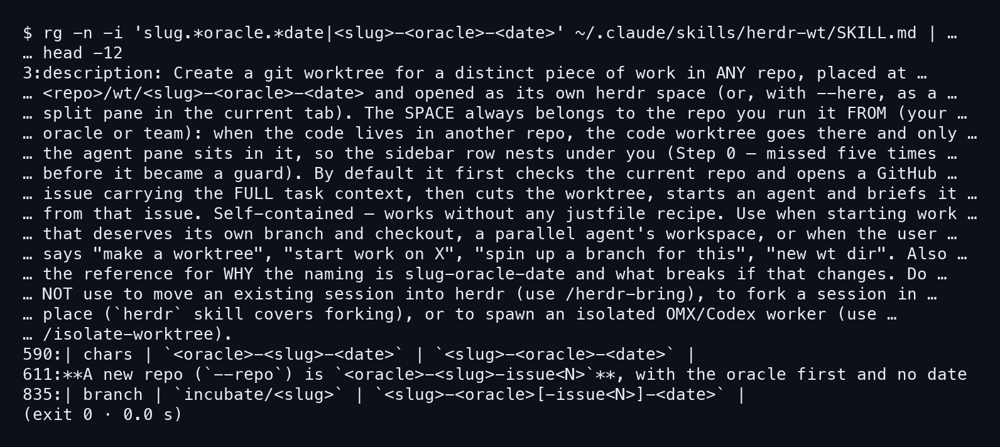
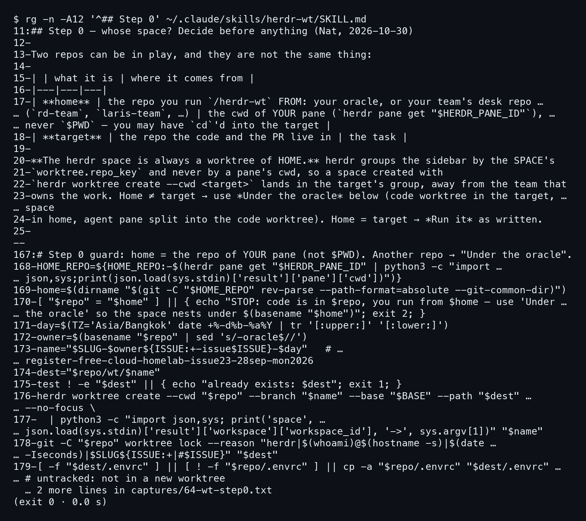
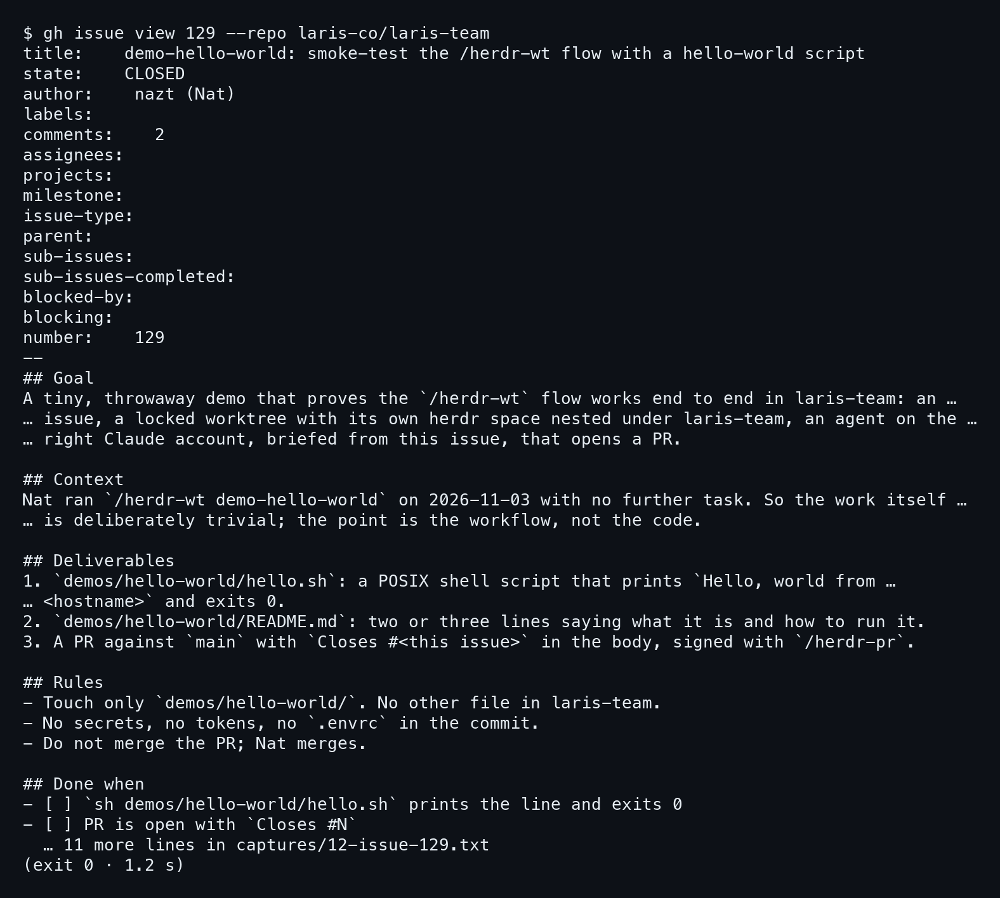
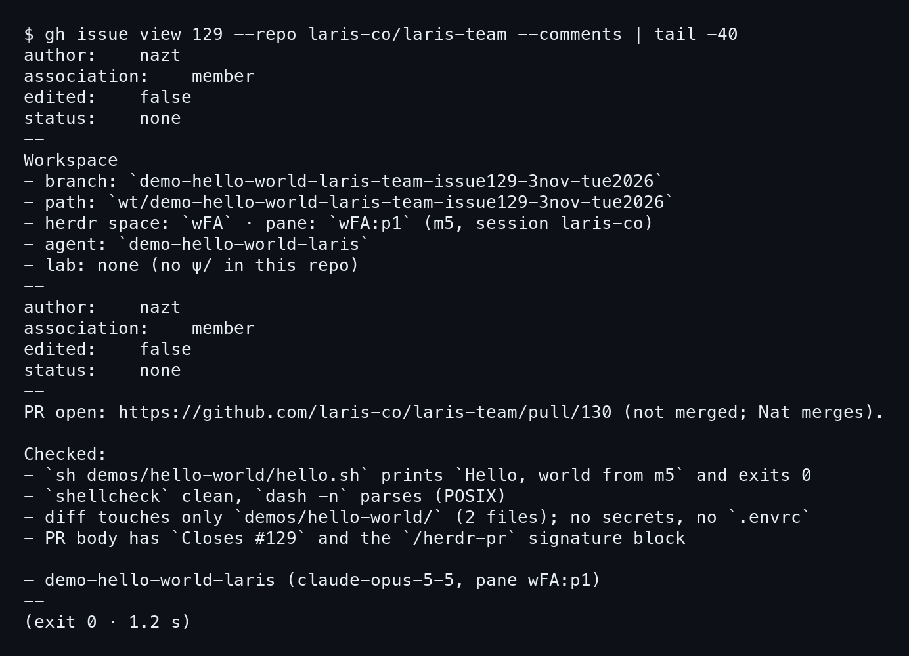
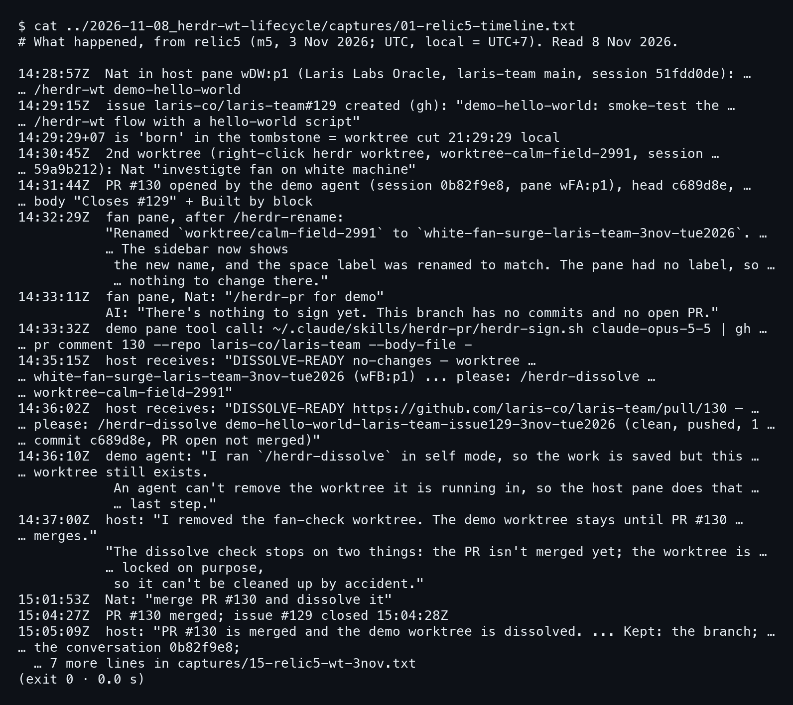
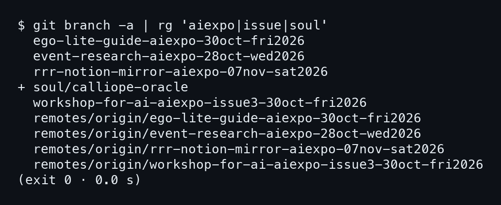

# บทที่ 2: /herdr-wt — เปิดงานหนึ่งชิ้น

บทนี้เดินตามสกิล `/herdr-wt` แล้วดูของจริงที่มันทิ้งไว้เมื่อ 3 พ.ย. ทุกอย่างอ่านจากไฟล์และบันทึก ไม่ได้สั่งรันสกิลใหม่

## 2.1 สกิลนี้ทำอะไรบ้าง

### ขั้นที่ 1 — ไล่ดูหัวข้อของ SKILL.md

ดูหัวข้อ `#` ของไฟล์สกิลเองก็รู้ว่ามันทำอะไร

```bash
rg '^#+ ' ~/.claude/skills/herdr-wt/SKILL.md
```



อ่านจากบนลงล่างจะเห็นลำดับ เริ่มที่ `Step 0` (บรรทัด 11) ถามว่าพื้นที่นี้เป็นของใคร ต่อด้วย `Step 1 — open the issue in the current repo` (บรรทัด 88) แล้วหัวข้อ `Goal`, `Context`, `Sources`, `Deliverables`, `Rules`, `Done when`, `Out of scope`, `Workspace` ซึ่งคือโครงของ issue ที่สกิลเปิดให้ **issue มาก่อน worktree เสมอ** จากนั้นถึง `Run it` (บรรทัด 159) และ `Brief the agent from the issue (step 5)` (บรรทัด 260)

### ขั้นที่ 2 — แยกส่วนที่เป็นทางเลือกออกจากส่วนหลัก

ที่เหลือใต้ลงไปคือทางเลือกกับกับดัก **ส่วนหลักที่ต้องจำมีแค่ Step 0 กับ Step 1** มี `--here` (split pane ในแท็บเดิม), `Under the oracle` (งานอยู่อีก repo), `--repo [org]` (repo ใหม่) และหมวด `Trap:` อีกหลายข้อ ที่เหลือเปิดดูตอนเจอสถานการณ์นั้นจริง

## 2.2 ทำไมโฟลเดอร์ชื่อ slug-oracle-date

### ขั้นที่ 1 — อ่านรูปแบบชื่อจากสกิล

สกิลบอกในบรรทัด description ว่า worktree ไปอยู่ที่ `<repo>/wt/<slug>-<oracle>-<date>` และมันเป็น "reference for WHY the naming is slug-oracle-date" ด้วย ลองดึงบรรทัดที่พูดถึงชื่อออกมาดู

```bash
rg -n -i 'slug.*oracle.*date|<slug>-<oracle>-<date>' \
  ~/.claude/skills/herdr-wt/SKILL.md | head -12
```



ในตารางเทียบ (บรรทัด 590) มีสองแบบวางคู่กัน และ **ชื่อที่สกิลใช้จริงคือแบบ slug นำหน้า** ส่วน repo ใหม่ที่เปิดด้วย `--repo` เป็นข้อยกเว้น (บรรทัด 611) สคริปต์ใน `Run it` ประกอบชื่อให้จาก slug, ชื่อ repo ที่ตัด `-oracle` ออก, `-issueN` ถ้ามี และวัน ชื่อเดียวกันใช้ทั้ง branch และโฟลเดอร์ ดูแล้วรู้ทันทีว่างานอะไร ของใคร วันไหน (สคริปต์เต็มอยู่ในภาคผนวก)

## 2.3 Step 0: พื้นที่เป็นของ repo ที่เรารันจาก

### ขั้นที่ 1 — แยก home กับ target

พอจะเปิดงานให้ repo อื่น ต้องตัดสินก่อนว่าใครเป็นเจ้าของ space ใน herdr ลองอ่านหัวข้อ Step 0

```bash
rg -n -A12 '^## Step 0' ~/.claude/skills/herdr-wt/SKILL.md
```



**home คือ repo ที่เรารันสกิลจากมัน** ส่วน target คือ repo ที่โค้ดกับ PR อยู่ home ดูจาก cwd ของ pane (`herdr pane get "$HERDR_PANE_ID"`) ห้ามดูจาก `$PWD`

### ขั้นที่ 2 — เข้าใจว่าทำไมต้องเป็น home

herdr จัดกลุ่ม sidebar ตาม `worktree.repo_key` ของ space ไม่ใช่ตาม cwd ของ pane สกิลจึงให้ space เป็น worktree ของ home เสมอ ถ้าโค้ดอยู่คนละ repo กับ pane สคริปต์ (บรรทัด 167–170) **หยุดทันที** ด้วยข้อความ `STOP: code is in $repo, you run from $home` แล้ว exit 2

## 2.4 issue #129 ของจริง

### ขั้นที่ 1 — เปิด issue ที่สกิลสร้างเมื่อ 3 พ.ย.

คืนวันที่ 3 พ.ย. Nat พิมพ์ `/herdr-wt demo-hello-world` ใน laris-team โดยไม่ให้โจทย์อะไรเพิ่ม สกิลเปิด issue ให้เอง ลองอ่านด้วย `gh`

```bash
gh issue view 129 --repo laris-co/laris-team
```



หัวข้อที่เห็นตรงกับโครงในขั้นที่ 1 ของ 2.1 เป๊ะ `Goal` บอกว่าเป็นงานทดสอบ flow ล้วน ๆ `Deliverables` มีสามข้อ คือ `hello.sh`, `README.md` และ PR ที่มี `Closes #<this issue>` **Rules ห้ามแตะอะไรนอก `demos/hello-world/` และห้ามรวม PR เอง Nat เป็นคนรวม**

### ขั้นที่ 2 — อ่านเงื่อนไขปิดงานและช่อง Workspace

`Done when` เป็น checkbox สามข้อ สคริปต์รันได้และ exit 0, PR เปิดอยู่พร้อม `Closes #N`, และมี comment บอก URL ของ PR กับสิ่งที่ตรวจ ส่วน **`Workspace` ตอนเปิดยังว่าง** รอให้สกิลมาเติมเป็น comment ทีหลังเมื่อ worktree เกิดแล้ว ท้าย issue มีลายเซ็นว่าเปิดโดย Laris Labs Oracle (AI) ผ่าน `/herdr-wt` session 51fdd0de

### ขั้นที่ 3 — อ่าน comment สองอัน

issue นี้มี 2 comments ลองดูท้ายสุดของ output

```bash
gh issue view 129 --repo laris-co/laris-team --comments | tail -40
```



อันแรกคือ Workspace ที่สกิลเติมให้หลังตัด worktree เสร็จ มี branch, path, space `wFA`, pane `wFA:p1` และชื่อ agent **ใครเปิด issue ก็กลับมาหา worktree ได้จาก comment นี้** อีกอันมาจาก agent ที่ทำงาน บอกว่า PR เปิดแล้วและตรวจอะไรไปบ้าง

## 2.5 ไทม์ไลน์คืนนั้นจาก relic5

### ขั้นที่ 1 — อ่านบันทึกที่ relic5 เก็บไว้

issue กับ PR บอกแค่ผลลัพธ์ แต่ลำดับเหตุการณ์จริงอยู่ในประวัติของ session ซึ่ง relic5 เก็บไว้ capture ด้านล่างคือเวลา UTC กับข้อความจริงที่มันดึงมา (เวลาไทยคือ UTC+7)

```bash
cat ../2026-11-08_herdr-wt-lifecycle/captures/01-relic5-timeline.txt
```



เวลาไทย 21:28 Nat พิมพ์ `/herdr-wt demo-hello-world` 21:29 issue #129 เกิด 21:31 agent เปิด PR #130 **สามนาทีจากคำสั่งเดียว** ได้ครบทั้ง issue, worktree ที่ล็อกไว้, agent และ PR

### ขั้นที่ 2 — ดูส่วนที่ไม่เป๊ะ

คืนนั้นมี worktree ที่สองสำหรับตรวจพัดลมบน white `/herdr-rename` ตอน 21:32 ทำงานใน pane นั้น ส่วน branch ของ demo ไม่เคยถูกเปลี่ยนชื่อ 21:33 `/herdr-pr for demo` ก็ถูกพิมพ์ใน pane เดียวกัน ได้คำตอบว่ายังไม่มีอะไรให้เซ็น ลายเซ็นจริงโพสต์โดย agent ของ demo เอง 21:35 `/herdr-dissolve` ปิด worktree พัดลมได้ (ลบตอน 21:37) แต่ **worktree ของ demo ยังอยู่** เพราะ PR ยังไม่รวมและ worktree ถูกล็อก รายละเอียดอยู่ในบทที่ 4 และ 5

## 2.6 branch ใน repo นี้ที่ตามกฎ

### ขั้นที่ 1 — ลองดู branch จริงของ aiexpo-oracle

**กฎชื่อไม่ใช่ทฤษฎี** repo ที่คุณกำลังอ่านอยู่ก็ใช้มัน ลองกรอง branch ที่มี `aiexpo`, `issue` หรือ `soul`

```bash
git branch -a | rg 'aiexpo|issue|soul'
```



branch จาก `/herdr-wt` ลงท้ายด้วยวัน เช่น `30oct-fri2026`

```
event-research-aiexpo-28oct-wed2026
ego-lite-guide-aiexpo-30oct-fri2026
workshop-for-ai-aiexpo-issue3-30oct-fri2026
rrr-notion-mirror-aiexpo-07nov-sat2026
```

owner คือ `aiexpo` และตัวที่ผูกกับ issue จะมี `-issue3` แทรกก่อนวัน ส่วน `soul/calliope-oracle` ไม่ลงท้ายวัน branch ที่ไม่ลงท้ายวันมักไม่ได้เปิดด้วยสกิลนี้

งานเปิดแล้ว แต่ agent ที่เคยทำงานไว้แล้วหายไปล่ะ บทหน้าคือ `/herdr-bring` ที่ดึงมันกลับมา
