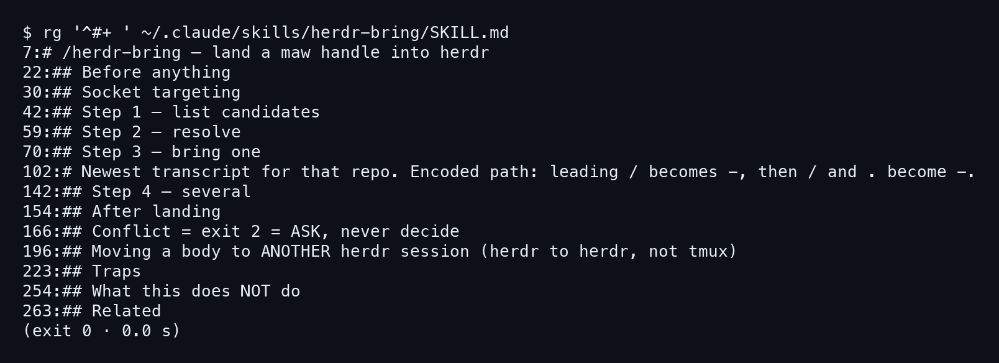
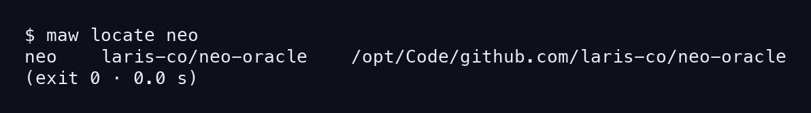
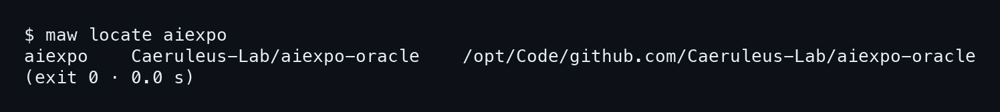
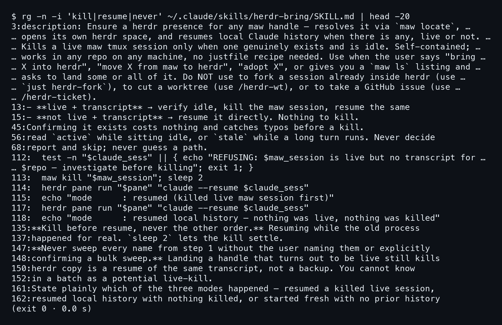
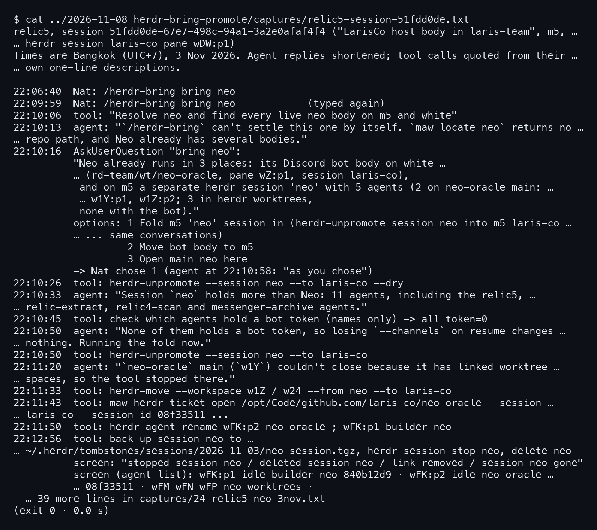
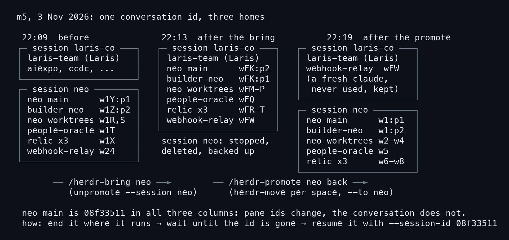

# บทที่ 3: /herdr-bring — ดึง agent ที่หายไปกลับมา

agent ตัวหนึ่งทำงานอยู่ใน tmux ของ maw พอย้ายมาใช้ herdr ก็ต้องมีคนพามันมา โดยไม่ให้ประวัติคุยหาย และไม่ให้มีสองตัวแย่งกันตอบ งานนี้คือหน้าที่ของ /herdr-bring บทนี้เริ่มจากว่าสกิลทำอะไรเป็นขั้น ดู `maw locate` วันนี้ ดูกฎของมัน แล้วจบด้วยเรื่องจริงวันที่ 3 พ.ย. ที่สกิลตัดสินเองไม่ได้

## 3.1 bring ทำอะไรบ้าง

สกิลนี้เป็นไฟล์ SKILL.md ไฟล์เดียว ในเครื่อง m5 อยู่ที่ `~/.claude/skills/herdr-bring/` เปิดดูหัวข้อก็เห็นลำดับงานทั้งหมด

### ขั้นที่ 1 — ดูหัวข้อของสกิล

พิมพ์ `rg` ให้มันไล่หัวข้อ `#` ของไฟล์ แล้วอ่านเรียงตามเลขบรรทัด เห็นเลยว่า **สกิลแบ่งเป็น Step 1 ถึง Step 4** ตามลำดับ list, resolve, bring one, several

```bash
rg '^#+ ' ~/.claude/skills/herdr-bring/SKILL.md
```



หัวข้อที่น่าสนใจมีสามอัน คือ `Step 3 — bring one` (บรรทัด 70) ที่ลงมือจริง, `Conflict = exit 2 = ASK, never decide` (บรรทัด 166) ที่บอกให้ถามคนเมื่อชน และ `Moving a body to ANOTHER herdr session` (บรรทัด 196) ที่ใช้กับเรื่อง 3 พ.ย. ข้างล่าง ส่วนท้ายไฟล์มี `What this does NOT do` ไว้บอกขอบเขต

## 3.2 maw locate วันนี้

Step 2 ของสกิลให้ถาม `maw locate` ก่อนทุกครั้งว่า handle นี้คือ repo ไหน อยู่ที่ path อะไร ถ้าไม่ได้ path ก็รายงานแล้วข้ามไป ห้ามเดา

### ขั้นที่ 1 — locate สองชื่อ

รันสองคำสั่ง ตัวแรกคือ neo ตัวที่สองคือ aiexpo ซึ่งเป็น oracle ของรีโปที่ถือหนังสือเล่มนี้ ผลออกมาเป็นบรรทัดเดียวคั่นด้วย tab คือ handle, org/repo, path

```bash
maw locate neo
maw locate aiexpo
```





ทั้งสองได้ path ครบ exit 0 ทั้งคู่ จำไว้ว่า **วันนี้ `maw locate neo` ตอบ path ได้** เพราะเรื่องใน 3.4 เกิดตอนที่มันยังตอบไม่ได้ และนั่นคือจุดที่สกิลต้องหยุดถามคน

## 3.3 กฎของมัน

กฎสำคัญของ bring ซ่อนอยู่ในคำว่า kill, resume และ never ลอง `rg` สามคำนี้ในไฟล์เดียวกัน

### ขั้นที่ 1 — ค้นกฎ

สั่ง `rg -n -i` ด้วยสามคำ แล้วตัดที่ 20 บรรทัดแรก จากผลลัพธ์ **ฆ่า tmux ของ maw เฉพาะตัวที่ live จริงและ idle** นอกนั้น resume ตรง ๆ

```bash
rg -n -i 'kill|resume|never' ~/.claude/skills/herdr-bring/SKILL.md \
  | head -20
```



อ่านตามบรรทัดได้สามโหมด บรรทัด 13 คือ live ที่มี transcript ให้ตรวจว่า idle, kill แล้ว resume บรรทัด 15 คือไม่ live แต่มี transcript ให้ resume ทันที ไม่มีอะไรให้ kill และมีโหมดที่สามคือไม่เคยมีประวัติ ก็เริ่มใหม่ (บรรทัด 161 ให้รายงานโหมดที่เกิดขึ้นเป็นภาษาตรง ๆ)

### ขั้นที่ 2 — กฎที่กันของเสีย

สามบรรทัดในผลลัพธ์ตอบคำถามว่าทำไมสกิลระวังขนาดนั้น บรรทัด 112 ถ้า live แต่ไม่มี transcript ให้ `REFUSING` ไม่ kill บรรทัด 135 เขียนว่า **kill ก่อน resume ไม่เคยกลับลำดับ** เพราะ resume ตอนตัวเก่ายังรันอยู่ จะได้สองตัวเขียน transcript เดียวกัน และบรรทัด 147 ห้ามกวาดทุกชื่อจาก Step 1 ถ้าผู้ใช้ไม่ได้ระบุชื่อเอง

ที่สกิลเขียนเข้มก็เพราะ resume ของ herdr ไม่ใช่ backup ของ session เดิม มันคือ transcript เดียวกันที่ถูกเปิดอีกครั้ง

## 3.4 เรื่องจริง 3 พ.ย.: bring neo

สกิลเขียนมาเพื่อกรณีง่าย handle เดียว repo เดียว แต่ Neo ในวันที่ 3 พ.ย. 2026 ไม่ได้ง่าย เรื่องนี้มาจาก relic5 ของ session 51fdd0de (Laris Labs Oracle, pane wDW:p1) ไม่ได้รันซ้ำเพื่อหนังสือ เวลาเป็นเวลากรุงเทพ

### ขั้นที่ 1 — สกิลยอมรับว่าตัดสินเองไม่ได้

22:06:40 Nat พิมพ์ `/herdr-bring bring neo` แล้วพิมพ์ซ้ำอีกครั้งตอน 22:09:59 agent ไปหา body ของ neo ทั้ง m5 และ white แล้วตอบตอน 22:10:13 ว่า `maw locate neo` ไม่คืน path และ Neo มีหลาย body อยู่แล้ว **เมื่อสกิลชนเรื่องที่ไม่ใช่กรณีง่าย agent ถามคน ไม่เดาเอง**

```
22:10:13  agent: "`/herdr-bring` can't settle this one by itself. …"
```



### ขั้นที่ 2 — สามตัวเลือก Nat เลือกข้อ 1

ตอน 22:10:16 agent เปิดคำถามสามข้อ แล้ว Nat เลือกข้อ 1 คือพับ session `neo` ของ m5 เข้ามาใน `laris-co` **agent ซ้อมด้วย `--dry` ก่อน** พอเห็นว่า `token=0` ทุกตัว ตอน 22:10:50 จึงสั่งพับจริง

### ขั้นที่ 3 — herdr-move หยุดกลางทาง

ตอน 22:11:20 เครื่องมือหยุด เพราะ `neo-oracle` main ปิดไม่ได้ **space ที่มี worktree space เกาะอยู่ ปิดตรง ๆ ไม่ได้** agent ต้องทำมือต่อ resume สองตัวด้วย id ของมัน คือ neo-oracle main ที่ `08f33511` กับ builder-neo ที่ `840b12d9` แล้วตั้งชื่อ pane ใหม่ พอครบก็สำรอง session `neo` ไว้ที่ `~/.herdr/tombstones/sessions/2026-11-03/neo-session.tgz` แล้วหยุดและลบ session นั้นตอน 22:12:56

### ขั้นที่ 4 — พับกลับด้วย promote

22:14:36 Nat สั่ง `/herdr-promote neo back session` แล้ว **agent ซ้อมด้วย `--dry` ก่อน** แล้ว `herdr-move` ทีละ space โดยเอา worktree ไปก่อน ตอน 22:17:54 ได้เจ็ดตัวกลับ `neo` แต่ neo main ชนปัญหาเดิมอีก agent ต้อง resume สองตัวด้วย id เดิม แล้วพบตอน 22:18:11 ว่าสองคำสั่งรายงาน pane เดียวกัน (`w1:p1`) คำสั่งที่สองอาจพิมพ์ลงช่องพิมพ์ของตัวแรก มันเลยล้างคำสั่งนั้นโดยไม่กดส่ง แล้วแยก pane ใหม่เปิดตัวที่สอง

```
22:19:05  agent: "Neo is back in its own herdr session, `neo`, …"
```

### ขั้นที่ 5 — ดูภาพรวมสามช่วงเวลา

การ์ด D2 วางสามคอลัมน์เทียบกัน ก่อน (22:09) หลังพับ (22:13) และหลังพับกลับ (22:19) **pane id เปลี่ยนทุกคอลัมน์ แต่ conversation id `08f33511` ไม่เปลี่ยน** ท่าที่ได้ผลคือจบตัวเก่าที่ที่มันรัน แล้ว resume ด้วย `--session-id` บทถัดไปไปที่การลงชื่อบนงาน คือ /herdr-pr


