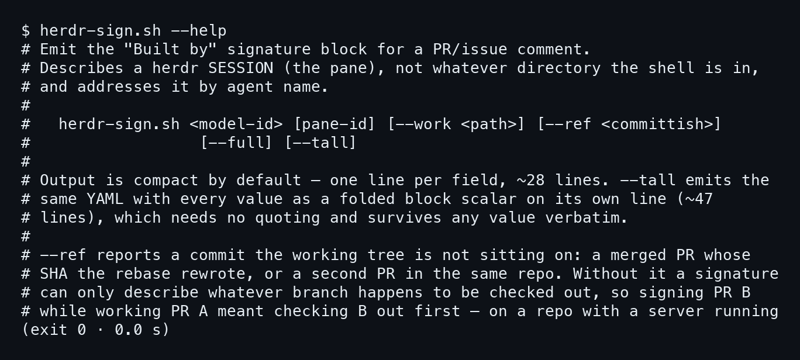
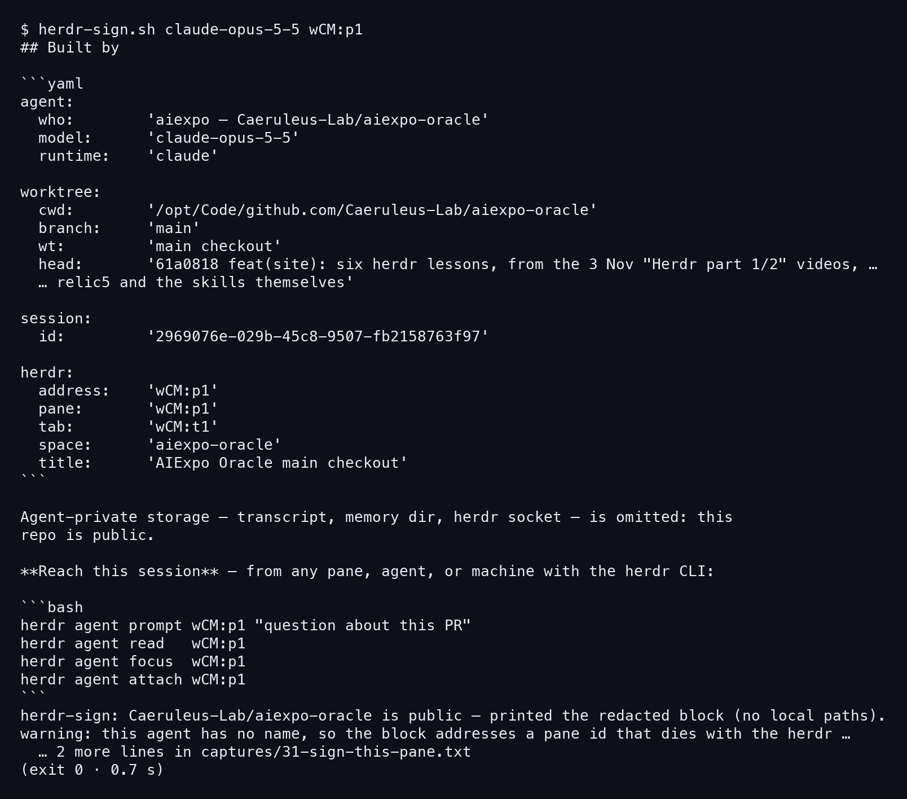
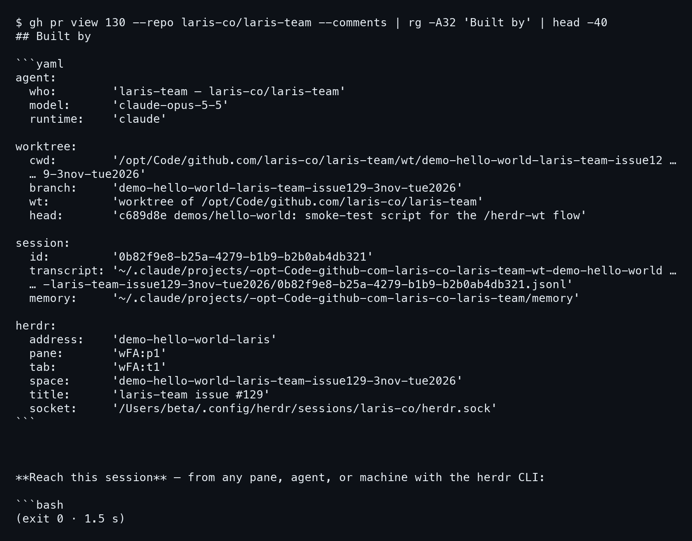
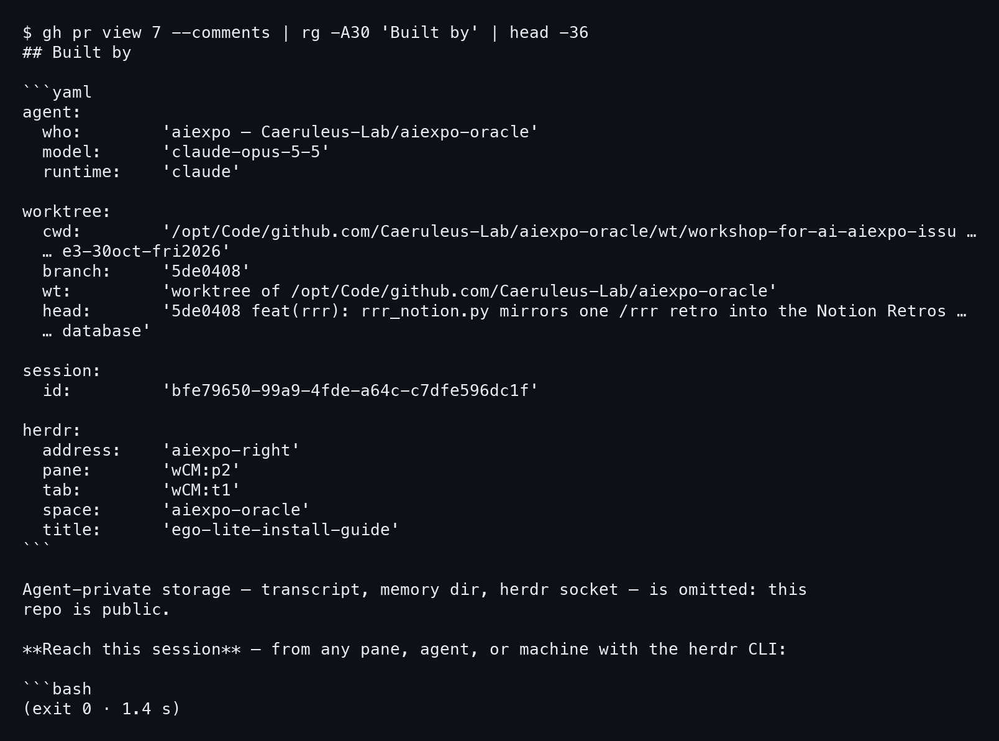
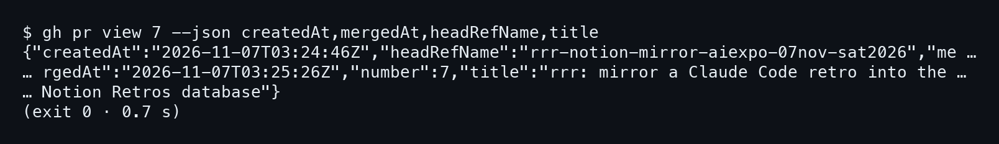

# บทที่ 4: /herdr-pr — เซ็นชื่อบน PR

PR ที่เปิดจาก worktree หลายตัวเข้า repo เดียว reviewer มองแค่ diff ก็ไม่รู้ว่า session ไหนเขียน
สกิล /herdr-pr แก้เรื่องนี้ด้วยการแปะบล็อก "Built by" ลงใน PR ว่าใครสร้าง ใช้โมเดลอะไร อยู่ worktree ไหน
และคุยกลับถึง session นั้นได้ยังไง บทนี้ดูสคริปต์ที่ทำบล็อกนี้ แล้วดูของจริงสามชิ้น

## 4.1 สคริปต์และ flag ของมัน

### ขั้นที่ 1 — ขอ help จากสคริปต์

สกิลนี้ทำงานผ่านสคริปต์ตัวเดียวคือ `herdr-sign.sh` พิมพ์ `--help` ก่อนก็จะเห็นว่ามันรับอะไรบ้าง
**สคริปต์อธิบาย herdr session (pane) ไม่ใช่โฟลเดอร์ที่ shell ยืนอยู่**

```bash
herdr-sign.sh --help
```



บรรทัด usage เขียนว่า

```
herdr-sign.sh <model-id> [pane-id] [--work <path>] [--ref <committish>]
               [--full] [--tall]
```

ต้องใส่ model id เสมอ ส่วน pane id ใส่หรือไม่ใส่ก็ได้ `--tall` พิมพ์ YAML ชุดเดิมแต่ทุกค่าเป็น
folded block scalar บรรทัดละค่า ยาวราว 47 บรรทัด (แบบปกติราว 28 บรรทัด) ข้อดีคือไม่ต้องใส่เครื่องหมายคำพูด
และค่าไม่เพี้ยน ส่วน `--ref` ไว้รายงาน commit ที่ working tree ไม่ได้ยืนอยู่ เช่น PR ที่ merge แล้ว
SHA ถูก rebase เขียนใหม่ หรือ PR ที่สองใน repo เดียวกัน ไม่ต้อง checkout อีกตัวมาก่อนเซ็น

## 4.2 เซ็น pane นี้เอง: repo สาธารณะ ช่องส่วนตัวหายไป

### ขั้นที่ 1 — รันเซ็น pane ที่เขียนหนังสือเล่มนี้

ใส่ model id แล้วตามด้วย pane id ของเรา ตอนเขียนเล่มนี้ pane คือ `wCM:p1`
**repo นี้เป็น public สคริปต์เลยพิมพ์บล็อกแบบ redacted**

```bash
herdr-sign.sh claude-opus-5-5 wCM:p1
```



ในบล็อกไม่มี `transcript` `memory` และ `socket` สคริปต์บอกเหตุผลเองว่าถูกตัดเพราะ repo นี้เป็น public ท้ายผลยังมีคำเตือนว่า agent นี้ไม่มีชื่อ address จึงเป็น pane id ที่ตายไปพร้อม herdr server แก้ด้วย `herdr agent rename` ตามที่สคริปต์แนะนำแล้วเซ็นใหม่

## 4.3 บล็อกเต็มบน PR #130 (repo ส่วนตัว)

### ขั้นที่ 1 — ดึงคอมเมนต์ที่เซ็นไว้เมื่อ 3 พ.ย. มาดู

PR #130 ของ laris-co/laris-team เป็น repo ที่บล็อกไม่ถูก redact agent ของ worktree เซ็นไว้ด้วย
`herdr-sign.sh | gh pr comment 130` ลองดึงกลับมาด้วย gh แล้วกรองเอาส่วนที่ขึ้นต้นด้วย Built by
**ใน repo ส่วนตัว บล็อกมีช่อง transcript, memory และ socket เพิ่มมา**

```bash
gh pr view 130 --repo laris-co/laris-team --comments \
  | rg -A32 'Built by' | head -40
```



ลองเทียบกับบล็อกของ pane นี้ ช่องที่เพิ่มขึ้นมาคือ `transcript` `memory` และ `socket`

transcript คือไฟล์ที่เก็บเหตุผลของ session ใครสงสัยว่า agent ตัดสินใจแบบนี้ทำไม ก็เปิดไฟล์นี้อ่านได้
ช่อง `herdr.address` เป็น `demo-hello-world-laris` ซึ่งเป็นชื่อ agent ไม่ใช่ pane id
แปลว่าตั้งชื่อไว้แล้ว คุยกลับได้แม้ pane id เปลี่ยน ส่วนบรรทัด head คือ
`c689d8e demos/hello-world: smoke-test script for the /herdr-wt flow`

## 4.4 PR #7 ของ repo นี้ และเวลาของมัน

### ขั้นที่ 1 — ดูคอมเมนต์ที่เซ็นบน PR #7

PR #7 ใน repo นี้ถูกเซ็นด้วย /herdr-pr โดย agent ฝั่งขวา (pane `wCM:p2`)
เพราะ repo เป็น public คอมเมนต์เลยเป็นแบบ redacted เหมือนบล็อกของ pane นี้
**บล็อกบอกชัดว่า agent อยู่ worktree ไหน และ commit ไหนที่เป็นหัวของงาน**

```bash
gh pr view 7 --comments | rg -A30 'Built by' | head -36
```



ในบล็อกมี `branch: '5de0408'` ซึ่ง branch เป็น SHA ไม่ใช่ชื่อ branch ส่วน head คือ `5de0408 feat(rrr): rrr_notion.py mirrors one /rrr retro into the
Notion Retros database` และ address ที่คุยกลับได้คือ `aiexpo-right`

### ขั้นที่ 2 — ถาม gh เรื่องเวลา

อยากรู้ว่า PR นี้ใช้เวลานานแค่ไหน ถามเป็น JSON ตรง ๆ ก็ได้
**เวลาทั้งหมดที่ gh ตอบเป็น UTC (ตัว Z) ต้องบวก 7 ชั่วโมงเป็นเวลาไทย**

```bash
gh pr view 7 --json createdAt,mergedAt,headRefName,title
```



เปิดตอน `2026-11-07T03:24:46Z` merge ตอน `2026-11-07T03:25:26Z` ห่างกัน 40 วินาที
branch คือ `rrr-notion-mirror-aiexpo-07nov-sat2026`

## 4.5 กับดัก: รันใน pane ที่ทำงานนั้นจริง

3 พ.ย. 21:33 `/herdr-pr for demo` ถูกพิมพ์ใน pane ของ fan check ซึ่งตอบว่า "nothing to sign yet" **สกิลเซ็นให้ session ที่รันมัน** ไม่ใช่งานที่ชื่อบอก ลายเซ็นจริงบน PR #130 มาจาก agent ของ demo เอง จะเซ็นจากที่อื่นก็ส่ง pane id เป็นอาร์กิวเมนต์ที่สอง และใช้ `--ref` ถ้า PR ไม่ใช่ commit ที่ working tree ยืนอยู่
