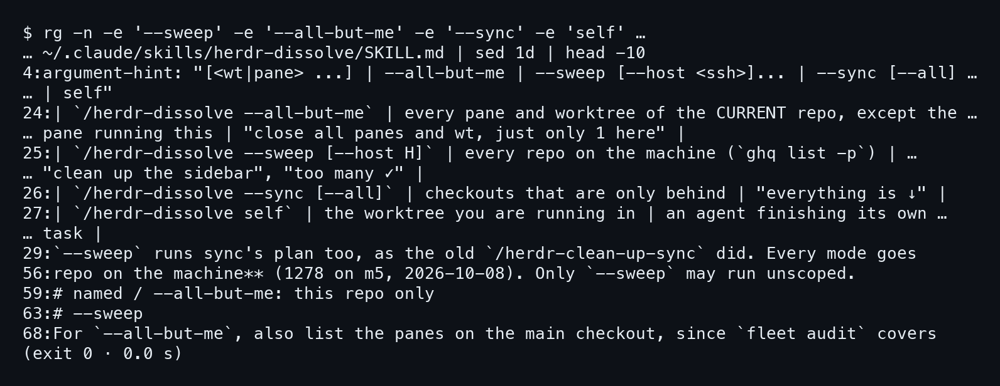
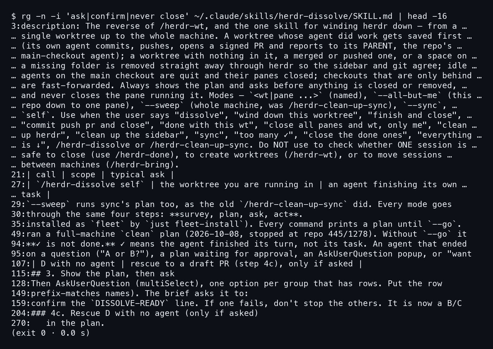
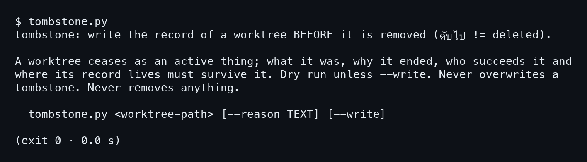
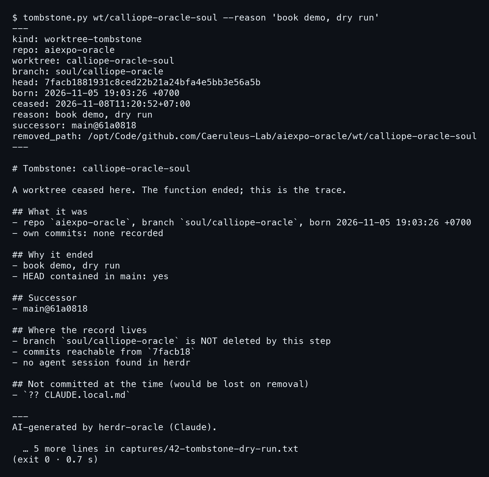
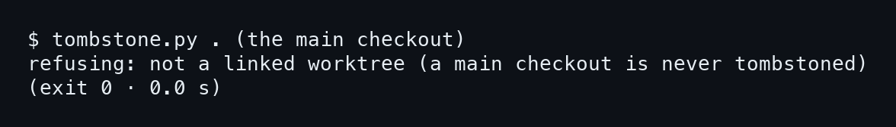
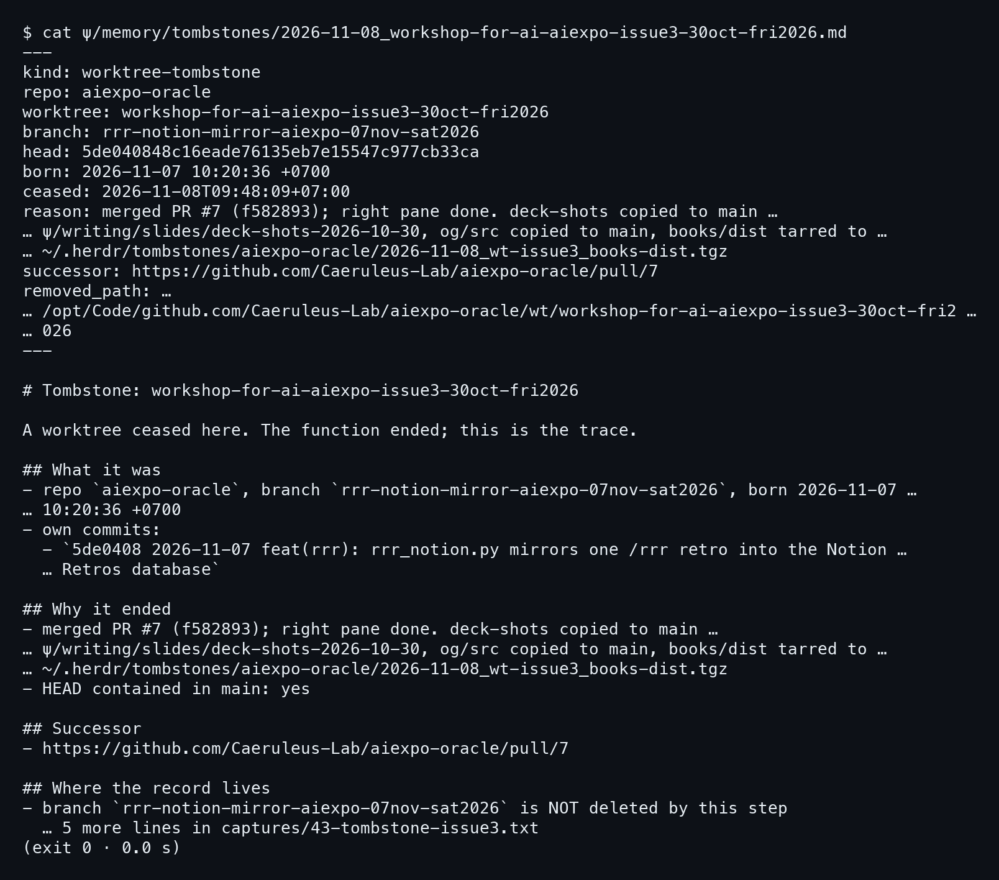
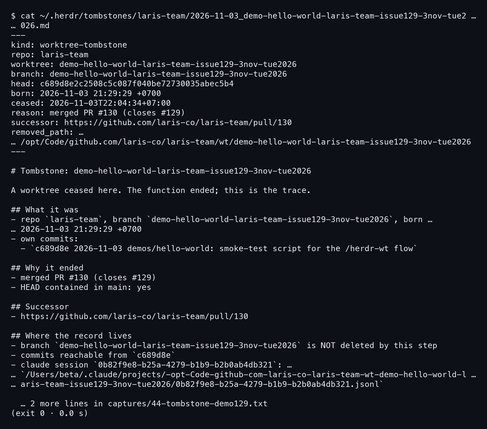
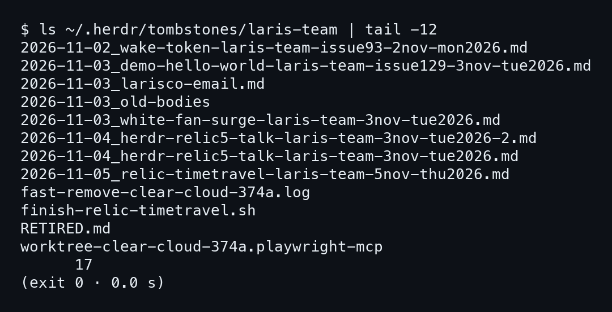

# บทที่ 5: /herdr-dissolve — ปิดงานโดยไม่ทิ้งอะไร

งานที่เปิดด้วย /herdr-wt ต้องมีวันปิด และตอนปิดมักมีของค้างใน worktree บทนี้ดูว่า /herdr-dissolve
ปิดยังไงโดยไม่ทำของหาย ตามหลัก Nothing is Deleted

## 5.1 โหมดทั้งห้า และการถามก่อนทำ

### ขั้นที่ 1 — ดูว่าเรียกได้กี่แบบ

ใช้ `rg` หาชื่อโหมดใน SKILL.md สกิลเดียวรับตั้งแต่ worktree เดียวไปจนถึงทั้งเครื่อง **ต่างกันแค่ขอบเขตที่ส่งให้**

```bash
rg -n -e '--sweep' -e '--all-but-me' -e '--sync' -e 'self' \
  ~/.claude/skills/herdr-dissolve/SKILL.md | sed 1d | head -10
```



ตารางในสกิลสรุปไว้ห้าแบบ ได้แก่ ชื่อ wt หรือ pane (named), `--all-but-me`, `--sweep`, `--sync`
และ `self`


`self` คือ agent ปิดงานตัวเอง ส่วน `--sweep` คือของเดิมชื่อ /herdr-clean-up-sync ที่ถูกรวมเข้ามา
บรรทัดที่ 56 ของสกิลบอกว่า repo บน m5 มี 1278 ตัว (นับเมื่อ 2026-10-08)
ก็เลยมีแค่ `--sweep` ที่อนุญาตให้รันแบบไม่จำกัด repo

### ขั้นที่ 2 — หาจุดที่สกิลหยุดถาม

ทุกโหมดเดินสี่จังหวะเหมือนกัน คือ survey, plan, ask, act ลองหาคำว่า ask กับ confirm ในไฟล์เดียวกัน
เพื่อดูว่าสกิลหยุดตรงไหน

```bash
rg -n -i 'ask|confirm|never close' \
  ~/.claude/skills/herdr-dissolve/SKILL.md | head -16
```



หัวข้อ `## 3. Show the plan, then ask` อยู่บรรทัดที่ 115 และ description ก็บอกว่าสกิลแสดงแผนและถามก่อนปิดหรือถอดอะไรทั้งนั้น
พอถึงจังหวะนั้นมันเปิด AskUserQuestion แบบเลือกได้หลายข้อ หนึ่งตัวเลือกต่อหนึ่งกลุ่มที่มีแถว
และไม่ปิด pane ที่ตัวเองรันอยู่ด้วย

> สกิลนี้ไม่ลบอะไรก่อนที่คนจะเห็นแผน

อีกจุดที่น่าจำคือบรรทัดที่ 94 ของสกิล ที่บอกว่า **เครื่องหมายติ๊กถูกในแถบข้างไม่ได้แปลว่างานเสร็จ**
ติ๊กถูกแปลว่า agent จบ turn ของมัน ถ้า agent ไปจบที่คำถามค้างอยู่ สกิลก็ไม่นับว่าพร้อมปิด

## 5.2 tombstone.py: ซ้อมก่อน เขียนจริงทีหลัง

### ขั้นที่ 1 — อ่าน help ของ tombstone.py

ก่อน worktree หายไป สกิลเรียก tombstone.py เขียนบันทึกไว้ก่อน ลองสั่งโดยไม่ใส่อาร์กิวเมนต์
เพื่ออ่านว่ามันสัญญาอะไรไว้

```bash
tombstone.py
```



ข้อความตรงนี้สำคัญสามประโยค

```
Dry run unless --write. Never overwrites a tombstone.
Never removes anything.
  tombstone.py <worktree-path> [--reason TEXT] [--write]
```

**ไม่ใส่ `--write` คือแค่ซ้อม** สคริปต์ไม่เขียนทับของเดิม และไม่ลบอะไรเลย
การลบ worktree เป็นงานของ herdr ในจังหวะถัดไป ไม่ใช่ของสคริปต์นี้

### ขั้นที่ 2 — ลองกับ worktree จริงของ repo นี้

ใน repo นี้มี worktree ชื่อ calliope-oracle-soul อยู่ในโฟลเดอร์ `wt/` เลยใช้มันเป็นตัวอย่าง
สั่งแบบไม่ใส่ `--write` เพราะฉะนั้นไม่มีอะไรถูกเขียนและไม่มีอะไรถูกลบ

```bash
tombstone.py wt/calliope-oracle-soul --reason 'book demo, dry run'
```



ผลออกมาเป็น Markdown เต็มใบ มี frontmatter บอก branch (`soul/calliope-oracle`) วันเกิด
`2026-11-05 19:03:26 +0700` เวลาที่ดับ ผู้สืบต่อ (`main@61a0818`) และ path ที่จะถูกถอด
ส่วนท้ายสุดคือสามบรรทัดที่ควรอ่านก่อนอย่างอื่น

```
destination: …/ψ/memory/tombstones/2026-11-08_calliope-oracle-soul.md
BLOCKER: 1 uncommitted/untracked file(s) would be LOST on removal
dry run - add --write to save it
```

**BLOCKER บอกว่ามีไฟล์ที่ยังไม่ commit** ในกรณีนี้คือ `CLAUDE.local.md` ซึ่งจะหายถ้าถอด worktree
นี่คือประโยชน์ของการซ้อม คือเห็นของที่จะหายก่อนลงมือ ส่วนหัวข้อ "Where the record lives"
ก็ระบุว่า branch ไม่ถูกลบ และ commit ยังเข้าถึงได้จาก `7facb18`

## 5.3 ปฏิเสธ main checkout

### ขั้นที่ 1 — สั่งกับ main checkout

main checkout ไม่ใช่ worktree ที่ควรถูกเก็บเป็นอนุสรณ์ ลองสั่งที่โฟลเดอร์ปัจจุบัน
ซึ่งเป็น main ของ repo เพื่อดูว่าสคริปต์กันไว้ไหม

```bash
tombstone.py .
```



```
refusing: not a linked worktree (a main checkout is never tombstoned)
```

มันตอบสั้นๆ ว่าไม่ทำ และ **main checkout ไม่เคยถูก tombstone** สคริปต์รู้ได้เพราะ main เป็นรายการแรกของลิสต์
ไม่ใช่ linked worktree ส่วนรายละเอียดว่าตรวจยังไง ไปอ่านต่อในบทที่ 6

## 5.4 สอง tombstone จริง

### ขั้นที่ 1 — worktree issue3 ของวันนี้

วันที่ 8 พ.ย. worktree `workshop-for-ai-aiexpo-issue3-30oct-fri2026` จบงานหลัง PR #7 merge
herdr ล็อกมันไว้ตั้งแต่ 30 ต.ค. agent ที่ main checkout เลยต้องปลดล็อกแล้วถอดจากข้างนอก
ก่อนถอดมีของค้างสามอย่าง สองอย่างแรก copy ไป main คือ og/src กับ deck-shots ที่ยังไม่ track (PNG 17 ไฟล์ กับ deck_report.json)
ส่วน books/dist ขนาด 61 MB ที่ถูก ignore ก็ tar เก็บไว้ที่ `~/.herdr/tombstones`
เปิดบันทึกที่ได้ออกมาอ่าน

```bash
cat ψ/memory/tombstones/\
2026-11-08_workshop-for-ai-aiexpo-issue3-30oct-fri2026.md
```



**ช่อง reason คือที่เก็บเรื่องราว** มันเขียนว่า merged PR #7 (f582893) พร้อมบอกว่าอะไรถูก copy
และอะไรถูก tar ไปไว้ที่ไหน ช่อง successor ชี้ไปที่ PR #7 ส่วน own commits มีหนึ่งรายการ
(`5de0408` rrr_notion.py) และบรรทัด "HEAD contained in main: yes" ยืนยันว่า commit นี้อยู่ใน main แล้ว
branch `rrr-notion-mirror-aiexpo-07nov-sat2026` ยังอยู่ ไม่ถูกลบ

### ขั้นที่ 2 — demo เมื่อ 3 พ.ย.

อีกใบมาจากงาน demo ใน laris-team (บทที่ 2) เก็บไว้ที่ `~/.herdr/tombstones/laris-team` ตามแบบเดียวกัน
เปิดดูเทียบกัน

```bash
cat ~/.herdr/tombstones/laris-team/\
2026-11-03_demo-hello-world-laris-team-issue129-3nov-tue2026.md
```



ใบนี้เกิด `2026-11-03 21:29:29 +0700` และดับ `2026-11-03T22:04:34+07:00` เหตุผลคือ
"merged PR #130 (closes #129)" ตรงกับที่ relic5 บันทึกไว้ว่า merge ตอน 22:05
สิ่งที่ใบนี้มีและใบ issue3 ไม่มีคือบรรทัด claude session
(`0b82f9e8-b25a-4279-b1b9-b2b0ab4db321`) พร้อม path ของไฟล์ jsonl **จึงย้อนกลับไปอ่านบทสนทนาของ agent ตัวนั้นได้**
ส่วนใบ issue3 เขียนว่า "no agent session found in herdr"

## 5.5 ชั้นวาง tombstone

### ขั้นที่ 1 — ดูชั้นวางของ laris-team

tombstone มีสองชั้นวาง ชั้นใน home อยู่ที่ `~/.herdr/tombstones/<repo>/` ส่วนชั้นของ repo อยู่ที่ `ψ/memory/tombstones/`
ลอง `ls` ดูแค่ 12 ชื่อท้ายสุดของ laris-team

```bash
ls ~/.herdr/tombstones/laris-team | tail -12
```



ชื่อไฟล์ขึ้นต้นด้วยวันที่ จึงเรียงตามเวลาอยู่ในตัว มีใบของ 2026-11-03 สี่ใบอยู่ใกล้กัน รวมถึง
demo-hello-world ที่อ่านไปเมื่อกี้ และ white-fan-surge ซึ่งเป็น worktree ที่ถูกถอดตอน 21:37
**บนชั้นเดียวกันยังมีของที่ไม่ใช่ tombstone ปนอยู่** เช่น log, สคริปต์ finish-relic-timetravel.sh
และ RETIRED.md

> Tombstone คือร่องรอย หน้าที่ของ worktree จบลง แต่เรื่องราวของมันยังอยู่

สรุปบทนี้ไว้ในประโยคเดียวนั้นพอ ส่วนในบทหน้าจะแกะไส้ในของสองสคริปต์ คือ herdr-sign.sh ที่ตัดสิน
ว่าจะพิมพ์ฟิลด์ไหนตามความเป็นส่วนตัวของ repo และ tombstone.py ที่เพิ่งใช้ไป
