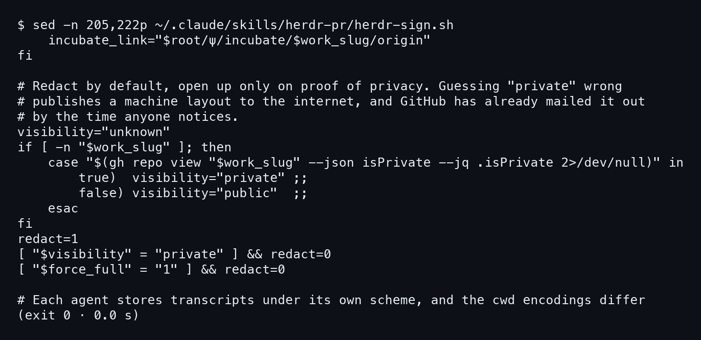
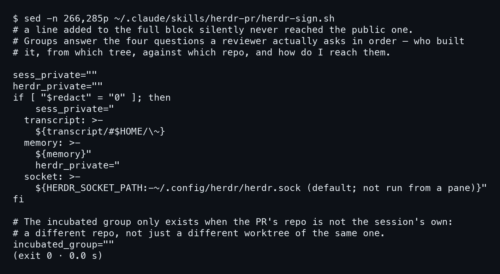
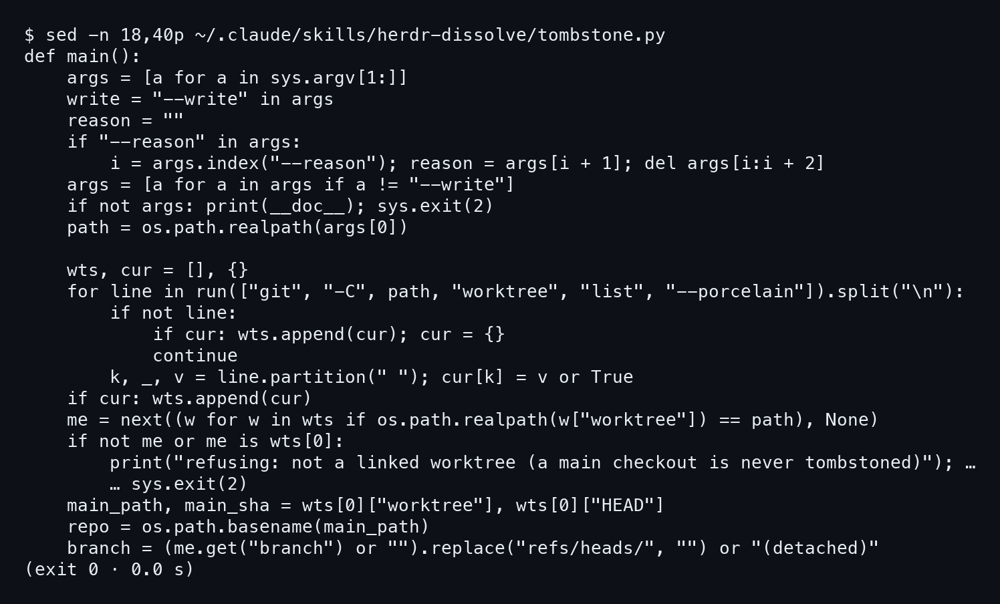
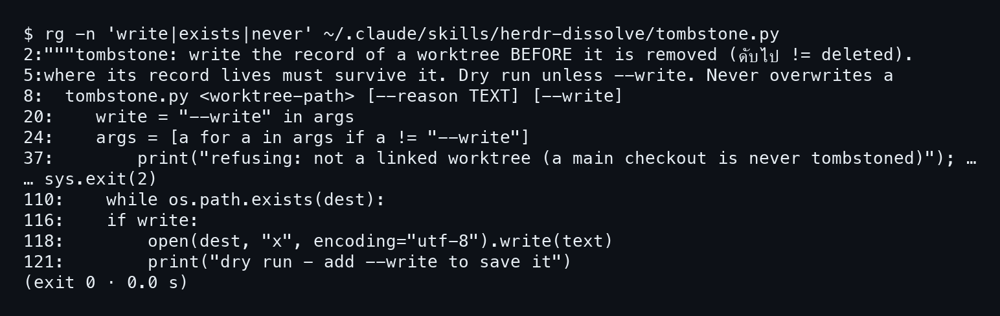
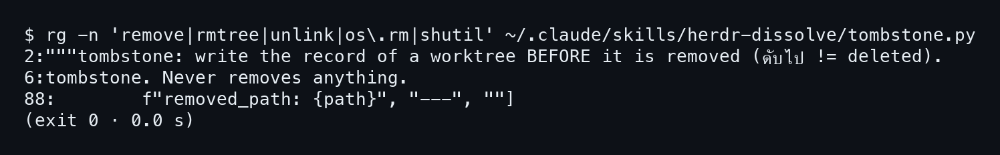

# บทที่ 6: แกะไส้ในสองสคริปต์

สี่บทที่ผ่านมาเราใช้สกิลจากข้างนอก พิมพ์คำสั่งแล้วดูผล บทนี้เปิดฝาดูข้างใน
สองสคริปต์ที่ทำงานหนักที่สุดคือ `herdr-sign.sh` ของ /herdr-pr กับ `tombstone.py`
ของ /herdr-dissolve เราจะอ่านทีละบรรทัดจากชิ้นที่ตัดมาจริง ไม่เดาและไม่เติม
ถ้าอยากเห็นทุกบรรทัดของไฟล์ ให้เปิดภาคผนวก `09-code.md` ซึ่งเก็บโค้ดเต็มทั้งสี่สกิลไว้

## 6.1 herdr-sign.sh ตัดสินจากความเป็น public ว่าจะพิมพ์แค่ไหน

### ขั้นที่ 1 — อ่านบล็อกที่ถาม GitHub ว่า repo เป็น private ไหม

เปิดไฟล์ช่วงบรรทัด 205 ถึง 222 ด้วย `sed -n`
ช่วงนี้คือจุดที่สคริปต์ตัดสินว่าบล็อกที่ตัวเองกำลังจะพิมพ์ จะเปิดข้อมูลบนเครื่องหรือไม่

```bash
sed -n 205,222p ~/.claude/skills/herdr-pr/herdr-sign.sh
```



ตัวแปรเริ่มต้นคือ `visibility="unknown"` สคริปต์เรียก
`gh repo view "$work_slug" --json isPrivate --jq .isPrivate`
แล้ว `case` ดูคำตอบ มีสองทางเท่านั้นที่เปลี่ยนค่า คือ `true` ได้ `private`
กับ `false` ได้ `public` ถ้า `gh` ล้ม หรือไม่มี `$work_slug` ค่าก็ค้างที่ `unknown`
**ค่าเริ่มต้นคือปิด ต้องมีหลักฐานว่าเป็น private ถึงจะเปิด** ตรงนี้คอมเมนต์ของสคริปต์เองก็บอกเหตุผลไว้
(เดาว่า private ผิด = เอาโครงเครื่องไปประกาศบนอินเทอร์เน็ต)

### ขั้นที่ 2 — ดูสองบรรทัดที่ตั้ง redact

อ่านต่อสองบรรทัดท้าย ๆ ของชิ้นเดียวกัน

```
redact=1
[ "$visibility" = "private" ] && redact=0
[ "$force_full" = "1" ] && redact=0
```

`redact=1` ตั้งไว้ก่อนเสมอ แล้วมีแค่สองเงื่อนไขที่ลดเป็น 0
เงื่อนไขแรกคือ visibility เท่ากับ `private` พอดี `unknown` กับ `public` ไม่ผ่าน
เงื่อนไขที่สองคือ `--full` ซึ่งตั้ง `force_full` ให้คนที่รู้ดีกว่าสคริปต์ สั่งทับได้เอง
บทที่ 4 เราเห็นผลของสองบรรทัดนี้มาแล้ว repo นี้ public บล็อกของ pane นี้เลยออกมาแบบ redact

## 6.2 ฟิลด์ที่มีแต่ private repo เท่านั้นที่ได้

### ขั้นที่ 1 — อ่านว่าฟิลด์ไหนถูกกั้นไว้หลัง redact

ไปที่บรรทัด 266 ถึง 285 ตรงนี้สคริปต์ประกอบสองก้อนข้อความ `sess_private` กับ `herdr_private`
ทั้งสองเริ่มเป็นสตริงว่าง

```bash
sed -n 266,285p ~/.claude/skills/herdr-pr/herdr-sign.sh
```



พอ `redact` เป็น 0 ก้อนแรกถึงได้ `transcript` กับ `memory` ก้อนที่สองได้ `socket`
(ค่าจาก `HERDR_SOCKET_PATH` หรือค่า default) ถ้า `redact` ยังเป็น 1 สองก้อนนี้ว่างต่อไป
บล็อกสาธารณะเลยไม่มีทั้งสามฟิลด์ **ฟิลด์ที่บอกว่าไฟล์อยู่ที่ไหนในเครื่อง มีเฉพาะบล็อกของ repo ที่พิสูจน์แล้วว่าเป็นส่วนตัว**
สังเกตว่า transcript ถูกแปลง `$HOME` เป็น `~` ก่อนพิมพ์ด้วย

คอมเมนต์ด้านบนของชิ้นนี้ยังเล่าที่มาของโครงสร้างนี้ด้วย
แต่ก่อนมีบล็อก full กับบล็อก public แยกกันสองก้อน บรรทัดที่เติมลง full เงียบ ๆ ไม่เคยไปถึง public
ตอนนี้ทั้งสองบล็อกมาจากแม่แบบเดียว ต่างกันแค่สองตัวแปรนี้ว่างหรือไม่ว่าง
อ่านโค้ดทั้งไฟล์ได้ที่ `09-code.md` ส่วน herdr-pr

## 6.3 tombstone.py หา worktree แล้วปฏิเสธ main checkout

### ขั้นที่ 1 — อ่านวิธีหา worktree จาก porcelain

ฝั่ง /herdr-dissolve เปิด `tombstone.py` บรรทัด 18 ถึง 40 ซึ่งเป็นต้นของ `main()`

```bash
sed -n 18,40p ~/.claude/skills/herdr-dissolve/tombstone.py
```



สคริปต์รับ path ตัวแรกแล้วทำ **`os.path.realpath` ก่อน** เพื่อให้ symlink ไม่หลอกการเทียบ
จากนั้นรัน `git -C path worktree list --porcelain` ผลลัพธ์แยกเป็นก้อนด้วยบรรทัดว่าง
ลูปเก็บแต่ละก้อนเป็น dict โดยตัดบรรทัดที่ช่องว่างแรก ได้ key เช่น `worktree`, `HEAD`, `branch`
แล้วหา `me` คือก้อนที่ realpath ของ `worktree` ตรงกับ path ที่ได้รับ

### ขั้นที่ 2 — ดูเงื่อนไขปฏิเสธ

บรรทัดที่สำคัญที่สุดของชิ้นนี้คือ

```
    if not me or me is wts[0]:
        print("refusing: not a linked worktree (a main checkout …")
```

`git worktree list` พิมพ์ main checkout เป็นรายการแรกเสมอ สคริปต์เลยใช้ `me is wts[0]` เป็นตัวตัดสิน
ไม่ต้องเดาจากชื่อโฟลเดอร์ และถ้าหา `me` ไม่เจอ (path ไม่ใช่ worktree เลย) ก็ปฏิเสธด้วยข้อความเดียวกัน
**ทั้งสองกรณีออกด้วย `sys.exit(2)` ก่อนจะทำอะไรต่อ** หลังผ่านด่านนี้ถึงอ่าน `main_path`, `main_sha`
ชื่อ repo จาก `basename` และชื่อ branch ที่ตัด `refs/heads/` ออก
ถ้า detached ก็ขึ้น `(detached)` บทที่ 5 เรารันด่านนี้กับ main checkout จริงแล้วเห็นข้อความนี้ออกมา
ส่วน exit 0 ที่เห็นในภาพนั้นเป็นของ wrapper ที่เรียกสคริปต์ ไม่ใช่ค่าที่ `sys.exit(2)` คืนมา

## 6.4 ไม่เขียนทับ ไม่ลบ เขียนเมื่อสั่ง --write เท่านั้น

### ขั้นที่ 1 — ค้นคำที่เกี่ยวกับการเขียนทั้งไฟล์

ไฟล์ยาวเกินจะอ่านทีละบรรทัดในหน้าเดียว เราเลยใช้ `rg` ดึงเฉพาะบรรทัดที่มีคำว่า
`write`, `exists` หรือ `never`

```bash
rg -n 'write|exists|never' ~/.claude/skills/herdr-dissolve/tombstone.py
```



เรียงตามเลขบรรทัดแล้วเห็น **สามจุดที่คุมการเขียน**
บรรทัด 5 ใน docstring บอกว่า `Dry run unless --write. Never overwrites`
บรรทัด 20 กับ 24 เก็บ `write = "--write" in args` แล้วกรอง flag ออกจาก args
บรรทัด 110 มี `while os.path.exists(dest):` ซึ่งหาชื่อไฟล์ใหม่เมื่อชื่อเดิมถูกใช้แล้ว

### ขั้นที่ 2 — อ่านท้ายไฟล์ที่เขียนจริง

สองบรรทัดสุดท้ายในผลคือหัวใจ

```
118:        open(dest, "x", encoding="utf-8").write(text)
121:        print("dry run - add --write to save it")
```

`if write:` ที่บรรทัด 116 คือประตูเดียว ถ้าไม่ใส่ `--write` สคริปต์พิมพ์ข้อความ dry run แล้วจบ
ถ้าใส่ ก็เปิดไฟล์ด้วยโหมด `"x"` ซึ่ง Python จะล้มทันทีถ้าไฟล์มีอยู่แล้ว
**สองชั้นกันเขียนทับ คือลูป `os.path.exists` หาชื่อใหม่ กับโหมด `"x"` ที่ปฏิเสธไฟล์เดิม**
rg ชุดแรกค้นแค่ `write|exists|never` เลยยังพิสูจน์ไม่ได้ว่าไม่มีคำสั่งลบ ขั้นต่อไปค้นคำพวกนั้นตรง ๆ

### ขั้นที่ 3 — ค้นหาคำสั่งลบทั้งไฟล์

ค้นคำที่เกี่ยวกับการลบไฟล์ ได้แก่ `remove`, `rmtree`, `unlink`, `os.rm` และ `shutil`

```bash
rg -n 'remove|rmtree|unlink|os\.rm|shutil' \
  ~/.claude/skills/herdr-dissolve/tombstone.py
```



มีแค่สามบรรทัดที่ตรง บรรทัด 2 กับ 6 เป็น docstring ที่เขียนว่า `Never removes anything` และบรรทัด 88 เป็นข้อความ `removed_path:` ที่เขียนลงบันทึก **ไม่มีคำสั่งลบจริงสักบรรทัด** สคริปต์นี้ทำหน้าที่จดบันทึก
ส่วนการถอด worktree จริงเป็นงานของสกิลที่เรียกมัน หลังจากแสดงแผนและถามคนก่อน

ตอนนี้เราเห็นทั้งสองสคริปต์ว่าระวังเรื่องเดียวกัน คือถ้าไม่แน่ใจ ให้ทำน้อยที่สุด
บทหน้ารวมสิ่งที่พลาดจริงตลอดงานนี้ พร้อมการ์ดสรุปใบเดียว
