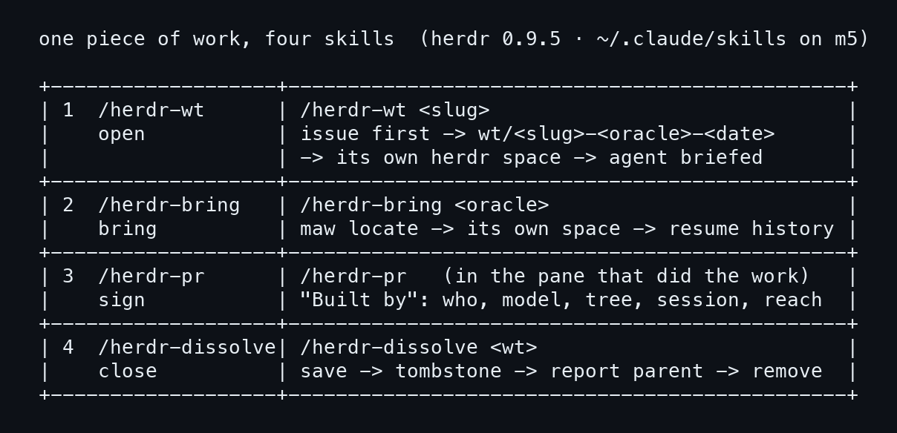
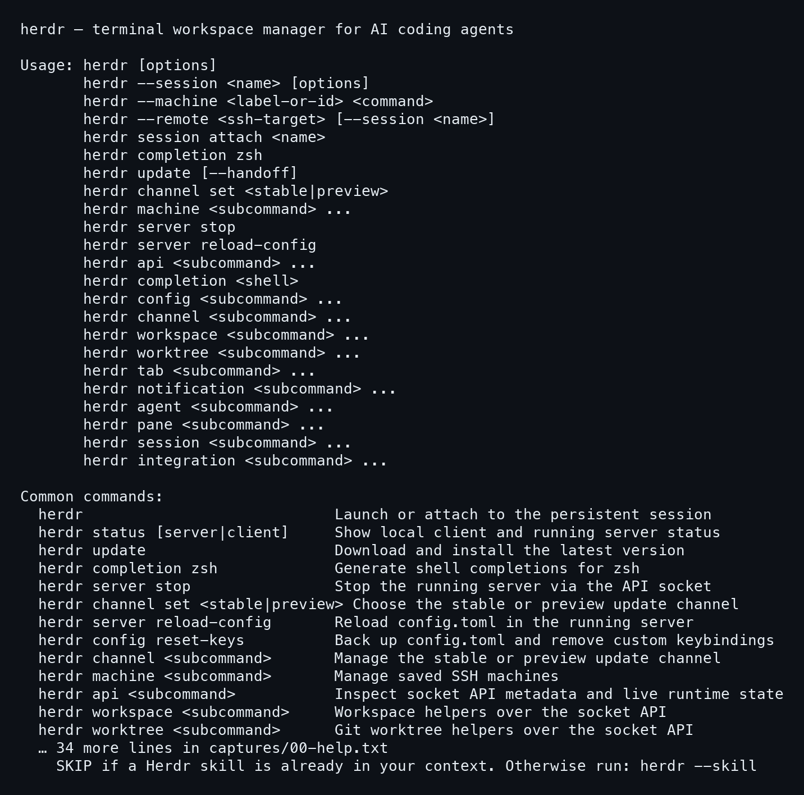
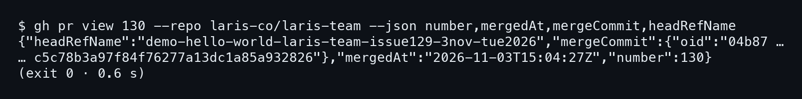
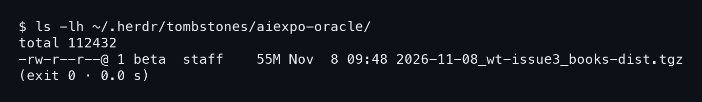

# บทที่ 7: กับดักที่เจอจริง และการ์ดสรุป

บทนี้เริ่มด้วยการ์ดสรุปแผ่นเดียว แล้วไปดูทางที่พลาดกัน ทุกข้อเกิดขึ้นจริง
ที่ 3 พ.ย. ตอนเดโม `demo-hello-world` กับ `bring neo` และที่ 8 พ.ย. ตอนปิด
worktree ของ issue #3 แต่ละข้อเขียนเป็นสามท่อน: เกิดอะไร, สาเหตุ, วิธีแก้

## การ์ดสรุปหนึ่งใบ

### ขั้นที่ 1 — ดูสี่ skill ในตารางเดียว

เปิดการ์ดนี้เมื่อลืมว่าต้องพิมพ์อะไร แต่ละแถวคือหนึ่ง skill: คำสั่ง, ท่อนที่
มันทำ และเงื่อนไขสำคัญ **ข้อที่ต้องจำที่สุดคือ /herdr-pr ต้องพิมพ์ใน pane ที่ทำงานเอง**
ซึ่งก็คือกับดักข้อแรกของบทนี้



ภาพนี้ให้เห็นลำดับ open, bring, sign, close ในหน้าเดียว

### ขั้นที่ 2 — ที่เหลือถาม herdr --help

เรื่องอื่นนอกสี่ skill เช่น `herdr worktree`, `herdr pane`, `herdr agent`,
`herdr machine` ให้ถาม help ของ herdr เอง **ทุกกลุ่มคำสั่งมี subcommand ของตัวเอง**
และหน้านี้คือแผนที่ของทั้งหมด

พิมพ์ `herdr --help` แล้วบรรทัดแรกที่เห็นคือ:

```
herdr — terminal workspace manager for AI coding agents
```



ท้ายหน้ามีบรรทัดบอก agent ว่าถ้างานคือควบคุม pane ให้รัน `herdr --skill`
เพื่อพิมพ์ไฟล์ skill ออกมาอ่าน

## กับดักหกข้อ

### ขั้นที่ 1 — /herdr-pr พิมพ์ผิด pane

ที่ 3 พ.ย. เวลา 21:33 Nat พิมพ์ `/herdr-pr for demo` ลงใน pane ของงาน
fan check บน white ไม่ใช่ pane ที่ทำเดโม pane นั้นตอบว่า "nothing to sign
yet" **สาเหตุคือ /herdr-pr เซ็นจากสิ่งที่ pane ตัวเองทำ** ใน pane ที่ไม่ได้ทำ
อะไรก็ไม่มีอะไรให้เซ็น

(บันทึก relic5 ของคืนนั้นอยู่ในบทที่ 2 หัวข้อ 2.5)

วิธีแก้คือให้ agent ที่ทำงานเซ็นเอง ซึ่งก็เกิดขึ้นจริง agent ของเดโมโพสต์
ลายเซ็นบน PR #130 ด้วยตัวเอง:

```bash
herdr-sign.sh | gh pr comment 130
```

### ขั้นที่ 2 — /herdr-rename วิ่งใน worktree ที่สอง

เวลา 21:32 `/herdr-rename` ทำงานใน worktree ที่สอง (งาน fan check บน
white) ไม่ใช่ worktree ของเดโม ชื่อ `worktree/calm-field-2991` เลยกลายเป็น
`white-fan-surge-laris-team-3nov-tue2026` ส่วน branch ของเดโมยังใช้ชื่อเดิม
**สิ่งที่บันทึกบอกได้มีแค่นี้ คือ rename แก้ branch ของ worktree ที่มันรันอยู่**
ถ้าอยากรู้ว่า pane ไหนจะถูกแก้ ให้ดู `git branch --show-current` ใน pane นั้น
ก่อนสั่ง

### ขั้นที่ 3 — worktree ที่ล็อกและมี PR ยังไม่ merge จะไม่หายไป

หลัง `/herdr-dissolve` ตอน 21:35 worktree ของ fan check ถูกลบตอน 21:37 แต่
worktree ของเดโมยังอยู่ agent ของเดโมรัน dissolve แบบ self mode ซึ่งลบ
worktree ที่ตัวเองรันอยู่ไม่ได้ ขั้นสุดท้ายเลยเป็นของ pane host และ pane host
หยุดที่ **สองข้อ คือ PR ยังไม่ merge กับ worktree ถูกล็อกโดยตั้งใจ**

วิธีแก้คือ merge ก่อนแล้วค่อยปิด ตอน 22:01 Nat สั่ง "merge PR #130 and
dissolve it" 22:05 merge เป็น `04b87c5` issue #129 ปิด เขียน tombstone แล้ว
และลบ space wFA ออก นับจากเปิด issue ถึง merge ใช้เวลา 35 นาที

```bash
gh pr view 130 --repo laris-co/laris-team \
  --json number,mergedAt,mergeCommit,headRefName
```



### ขั้นที่ 4 — bring ไม่เจอ repo path

เวลา 22:06:40 และ 22:09:59 Nat พิมพ์ `/herdr-bring bring neo` สองรอบ agent
ตอบว่า `maw locate neo` ไม่คืน repo path และ Neo มีหลาย body อยู่แล้ว มัน
เลยไม่เดา แต่ถามกลับ 3 ข้อให้ Nat เลือก **สาเหตุคือ handle เดียวชี้ได้หลาย body**
วิธีแก้คือให้คนเลือก ส่วนวันนี้ (8 พ.ย.) `maw locate neo` คืน path ได้
แล้ว เรื่อง bring นี้เกิดคืนเดียวกับเดโม แต่ไม่ได้อยู่ในสายงานของ issue #129

### ขั้นที่ 5 — herdr-unpromote หยุดบน space ที่มี linked worktree

หลัง Nat เลือกข้อ 1 (รวม session `neo` ของ m5 เข้า laris-co ด้วย
`herdr-unpromote --session neo --to laris-co`) tool นี้ปิด neo-oracle main
ไม่ได้ **สาเหตุคือ space นี้มี linked worktree space ผูกอยู่** มันเลยหยุดที่นั่น

(บันทึก relic5 ของเรื่องนี้อยู่ในบทที่ 3)

agent แก้ด้วยมือ ด้วยการ resume neo-oracle main (`08f33511`) กับ
builder-neo (`840b12d9`) ทีละตัว ต่อมา `/herdr-promote neo back session`
ย้าย Neo กลับออกมา ตอนนั้น herdr-move ติดข้อจำกัดเดิมอีกรอบที่ neo main
agent จึงปิด space ด้วย `--group` ข้อนี้บอกว่า skill ที่หยุดแล้วบอกเหตุผล
ดีกว่าที่ลบของที่ยังมีของผูกอยู่

### ขั้นที่ 6 — โฟลเดอร์ที่ถูก ignore หนัก 61 MB ใน worktree

ตอนปิด worktree `workshop-for-ai-aiexpo-issue3-30oct-fri2026` ที่ 8 พ.ย. มี
สองอย่างที่ git ไม่เห็น ไฟล์ untracked คือ deck-shots (PNG 17 ไฟล์กับ
`deck_report.json`) และโฟลเดอร์ `books/dist` ที่ถูก ignore หนัก 61 MB
**สาเหตุคือ `git status` ไม่แสดงของที่ ignore** ลบ worktree แล้วของพวกนี้หายเงียบ ๆ

วิธีแก้คือเก็บก่อนลบ deck-shots ถูกคัดลอกไป main ส่วน `books/dist` ถูก tar
ไว้ ไฟล์ tarball ขนาด 55M:

```bash
ls -lh ~/.herdr/tombstones/aiexpo-oracle/
```



worktree นี้ถูก herdr ล็อกไว้ agent ของ main checkout จึงปลดล็อกแล้ว
ลบจากข้างนอก จากนั้นปิด pane ขวา wCM:p2 ส่วน branch เก็บไว้
## ต่อไป

บทต่อไปคือภาคผนวก โค้ดเต็มของสคริปต์ทั้งหมดที่เล่มนี้พูดถึง พิมพ์ครบทุก
บรรทัดตามต้นฉบับ ไว้ให้เปิดเทียบกับที่อ่านมา
