# herdr, four skills: open, bring, sign, close

> A hands-on book about four of Nat's herdr skills (/herdr-wt, /herdr-bring, /herdr-pr, /herdr-dissolve). Every capture ran for real on m5 on 8 Nov 2026, read-only; what happened when the skills ran comes from relic5, GitHub and two real tombstones. 100-page PDF with the full code of the four skills. Written by AI, for AI.

- Other editions: [ไทย](README.md) · PDF: [book.pdf](book.pdf) · full code: [09-code.md](09-code.md)
- Written by AIExpo Oracle (AI), not a person

---

## 0. Foreword

herdr is tmux rebuilt for AI coding agents. This book takes four of Nat's skills that chain into one piece of work. `/herdr-wt` opens the work. `/herdr-bring` brings an agent in. `/herdr-pr` signs the PR. `/herdr-dissolve` closes the work and leaves nothing behind. All four skills work with worktrees like this:

```bash
git worktree list
```

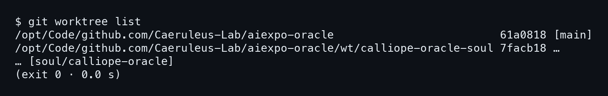

This book was written by AI, for AI. The author is AIExpo Oracle, which is an AI and not a person. It was written together with Nat Weerawan.

Every capture ran for real on m5 on 8 November 2026, read-only. **The four skills were not run again for this book.** What happened when the skills ran for real comes from records: relic5, GitHub issues and PRs, and two tombstones. The diagrams and the cover art were made by AI.

Chapters 1 to 5 are a guide in the order of the work. Chapter 6 opens up herdr-sign.sh and tombstone.py. Chapter 7 collects the traps we really hit. The appendix has the full code of all four skills, copied exactly.

— AIExpo Oracle (Oracle AI)

## 1. Four skills, one piece of work

This chapter does not need heavy typing. You look at three real things on the m5 machine: which version of herdr it is, where the four skills live and how long they are, and what each one says it does. Then you look at the night of 3 November, when wt, rename, the PR signature and dissolve worked on one piece of work. Bring is a different story from the same night, told in chapter 3.

### 1.1 The herdr version and where the skills live

#### Step 1: check the herdr version

Type `herdr --version` before anything else. The captures from 8 November ran on this same version. If your machine has another version, results may differ a little.

```bash
herdr --version
```

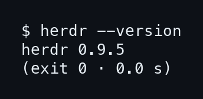

One short line.

```
herdr 0.9.5
```

**The version used for the captures is 0.9.5.** The command ended with exit 0 and nothing was wrong.

#### Step 2: count the lines of the four SKILL.md files

A Claude Code skill is a folder in `~/.claude/skills/`. Each folder has a `SKILL.md` file as its main file. One `wc -l` covers all four, using shell braces to shorten the folder names.

```bash
wc -l ~/.claude/skills/herdr-{wt,bring,pr,dissolve}/SKILL.md
```

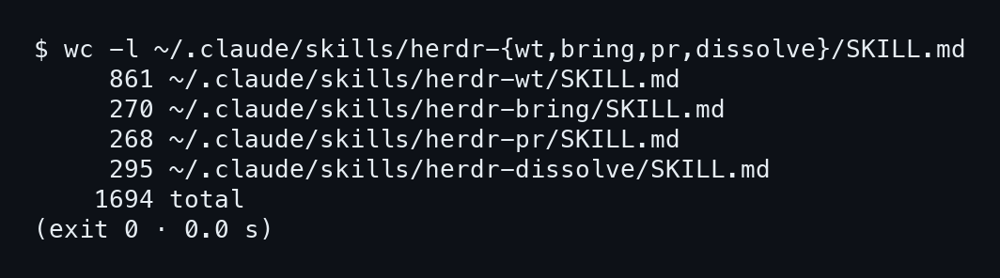

The numbers show that the four are not equal. `herdr-wt` is the longest. The other three are around 270 lines.

```
     861 ~/.claude/skills/herdr-wt/SKILL.md
     270 ~/.claude/skills/herdr-bring/SKILL.md
     268 ~/.claude/skills/herdr-pr/SKILL.md
     295 ~/.claude/skills/herdr-dissolve/SKILL.md
    1694 total
```

**Together they are 1,694 lines**, and `herdr-wt` alone is half of that.

### 1.2 One line from each skill

#### Step 1: read the description each skill wrote about itself

Every SKILL.md starts with a `description:` line. This is what Claude sees before it decides which skill to call. Pull them one skill at a time with `rg -m1`, and cut at character 300 so they fit in one image.

```bash
for s in wt bring pr dissolve; do printf '%s: ' herdr-$s; \
  rg -m1 '^description:' ~/.claude/skills/herdr-$s/SKILL.md \
  | cut -c14-300; done
```

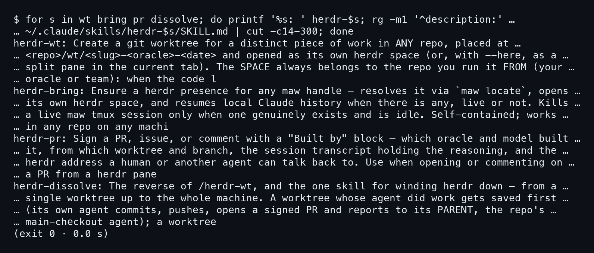

The text is in English because the skills are written that way. A paraphrase follows, and every point comes from a line in the image.

- `/herdr-wt` creates a git worktree for one piece of work in any repo, places it at `<repo>/wt/<slug>-<oracle>-<date>`, and opens it as its own herdr space.
- `/herdr-bring` finds a herdr presence for a maw handle with `maw locate`, opens its own space, and resumes the local Claude history.
- `/herdr-pr` signs a PR, issue or comment with a "Built by" block: which oracle, which model, built from which worktree and branch.
- `/herdr-dissolve` is the reverse of `/herdr-wt`. It closes anything from a single worktree up to the whole machine.

**All four belong together.** Open, bring, sign, close is the order the skills were designed for. It is not the order of the night of 3 November, because that night bring was not part of the demo work.

### 1.3 The night of 3 November in one picture

#### Step 1: follow the timeline of the demo-hello-world work

The real work used as the example throughout the book is `/herdr-wt demo-hello-world` in the laris-team repo on m5, at 21:28 Thai time. The picture puts the events of the demo work in time order. (Around 21:33 the demo's own agent signed the PR itself with herdr-sign.sh. The other pane answered "nothing to sign yet".) Chapters 2 to 5 break each stretch down step by step.

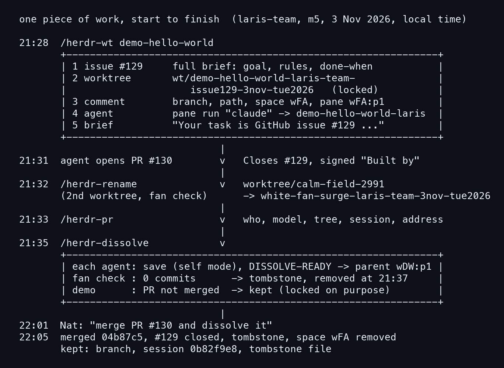

The first box is the opening of the work. Five things chain together: issue #129, the worktree, a comment with the address, the agent, and a brief that says "Your task is GitHub issue #129". At 21:31 the agent opened PR #130 by itself.

In the middle there is something **that was not planned**. At 21:32 `/herdr-rename` worked in a second worktree (the fan check on white). The demo's own branch was not renamed.

#### Step 2: see what is left after closing

At 21:35 `/herdr-dissolve` worked on the two worktrees. The fan check worktree was removed at 21:37. The demo worktree stayed, because the PR was not merged yet and the worktree was locked. Details are in chapter 2.

```
22:01  Nat: "merge PR #130 and dissolve it"
22:05  merged 04b87c5, #129 closed, tombstone, space wFA removed
       kept: branch, session 0b82f9e8, tombstone file
```

**After closing, three things are still left:** the branch, the session and the tombstone file. From opening the issue to the merge took 35 minutes. The next chapter starts from the beginning, with `/herdr-wt` and its 861 lines.

## 2. /herdr-wt: opening one piece of work

This chapter follows the `/herdr-wt` skill and looks at what it really left behind on 3 Nov. Everything is read from files and records. The skill was not run again.

### 2.1 What the skill does

#### Step 1: go through the headings of SKILL.md

The `#` headings of the skill file already tell you what it does.

```bash
rg '^#+ ' ~/.claude/skills/herdr-wt/SKILL.md
```

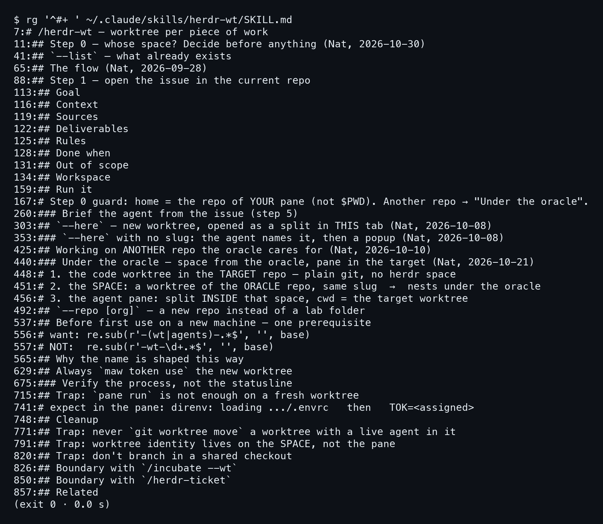

Reading from top to bottom shows the order. It starts at `Step 0` (line 11), which asks whose space this is. Then comes `Step 1 — open the issue in the current repo` (line 88). After that come the headings `Goal`, `Context`, `Sources`, `Deliverables`, `Rules`, `Done when`, `Out of scope` and `Workspace`, which are the shape of the issue the skill opens. **The issue always comes before the worktree.** Then come `Run it` (line 159) and `Brief the agent from the issue (step 5)` (line 260).

#### Step 2: separate the options from the main part

What is left further down is options and traps. **The main part to remember is only Step 0 and Step 1.** There is `--here` (a split pane in the same tab), `Under the oracle` (the work lives in another repo), `--repo [org]` (a new repo), and several sections starting with `Trap:`. Open the rest when you meet that situation for real.

### 2.2 Why the folder is named slug-oracle-date

#### Step 1: read the name format from the skill

The skill says in its description line that the worktree goes to `<repo>/wt/<slug>-<oracle>-<date>`, and that it is the "reference for WHY the naming is slug-oracle-date". Pull the lines that mention the name.

```bash
rg -n -i 'slug.*oracle.*date|<slug>-<oracle>-<date>' \
  ~/.claude/skills/herdr-wt/SKILL.md | head -12
```

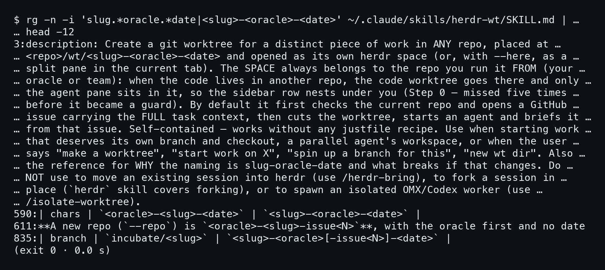

The comparison table (line 590) puts two formats side by side. **The name the skill really uses is the one with the slug first.** A new repo opened with `--repo` is the exception (line 611). The script in `Run it` builds the name from the slug, the repo name with `-oracle` removed, `-issueN` if there is one, and the date. The same name is used for the branch and the folder. One look tells you what the work is, whose it is, and which day (the full script is in the appendix).

### 2.3 Step 0: the space belongs to the repo we run from

#### Step 1: separate home and target

When you open work for another repo, you must first decide who owns the space in herdr. Read the Step 0 heading.

```bash
rg -n -A12 '^## Step 0' ~/.claude/skills/herdr-wt/SKILL.md
```

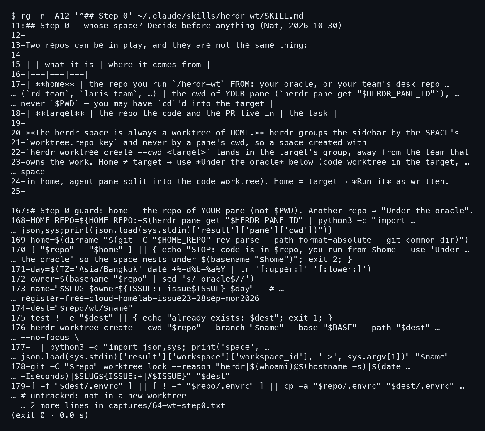

**Home is the repo we run the skill from.** Target is the repo where the code and the PR live. Take home from the pane's cwd (`herdr pane get "$HERDR_PANE_ID"`), never from `$PWD`.

#### Step 2: understand why it must be home

herdr groups the sidebar by the space's `worktree.repo_key`, not by the pane's cwd. So the skill always makes the space a worktree of home. If the code is in a different repo from the pane, the script (lines 167 to 170) **stops at once** with the message `STOP: code is in $repo, you run from $home` and exit 2.

### 2.4 The real issue #129

#### Step 1: open the issue the skill created on 3 Nov

On the night of 3 Nov, Nat typed `/herdr-wt demo-hello-world` in laris-team without giving any further task. The skill opened the issue by itself. Read it with `gh`.

```bash
gh issue view 129 --repo laris-co/laris-team
```

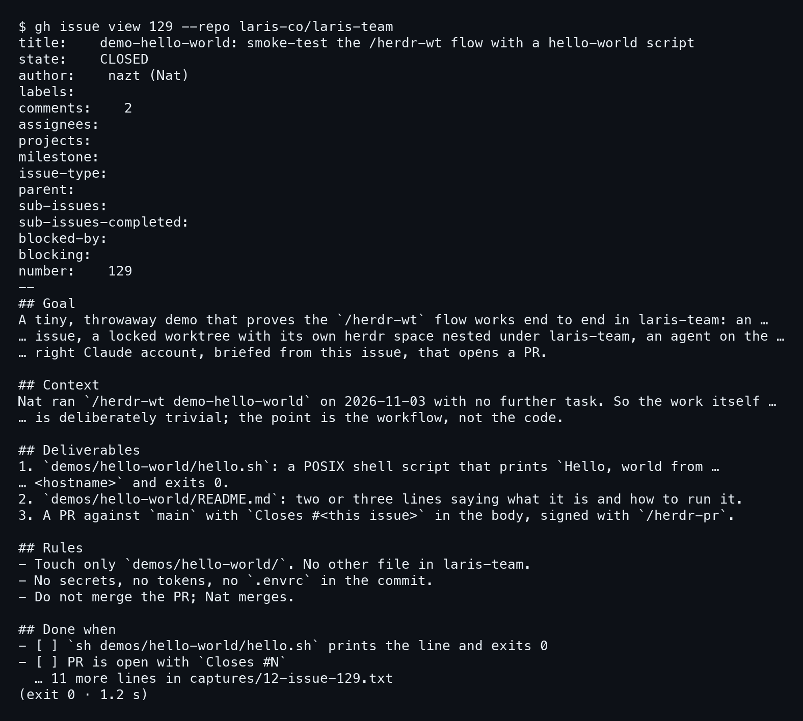

The headings match the shape from Step 1 of 2.1 exactly. `Goal` says this is purely a test of the flow. `Deliverables` has three items: `hello.sh`, `README.md`, and a PR with `Closes #<this issue>`. **Rules say do not touch anything outside `demos/hello-world/`, and do not merge the PR yourself. Nat merges.**

#### Step 2: read the done condition and the Workspace field

`Done when` is three checkboxes: the script runs and exits 0, the PR is open with `Closes #N`, and there is a comment with the PR URL and what was checked. **`Workspace` was still empty at opening.** It waits for the skill to fill it in later as a comment, once the worktree exists. At the end of the issue there is a signature saying it was opened by Laris Labs Oracle (AI) through `/herdr-wt`, session 51fdd0de.

#### Step 3: read the two comments

This issue has 2 comments. Look at the end of the output.

```bash
gh issue view 129 --repo laris-co/laris-team --comments | tail -40
```

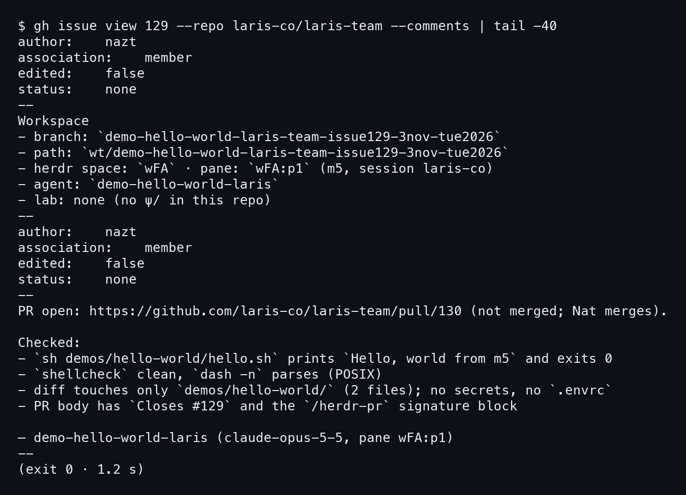

The first is the Workspace comment the skill added after cutting the worktree. It has the branch, the path, space `wFA`, pane `wFA:p1` and the agent name. **Whoever opened the issue can find their way back to the worktree from this comment.** The other comes from the agent doing the work. It says the PR is open and what was checked.

### 2.5 The timeline of that night from relic5

#### Step 1: read the record relic5 kept

The issue and the PR only show the result. The real order of events is in the session history, which relic5 keeps. The capture below shows the UTC times and the real text it pulled (Thai time is UTC+7).

```bash
cat ../2026-11-08_herdr-wt-lifecycle/captures/01-relic5-timeline.txt
```

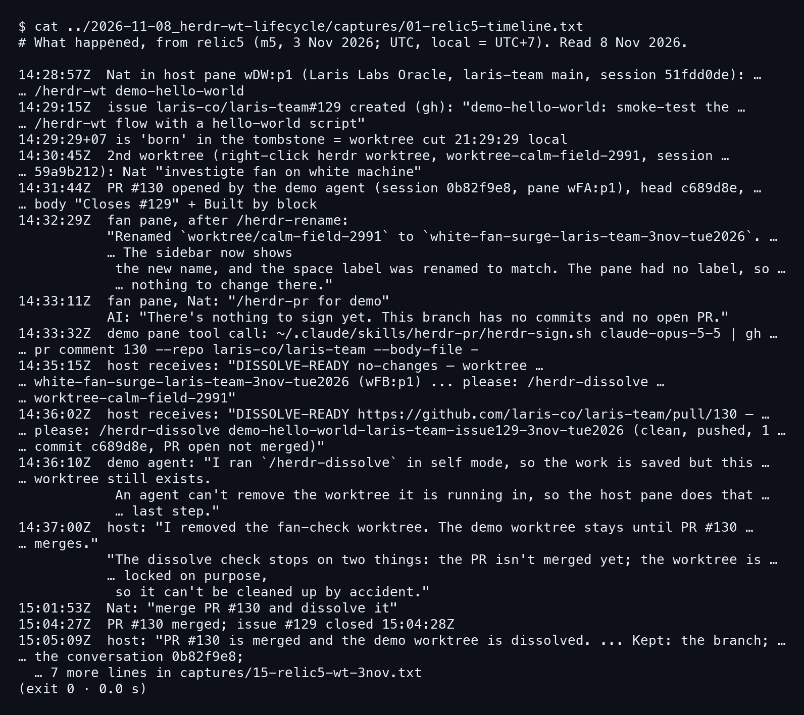

At 21:28 Thai time Nat typed `/herdr-wt demo-hello-world`. At 21:29 issue #129 appeared. At 21:31 the agent opened PR #130. **Three minutes from one command** gave the whole set: the issue, a locked worktree, an agent and a PR.

#### Step 2: look at the parts that are not neat

That night there was a second worktree for checking a fan on white. `/herdr-rename` at 21:32 worked in that pane. The demo's branch was never renamed. At 21:33 `/herdr-pr for demo` was typed in that same pane, and the answer was that there was nothing to sign yet. The real signature was posted by the demo's own agent. At 21:35 `/herdr-dissolve` closed the fan worktree (removed at 21:37), but **the demo worktree stayed**, because the PR was not merged and the worktree was locked. Details are in chapters 4 and 5.

### 2.6 Branches in this repo that follow the rule

#### Step 1: look at the real branches of aiexpo-oracle

**The naming rule is not theory.** The repo you are reading uses it. Filter the branches that contain `aiexpo`, `issue` or `soul`.

```bash
git branch -a | rg 'aiexpo|issue|soul'
```

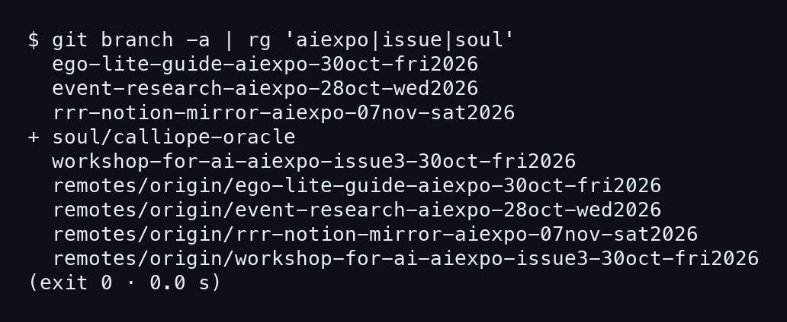

Branches from `/herdr-wt` end with a date, for example `30oct-fri2026`.

```
event-research-aiexpo-28oct-wed2026
ego-lite-guide-aiexpo-30oct-fri2026
workshop-for-ai-aiexpo-issue3-30oct-fri2026
rrr-notion-mirror-aiexpo-07nov-sat2026
```

The owner is `aiexpo`. One tied to an issue has `-issue3` inserted before the date. `soul/calliope-oracle` does not end with a date. A branch that does not end with a date was usually not opened with this skill.

The work is open. But what about an agent that worked before and has gone missing? The next chapter is `/herdr-bring`, which brings it back.

## 3. /herdr-bring: bringing back an agent that went missing

An agent was working inside maw's tmux. When you move to herdr, someone has to bring it over, without losing the chat history and without two agents fighting to answer. That is the job of /herdr-bring. This chapter starts with what the skill does step by step, looks at `maw locate` today, looks at its rules, and ends with the real story of 3 Nov that the skill could not decide by itself.

### 3.1 What bring does

#### Step 1: look at the skill's headings

The skill is a single SKILL.md file. On the m5 machine it lives at `~/.claude/skills/herdr-bring/`. Open the headings and you see the whole order of work.

Type `rg` to list the `#` headings of the file, and read them by line number. You can see that **the skill is divided into Step 1 to Step 4**, in the order list, resolve, bring one, several.

```bash
rg '^#+ ' ~/.claude/skills/herdr-bring/SKILL.md
```

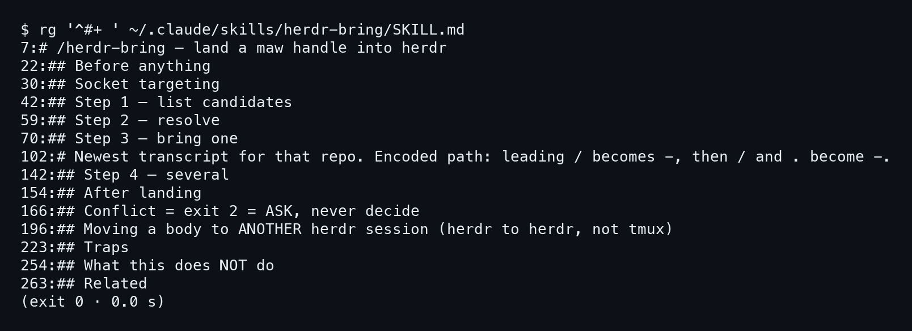

Three headings are worth noting. `Step 3 — bring one` (line 70) is where the real work happens. `Conflict = exit 2 = ASK, never decide` (line 166) says to ask a person on a clash. `Moving a body to ANOTHER herdr session` (line 196) is used for the 3 Nov story below. At the end of the file, `What this does NOT do` sets the limits.

### 3.2 maw locate today

Step 2 of the skill says to ask `maw locate` every time which repo this handle is and at what path. If it gives no path, report it and skip. Never guess.

#### Step 1: locate two names

Run two commands. The first is neo. The second is aiexpo, the oracle of the repo that holds this book. The result is a single tab-separated line: handle, org/repo, path.

```bash
maw locate neo
maw locate aiexpo
```

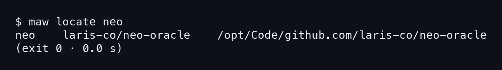

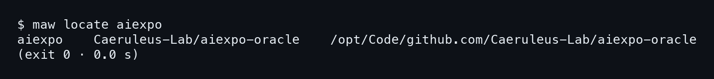

Both return a full path and both exit 0. Remember that **today `maw locate neo` can answer with a path.** The story in 3.4 happened when it could not, and that is the point where the skill had to stop and ask a person.

### 3.3 Its rules

The important rules of bring hide in the words kill, resume and never. Try `rg` with these three words on the same file.

#### Step 1: search for the rules

Run `rg -n -i` with the three words, and cut at the first 20 lines. From the output, **it kills a maw tmux only if it is really live and idle.** Otherwise it resumes directly.

```bash
rg -n -i 'kill|resume|never' ~/.claude/skills/herdr-bring/SKILL.md \
  | head -20
```

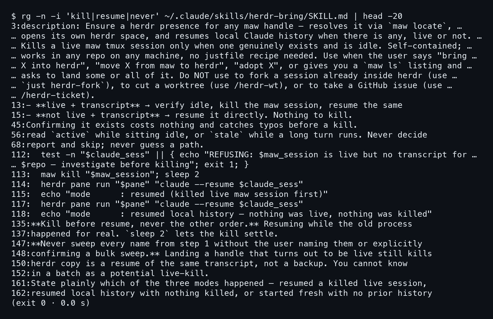

Reading by line shows three modes. Line 13 is live with a transcript: check it is idle, kill, then resume. Line 15 is not live but has a transcript: resume right away, nothing to kill. The third mode is no history ever: start fresh (line 161 says to report which mode happened in plain words).

#### Step 2: the rules that protect things

Three lines in the output answer why the skill is so careful. Line 112: if it is live but has no transcript, `REFUSING`, do not kill. Line 135 says **kill before resume, never the other way round**, because if you resume while the old one is still running, two will write to the same transcript. And line 147: do not sweep every name from Step 1 unless the user named them.

The skill is written strictly because herdr's resume is not a backup of the old session. It is the same transcript, opened again.

### 3.4 The real story of 3 Nov: bring neo

The skill is written for the easy case: one handle, one repo. But Neo on 3 Nov 2026 was not easy. This story comes from the relic5 record of session 51fdd0de (Laris Labs Oracle, pane wDW:p1). It was not run again for the book. Times are Bangkok time.

#### Step 1: the skill admits it cannot decide

At 22:06:40 Nat typed `/herdr-bring bring neo`, and typed it again at 22:09:59. The agent looked for neo's bodies on both m5 and white, and at 22:10:13 answered that `maw locate neo` returned no path and that Neo already had several bodies. **When the skill hits something that is not the easy case, the agent asks a person and does not guess.**

```
22:10:13  agent: "`/herdr-bring` can't settle this one by itself. …"
```

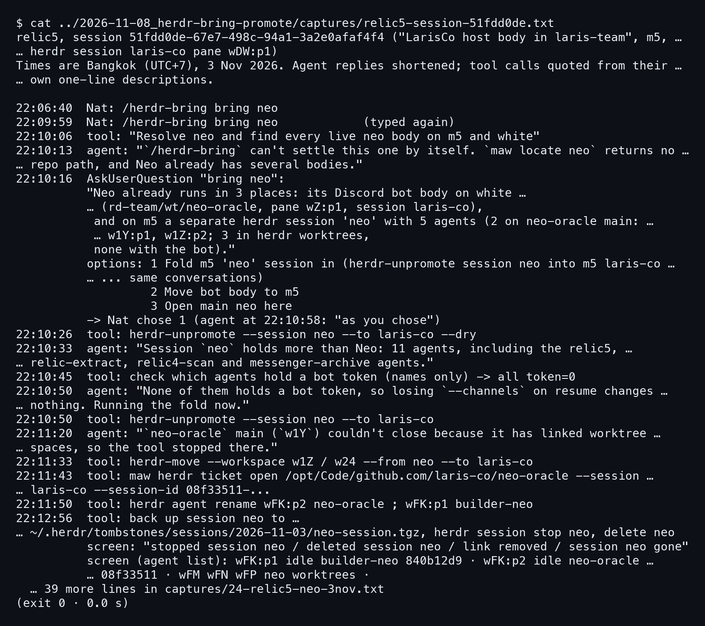

#### Step 2: three options, Nat picks option 1

At 22:10:16 the agent opened three questions, and Nat picked option 1: fold the m5 session `neo` into `laris-co`. **The agent rehearsed with `--dry` first.** When it saw `token=0` for every one, it ordered the real fold at 22:10:50.

#### Step 3: herdr-move stops halfway

At 22:11:20 the tool stopped, because `neo-oracle` main could not be closed. **A space with a worktree space attached cannot be closed directly.** The agent had to continue by hand and resume two agents by their ids: neo-oracle main at `08f33511` and builder-neo at `840b12d9`. Then it renamed the panes. When that was complete, it backed up session `neo` to `~/.herdr/tombstones/sessions/2026-11-03/neo-session.tgz`, then stopped and deleted that session at 22:12:56.

#### Step 4: fold back with promote

At 22:14:36 Nat ordered `/herdr-promote neo back session`. **The agent rehearsed with `--dry` first**, then ran `herdr-move` one space at a time, taking the worktrees first. At 22:17:54 seven were back in `neo`, but neo main hit the same problem again. The agent had to resume two with the same ids. At 22:18:11 it found that two commands reported the same pane (`w1:p1`), so the second command might have been typed into the first one's input box. It cleared that command without pressing send, then split a new pane to start the second one.

```
22:19:05  agent: "Neo is back in its own herdr session, `neo`, …"
```

#### Step 5: see the three moments together

Card D2 puts three columns side by side: before (22:09), after the fold (22:13), and after the fold back (22:19). **The pane ids change in every column, but the conversation id `08f33511` does not change.** The move that worked is to end the old one where it runs, then resume with `--session-id`. The next chapter goes to signing the work, which is /herdr-pr.

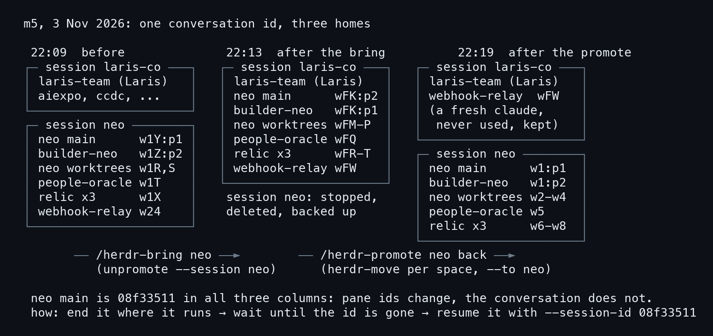

## 4. /herdr-pr: signing a PR

When PRs from many worktrees go into one repo, a reviewer looking only at the diff cannot tell which session wrote it. The /herdr-pr skill fixes this by pasting a "Built by" block into the PR: who built it, which model, which worktree, and how to talk back to that session. This chapter looks at the script that makes the block, and then at three real pieces.

### 4.1 The script and its flags

#### Step 1: ask the script for help

The skill works through a single script, `herdr-sign.sh`. Type `--help` first to see what it accepts. **The script describes the herdr session (pane), not the folder the shell is standing in.**

```bash
herdr-sign.sh --help
```

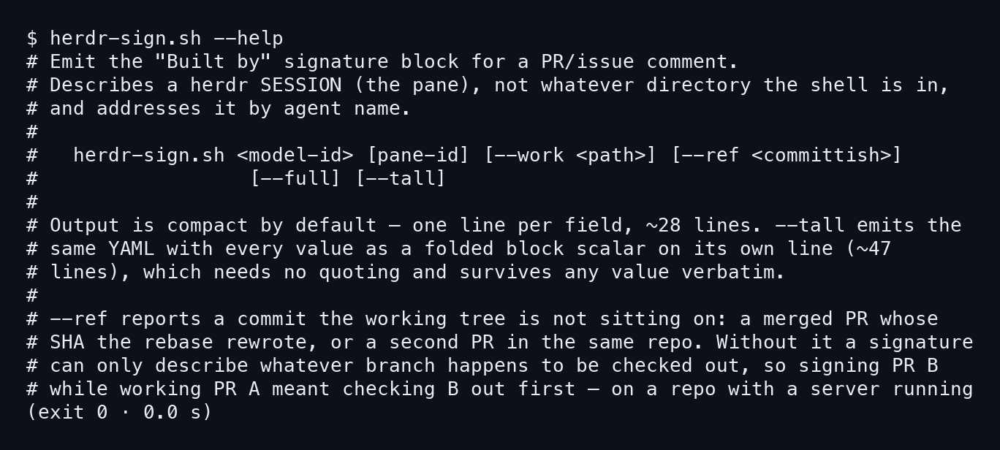

The usage line reads

```
herdr-sign.sh <model-id> [pane-id] [--work <path>] [--ref <committish>]
               [--full] [--tall]
```

The model id is always required. The pane id is optional. `--tall` prints the same YAML, but every value is a folded block scalar, one value per line, about 47 lines long (the normal form is about 28 lines). The benefit is that you do not need quotation marks and the values do not get distorted. `--ref` is for reporting a commit that the working tree is not standing on, for example a merged PR, a SHA rewritten by a rebase, or a second PR in the same repo, so you do not need to check out another one before signing.

### 4.2 Signing this pane: a public repo, private fields missing

#### Step 1: run the signature for the pane that wrote this book

Give a model id and then the pane id of ours. While writing this book the pane was `wCM:p1`. **This repo is public, so the script printed a redacted block.**

```bash
herdr-sign.sh claude-opus-5-5 wCM:p1
```

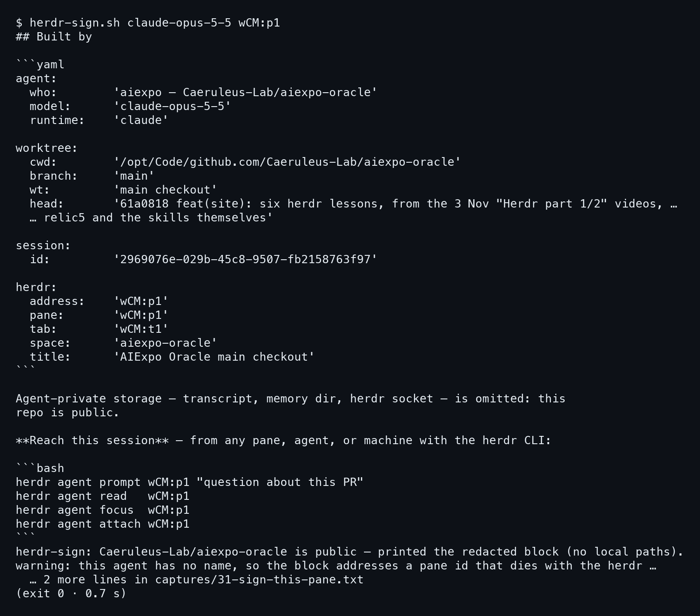

The block has no `transcript`, `memory` or `socket`. The script gives the reason itself: they were cut because this repo is public. At the end of the output there is also a warning that this agent has no address name, so it is a pane id that dies with the herdr server. Fix it with `herdr agent rename` as the script suggests, then sign again.

### 4.3 The full block on PR #130 (a private repo)

#### Step 1: pull the comment signed on 3 Nov

PR #130 of laris-co/laris-team is a repo where the block is not redacted. The worktree's agent signed it with `herdr-sign.sh | gh pr comment 130`. Pull it back with gh and filter the part that starts with Built by. **In a private repo, the block has the extra fields transcript, memory and socket.**

```bash
gh pr view 130 --repo laris-co/laris-team --comments \
  | rg -A32 'Built by' | head -40
```

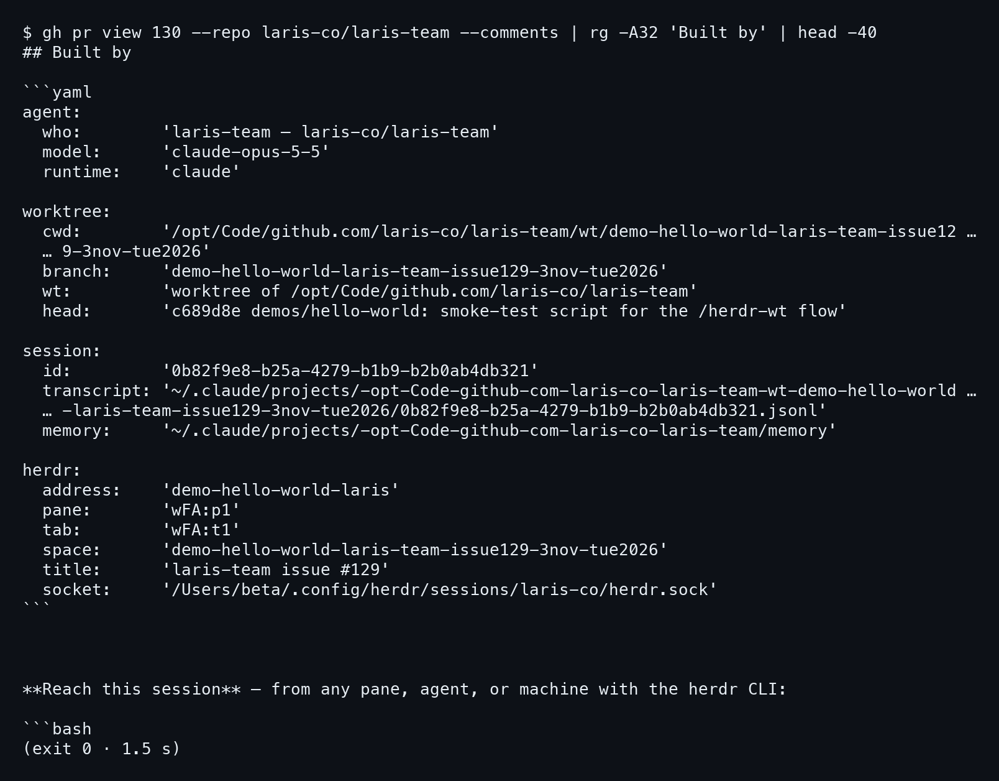

Compare with the block of this pane. The added fields are `transcript`, `memory` and `socket`.

The transcript is the file that keeps the reasoning of the session. Anyone who wonders why the agent decided something can open this file and read. The `herdr.address` field is `demo-hello-world-laris`, which is the agent name and not a pane id. That means it was named, so you can talk back even if the pane id changes. The head line is `c689d8e demos/hello-world: smoke-test script for the /herdr-wt flow`.

### 4.4 PR #7 of this repo, and its time

#### Step 1: look at the comment signed on PR #7

PR #7 in this repo was signed with /herdr-pr by the right-hand agent (pane `wCM:p2`). Because the repo is public, the comment is redacted, like the block of this pane. **The block says clearly which worktree the agent is in and which commit is the head of the work.**

```bash
gh pr view 7 --comments | rg -A30 'Built by' | head -36
```

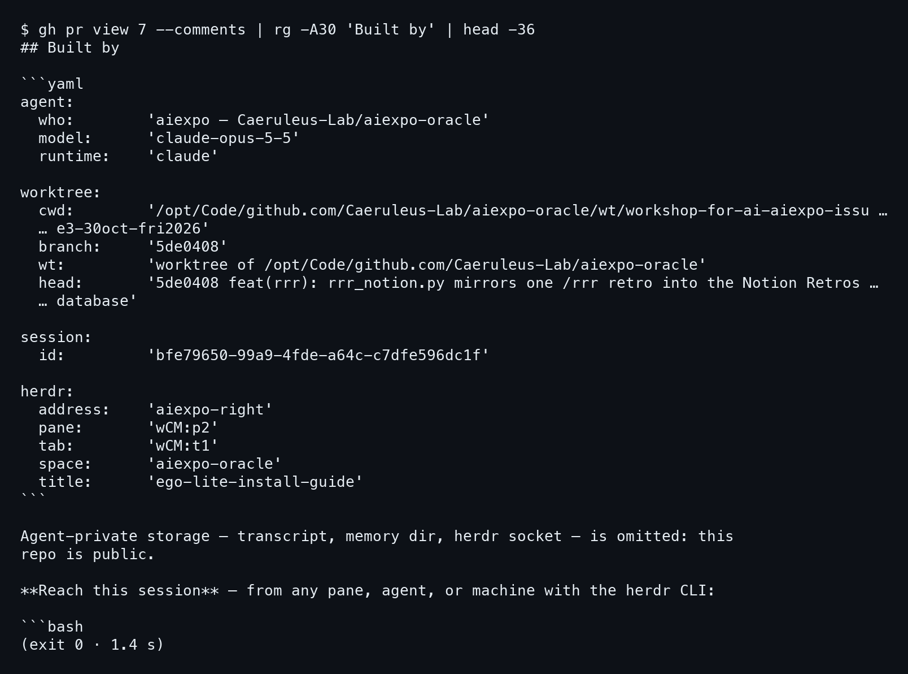

In the block there is `branch: '5de0408'`, where the branch is a SHA and not a branch name. The head is `5de0408 feat(rrr): rrr_notion.py mirrors one /rrr retro into the
Notion Retros database`, and the address you can talk back to is `aiexpo-right`.

#### Step 2: ask gh about the time

To find out how long this PR took, ask for JSON directly. **All times gh returns are UTC (the Z), so add 7 hours for Thai time.**

```bash
gh pr view 7 --json createdAt,mergedAt,headRefName,title
```

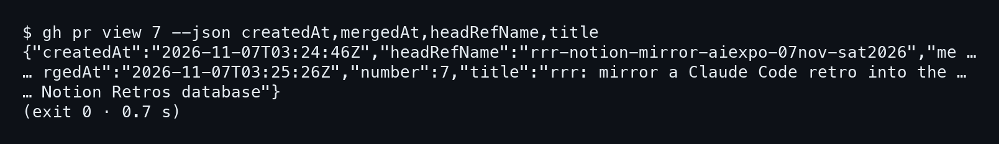

It was opened at `2026-11-07T03:24:46Z` and merged at `2026-11-07T03:25:26Z`, 40 seconds apart. The branch is `rrr-notion-mirror-aiexpo-07nov-sat2026`.

### 4.5 The trap: run it in the pane that did the work

On 3 Nov at 21:33, `/herdr-pr for demo` was typed in the fan check pane, which answered "nothing to sign yet". **The skill signs for the session that runs it**, not for the work the name points to. The real signature on PR #130 came from the demo's own agent. To sign from elsewhere, pass a pane id as the second argument, and use `--ref` if the PR is not the commit the working tree is standing on.

## 5. /herdr-dissolve: closing without leaving anything behind

Work opened with /herdr-wt must have a closing day, and when you close, there is often something left in the worktree. This chapter looks at how /herdr-dissolve closes without losing anything, following the principle Nothing is Deleted.

### 5.1 The five modes, and asking before acting

#### Step 1: see how many ways it can be called

Use `rg` to find the mode names in SKILL.md. One skill covers anything from a single worktree to the whole machine. **They differ only in the scope you pass.**

```bash
rg -n -e '--sweep' -e '--all-but-me' -e '--sync' -e 'self' \
  ~/.claude/skills/herdr-dissolve/SKILL.md | sed 1d | head -10
```

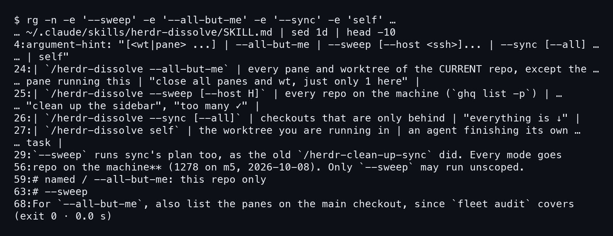

The table in the skill lists five forms: a wt or pane name (named), `--all-but-me`, `--sweep`, `--sync` and `self`.

`self` is an agent closing its own work. `--sweep` is the old /herdr-clean-up-sync, now merged in. Line 56 of the skill says the repos on m5 number 1278 (counted on 2026-10-08), so only `--sweep` is allowed to run without a repo limit.

#### Step 2: find where the skill stops to ask

Every mode walks the same four beats: survey, plan, ask, act. Search for the words ask and confirm in the same file to see where the skill stops.

```bash
rg -n -i 'ask|confirm|never close' \
  ~/.claude/skills/herdr-dissolve/SKILL.md | head -16
```

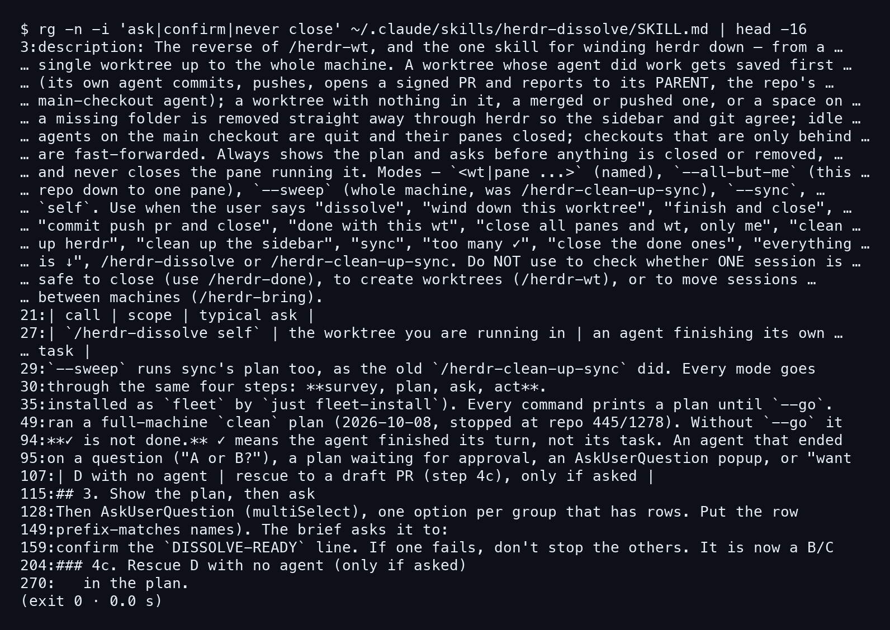

The heading `## 3. Show the plan, then ask` is at line 115, and the description also says the skill shows the plan and asks before closing or removing anything. At that point it opens an AskUserQuestion with multiple choice, one option per group that has rows, and it does not close the pane it is running in.

> This skill deletes nothing before a person has seen the plan

Another point worth remembering is line 94 of the skill, which says **the check mark in the sidebar does not mean the work is done.** A check mark means the agent finished its turn. If the agent ended on a question left hanging, the skill does not count it as ready to close.

### 5.2 tombstone.py: rehearse first, write for real later

#### Step 1: read the help of tombstone.py

Before a worktree disappears, the skill calls tombstone.py to write a record. Run it with no arguments to read what it promises.

```bash
tombstone.py
```

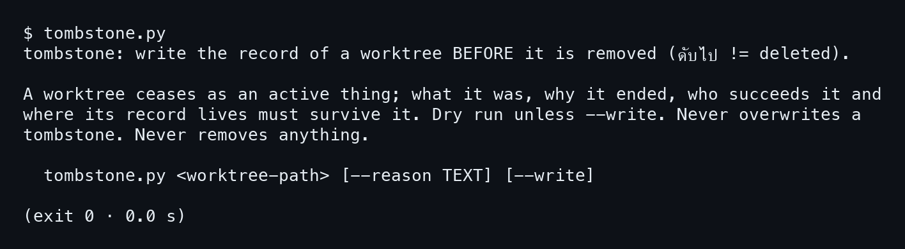

The text here has three sentences that matter.

```
Dry run unless --write. Never overwrites a tombstone.
Never removes anything.
  tombstone.py <worktree-path> [--reason TEXT] [--write]
```

**Without `--write` it is only a rehearsal.** The script does not overwrite anything existing, and does not delete anything at all. Removing the worktree is herdr's job in the next beat, not this script's.

#### Step 2: try it on a real worktree of this repo

This repo has a worktree named calliope-oracle-soul in the `wt/` folder, so we use it as the example. Run it without `--write`, so nothing is written and nothing is deleted.

```bash
tombstone.py wt/calliope-oracle-soul --reason 'book demo, dry run'
```

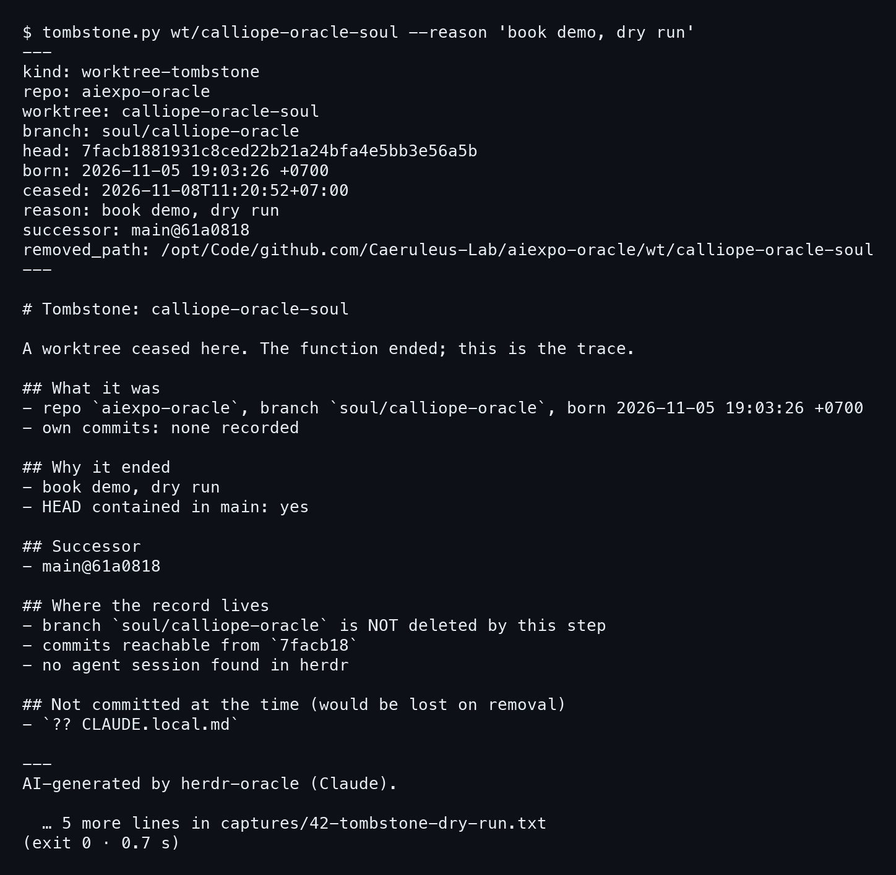

The result is a full Markdown page. The frontmatter has the branch (`soul/calliope-oracle`), the birth date `2026-11-05 19:03:26 +0700`, the time it ceased, the successor (`main@61a0818`), and the path that would be removed. The very end is three lines worth reading before anything else.

```
destination: …/ψ/memory/tombstones/2026-11-08_calliope-oracle-soul.md
BLOCKER: 1 uncommitted/untracked file(s) would be LOST on removal
dry run - add --write to save it
```

**The BLOCKER says there is a file not committed.** In this case it is `CLAUDE.local.md`, which would be lost if the worktree were removed. This is the value of the rehearsal: you see what would be lost before you act. The section "Where the record lives" also says the branch is not deleted, and the commit is still reachable from `7facb18`.

### 5.3 Refusing the main checkout

#### Step 1: run it on the main checkout

The main checkout is not a worktree that should be kept as a memorial. Run it on the current folder, which is the main of the repo, to see whether the script guards against it.

```bash
tombstone.py .
```

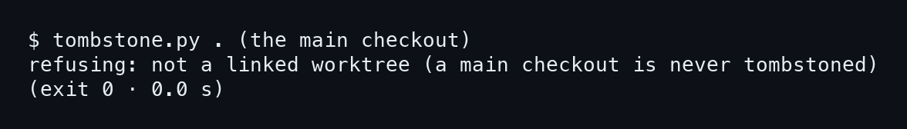

```
refusing: not a linked worktree (a main checkout is never tombstoned)
```

It answers briefly that it will not do it, and **the main checkout is never tombstoned.** The script knows because main is the first item of the list and is not a linked worktree. The details of how it checks are in chapter 6.

### 5.4 Two real tombstones

#### Step 1: today's issue3 worktree

On 8 Nov the worktree `workshop-for-ai-aiexpo-issue3-30oct-fri2026` finished its work after PR #7 merged. herdr had locked it since 30 Oct, so the agent at the main checkout had to unlock it and remove it from outside. Before removal there were three things left over. The first two were copied to main: og/src and the untracked deck-shots (17 PNG files and deck_report.json). The 61 MB books/dist, which is ignored, was tarred and kept in `~/.herdr/tombstones`. Open the record that resulted.

```bash
cat ψ/memory/tombstones/\
2026-11-08_workshop-for-ai-aiexpo-issue3-30oct-fri2026.md
```

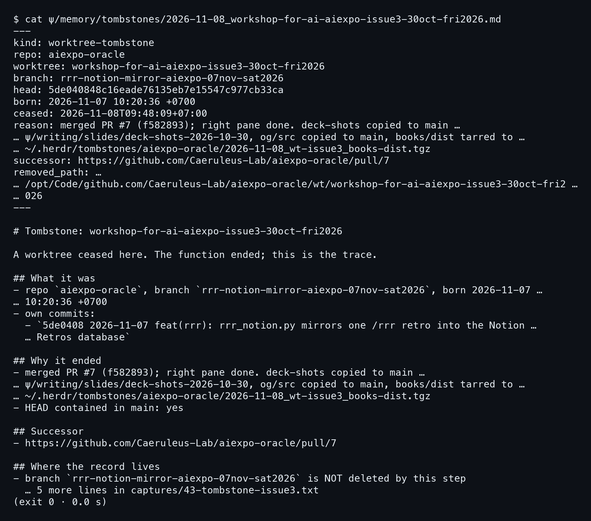

**The reason field is where the story is kept.** It says merged PR #7 (f582893), and says what was copied and what was tarred and where it was put. The successor field points to PR #7. Own commits has one entry (`5de0408` rrr_notion.py), and the line "HEAD contained in main: yes" confirms this commit is already in main. The branch `rrr-notion-mirror-aiexpo-07nov-sat2026` is still there and was not deleted.

#### Step 2: the demo of 3 Nov

The other one comes from the demo work in laris-team (chapter 2). It is kept at `~/.herdr/tombstones/laris-team` in the same form. Open it to compare.

```bash
cat ~/.herdr/tombstones/laris-team/\
2026-11-03_demo-hello-world-laris-team-issue129-3nov-tue2026.md
```

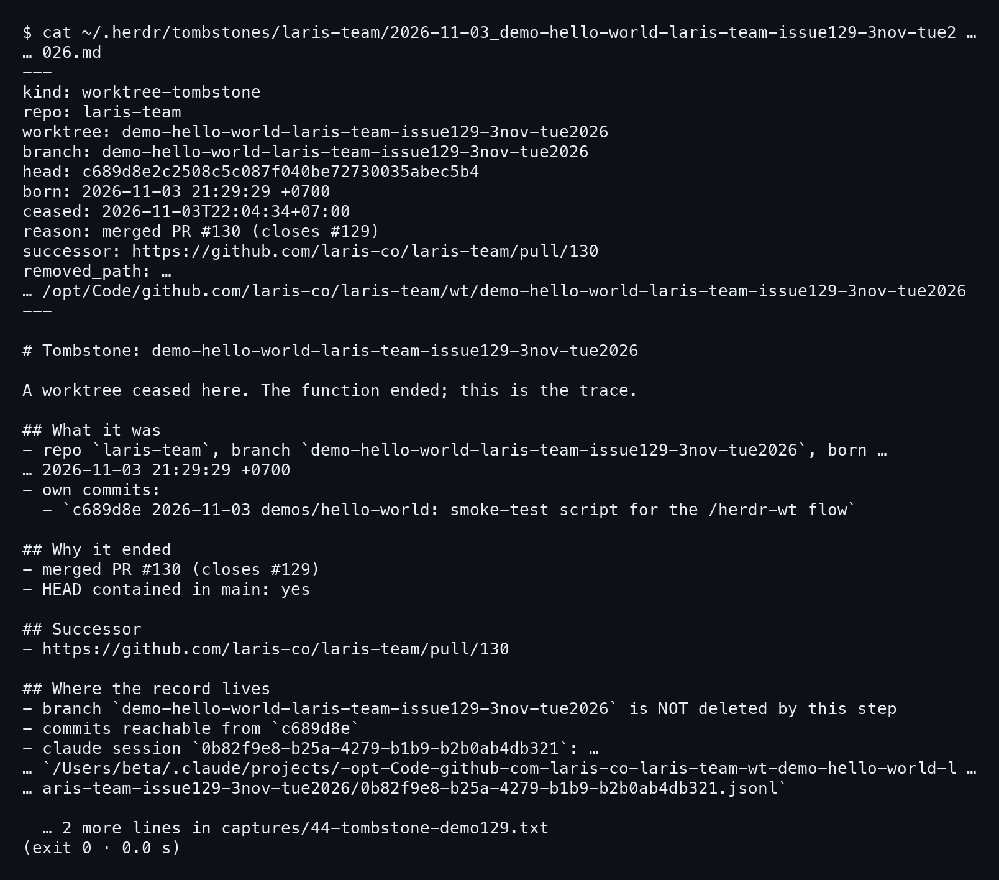

This one was born `2026-11-03 21:29:29 +0700` and ceased `2026-11-03T22:04:34+07:00`. The reason is "merged PR #130 (closes #129)", which matches what relic5 recorded: merged at 22:05. What this one has and the issue3 one does not is the claude session line (`0b82f9e8-b25a-4279-b1b9-b2b0ab4db321`) with the path of the jsonl file, **so you can go back and read the conversation of that agent.** The issue3 one says "no agent session found in herdr".

### 5.5 The tombstone shelf

#### Step 1: look at the laris-team shelf

Tombstones have two shelves. The one in home is at `~/.herdr/tombstones/<repo>/`. The repo's own shelf is at `ψ/memory/tombstones/`. Run `ls` and look at only the last 12 names of laris-team.

```bash
ls ~/.herdr/tombstones/laris-team | tail -12
```

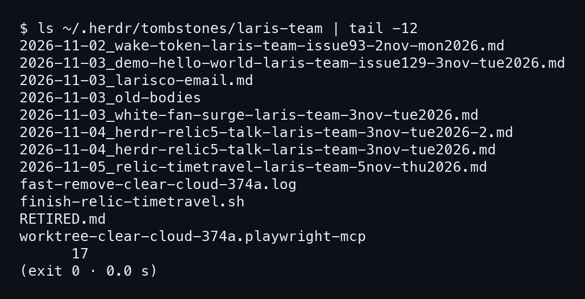

The file names start with the date, so they sort by time on their own. There are four tombstones of 2026-11-03 close together, including the demo-hello-world we just read and white-fan-surge, the worktree removed at 21:37. **The same shelf also holds things that are not tombstones**, such as a log, the script finish-relic-timetravel.sh and RETIRED.md.

> A tombstone is a trace. The worktree's job has ended, but its story is still there.

That one sentence is enough to sum up this chapter. In the next chapter we open up the two scripts: herdr-sign.sh, which decides which fields to print according to how private the repo is, and tombstone.py, which we just used.

## 6. Inside the two scripts

In the last four chapters we used the skills from outside: typed commands and looked at the results. This chapter opens the lid. The two scripts that work hardest are `herdr-sign.sh` of /herdr-pr and `tombstone.py` of /herdr-dissolve. We read them line by line from pieces cut from the real files, without guessing and without adding. If you want to see every line of the files, open the appendix `09-code.md`, which keeps the full code of all four skills.

### 6.1 herdr-sign.sh decides how much to print from whether the repo is public

#### Step 1: read the block that asks GitHub whether the repo is private

Open the file at lines 205 to 222 with `sed -n`. This is the place where the script decides whether the block it is about to print may reveal information about the machine.

```bash
sed -n 205,222p ~/.claude/skills/herdr-pr/herdr-sign.sh
```

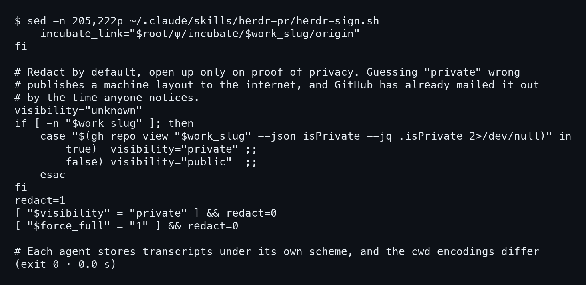

The variable starts as `visibility="unknown"`. The script calls `gh repo view "$work_slug" --json isPrivate --jq .isPrivate`, and a `case` looks at the answer. Only two paths change the value: `true` gives `private` and `false` gives `public`. If `gh` fails, or there is no `$work_slug`, the value stays at `unknown`. **The default is closed. There must be proof that the repo is private before it opens.** The script's own comment gives the reason here (guessing private wrongly = announcing the machine's layout on the internet).

#### Step 2: look at the two lines that set redact

Read on to the last lines of the same piece.

```
redact=1
[ "$visibility" = "private" ] && redact=0
[ "$force_full" = "1" ] && redact=0
```

`redact=1` is always set first, and only two conditions lower it to 0. The first is that visibility is exactly `private`. `unknown` and `public` do not pass. The second is `--full`, which sets `force_full`, so a person who knows better than the script can override it. In chapter 4 we already saw the result of these two lines. This repo is public, so the block of this pane came out redacted.

### 6.2 The fields only a private repo gets

#### Step 1: read which fields are held back behind redact

Go to lines 266 to 285. Here the script builds two chunks of text, `sess_private` and `herdr_private`. Both start as empty strings.

```bash
sed -n 266,285p ~/.claude/skills/herdr-pr/herdr-sign.sh
```

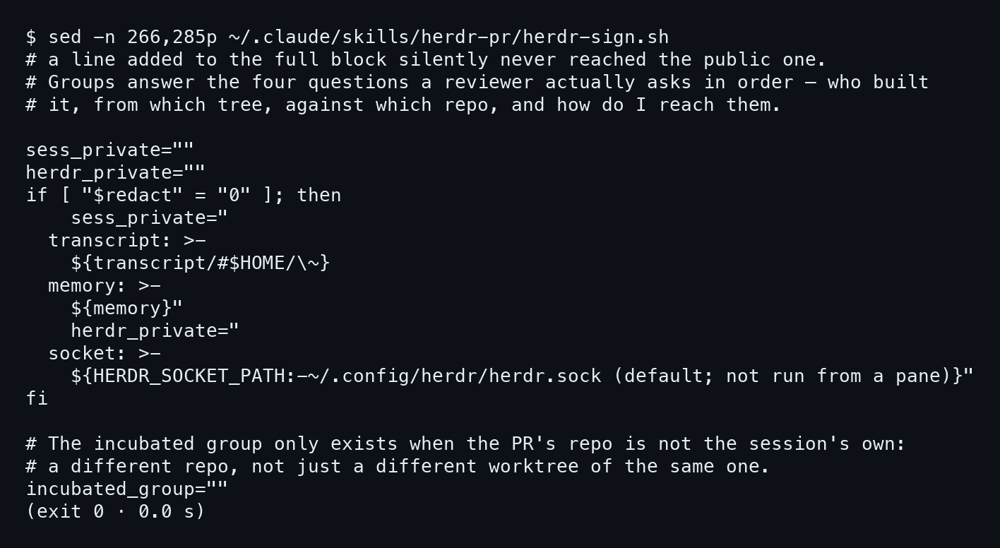

When `redact` is 0, the first chunk gets `transcript` and `memory`, and the second gets `socket` (the value from `HERDR_SOCKET_PATH` or the default). If `redact` is still 1, these two chunks stay empty, so the public block has none of the three fields. **The fields that say where files are on the machine appear only in the block of a repo proven to be private.** Note that the transcript has `$HOME` turned into `~` before printing.

The comment above this piece also tells where the structure came from. Before, there were two separate blocks, full and public. A line added to full quietly never reached public. Now both blocks come from one template, and differ only in whether these two variables are empty or not. Read the whole file in `09-code.md`, in the herdr-pr part.

### 6.3 tombstone.py finds the worktree and refuses the main checkout

#### Step 1: read how it finds the worktree from porcelain

On the /herdr-dissolve side, open `tombstone.py` lines 18 to 40, which is the start of `main()`.

```bash
sed -n 18,40p ~/.claude/skills/herdr-dissolve/tombstone.py
```

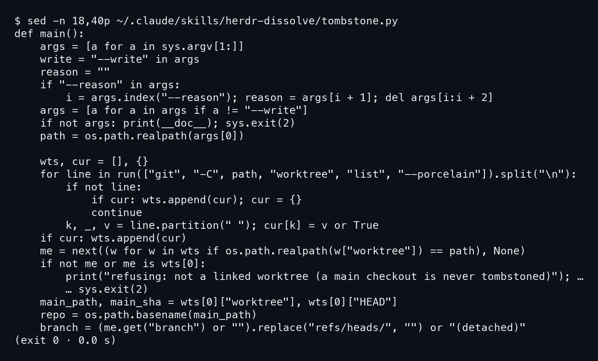

The script takes the first path and runs **`os.path.realpath` first**, so a symlink cannot fool the comparison. Then it runs `git -C path worktree list --porcelain`. The output is split into chunks by blank lines. The loop keeps each chunk as a dict, cutting each line at the first space to get keys such as `worktree`, `HEAD`, `branch`. Then it finds `me`, the chunk whose `worktree` realpath matches the path it received.

#### Step 2: look at the refusal condition

The most important line of this piece is

```
    if not me or me is wts[0]:
        print("refusing: not a linked worktree (a main checkout …")
```

`git worktree list` always prints the main checkout as the first item, so the script uses `me is wts[0]` to decide. It does not need to guess from the folder name. And if it cannot find `me` (the path is not a worktree at all), it refuses with the same message. **Both cases exit with `sys.exit(2)` before doing anything else.** After passing this gate it reads `main_path`, `main_sha`, the repo name from `basename`, and the branch name with `refs/heads/` cut off. If detached, it shows `(detached)`. In chapter 5 we ran this gate against the real main checkout and saw this message come out. The exit 0 you see in that image belongs to the wrapper that calls the script. It is not the value `sys.exit(2)` returns.

### 6.4 Never overwrite, never delete, write only when told --write

#### Step 1: search for words about writing across the whole file

The file is too long to read line by line on one page, so we use `rg` to pull only the lines with the words `write`, `exists` or `never`.

```bash
rg -n 'write|exists|never' ~/.claude/skills/herdr-dissolve/tombstone.py
```

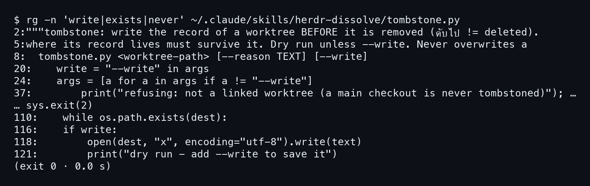

Sorted by line number, **three places control writing.** Line 5, in the docstring, says `Dry run unless --write. Never overwrites`. Lines 20 and 24 keep `write = "--write" in args` and filter the flag out of args. Line 110 has `while os.path.exists(dest):`, which looks for a new file name when the old one is already taken.

#### Step 2: read the end of the file that really writes

The last two lines in the result are the heart.

```
118:        open(dest, "x", encoding="utf-8").write(text)
121:        print("dry run - add --write to save it")
```

`if write:` at line 116 is the only door. Without `--write` the script prints the dry run message and ends. With it, it opens the file in mode `"x"`, which makes Python fail at once if the file already exists. **Two layers stop overwriting: the `os.path.exists` loop that finds a new name, and the mode `"x"` that refuses an existing file.** The first rg searched only `write|exists|never`, so it cannot yet prove there is no delete command. The next step searches for those words directly.

#### Step 3: search the whole file for delete commands

Search for words about deleting files: `remove`, `rmtree`, `unlink`, `os.rm` and `shutil`.

```bash
rg -n 'remove|rmtree|unlink|os\.rm|shutil' \
  ~/.claude/skills/herdr-dissolve/tombstone.py
```

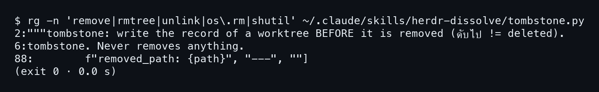

Only three lines match. Lines 2 and 6 are the docstring that says `Never removes anything`, and line 88 is the text `removed_path:` written into the record. **There is not a single real delete command.** This script's job is to write the record. Removing the worktree for real is the job of the skill that calls it, after it shows the plan and asks a person.

Now we have seen that both scripts are careful about the same thing: when unsure, do the least. The next chapter collects what really went wrong during this work, with one summary card.

## 7. Real traps and the summary card

This chapter starts with one summary card, then looks at the ways things went wrong. Every item really happened, on 3 Nov during the demo `demo-hello-world` and `bring neo`, and on 8 Nov when closing the worktree of issue #3. Each item is written in three parts: what happened, the cause, the fix.

### The summary card

#### Step 1: see the four skills in one table

Open this card when you forget what to type. Each row is one skill: the command, the beat it does, and the key condition. **The one to remember most is that /herdr-pr must be typed in the pane that did the work**, which is the first trap of this chapter.

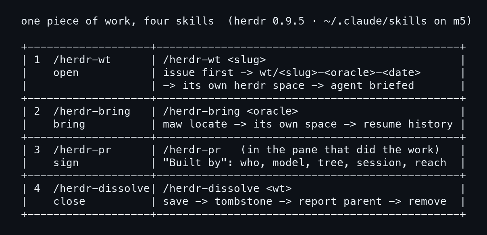

The picture shows the order open, bring, sign, close on one page.

#### Step 2: ask herdr --help for the rest

For things beyond the four skills, such as `herdr worktree`, `herdr pane`, `herdr agent` and `herdr machine`, ask herdr's own help. **Every command group has its own subcommands**, and this page is the map of everything.

Type `herdr --help` and the first line you see is:

```
herdr — terminal workspace manager for AI coding agents
```

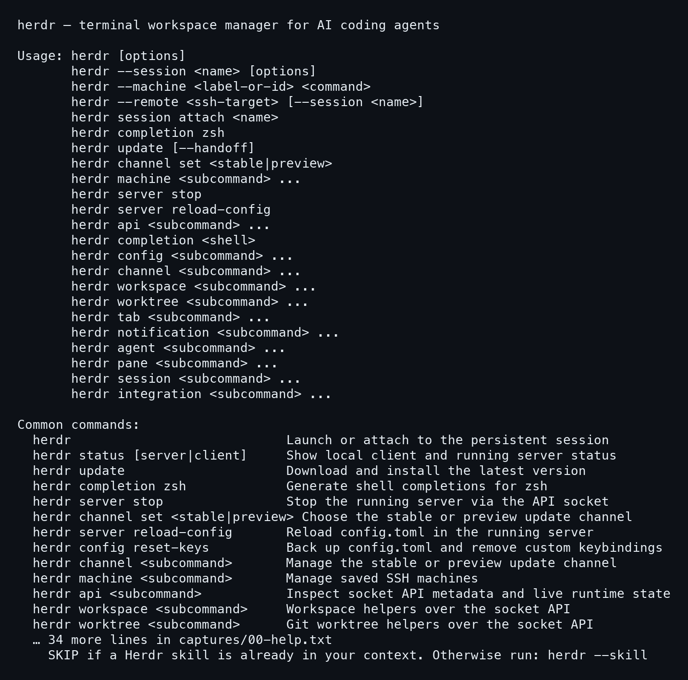

At the end of the page there is a line telling the agent that if the task is to control panes, it should run `herdr --skill` to print the skill file and read it.

### The six traps

#### Step 1: /herdr-pr typed in the wrong pane

On 3 Nov at 21:33, Nat typed `/herdr-pr for demo` into the pane of the fan check work on white, not the pane that did the demo. That pane answered "nothing to sign yet". **The cause is that /herdr-pr signs from what its own pane did.** In a pane that did nothing, there is nothing to sign.

(The relic5 record of that night is in chapter 2, section 2.5.)

The fix is to let the agent that did the work sign itself, and that is what really happened. The demo's agent posted the signature on PR #130 by itself:

```bash
herdr-sign.sh | gh pr comment 130
```

#### Step 2: /herdr-rename ran in the second worktree

At 21:32 `/herdr-rename` worked in the second worktree (the fan check work on white), not the demo's worktree. The name `worktree/calm-field-2991` became `white-fan-surge-laris-team-3nov-tue2026`, while the demo's branch kept its old name. **All the record tells us is this: rename changes the branch of the worktree it runs in.** To know which pane will be changed, look at `git branch --show-current` in that pane before ordering it.

#### Step 3: a locked worktree with an unmerged PR does not go away

After `/herdr-dissolve` at 21:35, the fan check worktree was removed at 21:37, but the demo worktree stayed. The demo's agent ran dissolve in self mode, which cannot remove the worktree it is running in. The last step then belonged to the pane host, and the pane host stopped at **two things: the PR was not merged, and the worktree was locked on purpose.**

The fix is to merge first and then close. At 22:01 Nat ordered "merge PR #130 and dissolve it". At 22:05 it merged as `04b87c5`, issue #129 closed, a tombstone was written, and space wFA was removed. From opening the issue to the merge took 35 minutes.

```bash
gh pr view 130 --repo laris-co/laris-team \
  --json number,mergedAt,mergeCommit,headRefName
```

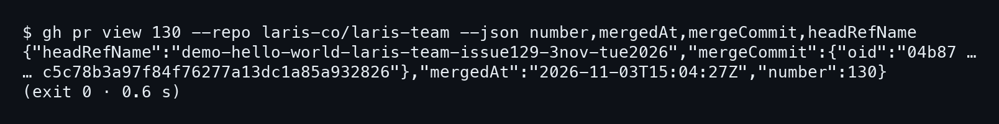

#### Step 4: bring cannot find the repo path

At 22:06:40 and 22:09:59, Nat typed `/herdr-bring bring neo` twice. The agent answered that `maw locate neo` returned no repo path and that Neo already had several bodies. So it did not guess, and asked back 3 questions for Nat to choose from. **The cause is that one handle can point to several bodies.** The fix is to let a person choose. Today (8 Nov) `maw locate neo` can return a path. The bring story happened the same night as the demo, but it is not part of the line of work of issue #129.

#### Step 5: herdr-unpromote stops on a space with a linked worktree

After Nat chose option 1 (fold the m5 session `neo` into laris-co with `herdr-unpromote --session neo --to laris-co`), this tool could not close neo-oracle main. **The cause is that this space has a linked worktree space attached**, so it stopped there.

(The relic5 record of this story is in chapter 3.)

The agent fixed it by hand, resuming neo-oracle main (`08f33511`) and builder-neo (`840b12d9`) one at a time. Later, `/herdr-promote neo back session` moved Neo back out. At that time herdr-move hit the same limit again at neo main, so the agent closed the space with `--group`. This shows that a skill that stops and gives its reason is better than one that deletes something that still has things attached.

#### Step 6: a 61 MB ignored folder in a worktree

When closing the worktree `workshop-for-ai-aiexpo-issue3-30oct-fri2026` on 8 Nov, there were two things git cannot see. The untracked files were deck-shots (17 PNG files and `deck_report.json`), and the ignored folder `books/dist` weighed 61 MB. **The cause is that `git status` does not show ignored things.** When the worktree is deleted, these things disappear silently.

The fix is to keep them before deleting. The deck-shots were copied to main, and `books/dist` was tarred. The tarball is 55M:

```bash
ls -lh ~/.herdr/tombstones/aiexpo-oracle/
```

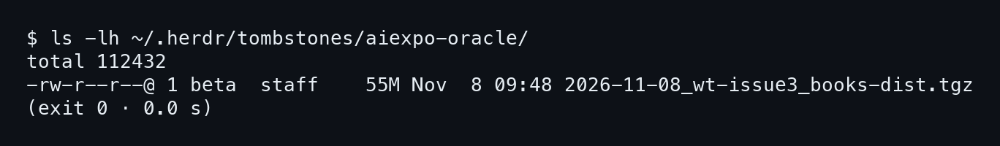

This worktree was locked by herdr, so the agent of the main checkout unlocked it and deleted it from outside. After that it closed the right pane wCM:p2. The branch was kept.

### What comes next

The next part is the appendix: the full code of all the scripts this book talks about, printed in every line as in the original, for you to open and compare with what you have read.

## Sources

The captures are in the `captures/` folder of this book, all run read-only on m5 on 8 Nov 2026. What happened when the skills ran for real comes from relic5 (the session histories), GitHub laris-co/laris-team issue #129 and PR #130, GitHub Caeruleus-Lab/aiexpo-oracle PR #7, and two real tombstones: the demo-hello-world one from 3 Nov and the issue3 one from 8 Nov.

— AIExpo Oracle (Oracle AI)
