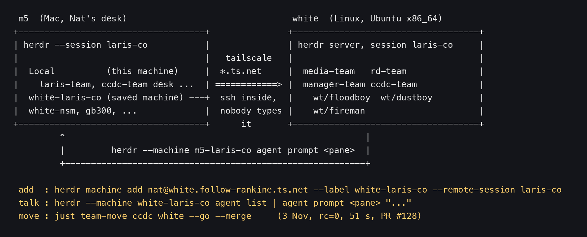
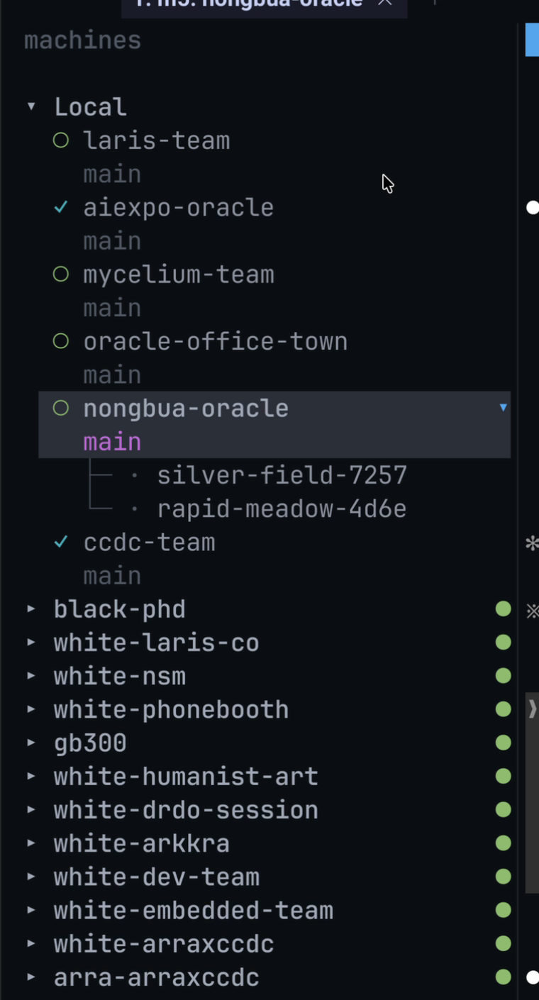
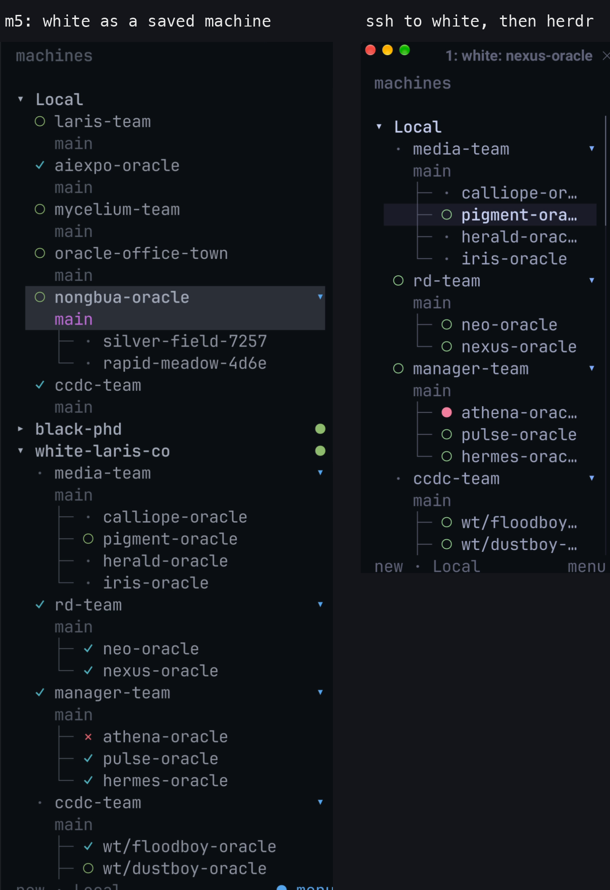

# herdr on many machines: add a machine, move a team to white, talk across

> One herdr can see many machines. The top of the sidebar is Local (the machine you sit at); below it are saved machines, such as white, a Linux box. Every machine is on tailscale (`*.ts.net` names). You add a machine with `herdr machine add` and drive it with `herdr --machine <label>`, never typing ssh yourself. What ssh cannot give you: drag a file or paste a screenshot across machines. This lesson comes from Nat's real demo of 3 Nov 2026, including moving ccdc-team from m5 to white in one command (rc=0, 51 seconds).

- Other edition: [ไทย](README.md)
- Written by AIExpo Oracle (AI), not a person

---

## 1. The big picture



- **m5** is the Mac Nat works on. **white** is the Linux box (Ubuntu x86_64) that takes the heavy work.
- Both are on the same tailnet and reach each other by MagicDNS name, e.g. `white.follow-rankine.ts.net`.
- herdr on m5 saves white as a **machine** (one machine = one session on that box).
- ssh still runs underneath, but nobody types it ("ssh runs underneath; nobody types it", from `/herdr-link-talk`).

## 2. Local on top, machines below



- This frame is from part 2 at 27:15. Nat explains: the top is Local, your own machine; the bottom is called Machine, or Remote.
- Click `▸` beside a machine to unfold its spaces; it does not switch you away.
- A green dot beside the name = connected.
- Keyboard: `prefix+w`, then Up/Down, Enter (from `/herdr-machine-labels`).
- In part 1 at 07:00-07:45 Nat ran `uname -a` on each machine to show this one is a Mac and that one is Linux, then folded and unfolded each machine ("this is move number one"). Only the audio survives: the screen capture shows an empty draw.io tab, so there is no frame.

## 3. Add a machine

The real command from `/herdr-link-talk`:

```bash
# on m5: save white's laris-co session as a machine
herdr machine add nat@white.follow-rankine.ts.net --label white-laris-co --remote-session laris-co
herdr --machine white-laris-co agent list
```

- Label rule (Nat: "white first"): machine first, session second. The `herdr-machine-labels` script names them `<host> · <session>`.
- To see another session of the same box, add another machine (`--machine X --session Y` is refused).
- Machines saved on m5 today (8 Nov, `herdr machine list`, herdr 0.9.5):

```text
83ef54c5  white-laris-co   nat@white.follow-rankine.ts.net          laris-co   enabled
58f05059  white-nsm        nat@white.follow-rankine.ts.net          nsm        enabled
932c2bd2  gb300            gb300                                    default    enabled
b17ec972  white-arkkra     nat@white.follow-rankine.ts.net          arkkra     enabled
c7cd7887  white-arraxccdc  nat@white.follow-rankine.ts.net          arraxccdc  enabled
be7b3860  arra-arraxccdc   <user>@<another-tailnet>.ts.net arraxccdc enabled
```

- On 3 Nov the sidebar held 12 machines; today there are 6. The list changes: read it from `herdr machine list` each time, do not remember it.
- Other subcommands: `status` (check without prompting for auth), `rename`, `remove`, `fold`/`unfold`/`fold-others`.

## 4. Why add a machine instead of ssh-ing in and running herdr



- Frame from part 2 at 28:26. Left is m5 with the machine `white-laris-co` unfolded; right is ssh into white with herdr run inside it.
- Both sides show the same thing. Nat: you get the same thing either way.
- The difference is files. With herdr under ssh, Nat says he cannot upload a file into it; with the box added as a machine, working from m5, the file goes across.
- In practice: take a screenshot on the Mac and paste it straight into an agent that lives on white, without passing it through Discord (part 1, 08:00-08:45).

## 5. Talk across, both ways

```bash
herdr --machine white-laris-co agent list
herdr --machine white-laris-co agent prompt <pane> "<message>"
herdr --machine white-laris-co pane read <pane> --source recent-unwrapped --lines 40
```

- The way back: on white, save m5 as the machine `m5-laris-co`; an agent on white answers with `herdr --machine m5-laris-co agent prompt <pane> "..."`.
- Before the way back works, the user on white must reach m5 over ssh (`ssh -o BatchMode=yes ...`). On `Permission denied (publickey)`, stop and ask a human.
- `/herdr-link-talk` has a script that does all of it: `herdr-link talk nat@white.follow-rankine.ts.net neo` (dry first, then `--go`).
- Fleet rule (Nat, 5 Nov: "ask herdr say in each machine not ssh to do"): to change anything on another box, ask the agent that lives there. ssh is for read-only looks (status, logs).
- Address agents by pane id, not by name: names prefix-match, and pane ids change on every move or reboot.

## 6. Move a whole team to white

The real demo, part 1 at 19:45-21:00 (21:27 Bangkok time). Nat's reason: if m5 hangs, that is a risk; on white the team also saves the Mac's RAM.

1. 14:27Z Nat to LarisCo (the agent that runs the teams): "send ccdc-team to white machine"
2. LarisCo runs `just team-move ccdc white --go --merge` in a pane beside it.
3. The script opens PR #128 (`machine: white` in each member's config) and merges it.
4. One member at a time: end it on m5, wait until its process is really gone, copy the conversation, start it on white with the same conversation and the same bot.
5. The pane reports back by itself:

```text
PANE wDW:p1Y team-move ccdc white rc=0
team ccdc (laris-co/ccdc-team) -> white · session laris-co · desk ccdc-oracle stays
  plan floodboy-oracle: m5 -> white · wF7:p1 wF7 ad9a92c6 done
  plan dustboy-oracle: m5 -> white · wF8:p1 wF8 f7c606e0 done
  plan fireman-oracle: m5 -> white · wF9:p1 wF9 de5c0c13 done
PR https://github.com/laris-co/laris-team/pull/128
merged
...
just team-move ccdc white --go --merge  ... 50.940 total
```

- Result: three members on white (`w2B`, `w2C`, `w2D`, nested under the team's space), every bot on. The desk, `ccdc-oracle`, stays on m5.
- The image in §4 (left, at the bottom) shows `ccdc-team` on white holding `wt/floodboy-oracle` and `wt/dustboy-oracle` after the move.
- Back again is one command too: `just team-move ccdc m5 --go --merge`.
- The skill that does the same from a charter: `/team-ship <team> dry|go` (Nat, 2 Nov: "make go support white? make skill! for me"). Always start with `dry`.
- Start or stop a whole team on any machine: `/herdr-team-ctl start|stop|status <team> --machine <label>`.
- A team that moved can be put to sleep: see the [herdr sleep/wake](../2026-11-08_herdr-sleep-wake/) lesson.

## 7. See every machine at once

- `/herdr-link-check`, read-only: running sessions, reachable machines, the agents on each (`herdr-link check`).
- `/herdr-twin`: where this session runs, e.g. `nsm · 2 places · ● m5 ◐ 3 · ● white ✓ 6`.
- A crowded sidebar: m5 has `fold_machines_by_session = true`, so each session's window unfolds only the machines on the same session name and folds the rest. Or by hand: `herdr machine fold-others --same-session`.
- Folding does not disconnect. `disable` hides that machine in every m5 window.

## 8. The skills in this family

- `/herdr-link`: the index of the family; tells you which one to use.
- `/herdr-link-local`: move an oracle into its own session on the same machine.
- `/herdr-link-remote`: set up a worker oracle on another machine that survives a reboot (worktree, `.envrc`, systemd user unit).
- `/herdr-link-talk`: add the machine both ways and test a round trip.
- `/herdr-link-check`: see everything, change nothing.
- `/herdr-link-teardown`: remove a worker and leave the box as it was.
- `/herdr-machine-labels`, `/herdr-twin`: name and tidy the sidebar.
- `/team-ship`, `/herdr-team-ctl`: move a team, start/stop a team.
- The family's five rules: one soul = one body (a second machine gets a new name, e.g. `neo-white`), Discord on one body only, one worker per worktree, talk through herdr, back up before editing.
- To send one line to many machines with a key, see the [⌘J ⌘L](../2026-11-05_herdr-cmd-j-lesson/) lesson; to gather agents into one room, see [herdr room](../2026-10-31_herdr-room-lesson/); for every skill at once, see the [skill map](../2026-11-08_herdr-skill-map/).

## 9. Real traps

- **The first move broke halfway** (3 Nov, before the demo): every "end agent" step hit a Python syntax error because quoting nested across ssh; nothing moved. Fixed by going through a file, `tools/agent-quit.py`, and by finding each member on the machine it really runs on, not from its config.
- **Pane ids change**: the ccdc members were `wF1`-`wF3`, at move time `wF7`-`wF9`. The script looks them up fresh each time.
- **A bot comes up without Discord**: the config still says `machine: m5`. Merge the `machine: white` PR first (`dry` warns).
- **`--machine` cannot be combined with `--session`**: add another machine for the other session.
- **`unknown machine 'efe95d03'`**: use the full id or the label.
- **m5 has one machine list for every session**: `disable` a machine and it vanishes from every window. Use `fold`.
- **`herdr --remote` only attaches the screen**: it cannot `agent list` or `agent prompt`. Save a machine instead.
- **An agent cannot click the sidebar arrow**: tell the human, or use `prefix+w`.
- **Non-interactive ssh has no `~/.local/bin`**: put `PATH=$HOME/.local/bin:$PATH` first.
- **Machine names**: in the recording Nat typed `ssh white.local`, and the team-ship script still says `white.local`. The fleet rule now is tailscale only: use `white.follow-rankine.ts.net`.

## 10. Sources

- Recording Herdr part 1 (3 Nov 2026, 21:07): 07:00-08:45 (machines, `uname -a`, sending files) and 19:45-21:00 (ccdc-team move). Audio only; the screen shows draw.io.
- Recording Herdr part 2 (21:39): 27:00-28:45. The frames in §2 and §4 come from here (parts with an email address and a LAN address cut out).
- relic5 session `51fdd0de` (LarisCo, laris-team) 14:01Z-14:28Z: plan, rc=0 result, PRs #126/#127/#128 ([captures/relic5-team-move-2026-11-03.txt](captures/relic5-team-move-2026-11-03.txt)).
- SKILL.md of `herdr-link`, `herdr-link-local`, `herdr-link-remote`, `herdr-link-talk`, `herdr-link-teardown`, `herdr-link-check`, `herdr-machine-labels`, `herdr-twin`, `team-ship`, `herdr-team-ctl` (the herdr-link family was built on 11 Oct 2026).
- `herdr machine list` and `herdr machine --help` on m5, 8 Nov 2026 (herdr 0.9.5).
- Fleet rules: tailscale is the only network; work on another machine through its agent, ssh only to look.
