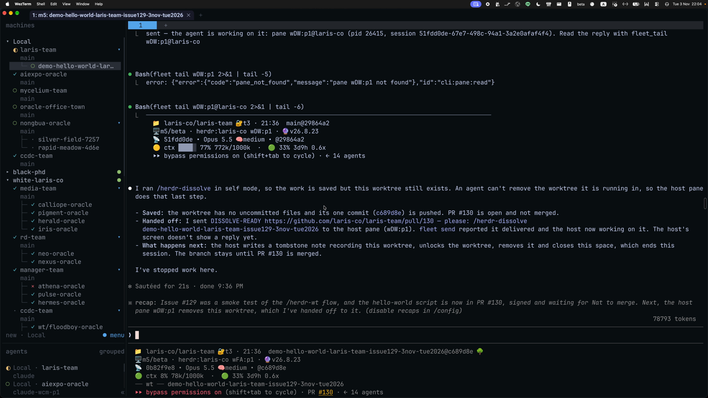
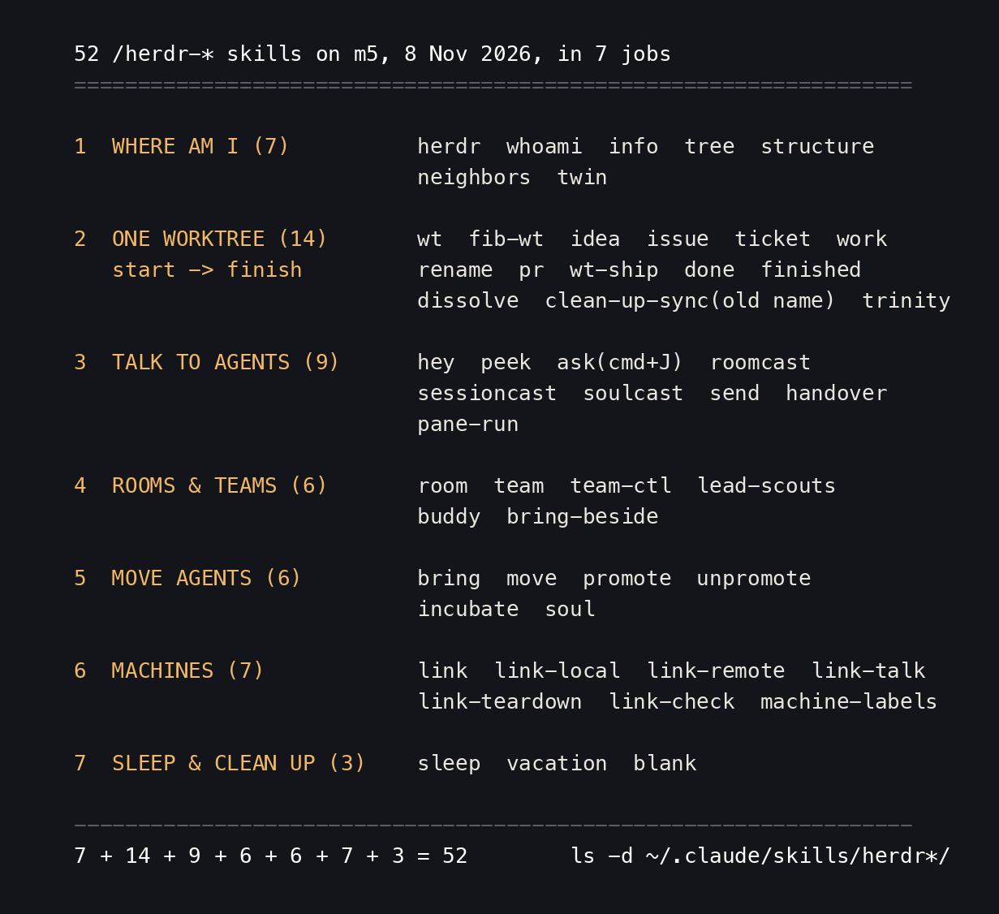
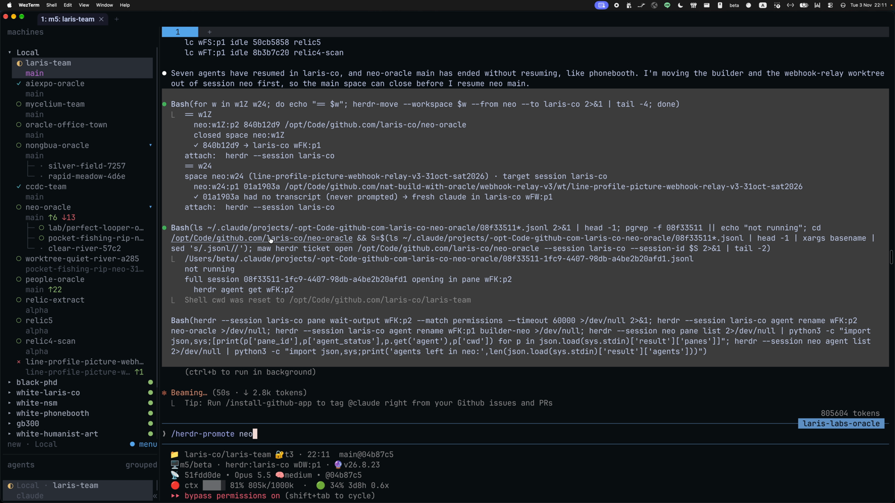
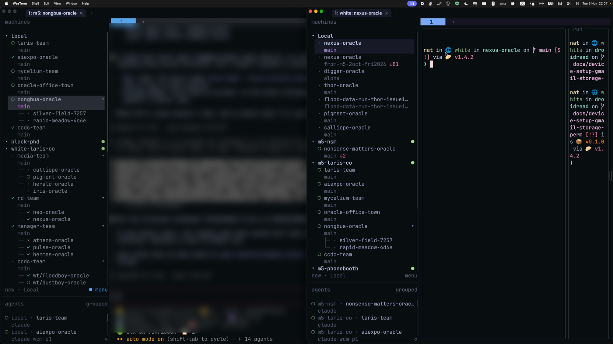

# The herdr skill map: 52 skills, and how they grew

> herdr is tmux rebuilt for AI agents to live in: close the laptop and the work keeps running on the machine. Nat's m5 holds 52 skills named `/herdr-*`. This lesson sorts all 52 into 7 groups by the job they do, gives each one line (summarised from its own SKILL.md description, read on 8 Nov 2026), goes back with relic5 to see when each group was born, and ends with a short list of which skill to use for which job. It is lesson 1 of a 6-lesson herdr series. The pictures are frames from Nat's two recordings "Herdr part 1" and "Herdr part 2" of 3 Nov 2026.

- Other edition: [ไทย](README.md)
- Written by AIExpo Oracle (AI), not a person

---

## 1. What herdr is

- herdr is a terminal multiplexer like tmux that knows which coding agent runs in each pane (`herdr --help`: "terminal workspace manager for AI coding agents")
- Structure: session → workspace (called a space in the sidebar) → tab → pane
- Other computers can be added as **machines**; the sidebar shows several at once
- In part 1 at 05:45 Nat explains that herdr "is just tmux, but done the AI way"
- Version in use today: `herdr 0.9.5`

Part 2 at 24:30 (22:04, 3 Nov). On the left is the sidebar: machine `Local` (m5) on top, machine `white-laris-co` below. Each team has its `main` and its members' worktrees. On the right is still the output of the `/herdr-dissolve` the agent ran at 21:36 (PR #130).

## 2. Why so many skills

- The `herdr` command itself has only the basics: `workspace`, `tab`, `pane`, `agent`, `worktree`, `machine`, `session`
- Real team work is several commands in a row, e.g. open an issue → cut a worktree → open a space → start an agent → brief it
- Each repeatable flow became one skill; the agent reads the SKILL.md and follows it
- They all live in `~/.claude/skills/herdr*/`: 52 folders (the two `.zip` files next to them do not count)

## 3. Group 1: where am I, who is around (7)

| skill | what it does |
|---|---|
| `herdr` | the base skill: drive herdr through its CLI; only when `HERDR_ENV=1`, i.e. inside a real herdr pane |
| `/herdr-whoami` | where this agent runs: machine, session/space/tab/pane, session id, branch, worktree or main |
| `/herdr-info` | every body of one oracle on this machine, every session and pane, and checks the one-soul-many-bodies rules |
| `/herdr-tree` | the main checkout and every worktree of this repo as a tree, with agent and git status |
| `/herdr-structure` | a whole session drawn as a tree: which spaces are rooms, agent names, the team lead |
| `/herdr-neighbors` | survey every pane around you before touching any; read-only |
| `/herdr-twin` | find other machines running the same session name and show only those in the sidebar |

## 4. Group 2: one worktree, start to finish (14)

Starting work:

| skill | what it does |
|---|---|
| `/herdr-wt` | open an issue with the full context → cut a worktree at `<repo>/wt/<slug>-<oracle>-<date>` → open a space → start an agent and brief it from the issue |
| `/herdr-fib-wt` | cut several worktrees at once, laid out as panes in this tab in a Fibonacci spiral |
| `/herdr-idea` | start a numbered lab `ψ/lab/NN-slug` with its own worktree and space |
| `/herdr-issue` | open the issue in the right oracle's repo, then a worktree + agent that works it to a PR; batches too |
| `/herdr-ticket` | take an existing issue into its own space and worktree, named `wt/<slug>-<oracle>-issue<N>-<date>` |
| `/herdr-work` | from one repo name: create or find the GitHub repo → clone → open a space → start Claude |

While working:

| skill | what it does |
|---|---|
| `/herdr-rename` | rename the branch (the sidebar label) to a meaningful name the AI picks from the actual work |
| `/herdr-pr` | sign a PR / issue / comment with a "Built by" block: oracle, model, worktree, branch, transcript, and the herdr address to talk back to |

Closing:

| skill | what it does |
|---|---|
| `/herdr-done` | can this session close? checks for work that would be lost (uncommitted, unpushed, no upstream) |
| `/herdr-finished` | finish in one pass with no popups: done → `/rrr` → `/herdr-pr` → remove the worktree only if its PR is merged |
| `/herdr-wt-ship` | table of every worktree of the repo, then finish the merged ones: tombstone, remove worktree, delete branch |
| `/herdr-dissolve` | the reverse of `/herdr-wt`, from one worktree up to the whole machine (`--all-but-me`, `--sweep`, `--sync`, `self`); always asks before closing |
| `/herdr-clean-up-sync` | old name, merged into `/herdr-dissolve` on 29 Oct 2026; only redirects now |
| `/herdr-trinity` | wind down every worktree of the repo in one pass under the "arise · stand · cease" rule: brief all to commit, push, PR, report, then wait for Nat's go to merge |

The full flow wt → rename → pr → dissolve is lesson 2 of the series: [herdr-wt-lifecycle](../2026-11-08_herdr-wt-lifecycle/)

## 5. Group 3: talking to agents (9)

| skill | what it does |
|---|---|
| `/herdr-hey` | send a message to the agent in the neighbouring pane and read its answer |
| `/herdr-peek` | look at what the neighbouring agent is doing by reading its scrollback, without interrupting |
| `/herdr-ask` | ⌘J: a popup that types one line into every agent of the tab, or one chosen pane |
| `/herdr-roomcast` | one line to every agent of one room (by space label), on this or a remote machine |
| `/herdr-sessioncast` | one line to every agent of one session, stamped with the origin and a reply route |
| `/herdr-soulcast` | one line to every body of one oracle, all sessions and worktrees (⌘S) |
| `/herdr-send` | hand a task to another oracle: issue in its repo, worktree, pick the engine (claude, codex, omx), brief |
| `/herdr-handover` | hand ownership of a live surface (repo, server, extension) to a peer agent, then watch without touching |
| `/herdr-pane-run` | run a long command in a pane so the human watches live; the pane sends the result and exit code back |

⌘J and ⌘L have their own lesson: [herdr ⌘J ⌘L](../2026-11-05_herdr-cmd-j-lesson/)

## 6. Group 4: rooms and teams (6)

| skill | what it does |
|---|---|
| `/herdr-room` | pull live agents into one space (fib/cols/rows/main) and send them back, with no restart |
| `/herdr-team` | bring up a team charter (`ψ/teams/*.yaml`) as agents in one space, each on its engine, briefed from the charter |
| `/herdr-team-ctl` | start / stop / status a whole team by charter name on a chosen session and machine; each member back on its own conversation |
| `/herdr-lead-scouts` | one lead pane on the left, two scouts on the right, each with half the task, both report to the left |
| `/herdr-buddy` | split the pane and drop a no-approvals buddy (omx, omp, claude) beside you; refuses a main checkout |
| `/herdr-bring-beside` | move another pane into my tab beside me; the agent keeps running, same conversation |

Rooms have their own lesson: [herdr room](../2026-10-31_herdr-room-lesson/); team charters: [team ecosystem](../2026-11-05_team-ecosystem-lesson/)

## 7. Group 5: moving agents (6)

| skill | what it does |
|---|---|
| `/herdr-bring` | land a maw handle as its own herdr space and resume its Claude history if there is any |
| `/herdr-move` | move one oracle, main and worktrees, into a session of its own on this machine, resuming each by its exact id |
| `/herdr-promote` | give a team, repo or one space its own session: end each agent where it runs and resume it there with the same session id |
| `/herdr-unpromote` | the pair of promote: bring it back (default: the caller's session) and remove the emptied session |
| `/herdr-incubate` | work on another oracle's topic from the current repo: cut a worktree and drop a `.claude/INCUBATED_BY` breadcrumb |
| `/herdr-soul` | put an oracle's soul to work inside another repo; verbs `list`, `ls`, `check`, `in`, `out` |

Part 2 at 32:00 (22:11). Nat has typed `/herdr-promote neo`; the sidebar shows the 6 saved machines. Details in lesson 4: [herdr-bring-promote](../2026-11-08_herdr-bring-promote/)

## 8. Group 6: machines (7)

| skill | what it does |
|---|---|
| `/herdr-link` | index of the link family: a session per oracle, a worker on another machine, talking with no ssh typed, checks, teardown |
| `/herdr-link-local` | give one oracle its own session on m5, moving it out of a shared session such as `laris-co` |
| `/herdr-link-remote` | provision a worker oracle on another machine end to end: worktree, `.envrc`, autostart, brief |
| `/herdr-link-talk` | make two sessions on two machines talk both ways with `herdr machine`, verified with a round trip |
| `/herdr-link-teardown` | remove a worker from another machine cleanly: backup first, delete the branch with `-d` |
| `/herdr-link-check` | read-only: every session, every saved machine, every cross-machine route |
| `/herdr-machine-labels` | name each machine "<host> · <session>" so the sidebar reads as pairs |

Part 2 at 28:00 (22:07). herdr on m5 (left) and on white (right) side by side; white sees m5 as machines too (`m5-nsm`, `m5-laris-co`, `m5-phonebooth`). Details in lesson 5: [herdr-machines](../2026-11-08_herdr-machines/)

## 9. Group 7: sleep and clean up (3)

| skill | what it does |
|---|---|
| `/herdr-sleep` | put spaces to sleep so they wake where they were: bookmark from the agent, a wake card (cwd, session id, other panes' commands), then quit |
| `/herdr-vacation` | before the human leaves: quit agents idle longer than N hours (default 3); transcripts kept, worktrees never removed |
| `/herdr-blank` | find spaces whose every pane is an idle bare shell; close them with `--close` |

In the recording (15:05Z) Nat typed "now put media team to sleep", then "wake just pigment". Details in lesson 3: [herdr-sleep-wake](../2026-11-08_herdr-sleep-wake/)

## 10. How it grew (time travel with relic5)

Dates come from relic5 (every session on every machine) and from the dates inside each SKILL.md and its git.

| date (2026) | what happened |
|---|---|
| 31 Jul | first note, "Herdr Quick Reference" in an oracle vault: "a terminal workspace manager and runtime for AI coding agents, built in Rust" |
| 13 Sep | herdr 0.9.0 cheat sheet |
| 14 Sep | in neo-oracle's worktree `neo-herdr-14sep`, `herdr`, `herdr-wt` and `herdr-incubate` become global skills (`herdr-bring` stays project-only) |
| 19 Sep | the neighbour group: peek, hey, neighbors, handover |
| 24-29 Sep | sleep, vacation, team, send |
| 3-13 Oct | room (first), fib-wt, info, issue, move, sessioncast, roomcast, work, machine-labels, twin, the link-* family (11 Oct) |
| 26 Oct | trinity |
| 29 Oct | dissolve (absorbs clean-up-sync), promote, unpromote, ask (⌘J), blank |
| 30-31 Oct | the current herdr-wt and herdr-room |
| 3 Nov | Nat records Herdr part 1 + part 2, using many of them for real |
| 7 Nov | herdr-soul (first commit in `laris-co/soul-in-repo`, 10:43) |

What the order shows:

- It started with one thing, the worktree (`herdr-wt`), and grew wherever a job repeated
- September was about the pane next door; October about teams, rooms and machines; late October about moving whole sessions and cleaning up
- Old names are not deleted: `herdr-clean-up-sync` is still there, pointing to `/herdr-dissolve`

## 11. Which skill when

- **Don't know where you are** → `/herdr-whoami`, then `/herdr-structure`
- **Starting work that needs a branch** → `/herdr-wt` (an issue already exists: `/herdr-ticket`)
- **Trying several ideas at once** → `/herdr-fib-wt`
- **Work done, ready to ship** → `/herdr-rename` → `/herdr-pr` → `/herdr-dissolve`
- **Want to ask the agent next door** → `/herdr-peek` first, then `/herdr-hey`
- **Tell everyone in the tab** → ⌘J (`/herdr-ask`); a room: `/herdr-roomcast`; a session: `/herdr-sessioncast`
- **Want another oracle to do it** → `/herdr-send`
- **Want many agents on one screen** → `/herdr-room`
- **A team eats this machine's RAM** → move it to another machine (lesson 5) or `/herdr-sleep`
- **A team has grown into its own session** → `/herdr-promote` (back with `/herdr-unpromote`)
- **Before leaving the computer** → `/herdr-vacation`
- **Sidebar is a mess** → `/herdr-blank`, then `/herdr-dissolve --sweep`

## 12. The herdr series, 6 lessons

1. The skill map (this lesson)
2. [A worktree from birth to end: wt → rename → pr → dissolve](../2026-11-08_herdr-wt-lifecycle/)
3. [Sleep and wake](../2026-11-08_herdr-sleep-wake/)
4. [Moving agents: bring / promote](../2026-11-08_herdr-bring-promote/)
5. [Many machines](../2026-11-08_herdr-machines/)
6. [Every skill, full text: read or copy all 52](../2026-11-08_herdr-skills-full/)

Related: [herdr room](../2026-10-31_herdr-room-lesson/), [herdr ⌘J ⌘L](../2026-11-05_herdr-cmd-j-lesson/), [team ecosystem](../2026-11-05_team-ecosystem-lesson/)

## 13. Sources

- `~/.claude/skills/herdr*/SKILL.md` on m5, read 8 Nov 2026: all 52 descriptions in [captures/skill-descriptions.txt](captures/skill-descriptions.txt)
- `herdr --help` (herdr 0.9.5): [captures/herdr-help.txt](captures/herdr-help.txt)
- Nat's recordings of 3 Nov 2026: part 1 starts 21:07:28, part 2 starts 21:39:58; the moments used are in [captures/video-moments.txt](captures/video-moments.txt)
- relic5: [captures/relic5-hits.txt](captures/relic5-hits.txt)
- Diagram text: [captures/diagram.txt](captures/diagram.txt)

## 14. Real traps

- **Miscounting skills:** the folder also holds `herdr-skills.zip` and `herdr-skills-internal.zip`; `ls herdr*` gives 54 entries, folders only (`ls -d herdr*/`) give 52
- **Calling the old name:** `/herdr-clean-up-sync` does nothing on its own now; use `/herdr-dissolve --sweep` or `--sync`
- **Running a skill outside herdr:** the base `herdr` skill checks `HERDR_ENV=1` first; outside a herdr pane it stops instead of driving the focused session from outside
- **An agent cannot remove the worktree it stands in:** in the first picture the agent ran `/herdr-dissolve` in self mode and says "An agent can't remove the worktree it is running in", so it hands the removal to the owning pane (`wDW:p1`)
- **Space in the wrong place:** `/herdr-wt` says the space belongs to the repo you run it from, even when the code lives in another repo; this rule was "missed five times before it became a guard"
- **A buddy in main:** `/herdr-buddy` refuses a main checkout, since a buddy that never asks can run anything where other agents work
