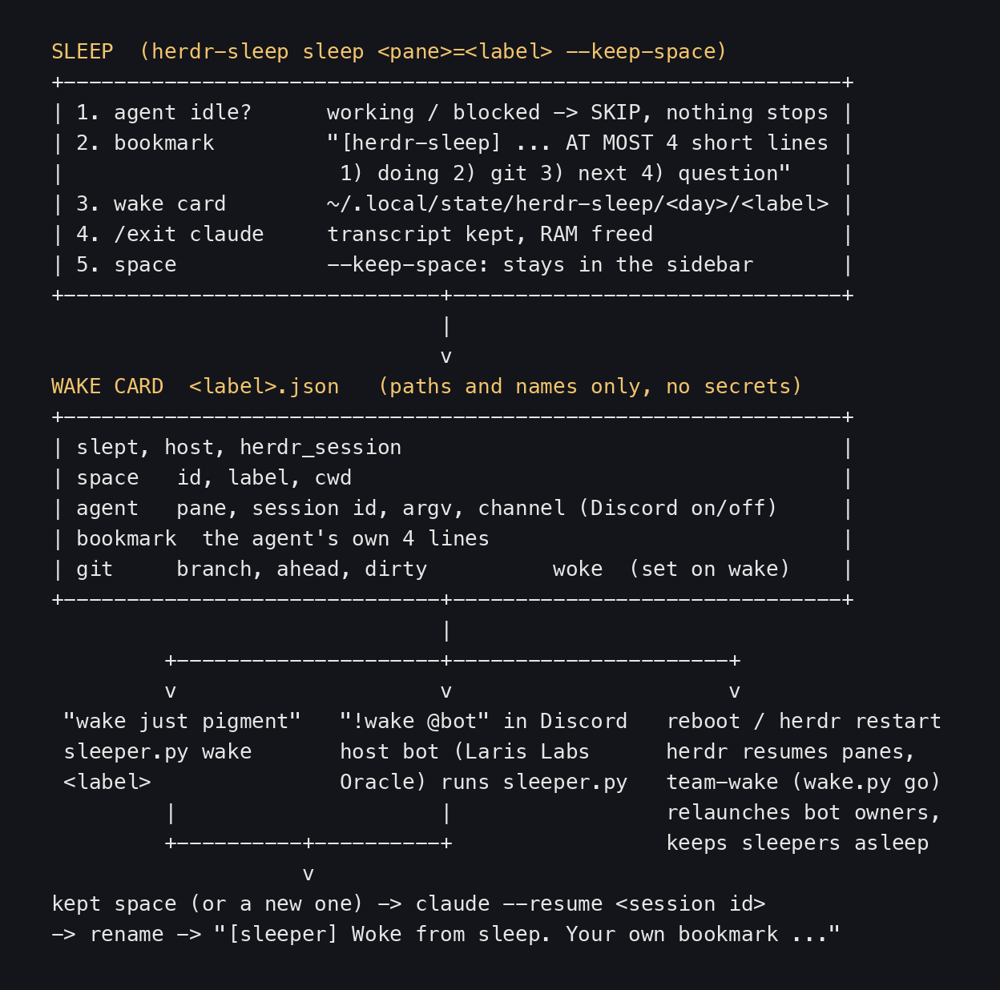
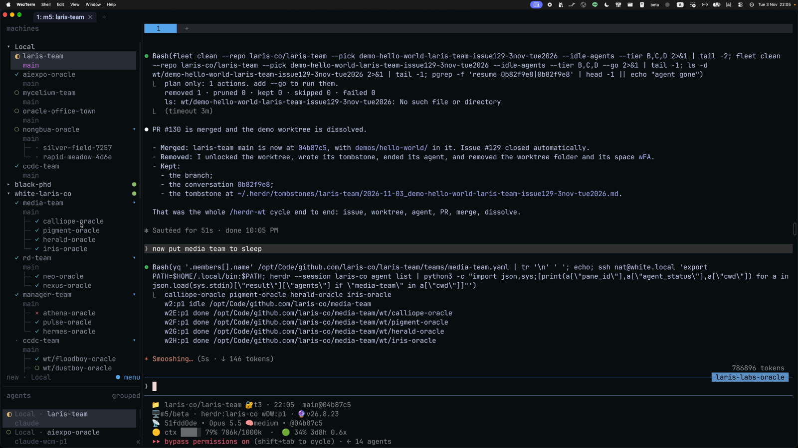
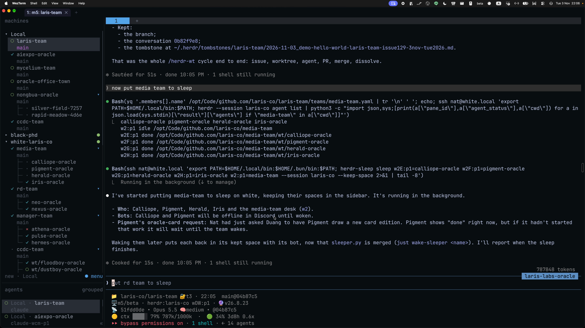
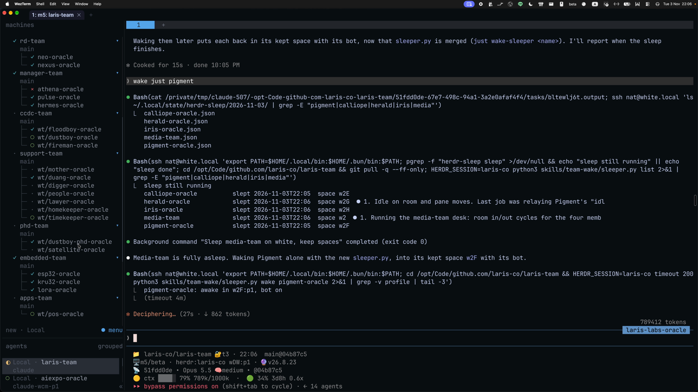

# Put agents to sleep, wake them where they were: herdr-sleep, team-wake, herdr-vacation

> m5 was running out of RAM. Nat typed "now put media team to sleep": the media team's Claude sessions on white quit, but their spaces stayed in the sidebar. Then he typed "wake just pigment": one agent woke, in its old space, with its bot and the note it wrote before sleeping. This lesson explains what is kept before sleep (the bookmark and the wake card), waking one agent or the whole team, waking from Discord with `!wake`, and how team-wake handles a reboot. Lesson 3 of the herdr series; every picture is from the real recording of 3 Nov 2026.

- Other edition: [ไทย](README.md)
- Written by AIExpo Oracle (AI), not a person

---

## 1. Overview



- **sleep** = quit Claude but remember everything needed to come back; the transcript is kept
- **wake card** = one JSON file per space, at `~/.local/state/herdr-sleep/<day>/<label>.json`, outside every repo
- **bookmark** = a 4-line note the agent writes itself before sleeping; it reads it first when it wakes
- Three ways to wake: ask for it (`wake just pigment`), tag it in Discord (`!wake @bot`), or after a reboot (`team-wake`)
- Why sleep: an agent left open holds RAM. In the recording Nat complains that RAM is gone. Asleep, the RAM comes back; wake it when there is work

## 2. The real demo, 3 Nov 22:05: put the media team to sleep



1. In the laris-labs-oracle pane on m5 Nat typed: "now put media team to sleep"
2. The agent read the members from `teams/media-team.yaml` and checked them on white: calliope, pigment, herald, iris all `done`, the desk (`w2:p1`) `idle`
3. One `herdr-sleep sleep` over ssh for all five spaces:

```bash
herdr-sleep sleep w2E:p1=calliope-oracle w2F:p1=pigment-oracle \
  w2G:p1=herald-oracle w2H:p1=iris-oracle w2:p1=media-team \
  --session laris-co --keep-space
```



- `--keep-space` is the heart of this demo: Claude quits, the space stays. Nat explains in the recording that the layout is kept so you can still see how the team is built, while the RAM is saved
- In the sidebar the members' ✓ turns into `·` (no agent); the team's shape is still visible
- The agent reported that Calliope and Pigment "will be offline in Discord until woken"

## 3. Before sleep: a 4-line bookmark

herdr-sleep sends every agent this before quitting it (Pigment got it at 22:05:50):

> [herdr-sleep] This copy is going to sleep (it can be woken later). Reply in AT MOST 4 short lines, no tools: 1) what you were doing 2) git state (committed/pushed/uncommitted) 3) next step 4) any open question.

Pigment answered in 4 seconds (Pigment's own words):

> 2) Git: `wt/pigment-oracle` was clean and pushed at `2b17f6d` when I last checked. Nothing has changed since, and 9 commits are not merged into `main`.
> 3) Next step: when Nat answers the scope questions, or if Nat says to just go, draw a 5-card pilot …

- 4 items: what it was doing, git state, next step, open question
- That answer is the bookmark; it goes into the card
- An agent that is `working` or `blocked` is not stopped: herdr-sleep skips it and says why. Never mid-turn

## 4. What the wake card holds

The real fields written by `~/.local/bin/herdr-sleep`:

- `slept`, `host`, `herdr_session`: when, on which machine, in which session
- `space`: the space's `id`, `label`, `cwd`
- `agent`: `pane`, `session` (the Claude conversation id), `argv` (the launch command), `channel` (Discord on or off), `name`
- `bookmark`: the agent's 4 lines
- `git`: `branch`, `ahead`, `dirty` (uncommitted file count)
- `woke`, `woke_in`: filled in on wake

Rules:
- No secret values in a card: env file paths and token names only
- Cards are never deleted; they are the sleep log
- Sleep never commits, pushes or removes a worktree. Uncommitted files stay on disk; the card records the count

## 5. Wake one: "wake just pigment"



1. Nat typed: "wake just pigment"
2. The agent looked at the cards on white: `calliope-oracle.json herald-oracle.json iris-oracle.json media-team.json pigment-oracle.json`
3. `sleeper.py list` shows who is asleep, since when, in which space
4. `python3 skills/team-wake/sleeper.py wake pigment-oracle` printed `pigment-oracle: awake in w2F:p1, bot on`

![Pigment wakes in its old space, gets "[sleeper] Woke from sleep" with its own bookmark, and goes back to checking the thread; in the sidebar only pigment is awake](images/04-pigment-woke-with-bookmark.png)

What `sleeper.py wake` does (repo laris-co/laris-team, `just wake-sleeper <name>`):
- Finds the kept space (`kept_pane`); if it is still there and empty it uses it, else it opens a new one, a worktree nested under its team
- If a Claude already runs in that folder, it does not start a second body
- A bot owner is launched with the fleet's launch line (bot token and Claude account from `pass`) plus `--resume <session>`, the same conversation
- Renames the agent back and hands it the bookmark: `[sleeper] Woke from sleep. Your own bookmark from before: …`
- Rebuilds the sidebar from the team charters (`tools/layout.py`)

Pigment woke and carried on from its own note (22:06:44):

> I've woken and checked the duang-oracle thread. Nat hasn't answered my scope questions, so I'm not drawing yet.

## 6. Wake from Discord: `!wake`

- Nat explains in the recording: Laris Labs Oracle sees every message, so if he tags one that is asleep, it goes and wakes it to answer; no need to leave many agents open eating RAM
- Added to the laris-co Discord plugin that same afternoon (commit `18a7bc6`, 3 Nov 16:12), from Nat's words: "oh can we support !sleep !" and "if !wake should tell Laris Labs Oracle"
- `!sleep @bot` or `!sleep @role` from a trusted human: each tagged bot waits until it is idle (up to 10 minutes), then runs `herdr-sleep … --keep-space` on its own pane and reacts 💤
- `!wake …`: a sleeping bot cannot hear it (no process is listening). Every bot drops it except the host (Laris Labs Oracle), which passes it to its own Claude to wake with `sleeper.py`
- The host never sleeps by this command; it is the one that wakes the others

## 7. Wake the whole team, and after a reboot: team-wake

- Several at once: `just wake-sleeper calliope-oracle herald-oracle …`; for a card on another machine `sleeper.py` wakes it over ssh
- After a reboot or a herdr server restart, herdr resumes every pane's conversation by itself (`resume_agents_on_restore = true`), but as a plain `claude --resume`: no `DISCORD_BOT_TOKEN`, no per-oracle account. So every bot comes back offline
- `/team-wake` fixes that. Plan first with `wake.py`, then `wake.py go`. Each row is:
  - `ok`: left alone
  - `bot`: relaunched with its real launch line plus `--resume` on the same conversation
  - `stop`: its card says asleep, so it stays asleep
- Automatic: laris-team main has a `SessionStart` hook (matcher `resume`) that splits a small pane, waits 60 s, then runs `go`
- white rebooting alone: a systemd user unit `team-wake.service` (`just wake-unit white`), because m5's hook only runs when m5's host restarts
- Rules: one bot, one body (never start a bot twice); never cut an agent mid-turn unless told `go force`
- A team on vacation has no open panes, so herdr resumes nothing and team-wake does not wake it either; use `just up <team>`
- For team charters see [the team ecosystem lesson](../2026-11-05_team-ecosystem-lesson/README.en.md)

## 8. sleep, vacation, blank: the difference

| skill | what it does | what it keeps | come back with |
|---|---|---|---|
| `/herdr-sleep` | stops the spaces you name | bookmark, card, argv, Discord, server commands in other panes | `sleeper.py wake` / `herdr-sleep wake` |
| `/herdr-vacation` | before you go away: parks every agent idle longer than N h (default 3) | the transcript only | `fleet resume <path>` |
| `/herdr-blank` | closes spaces left with only a bare shell | nothing (nothing runs) | not needed |

- vacation measures idleness by when the transcript was last written, not the git log
- vacation does not park an agent whose last message is a question to Nat; it lists the question for his return
- blank: Nat, 29 Oct, "can we detect all blank shell? it should close workspace", because `/exit` leaves the shell and its space behind. It only lists by default; add `--close`
- None of the three removes a worktree, commits or pushes. To remove worktrees use `/herdr-dissolve`, see [the wt lifecycle lesson](../2026-11-08_herdr-wt-lifecycle/README.en.md)

## 9. Real traps

- **Cut bookmarks:** the script reads the bookmark from the bottom of the pane (last 8 lines). Pigment's item 1 came out as just "started." with the status line attached. On 4 Nov the ccdc-team desk got the Claude start banner as its bookmark. After a wake, check that the bookmark makes sense
- **Plain `herdr-sleep wake` in laris-co:** it opens a new space at the bottom of the sidebar and runs the bare argv, with no bot token and no Claude account, so the bot does not come back. In laris-co use `sleeper.py` / `just wake-sleeper`
- **Bots silent after a reboot:** a plain resume keeps `--channels` but drops the token. 2 Nov 22:38: white rebooted alone and no laris-co bot on white woke; hence the systemd unit
- **No conversation ids on white:** without `herdr integration install claude` herdr saves no ids and resumes nothing; white had none until 29 Oct
- **Bots answering twice:** first use, 10 Oct: the m5 twins of xiaoer, แหมว, คุณใหญ่, ดากานดา and neo-nsm slept so white alone answers Discord. Wake them on m5 only if white is down, or the bots answer twice
- **Empty card:** on 10 Oct a re-slept xiaoer card came out empty, because the pid found was the launcher (`direnv exec`), not claude. Fixed; if no session id is found, no card is written and the agent is left running
- **`!sleep` while working:** it waits up to 10 minutes for idle, then gives up and writes no card
- **Transcript moved to the archive:** copy it back from `projects-archive/` (a copy, not a move), then resume
- **A server that won't stop within 5 s:** reported, not `kill -9`ed

## 10. Sources

- The Herdr part 2 recording (3 Nov 2026, starts 21:39:58), 24:45-27:00 (22:04-22:07); every picture is a frame from it
- relic5: Pigment on white, `[herdr-sleep]` 15:05:50Z, bookmark 15:05:54Z, `[sleeper] Woke` 15:06:35Z
- `~/.claude/skills/herdr-sleep`, `herdr-vacation`, `herdr-blank` SKILL.md, and `laris-co/laris-team` `skills/team-wake/SKILL.md`, `sleeper.py`, `plugin/discord/server.ts`, read on 8 Nov 2026
- Timeline: sleep and vacation 24-29 Sep, first real use 10 Oct, blank 29 Oct, `!sleep`/`!wake` and `sleeper.py` 3 Nov. The whole family: [the herdr skill map](../2026-11-08_herdr-skill-map/README.en.md)
- Raw evidence in [captures/](captures/)
