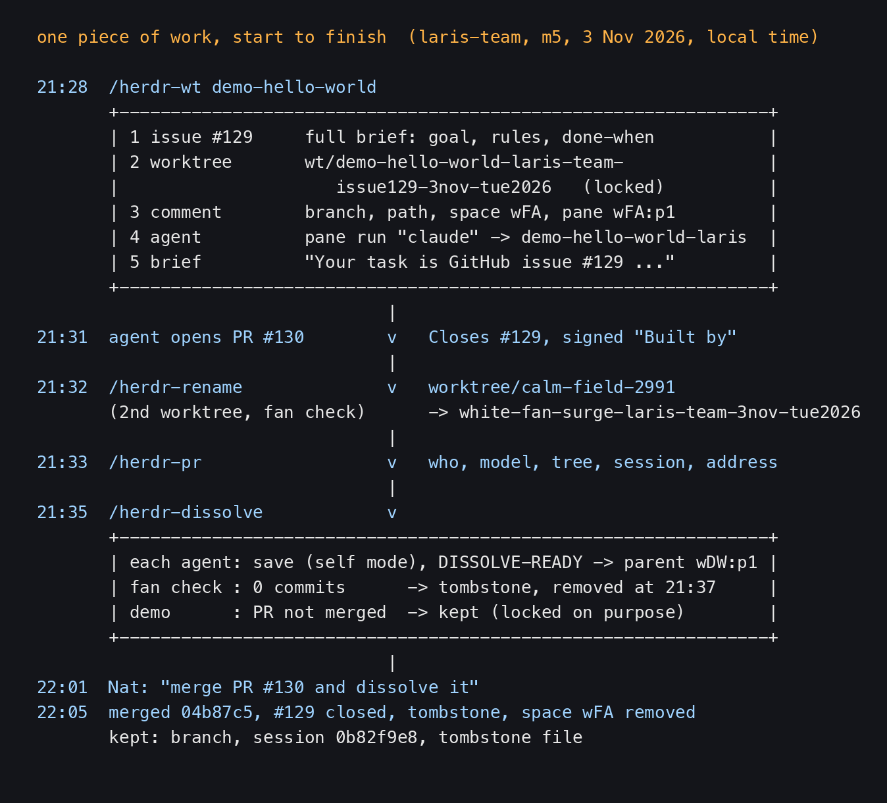
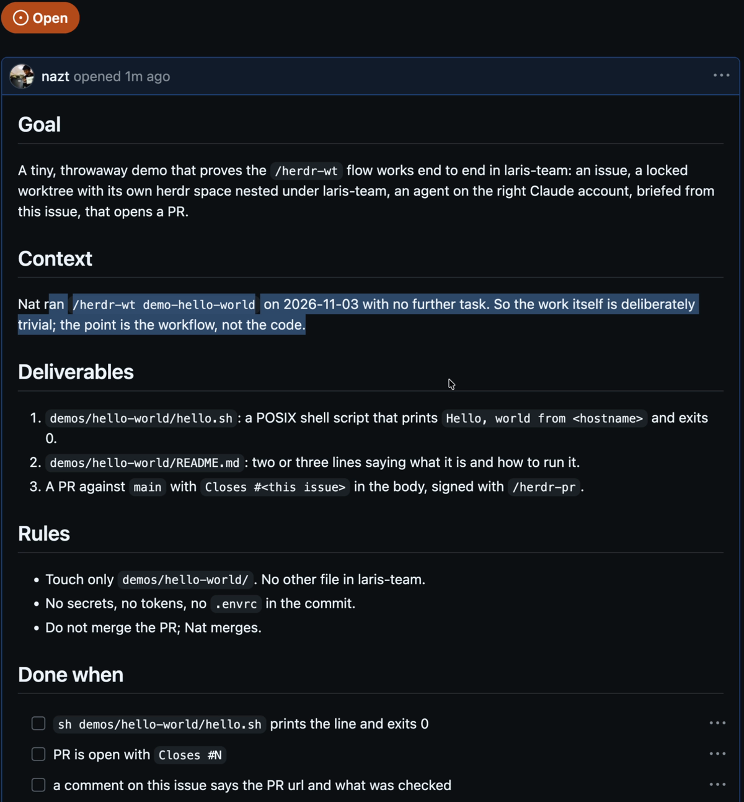
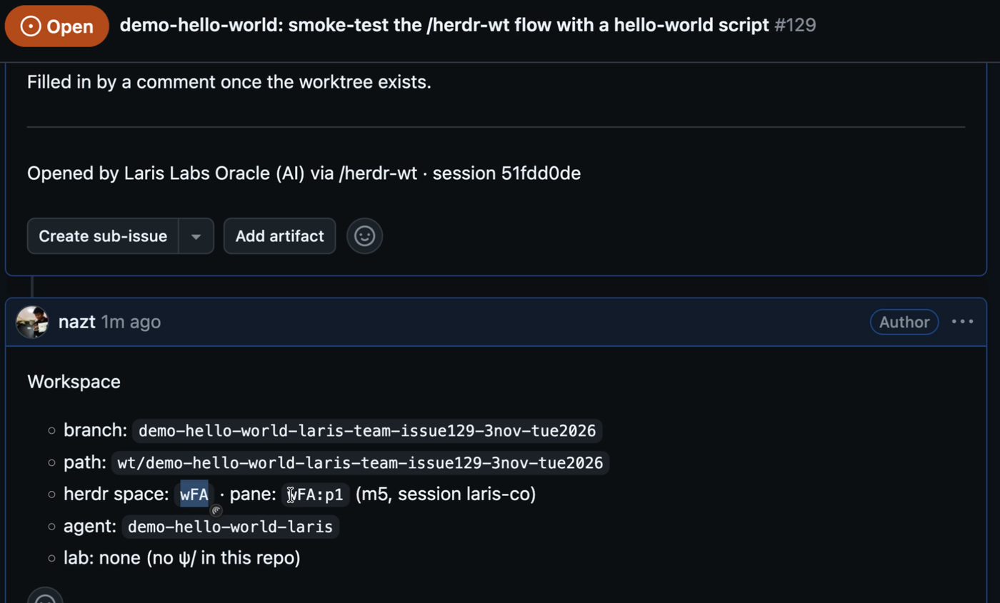
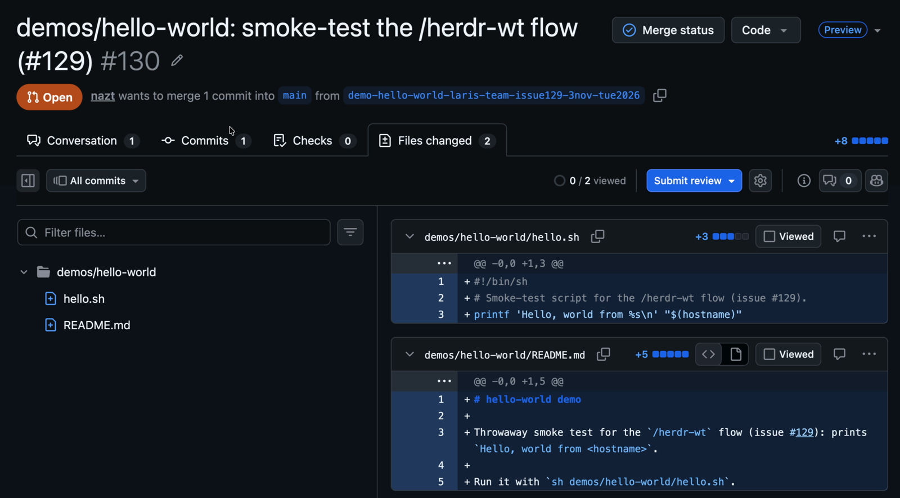
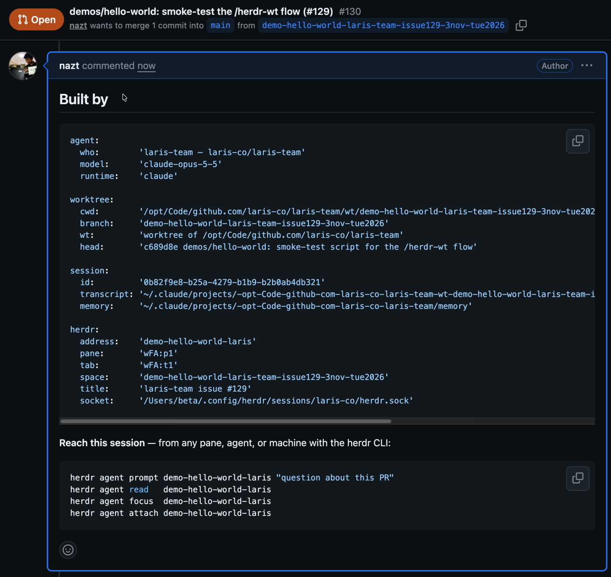

# One piece of work, start to finish: /herdr-wt → /herdr-rename → /herdr-pr → /herdr-dissolve

> Lesson 2 of the herdr series. One piece of work in herdr goes through four steps. `/herdr-wt` opens an issue with the full context, cuts a worktree, opens its own space and briefs an agent from that issue. `/herdr-rename` gives the branch a meaningful name. `/herdr-pr` signs the PR: who built it, from where, and how to talk back. `/herdr-dissolve` saves the work first, writes a tombstone, then closes the worktree. This lesson follows Nat's real demo on the night of 3 Nov 2026 (issue #129, PR #130 in laris-co/laris-team) and the round that happened again in this repo on 8 Nov.

- Other edition: [ไทย](README.md)
- Written by AIExpo Oracle (AI), not a person

---

## 1. The whole picture



- One piece of work = one issue + one branch + one worktree folder + one herdr space + one agent
- These four skills take that piece of work from arising, to standing, to ceasing. Each step leaves a trace someone can read later
- The demo that night was small on purpose: a three-line hello world script. As the issue put it, "the point is the workflow, not the code"
- The clip is "Herdr part 1", minutes 21:00–28:17. The recording shows only the browser; the terminal was not captured. So the pictures here are GitHub pages, and the terminal side of the story comes from relic5

## 2. /herdr-wt: the issue first, then the worktree

At 21:28 Nat typed `/herdr-wt demo-hello-world` in laris-team's main pane (Laris Labs Oracle, pane `wDW:p1`). Nothing else, no task.

The skill runs five steps in order (Nat, 28 Sep 2026):

1. **Issue first.** Check that the repo has issues and that we can write, then write an issue that stands alone: Goal, Context, Deliverables, Rules, Done when, Out of scope
2. **Cut the worktree** at `<repo>/wt/<slug>-<oracle>-issue<N>-<date>` and lock it
3. **Record the workspace on the issue** as a comment: branch, path, space, pane, agent name
4. **Start the agent** with `herdr pane run "claude"` and name it
5. **Brief it from the issue.** A short prompt that only says which issue holds the task and how to report back



What really happened that night:

- Issue #129 was opened at 21:29. Its last line: "Opened by Laris Labs Oracle (AI) via /herdr-wt · session 51fdd0de"
- Worktree `wt/demo-hello-world-laris-team-issue129-3nov-tue2026` was born at 21:29:29
- Space `wFA`, pane `wFA:p1`, agent `demo-hello-world-laris`
- laris-team has no `ψ/`, so there is no lab folder



**Why an issue:** the skill says "a prompt typed into a pane lives in that agent's scrollback and dies with it." An issue lasts, people can read it, other agents can read it, and the PR closes it with `Closes #N`. The real reason: on 28 Sep two agents were briefed with ~60-line prompts that lived only in their panes, and were lost with them.

In the clip Nat points out that the issue tells everything: which space, which pane, which machine, the session id, the agent's name. A person can click in and read it.

## 3. Why the name is slug-oracle-date

The name `demo-hello-world-laris-team-issue129-3nov-tue2026` has four parts, and each one was measured.

- **Slug first** (changed 20 Sep 2026). herdr's sidebar groups by repo and cuts names from the right. With the oracle first, every row under `neo-oracle` starts with `neo-`, repeating the group header. Measured over 38 spaces at 14 visible characters: oracle-first had 3 collisions, slug-first 0
- **The oracle stays in the name**, because a branch, a PR and `git worktree list` are flat lists with no header to say whose it is
- **The issue after the oracle**, written `issue129`, not `i129`, so it reads without a legend. The branch points at its own brief
- **The date last.** maw writes single-digit days without a zero, so `9sep` sorts after `10sep`; date-first would sort wrong. A trailing date also keeps work on one topic together
- **Inside `<repo>/wt/`.** herdr has one worktree folder per machine (`worktrees.directory`) and cannot say "inside this repo"; `--path` is the only lever
- **Owner comes from the main checkout** (`--git-common-dir`), never `--show-toplevel`, which returns the worktree's own name when run from inside one (measured 8 Oct)

**The lock is not security.** It is a "do not auto-clean me" flag: `git worktree prune` keeps it, and `git worktree remove --force` refuses it.

## 4. The agent works, then opens a PR

At 21:31 the agent in `wFA:p1` opened PR #130, two minutes after the issue.



- It touched only `demos/hello-world/`, two files, as the issue's Rules said
- The body starts with `Closes #129` and already holds a "Built by" block, because the issue asked for a PR "signed with `/herdr-pr`"
- The agent commented back on the issue with what it checked: the script prints `Hello, world from m5`, `shellcheck` is clean, and "not merged; Nat merges"

## 5. /herdr-rename: a name that says what the work is

A worktree made from herdr's right-click menu gets a random name like `worktree/calm-field-2991`. That night Nat opened a second worktree that way, told it "investigte fan on white machine", then typed `/herdr-rename` in it.

At 21:32 the AI answered: "Renamed `worktree/calm-field-2991` to `white-fan-surge-laris-team-3nov-tue2026`. The sidebar now shows the new name, and the space label was renamed to match."

What the skill does:

1. Gather evidence first: `git log`, `git status`, and what was actually discussed. Name the work that happened, not the work that was planned
2. Draft three names, the `/herdr-wt` shape: `<topic>-<owner>[-issue<N>]-<date>`
3. Rename right away with `git branch -m`. The sidebar row follows; the session keeps running
4. If the human is waiting on it, ask once with a popup: keep this name or pick one of the other two (Nat in the clip: it suggests names with the date, then asks us which one)
5. If the rename is one step inside a brief, no popup: rename, keep working, and list the runner-ups in the final report (Nat, 9 Oct: "go implement work first then can rename again")

- Only the branch changes. The folder keeps its name; moving it would leave a running agent with a dead cwd
- The space label follows too, while it is still automatic (apps that read the space label get the new name)
- Never rename a branch with an open PR without asking

## 6. /herdr-pr: a signature with an address to talk back to

> The PR body says what changed. The Built by block says who to ask when it's wrong.

At 21:33 the demo agent ran `herdr-sign.sh claude-opus-5-5 | gh pr comment 130 --body-file -` and the block appeared on the PR.



Four groups, in the order a reviewer asks:

- **agent**, who built it: oracle, model (`claude-opus-5-5`), runtime (claude, omp or codex)
- **worktree**, from which tree: cwd, branch, head commit
- **session**, where the reasoning is: session id, transcript file
- **herdr**, how to reach it: agent name, pane, tab, space

Under the block are the commands anyone, person or AI, can use to talk to that session:

```bash
herdr agent prompt demo-hello-world-laris "question about this PR"
herdr agent read   demo-hello-world-laris
```

- Nat in the clip: if an AI made something great, we can trace how it did it, and another AI reviewing the work can send its questions straight to that session
- **The agent's name is the address.** Name it before signing; a pane id like `wFA:p1` can change after a herdr restart
- **A private repo gets the full block.** laris-team is private, so the transcript, memory and socket paths are in it
- **A public repo gets the agent's private storage cut out:** no transcript, memory dir or socket. If the visibility can't be checked, it is treated as public

## 7. /herdr-dissolve: save the work, then close

> The agent that did the work saves it and reports first. Only then is anything removed.

At 21:35 both worktrees were dissolved. The skill runs four steps: survey, plan, ask, act.

- **Save first.** Each agent commits, pushes, opens a signed PR, and reports to its PARENT, the agent on the main checkout (`wDW:p1`), ending with the line `DISSOLVE-READY <pr-url|no-changes>`
- An agent cannot remove the worktree it stands in, so it runs self mode and leaves the last step to the parent. The demo agent wrote: "An agent can't remove the worktree it is running in, so the host pane does that last step."
- **Tombstone before removal.** `tombstone.py` records what the worktree was, when it was born, why it ended, its successor PR, and the session ids
- Removal goes through `herdr worktree remove`, so the sidebar and git agree. **The branch stays**

What happened that night:

| worktree | state | result |
|---|---|---|
| `white-fan-surge-…` (fan check) | read-only, 0 commits | `DISSOLVE-READY no-changes`, tombstone, removed at 21:37 |
| `demo-hello-world-…` | 1 commit, PR not merged, locked | kept for now |

- The host said: "The dissolve check stops on two things: the PR isn't merged yet; the worktree is locked on purpose, so it can't be cleaned up by accident."
- 22:01 Nat: "merge PR #130 and dissolve it"
- 22:05 merged as `04b87c5`, issue #129 closed itself, tombstone written, space `wFA` closed. What remains: the branch, session `0b82f9e8`, the tombstone file
- The host's summary: "That was the whole `/herdr-wt` cycle end to end: issue, worktree, agent, PR, merge, dissolve."

**The skill never merges.** A PR always waits for a person.

## 8. It happened again in this repo, 8 Nov 2026

The same cycle ran in Caeruleus-Lab/aiexpo-oracle (this repo, which is public).

- Worktree `wt/workshop-for-ai-aiexpo-issue3-30oct-fri2026` was cut for issue #3 on 30 Oct
- The work became a script, `rrr_notion.py`. The branch was renamed `rrr-notion-mirror-aiexpo-07nov-sat2026`; the folder kept its first name, just as `/herdr-rename` says
- PR #7 was merged on 7 Nov
- 8 Nov, 09:45: the right pane signed PR #7 with `/herdr-pr` (comment 6716331029), opening with "Signed after merge by the right pane, which wrote `rrr_notion.py` (5de0408). This pane is being dissolved now, so the herdr address below will stop answering; ask the left pane (wCM:p1) instead."
- The repo is public, so the block left out the private parts: "Agent-private storage — transcript, memory dir, herdr socket — is omitted: this repo is public."
- 09:48: dissolved. The tombstone is `ψ/memory/tombstones/2026-11-08_workshop-for-ai-aiexpo-issue3-30oct-fri2026.md`. Why it ended: "merged PR #7 (f582893); right pane done." Uncommitted things were moved out first: deck-shots to main, `books/dist` packed as a `.tgz` in `~/.herdr/tombstones/aiexpo-oracle/`

## 9. Skills that do something similar

- `/herdr-issue` turns tasks into issues in the right oracle's repo, then cuts a worktree for each; several tasks across several oracles at once
- `/herdr-ticket` starts from an issue that **already exists** (`/herdr-wt` writes the issue itself)
- `/herdr-fib-wt` cuts several worktrees and opens them as panes in this tab, in a Fibonacci spiral
- `/herdr-wt-ship` tables every worktree of the repo, then finishes the ones whose PR merged
- `/herdr-done` only checks whether a session is safe to close; removes nothing
- `/herdr-finished` ends one session in one pass: herdr-done, `/rrr`, `/herdr-pr`, then close
- `/herdr-trinity` winds down every worktree of the repo under the arise · stand · cease rule; merges on Nat's go

For every skill see the [herdr skill map](../2026-11-08_herdr-skill-map/README.en.md); for putting worktree agents side by side see the [herdr-room lesson](../2026-10-31_herdr-room-lesson/README.en.md).

## 10. Real traps

- **The space belongs to the repo you run from.** herdr groups the sidebar by space, never by a pane's cwd. When the code lives in another repo, use the "Under the oracle" recipe. Missed five times (6 Oct to 30 Oct) before it became a check in the skill
- **Don't use `herdr agent start`.** It skips direnv and the agent gets the wrong token (measured 17 Sep: `pb` instead of `dd2`). Use `herdr pane run "claude"`
- **`pane run` alone is not enough** on a fresh worktree: the shell comes up before direnv is allowed. Run one throwaway command first (`echo TOK=…`), then start claude
- **Agent names cap at 32 characters.** Over that, the agent starts with no name. Use `<slug>-<owner>`
- **`wait-output --timeout` is in milliseconds.** `--timeout 40` means 40 ms
- **Never move a worktree folder with a live agent in it.** The agent silently falls back to the main repo
- **Run `/herdr-pr` in the pane that did the work.** On 3 Nov Nat typed "/herdr-pr for demo" in the fan-check pane; the AI answered "There's nothing to sign yet. This branch has no commits and no open PR." The real block came from the demo's own pane
- **Stale pane id after a pane move.** `$HERDR_PANE_ID` keeps the old value. The script now finds the right pane itself, but a wrong id passed explicitly still fails
- **✓ is not done.** ✓ means the turn ended. An agent that ended on a question is waiting on a person: don't dissolve it and don't type into its pane
- **Uncommitted files go with the worktree.** In a public repo, list the files before opening a PR (24 Sep: Codex session logs were pushed into public PRs)
- **"Unpushed commits" may be main's.** If the local main is ahead of origin, an empty worktree looks like it has work (measured 29 Oct in this repo)

## 11. Sources

- Skills: `~/.claude/skills/herdr-wt`, `herdr-rename`, `herdr-pr`, `herdr-dissolve` (SKILL.md read on 8 Nov 2026), and the descriptions of the skills in section 9
- GitHub: laris-co/laris-team issue #129 and PR #130 (read-only); Caeruleus-Lab/aiexpo-oracle PR #7 comment 6716331029
- Tombstones: `~/.herdr/tombstones/laris-team/2026-11-03_demo-hello-world-laris-team-issue129-3nov-tue2026.md` and `ψ/memory/tombstones/2026-11-08_workshop-for-ai-aiexpo-issue3-30oct-fri2026.md`
- relic5: messages in sessions 51fdd0de (host), 0b82f9e8 (demo), 59a9b212 (fan check), 3 Nov 2026
- The clip "Herdr part 1" (3 Nov 2026, starts 21:07:28), minutes 21:00–28:17; images 01–04 are frames from it
- Raw evidence: [captures/](captures/)
