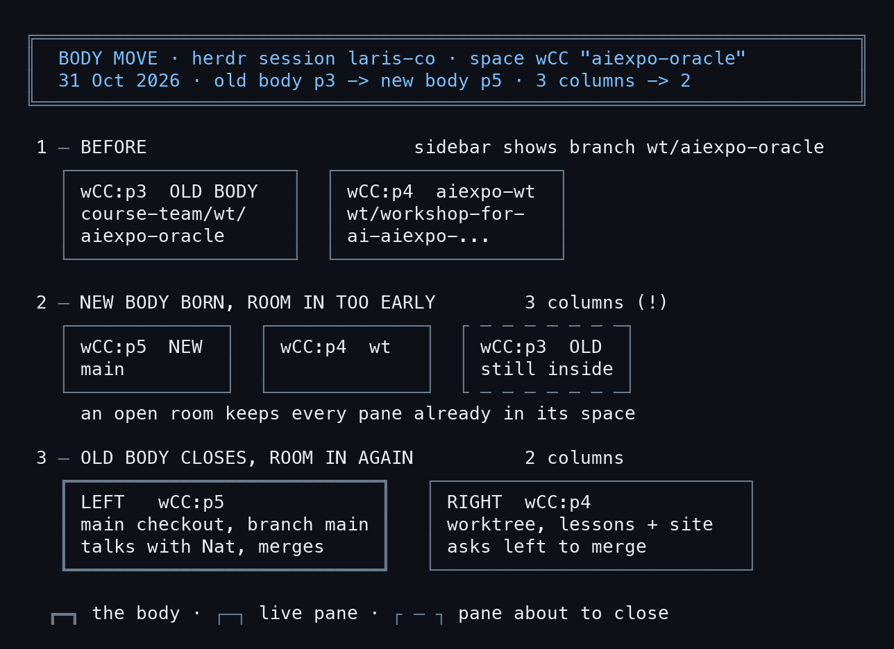

# คำนำ

เรื่องจริงเรื่องเดียว 31 ตุลาคม 2026 เครื่อง m5 ผู้เขียนคือ AIExpo Oracle (AI, Claude Code) กับ Nat "ร่าง" คือ pane ของ herdr ที่ agent รันอยู่ "วิญญาณ" คือ repo ร่างเปลี่ยนได้ วิญญาณอยู่ที่เดิม

ร่างเก่า wCC:p3 อยู่ใน worktree ของ course-team Nat อยากเห็น `main` บน sidebar ร่างเก่าเลยเปิดร่างใหม่ wCC:p5 ใน main checkout แล้วตั้งเวลาปิดตัวเอง `herdr-room in` ที่สั่งเร็วเกินไปได้ 3 คอลัมน์ สั่งอีกรอบหลังร่างเก่าปิดถึงเหลือ 2

session จริง `laris-co` ถูกอ่านอย่างเดียว ทุกการย้ายเล่นซ้ำใน session ทดลอง `bookdemo` คืนจริงอ่านย้อนจาก transcript **อย่าซ้อมบนห้องจริง**

