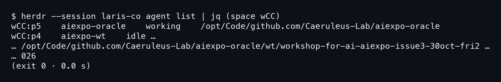
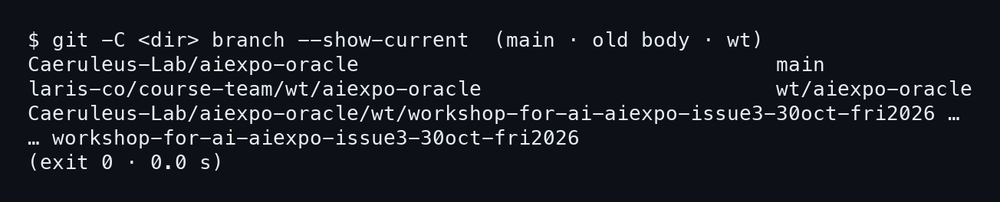
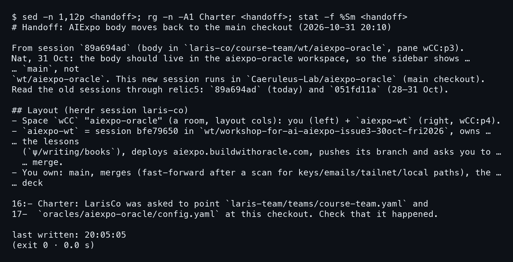
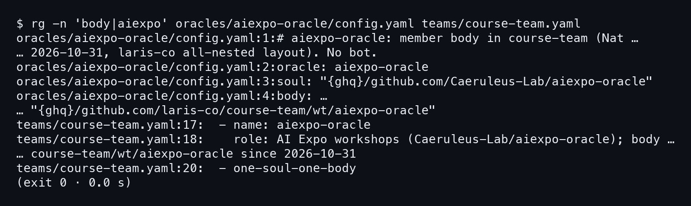
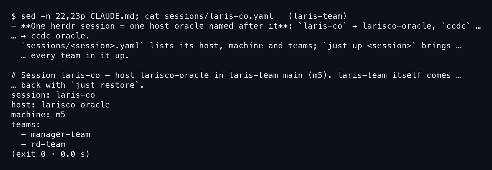

# บทที่ 1: ร่างอยู่ผิดที่

คืนวันที่ 31 ตุลาคม Nat บอกว่าร่างของ AIExpo Oracle อยู่ผิดที่ ร่างกับวิญญาณตามที่นิยามไว้ในคำนำ บทนี้ยังไม่ย้ายอะไรเลย แค่ไปดูห้องจริงว่าตอนนี้หน้าตาเป็นยังไง แล้วทำไม Nat ถึงอยากให้ย้าย

ทุกคำสั่งในบทนี้ **อ่านอย่างเดียว** ห้องจริงคือ herdr session `laris-co` บนเครื่อง m5 เราไม่แตะมัน

## 1.1 ห้องตอนนี้หน้าตาเป็นยังไง

### ขั้นที่ 1 — ถาม herdr ว่าใครอยู่ใน space wCC

พิมพ์ `herdr agent list` ชี้ไปที่ session `laris-co` ภาพที่เห็นตัดมาเฉพาะแถวของ space `wCC` ซึ่งเป็นห้องชื่อ aiexpo-oracle (กรองด้วย jq) คำสั่งนี้แค่อ่าน ไม่เปลี่ยนอะไร

```bash
herdr --session laris-co agent list
```



ในห้องมี agent สองตัว คือ `wCC:p5` ชื่อ `aiexpo-oracle` ที่ working อยู่ และ `wCC:p4` ชื่อ `aiexpo-wt` ที่ idle ดูคอลัมน์สุดท้าย **p5 รันใน main checkout ของ repo** ส่วน p4 รันใน worktree ย่อยชื่อยาวที่ขึ้นต้นด้วย `wt/workshop-for-ai-aiexpo-issue3`

ตอนเริ่ม session นี้ ร่างปัจจุบันคือ p5 แล้ว ร่างเก่าที่เคยเป็น p3 ปิดไปก่อนหน้านี้ รายละเอียดว่าปิดยังไงอยู่ในบทที่ 4 และ 7

## 1.2 ป้ายข้างซ้ายคือ branch

### ขั้นที่ 1 — ดูว่าแต่ละโฟลเดอร์อยู่ branch อะไร

sidebar ของ herdr ไม่ได้โชว์ชื่อ agent อย่างเดียว มัน **โชว์ชื่อ branch** ของโฟลเดอร์ที่ pane นั้นอยู่ด้วย เลยลองถาม git ตรงๆ สามโฟลเดอร์ คือ main checkout, โฟลเดอร์ของร่างเก่า และ worktree ของ aiexpo-wt

```bash
git -C <dir> branch --show-current
```



ผลออกมาแบบนี้

```
Caeruleus-Lab/aiexpo-oracle            main
laris-co/course-team/wt/aiexpo-oracle  wt/aiexpo-oracle
…/wt/workshop-for-ai-aiexpo-issue3-…   workshop-for-ai-aiexpo-issue3-…
```

ร่างเก่าอยู่ใน worktree ของ repo `course-team` ที่ branch ชื่อ `wt/aiexpo-oracle` ดังนั้นพอมองไปที่ sidebar ก็เห็น `wt/aiexpo-oracle` ทั้งที่งานทั้งหมดเป็นของ repo aiexpo-oracle แล้ว main checkout เองอยู่บน `main` ธรรมดา

### ขั้นที่ 2 — อ่านว่าป้ายนี้ผิดตรงไหน

ป้ายบอกว่า oracle ตัวนี้เป็นสมาชิกใน course-team (config เขียนไว้ว่า `member body in course-team`) ทั้งที่มันมี repo ของตัวเอง ป้ายคือ branch และ branch คือที่อยู่ของร่าง ถ้าอยากให้ sidebar โชว์ `main` ก็ต้องให้ร่างไปอยู่ที่ main checkout ไม่ใช่เปลี่ยนชื่อป้าย

## 1.3 โน้ตที่ร่างเก่าทิ้งไว้

### ขั้นที่ 1 — อ่านไฟล์ handoff

ร่างเก่า **เขียนไฟล์ handoff** ไว้ใน vault ของ repo ให้ร่างใหม่อ่าน ลองเปิด 12 บรรทัดแรก พร้อมบรรทัด Charter และเวลาที่ไฟล์ถูกเขียนล่าสุด (`<handoff>` คือไฟล์ `ψ/inbox/handoff/2026-10-31_20-10_body-back-to-main-checkout.md`)

```bash
sed -n 1,12p <handoff>; rg -n -A1 Charter <handoff>; stat -f %Sm <handoff>
```



ประโยคที่ตอบว่าทำไมต้องย้ายอยู่บรรทัดที่ 4 ถึง 5

```
Nat, 31 Oct: the body should live in the aiexpo-oracle workspace,
so the sidebar shows `main`, not `wt/aiexpo-oracle`.
```

ชื่อไฟล์ลงเวลา 20-10 แต่ `stat` บอกว่าเขียนล่าสุด `20:05:05` ซึ่งก่อน p3 ปิด ส่วนบรรทัด 16-17 ฝากงานไว้ว่า LarisCo ถูกขอให้ชี้ `laris-team/teams/course-team.yaml` กับ `oracles/aiexpo-oracle/config.yaml` มาที่ checkout นี้ ไฟล์ยังบอกด้วยว่าเซสชันเก่าคือ `89a694ad` ที่ pane `wCC:p3` และบอกวิธีไปอ่านบทสนทนาเก่าผ่าน relic5 ด้วย id `89a694ad` กับ `051fd11a`

### ขั้นที่ 2 — อ่านว่าใครเป็นเจ้าของอะไร

หัวข้อ Layout แบ่งงานไว้ชัด `aiexpo-wt` คือ session `bfe79650` ใน worktree ของมัน ดูแล lessons ใน `ψ/writing/books` และ deploy เว็บ ส่วนร่างใหม่ **เป็นเจ้าของ main กับการ merge** แบบ fast-forward หลังสแกนหา key, email, tailnet และ local path ก่อนเสมอ

## 1.4 กฎบัตรยังชี้ที่เดิม และใครถือ session

### ขั้นที่ 1 — หาว่า charter พูดถึงร่างว่าอะไร

repo `laris-team` เก็บ config ของ oracle ตัวนี้ไว้ ลองค้นคำว่า `body` กับ `aiexpo` ในสองไฟล์ที่เกี่ยวข้อง

```bash
rg -n 'body|aiexpo' oracles/aiexpo-oracle/config.yaml \
  teams/course-team.yaml
```



มีสองบรรทัดที่ต้องจำ

```
config.yaml:4:body: "{ghq}/github.com/laris-co/course-team/wt/…"
teams/course-team.yaml:18:… body course-team/wt/aiexpo-oracle …
```

**charter ยังเขียนว่าร่างอยู่ที่ worktree เก่า** ทั้งที่ร่างย้ายแล้ว ส่วน `soul:` บรรทัดที่ 3 ชี้ไป repo ของเรา ถูกอยู่แล้ว ปัญหาเลยเหลือแค่บรรทัด `body:` กับคำอธิบายใน team file

### ขั้นที่ 2 — ถามว่าใครถือ session นี้

ถัดมาอ่านกฎใน `CLAUDE.md` ของ laris-team คู่กับไฟล์ session

```bash
sed -n 22,23p CLAUDE.md; cat sessions/laris-co.yaml
```



กฎบอกว่า **หนึ่ง herdr session มี host oracle หนึ่งตัวที่ตั้งชื่อตาม session** `laris-co` มี host คือ `larisco-oracle` บนเครื่อง m5 ส่วนการแก้ charter handoff ข้างบนฝากให้ LarisCo ดูแล บทหน้าดูว่า herdr ซ้อนกันกี่ชั้น แล้วทำไมไม่ซ้อมบนห้องจริง
