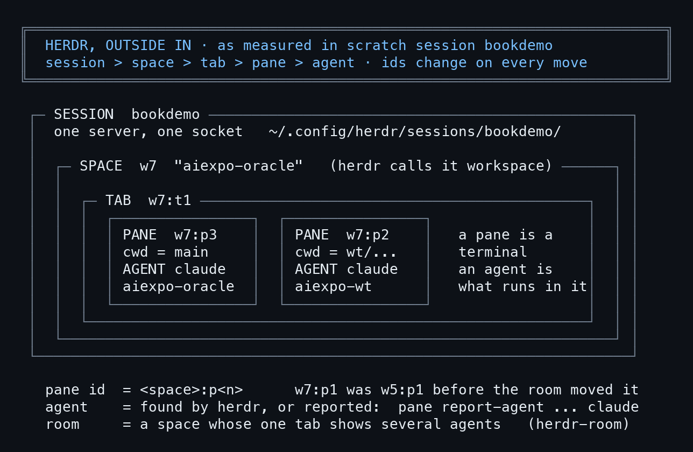
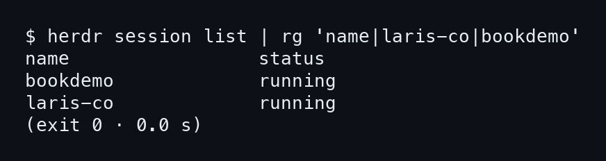
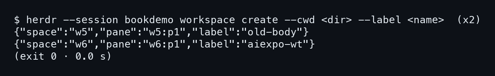
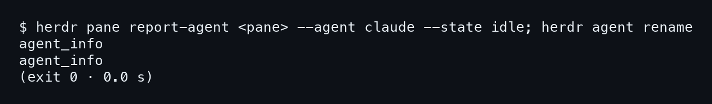
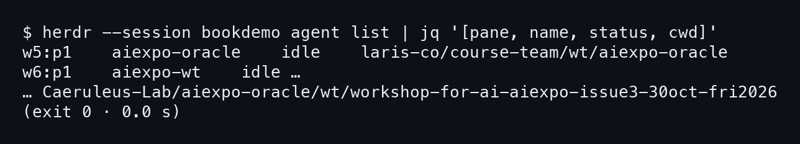
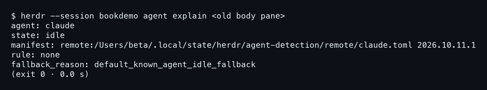

# บทที่ 2: herdr จากข้างนอกเข้าข้างใน

บทที่แล้วเห็นห้องจริงของ laris-co ไปแล้ว บทนี้ถอยออกมาดู herdr ทีละชั้น แล้วสร้างเวทีซ้อมของเราเอง จะได้ย้ายร่างได้โดยไม่แตะห้องที่ Nat ใช้อยู่

## 2.1 session, space, tab, pane, agent

herdr ซ้อนกันห้าชั้น และเราต้องรู้ว่า id แต่ละตัวอยู่ชั้นไหน ไม่งั้นอ่านผลคำสั่งไม่ออก

### ขั้นที่ 1 — ดูภาพรวมทั้งห้าชั้น

ดูการ์ดข้างล่างก่อน มันวัดจาก session `bookdemo` ที่เราจะสร้างในหัวข้อถัดไป ชั้นนอกสุดคือ session หนึ่ง session มี server และ socket ของตัวเอง ข้างในมี space (CLI ของ herdr เรียกว่า workspace) หนึ่ง space มี tab แล้ว tab มี pane



อ่านการ์ดแล้วจับสามเรื่อง ข้อแรก **pane คือเทอร์มินัล ส่วน agent คือสิ่งที่รันอยู่ในนั้น** สองอย่างนี้ไม่ใช่ของชิ้นเดียวกัน ข้อสอง id ของ pane ขึ้นต้นด้วย id ของ space เช่น `w7:p3` พอ pane ย้ายไป space อื่น id ก็เปลี่ยน การ์ดเขียนไว้ว่า `w7:p1` เคยเป็น `w5:p1` ข้อสาม "ห้อง" ไม่ใช่ชั้นใหม่ มันคือ space ที่ tab เดียวโชว์หลาย agent พร้อมกัน

ตลอดเล่ม ถ้าเห็น id แล้วงง ให้กลับมาที่การ์ดนี้ แล้วถามว่าตัวเลขหน้าโคลอนคือ space ตัวเลขหลังโคลอนคือ pane

## 2.2 session ซ้อมคู่กับห้องจริง

เรื่องที่ทำให้เล่มนี้ปลอดภัยอยู่ตรงนี้ ตอนทำหนังสือ ห้องจริงของ laris-co เราอ่านอย่างเดียว ทุกการย้ายซ้อมใน session แยก

### ขั้นที่ 1 — ดูว่ามี session อะไรรันอยู่

พิมพ์ `herdr session list` แล้วกรองเอาเฉพาะสองชื่อที่สนใจ จะเห็นว่า `bookdemo` กับ `laris-co` รันอยู่คู่กัน **สอง session เป็นสองโลกที่ไม่ปนกัน** pane ใน `bookdemo` ไม่มีทางไปกระทบ `laris-co`

```bash
herdr session list | rg 'name|laris-co|bookdemo'
```



```
bookdemo             running
laris-co             running
```

ข้อนี้มีเหตุผลสองชั้น ชั้นแรก ถ้าย้ายพลาดบนห้องจริง อาจกระทบห้องที่ Nat ใช้อยู่ ชั้นที่สอง `herdr-room` ย้าย pane จริง ไม่ใช่จำลอง ซ้อมที่ไหนก็คือย้ายจริงที่นั่น เราเลยเลือกที่ที่ย้ายพังได้

เรารัน `bookdemo` จาก pane ใน space wCF ของ laris-co ด้วย `herdr session attach bookdemo` ห้อง wCC ที่เป็นของจริงไม่ถูกแตะเลยแม้แต่ pane เดียว คำสั่งที่แตะ `bookdemo` จึงมี `--session bookdemo` นำหน้า

## 2.3 สร้างสอง space

เราต้องมีสองร่างใน session ซ้อม ร่างเก่าที่อยู่ใน worktree ของ course-team กับ aiexpo-wt ที่อยู่ใน worktree ของตัวเอง

### ขั้นที่ 1 — สร้าง space ด้วย workspace create

`workspace create` รับ `--cwd` กับ `--label` คำสั่งนี้ทำสองรอบ รอบแรกชี้ cwd ไปที่ไดเรกทอรีของร่างเก่า (`laris-co/course-team/wt/aiexpo-oracle`) รอบสองชี้ไปที่ worktree ของ aiexpo-wt ในรีโปนี้ **cwd ของ pane คือสิ่งที่ herdr-room ใช้แยกว่าใครเป็นใคร** เลยต้องตั้งให้ตรงกับของจริง

```bash
herdr --session bookdemo workspace create --cwd <dir> --label <name>
```



```
{"space":"w5","pane":"w5:p1","label":"old-body"}
{"space":"w6","pane":"w6:p1","label":"aiexpo-wt"}
```

แต่ละครั้งได้ space ใหม่พร้อม pane แรกมาให้เลย เราจดไว้สองตัว `w5:p1` คือร่างเก่า `w6:p1` คือ aiexpo-wt ทุกอย่างที่เกิดทีหลังตามรอยกลับมาถึงสองบรรทัดนี้ได้

## 2.4 ทำให้เชลล์เปล่าดูเป็น claude

pane ที่เพิ่งสร้างมีแค่เชลล์ ยังไม่มี Claude Code และเราไม่อยากเปิด Claude จริงสองตัวเพื่อซ้อม herdr-room เลือกสมาชิกจากรายชื่อ agent ดังนั้นต้องบอก herdr ว่า pane นี้มี agent

### ขั้นที่ 1 — report-agent แล้ว rename

`pane report-agent` บอก herdr ว่า pane นี้รัน agent ชนิดนี้ สถานะนี้ แล้ว `agent rename` ตั้งชื่อให้ตรงกับร่างจริง **herdr เชื่อสิ่งที่ pane รายงาน** มันไม่ได้ตรวจว่าข้างในเป็น Claude จริงหรือเปล่า

```bash
herdr pane report-agent <pane> --agent claude --state idle; \
herdr agent rename
```



ผลออกมาแค่ `agent_info` สองบรรทัด ไม่มีอะไรให้ดูต่อ ต้องไปถาม agent list ว่าเข้าไหม

### ขั้นที่ 2 — เช็กด้วย agent list

สั่ง `agent list` แล้วดึงสี่ช่อง pane, ชื่อ, สถานะ, cwd ออกมาด้วย jq ถ้าสองแถวขึ้นตรงตามนี้ แสดงว่าเชลล์สองตัวถูกนับเป็น agent แล้ว

```bash
herdr --session bookdemo agent list | jq '[pane, name, status, cwd]'
```



```
w5:p1  aiexpo-oracle  idle  laris-co/course-team/wt/aiexpo-oracle
w6:p1  aiexpo-wt      idle  Caeruleus-Lab/aiexpo-oracle/wt/…
```

ทั้งสองสถานะ `idle` และ cwd ตรงกับที่ใส่ตอนสร้าง **ชื่อกับ cwd คือสองกุญแจที่ herdr-room ใช้หาสมาชิก** ตอนนี้ฉากพร้อมแล้ว สองร่างนี้จำลองสองร่างจริงของคืนวันที่ 31 ต.ค. (ของจริงอยู่ wCC:p3 กับ wCC:p4)

## 2.5 agent explain บอกว่า herdr เชื่ออะไร

เรื่องสุดท้ายคือถามย้อนกลับ ว่าที่ herdr คิดกับ pane นี้มาจากไหน เพราะ agent ของเราปลอม เราควรรู้ว่ามันปลอมแล้วผ่านด่านได้เพราะอะไร

### ขั้นที่ 1 — ถาม explain กับ pane ร่างเก่า

ผลที่จะเห็นมี `rule: none` กับ `default_known_agent_idle_fallback` แปลว่า **สถานะนี้มาจากที่เรารายงาน ไม่ได้มาจากการอ่านจอ** แค่นี้พอแล้ว เพราะ herdr-room ต้องการแค่ชื่อกับ cwd บทต่อไปเรียก `herdr-room --dry`

```bash
herdr --session bookdemo agent explain <old body pane>
```


