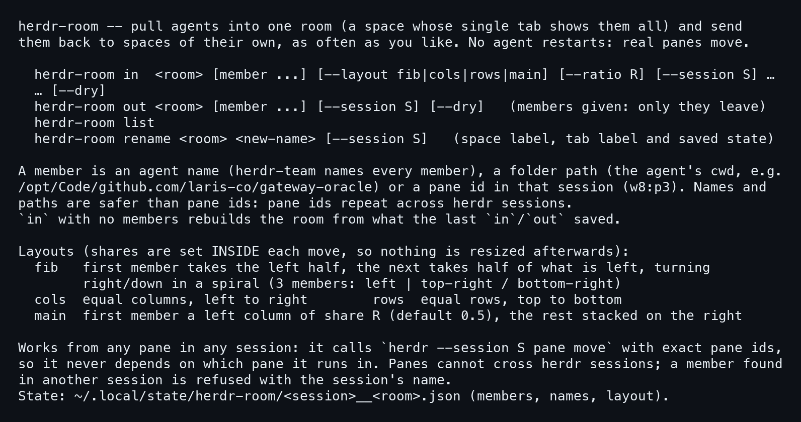
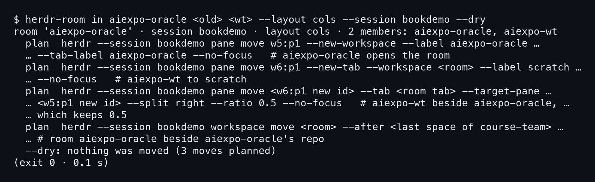
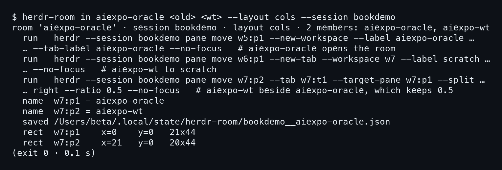
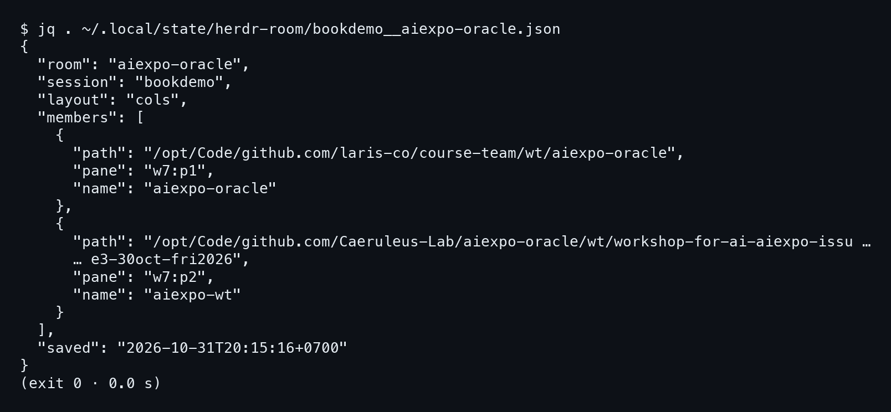
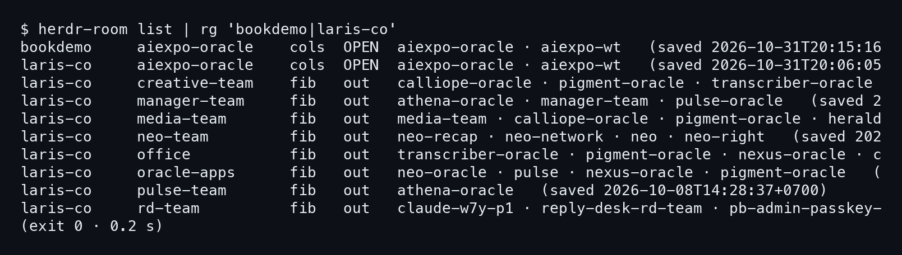

# บทที่ 3: herdr-room — ห้องเดียว หลาย agent

สองบทแรกวางพื้นให้แล้ว มี session ทดลองชื่อ `bookdemo` กับ agent ปลอมสองตัวที่ herdr เชื่อว่าเป็น claude บทนี้เป็นครั้งแรกที่ได้ลงมือกับตัวเครื่องมือ `herdr-room` จริง ๆ เราจะอ่าน help ดู dry run ก่อน แล้วค่อยรันของจริง ดูว่า pane ย้ายไปไหน และ herdr-room จดอะไรไว้

## 3.1 herdr-room ทำอะไรได้

### ขั้นที่ 1 — อ่าน help ก่อนแตะอะไร

พิมพ์ `herdr-room` เปล่า ๆ หรือเรียก help ก็ได้ มันจะบอกว่ามีคำสั่งอะไรบ้าง เครื่องมือนี้ดึง agent หลายตัวมาอยู่ใน **space เดียวที่มี tab เดียว** แล้วส่งกลับไปอยู่ space ของตัวเองได้อีก โดยไม่ต้อง restart agent เพราะ pane ที่ย้ายคือ pane จริง

```bash
herdr-room
```



มีสี่คำสั่งที่ต้องจำ ได้แก่ `in` กับ `out` สำหรับเข้าและออกจากห้อง `list` สำหรับดูห้องทั้งหมด และ `rename` สำหรับเปลี่ยนชื่อห้อง ส่วน layout มีสี่แบบคือ `fib`, `cols`, `rows`, `main` บทนี้ใช้ `cols`

### ขั้นที่ 2 — เลือกสมาชิกด้วยชื่อหรือ path

สมาชิกของห้องบอกได้สามแบบ คือชื่อ agent, path ของโฟลเดอร์ที่ agent ทำงานอยู่ หรือ pane id ใน session นั้น help เขียนไว้ชัดว่า

```
Names and paths are safer than pane ids: pane ids repeat across
herdr sessions.
```

ใน herdr แต่ละ session นับ id ของตัวเองใหม่ w5:p1 ใน session หนึ่งไม่ใช่ตัวเดียวกับ w5:p1 อีก session ถ้าเอา id ไปใช้ข้าม session ก็เสี่ยงย้ายผิดตัว เราเลยจะใช้ **ชื่อกับ path เป็นหลัก** แล้วค่อยอ่าน pane id จากผลลัพธ์ทีหลัง

อีกบรรทัดหนึ่งที่ควรอ่านคือ `in` ที่ไม่ระบุสมาชิก มันจะสร้างห้องใหม่จากรายชื่อที่ `in` หรือ `out` ครั้งก่อนจดไว้ เรื่องนี้จะกลับมาตอนดู state file

## 3.2 --dry ก่อนเสมอ

### ขั้นที่ 1 — รัน in ด้วย --dry

ก่อนย้ายของจริง ให้ใส่ `--dry` ทุกครั้ง มันพิมพ์แผนออกมาโดยไม่ขยับ pane สักตัว ที่นี่ส่งสมาชิกสองตัวเป็น path ของโฟลเดอร์ (ในภาพ `<old>` กับ `<wt>` ย่อ path ยาวไว้) คือร่างเก่าที่ทำงานใน worktree ของ course-team กับ `aiexpo-wt`

```bash
herdr-room in aiexpo-oracle <old> <wt> \
  --layout cols --session bookdemo --dry
```



แผนบอกว่าจะทำสิ่งต่อไปนี้ บรรทัดแรก `w5:p1` ย้ายออกมาเปิด workspace ใหม่ชื่อ `aiexpo-oracle` บรรทัดสอง `w6:p1` ย้ายไป tab ชั่วคราวชื่อ `scratch` ในห้องนั้น บรรทัดสาม pane ที่ย้ายแล้วถูกต่อเข้ามาทางขวาด้วย `--split right --ratio 0.5` ส่วนบรรทัดสุดท้ายย้ายตัวห้องไปวางข้าง space ของ course-team

ท้ายผลลัพธ์สรุปว่า

```
--dry: nothing was moved (3 moves planned)
```

สังเกตว่าในแผน id ของ pane ที่ย้ายแล้วยังเป็น `<w6:p1 new id>` เพราะ herdr ยังไม่ได้ออก id ใหม่ให้ **id ใหม่เกิดหลังย้ายจริงเท่านั้น** ดู dry run แล้วเดา id ปลายทางไม่ได้

## 3.3 in ของจริง

### ขั้นที่ 1 — ตัด --dry ออกแล้วรันซ้ำ

พอแผนหน้าตาถูกต้อง ก็รันคำสั่งเดิมโดยไม่มี `--dry`

```bash
herdr-room in aiexpo-oracle <old> <wt> \
  --layout cols --session bookdemo
```



คำว่า `plan` เปลี่ยนเป็น `run` และตอนนี้ id จริงโผล่ขึ้นมาแล้ว **pane ย้ายแล้ว id เปลี่ยน** ร่างเก่าที่เคยเป็น `w5:p1` กลายเป็น `w7:p1` ส่วน `aiexpo-wt` ที่เคยเป็น `w6:p1` กลายเป็น `w7:p2`

```
name  w7:p1 = aiexpo-oracle
name  w7:p2 = aiexpo-wt
```

เหตุผลคือ pane อยู่ใน space ใหม่ `w7` แล้ว herdr จึงนับ id ใหม่ตาม space นั้น สองบรรทัด `name` คือ herdr-room ตั้งชื่อ agent ซ้ำให้อีกรอบ ซึ่งแปลว่าต้องตั้งชื่ออีกรอบหลังย้าย

### ขั้นที่ 2 — อ่านขนาดของแต่ละ pane

ท้ายผลลัพธ์มีสองบรรทัด `rect` บอกตำแหน่งและขนาดจริงของ pane หลังย้าย

```
rect  w7:p1    x=0    y=0   21x44
rect  w7:p2    x=21   y=0   20x44
```

คอลัมน์ซ้ายกว้าง 21 คอลัมน์ ขวากว้าง 20 รวมกันได้ 41 คอลัมน์เต็ม สูง 44 เท่ากัน ที่ซ้ายกว้างกว่าหนึ่งเพราะหารสี่สิบเอ็ดสองไม่ลงตัว ตัวเลขนี้สำคัญ เพราะบทหลังจะเอามาเทียบว่าห้องมีกี่คอลัมน์

## 3.4 ไฟล์ state

### ขั้นที่ 1 — เปิดไฟล์ที่ herdr-room จดไว้

บรรทัด `saved` บอก path ของไฟล์ ลองอ่านด้วย `jq` ได้เลย ชื่อไฟล์คือ `<session>__<room>.json` อยู่ใต้ `~/.local/state/herdr-room/`

```bash
jq . ~/.local/state/herdr-room/bookdemo__aiexpo-oracle.json
```



ไฟล์มีห้าช่อง คือ `room`, `session`, `layout`, `members` และ `saved` ส่วน members แต่ละคนมีสามอย่าง

```
"path": "/opt/Code/github.com/laris-co/course-team/wt/aiexpo-oracle",
"pane": "w7:p1",
"name": "aiexpo-oracle"
```

**path เป็นตัวระบุสมาชิก** ส่วน pane กับ name เป็นแค่ผลของการย้ายครั้งล่าสุด เวลา `saved` ในรอบนี้คือ `2026-10-31T20:15:16+0700` นี่คือเหตุที่ `in` เปล่า ๆ สร้างห้องกลับมาได้ เพราะมันอ่านรายชื่อจากไฟล์นี้ แต่ถ้าสมาชิกในไฟล์ไม่ตรงกับความจริง ห้องก็ตามไปผิดด้วย เรื่องนี้เป็นหัวใจของบทที่ 5

## 3.5 list: ห้องที่เปิดอยู่กับห้องที่ออกไปแล้ว

### ขั้นที่ 1 — ดูทุกห้องในเครื่องพร้อมกัน

`herdr-room list` **อ่านไฟล์ state ทุกไฟล์**แล้วพิมพ์เป็นตาราง ที่นี่กรองเอาเฉพาะ session `bookdemo` กับ `laris-co` ด้วย `rg`

```bash
herdr-room list | rg 'bookdemo|laris-co'
```



สองบรรทัดบนสุดน่าดู ห้องชื่อเดียวกันอยู่ใน session ต่างกันสองที่ อันบนคือห้องซ้อม อันล่างคือห้องจริงใน `laris-co` ห้องอื่นอย่าง `creative-team` เป็น `out` คือสมาชิกกลับ space ของตัวเองแล้ว

บทต่อไปร่างเก่าเปิด pane ใหม่ใต้ตัวเอง แล้วตั้งเวลาปิดตัวเอง
