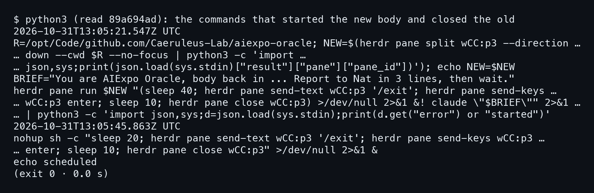
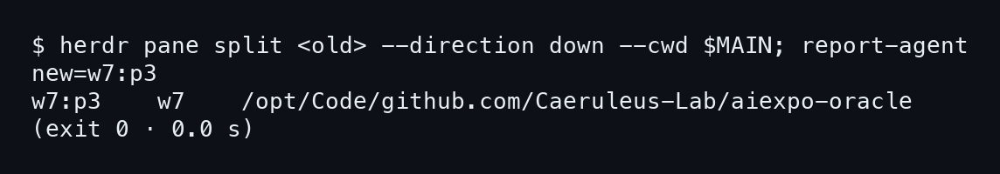
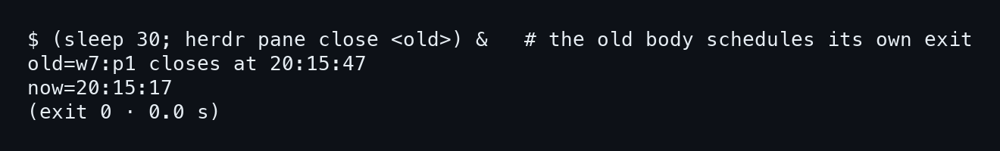

# บทที่ 4: ร่างใหม่เกิดใต้ร่างเก่า

ร่างใหม่ไม่ได้เกิดจาก Nat เปิด pane เอง แต่ร่างเก่าเป็นคนสร้างมันขึ้นมา แล้วตั้งเวลาปิดตัวเองไว้ด้วย บทนี้อ่านคำสั่งจริงของคืนนั้นก่อน แล้วรันแบบเดียวกันซ้ำใน `bookdemo`

## 4.1 คำสั่งจริงของร่างเก่า

### ขั้นที่ 1 — อ่านสิ่งที่ร่างเก่ารันคืนนั้น

transcript ของร่างเก่า (89a694ad) เก็บคำสั่งไว้ครบ เราดึงออกมาอ่านด้วย `timeline.py` เวลาในภาพเป็น UTC ส่วนเวลากรุงเทพคือบวก 7 ชั่วโมง ดังนั้น 13:05:21Z ก็คือ 20:05:21

เปิดภาพนี้ได้เลย ไม่ต้องรันอะไรเพิ่ม สองบรรทัดเวลาในภาพคือจุดเริ่มของสองคำสั่ง

```
2026-10-31T13:05:21.547Z UTC
2026-10-31T13:05:45.863Z UTC
```



คำสั่งแรกทำสามอย่างในบรรทัดเดียว **ร่างเก่าแยก pane ของตัวเองลงล่างด้วย `herdr pane split wCC:p3 --direction down` โดยตั้ง `--cwd` เป็น main checkout** จึงได้ pane ใหม่ที่อยู่ใน repo `aiexpo-oracle` ตรง ๆ อีกสองอย่างคือ `--no-focus` ไม่ให้โฟกัสเด้งหนี และเก็บ pane id ที่ได้ไว้ในตัวแปร `NEW`

### ขั้นที่ 2 — ใส่ brief แล้วตั้ง timer ตัวแรก

คำสั่งที่สองส่งเข้า pane ใหม่ผ่าน `herdr pane run $NEW` ข้างในมีสองส่วน ส่วนแรกคือ subshell ที่ทำงานเบื้องหลัง ส่วนหลังคือ `claude "$BRIEF"` ซึ่งเริ่ม Claude Code พร้อมข้อความบอกว่าเป็นร่างที่กลับมา main แล้วให้รายงาน Nat 3 บรรทัด

subshell นี้รอ 40 วินาที พิมพ์ `/exit` ใส่ pane เก่า กด enter รออีก 10 วินาที แล้วสั่ง `pane close` **ร่างเก่าตั้งเวลาปิดตัวเองไว้ก่อนที่ร่างใหม่จะทันตื่นด้วยซ้ำ**

### ขั้นที่ 3 — timer ตัวที่สองตอน 20:05:45

เวลาผ่านไปราว 24 วินาที ร่างเก่ารันอีกคำสั่งที่หน้าตาเหมือนเดิม แต่ครั้งนี้ `sleep 20` และห่อด้วย `nohup sh -c` ปิดท้ายด้วย `echo scheduled` ในภาพไม่มีคำสั่งยกเลิก timer ตัวแรกปรากฏ **จึงน่าจะมี timer ค้างอยู่สองตัวที่จะปิด wCC:p3 ทั้งคู่**

## 4.2 เล่นซ้ำใน bookdemo

### ขั้นที่ 1 — แยก pane ลงล่างแล้วประกาศว่าเป็น agent

ใน `bookdemo` ทำเหมือนกันทุกอย่าง ต่างแค่ pane ที่นี่เป็น shell ธรรมดา เลยต้องใช้ `report-agent` ให้ herdr มองว่าเป็น claude ตัวหนึ่ง ถ้าอยากทำตามให้แทน `<old>` ด้วย pane ของร่างเก่า และ `$MAIN` ด้วยพาธ main checkout

```bash
herdr pane split <old> --direction down --cwd $MAIN
```



ผลลัพธ์บอก `new=w7:p3` และบรรทัดข้างล่างระบุ cwd เป็น `/opt/Code/github.com/Caeruleus-Lab/aiexpo-oracle` **pane id เปลี่ยนจากตอนอยู่ใน session จริง เพราะ `bookdemo` เป็นคนละ session** ร่างเก่าในรอบนี้คือ w7:p1 ตามที่ภาพถัดไปจะยืนยัน

## 4.3 ร่างเก่าตั้งเวลาออกเอง

### ขั้นที่ 1 — ตั้ง timer 30 วินาทีแล้วนับเวลา

คืนจริงใช้ 40 กับ 20 วินาที ส่วนใน replay ใช้ 30 วินาทีครั้งเดียว

```bash
(sleep 30; herdr pane close <old>) &   # the old body schedules its own exit
```



```
old=w7:p1 closes at 20:15:47
now=20:15:17
```

**ระหว่าง 20:15:17 ถึง 20:15:47 ร่างเก่ายังมีชีวิตอยู่ ทั้งที่ร่างใหม่เริ่มแล้ว** คืนจริงก็เป็นแบบนี้ ร่างเก่ารอ 40 วินาทีแล้วค่อย `/exit` ช่วงรอนั้นมีสอง agent ใน space เดียวกัน และถ้ามีใครสั่ง `herdr-room in` ตอนนั้น มันจะนับเห็นทั้งคู่

ทำไมห้องถึงได้ 3 คอลัมน์แทนที่จะเป็น 2 บทหน้าเปิดดูตรงนั้นพอดี
