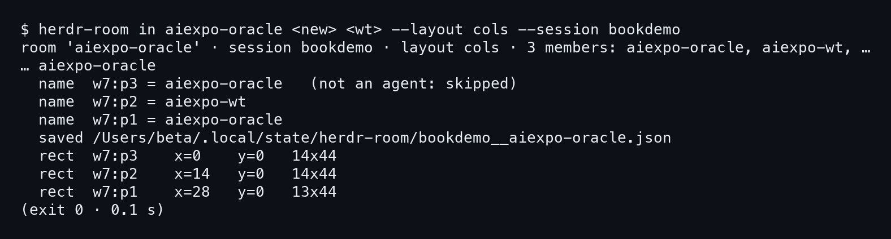
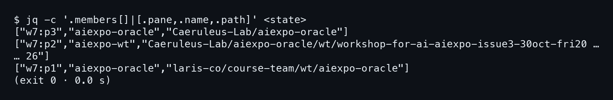
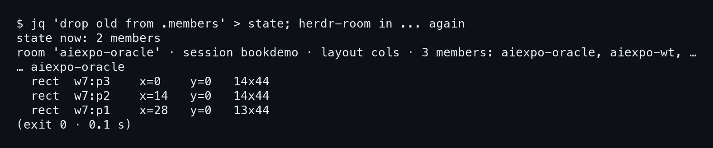
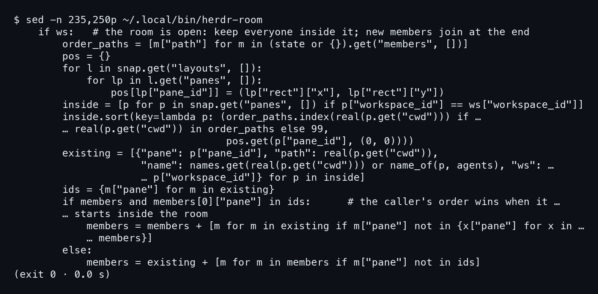
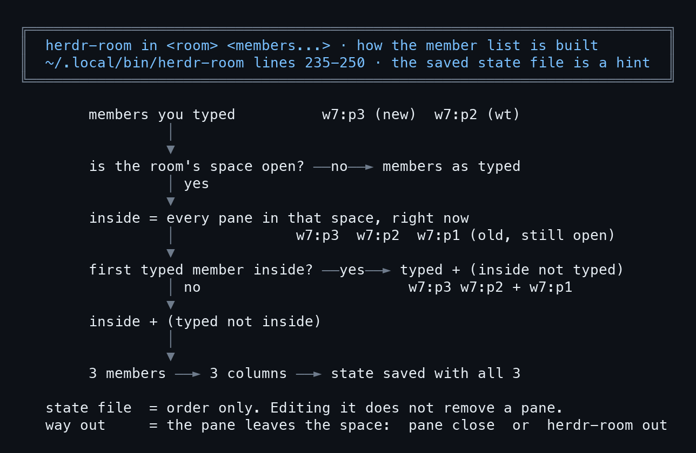

# บทที่ 5: ทำไมมี 3 คอลัมน์

ร่างใหม่เกิดแล้ว (w7:p3) ร่างเก่ายังไม่ปิด (w7:p1) ทีนี้ถ้าสั่ง `herdr-room in` ตอนนี้ จะได้กี่คอลัมน์ คนที่ตั้งใจให้เหลือสองก็คงคิดว่าสอง แต่ห้องนับเองอีกแบบ ทุกภาพในบทนี้มาจากการซ้อมใน session bookdemo (id จึงเป็น w7) คืนจริงตอน 20:05:38 ก็ได้ 3 members เหมือนกัน บทนี้ดูว่าห้องนับยังไง แล้วทำไมแก้ไฟล์ state ก็ไม่ช่วย

## 5.1 สั่ง in ด้วยสองสมาชิก ได้ห้องสาม

### ขั้นที่ 1 — สั่ง room in ด้วยร่างใหม่กับ worktree

พิมพ์ชื่อห้อง แล้วตามด้วยสมาชิกที่ต้องการ คือร่างใหม่ (path ของ main checkout) กับ worktree ของ aiexpo-wt ใส่ `--layout cols` ให้เรียงเป็นคอลัมน์ และ `--session bookdemo` ให้รันใน session ซ้อม ตรงนี้ร่างเก่ายังเปิดอยู่ใน space เดียวกัน

```bash
herdr-room in aiexpo-oracle <new> <wt> --layout cols --session bookdemo
```



สั่งไปสองสมาชิก แต่หัวบรรทัดแรกรายงานว่า **ห้องมี 3 members** และรายชื่อมี aiexpo-oracle สองครั้ง (ร่างใหม่กับร่างเก่า) ไล่ดู rect ก็ได้สามก้อน

ภาพแรกของบทมีบรรทัด `name w7:p3 = aiexpo-oracle (not an agent: skipped)` สาเหตุ capture ไม่ได้บอก บทนี้ไม่เดา แต่ **pane นี้ยังเป็นสมาชิกของห้อง** เพราะบรรทัด `rect w7:p3` ยังอยู่ บทหน้าแก้ที่ต้นเหตุ

```
room 'aiexpo-oracle' · session bookdemo · layout cols · 3 members: …
  rect  w7:p3    x=0    y=0   14x44
  rect  w7:p2    x=14   y=0   14x44
  rect  w7:p1    x=28   y=0   13x44
```

กว้าง 14, 14 และ 13 สูง 44 เท่ากันหมด รวมแล้ว 14+14+13 = 41 ก้อนที่สามคือ w7:p1 ร่างเก่า

## 5.2 ไฟล์ state ก็จดไว้สามคน

### ขั้นที่ 1 — เปิดไฟล์ state ดูสมาชิก

ห้องเก็บรายชื่อสมาชิกไว้ในไฟล์ JSON ใช้ `jq` ดึงออกมาทีละคน เอาแค่ pane, name และ path

```bash
jq -c '.members[]|[.pane,.name,.path]' <state>
```



มีสามแถว สองแถวแรกคือ w7:p3 กับ w7:p2 ที่เราสั่ง ส่วนแถวที่สามคือ **ร่างเก่าที่ห้องเก็บเข้ามาเอง**

```
["w7:p1","aiexpo-oracle","laris-co/course-team/wt/aiexpo-oracle"]
```

path นี้คือ worktree เดิมใน course-team ไม่ใช่ main checkout ตรงนี้ชัดว่าห้องรู้จักร่างเก่า ทั้งที่เราไม่ได้พิมพ์ถึงมันสักคำ

## 5.3 แก้ state ให้เหลือสอง ไม่ได้อะไรเลย

### ขั้นที่ 1 — ตัดร่างเก่าออกจากไฟล์ แล้วสั่ง in อีกรอบ

ความคิดแรกของใครก็คงเป็นแบบนี้ ถ้าห้องอ่านรายชื่อจากไฟล์ ก็ลบแถวร่างเก่าออกจากไฟล์ แล้วสั่งซ้ำ การทดลองนี้ใช้ `jq` ตัดสมาชิกที่ path เป็นร่างเก่า เขียนทับไฟล์ state แล้วรัน `herdr-room in` ชุดเดิม

```bash
jq 'drop old from .members' > state
herdr-room in aiexpo-oracle <new> <wt> --layout cols --session bookdemo
```



capture บอกว่า `state now: 2 members` แต่บรรทัดถัดมายังเป็น `3 members` และ rect ยังเป็น 14, 14, 13 เหมือนเดิมทุกตัว **การแก้ไฟล์ state ไม่ได้ลบ pane ออกจากห้อง** ส่วนทำไมถึงเป็นแบบนี้ ต้องไปอ่านโค้ด

## 5.4 โค้ดที่ตัดสินว่าใครอยู่ในห้อง

### ขั้นที่ 1 — อ่านบรรทัด 235 ถึง 250 ของ herdr-room

เปิดสคริปต์ด้วย `sed -n` ดูเฉพาะช่วงที่เกี่ยวกับห้องที่เปิดอยู่

```bash
sed -n 235,250p ~/.local/bin/herdr-room
```



การ์ดนี้วาดเส้นทางตัดสินใจของโค้ดสิบหกบรรทัดนี้ไว้ก่อน



แล้วอ่านทีละบรรทัดได้ดังนี้

- บรรทัด 235 `if ws:` ถ้า space ของห้องเปิดอยู่ (มี workspace ตัวจริง) ก็เข้าสาขานี้ คอมเมนต์บอกว่า "keep everyone inside it"
- บรรทัด 236 `order_paths` ดึง path จาก `members` ใน state เก็บไว้เป็น **ลำดับ** อย่างเดียว
- บรรทัด 241 `inside` คือ pane ทุกตัวที่ `workspace_id` ตรงกับ space ของห้อง ณ ตอนนี้ จุดนี้แหละที่ร่างเก่าเข้ามา เพราะมันยังนั่งอยู่ใน space
- บรรทัด 237–243 จดตำแหน่งบนจอ แล้วเรียง `inside` ตามลำดับใน state
- บรรทัด 244–245 ทำ `existing` ซึ่งเป็นรายการสมาชิกที่สร้างจาก pane จริง มี pane, path, ชื่อ และ workspace
- บรรทัด 246 `ids` เก็บ id ของ pane ที่อยู่ข้างในทั้งหมด
- บรรทัด 247–250 ถ้าสมาชิกคนแรกที่พิมพ์อยู่ข้างในห้องอยู่แล้ว ลำดับที่พิมพ์ชนะ แล้วต่อท้ายด้วย pane ข้างในที่ไม่ได้พิมพ์ ไม่งั้นเอา `existing` ขึ้นก่อน แล้วค่อยเติมคนที่พิมพ์แต่ยังไม่อยู่ข้างใน

ในเคสเรา w7:p3 ที่พิมพ์เป็นคนแรกอยู่ข้างในห้อง จึงเป็น `typed + (inside not typed)` และ w7:p1 ก็ตามมาต่อท้าย **ไฟล์ state เป็นแค่คำใบ้เรื่องลำดับ ตัวตัดสินสมาชิกคือ pane ที่อยู่ใน space จริง** ทางออกจึงอยู่ในกล่องสุดท้ายของการ์ด คือให้ pane ออกจาก space ด้วย `pane close` หรือ `herdr-room out` ไม่ใช่แก้ไฟล์
