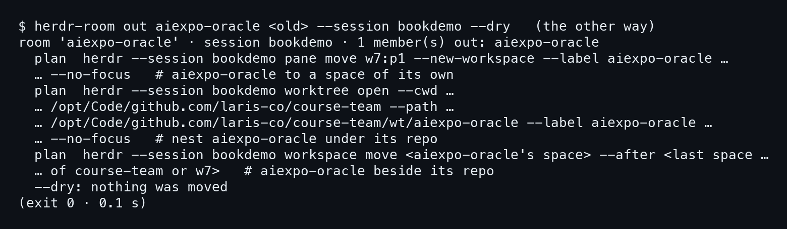
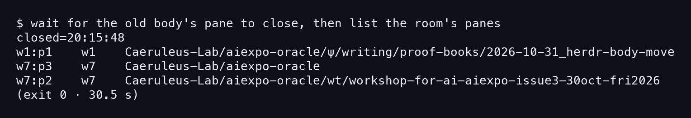
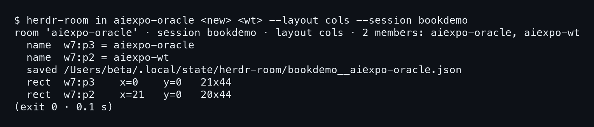
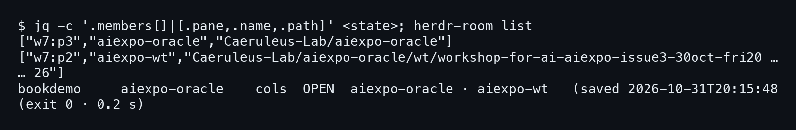

# บทที่ 6: ทางแก้ — ให้ร่างเก่าออกก่อน

บทที่ 5 เห็นแล้วว่าห้องมี 3 คอลัมน์เพราะ `herdr-room in` ไล่เก็บ pane ทุกอันที่อยู่ในห้อง
ตอนนั้นร่างเก่ายังไม่ไปไหน ทางแก้เลยไม่ใช่การแก้ไฟล์ state แต่คือให้ร่างเก่าออกจากห้องก่อน
แล้วค่อยเรียก room in ใหม่ บทนี้ทำให้ดูใน session `bookdemo` ทีละขั้น

## 6.1 ทางออกมีสองทาง

ร่างเก่าออกจากห้องได้สองทาง ทางแรกคือสั่ง `herdr-room out` ทางที่สองคือปิด pane ทิ้งเลย
ลองทางแรกด้วย `--dry` ก่อน จะได้เห็นว่ามันตั้งใจทำอะไรบ้างโดยที่ยังไม่แตะอะไรจริง

### ขั้นที่ 1 — ดู dry run ของ out

สั่ง out กับชื่อ `aiexpo-oracle` และ path ของร่างเก่า (ในภาพเขียนว่า `<old>`) พร้อม `--dry`
คำสั่งนี้ไม่ย้ายอะไร แค่พิมพ์แผนออกมา

```bash
herdr-room out aiexpo-oracle <old> --session bookdemo --dry
```



แผนมี 3 บรรทัด บรรทัดแรกย้าย `w7:p1` ไปเป็น space ของตัวเอง ซึ่งก็คือสิ่งที่ต้องการ
แต่บรรทัดที่สองคือ `worktree open --cwd .../laris-co/course-team --path .../course-team/wt/aiexpo-oracle`
แปลว่า out จะ **เปิด space ของ worktree ใต้ course-team** เพิ่มให้ด้วย
ซึ่งไม่ใช่สิ่งที่ต้องการ เพราะเป้าหมายคือให้ร่างเก่าหายไป ไม่ใช่ให้มีที่อยู่ใหม่ใต้ repo เดิม

### ขั้นที่ 2 — เลือกปิด pane

คืนจริงไม่ได้ใช้ out แต่ใช้ `pane close` ตามที่ร่างเก่าตั้ง timer ไว้เอง (บทที่ 4)
พอ timer ครบ ร่างเก่าก็ `/exit` แล้วปิด pane ของตัวเอง ในรีเพลย์ timer ตั้งไว้ 30 วินาที
เหตุผลที่ **ปิด pane ได้ตรงกว่า out** คือไม่มีผลข้างเคียง ไม่มี space ใหม่โผล่มา
ข้อเสียมีข้อเดียว คือต้องรอให้ pane หายไปจริงก่อนทำขั้นต่อไป

## 6.2 รอจนร่างเก่าหาย

ห้ามรีบเรียก room in ทันทีหลังสั่งปิด เพราะบทที่ 5 พิสูจน์แล้วว่าแค่ pane ยังอยู่ ห้องก็ยังนับมัน
จึงต้องรอแล้วตรวจรายการ pane ก่อน

### ขั้นที่ 1 — รอแล้วดูรายการ pane

รอจน pane ของร่างเก่าปิด จดเวลาที่เห็น แล้ว list pane ของห้องใน session `bookdemo`
(ภาพนี้คือผลของการรอแล้ว list ไม่ใช่คำสั่งเดียว) pane ที่ควรเหลือมีสองอัน

```
w7:p3	w7	Caeruleus-Lab/aiexpo-oracle
w7:p2	w7	Caeruleus-Lab/aiexpo-oracle/wt/workshop-for-ai-aiexpo-issue3-…
```



ภาพบอกว่าปิดตอน `closed=20:15:48` และคำสั่งรอใช้เวลา 30.5 วินาที ตรงกับ timer 30 วินาที
รายการที่เหลือในห้องมีแค่ 2 pane ตามที่ยกมาข้างบน

ส่วน `w1:p1` ที่โผล่บรรทัดบนสุดเป็น pane ที่ใช้เขียนหนังสือเล่มนี้ ใน space `w1` อีกอัน ไม่ได้อยู่ในห้อง
ร่างเก่าไม่อยู่ในรายการแล้ว ใช้ **รายการ pane เป็นตัวตัดสิน** ไม่ใช่ความรู้สึกว่า timer น่าจะครบ

## 6.3 room in อีกรอบ

พอร่างเก่าไม่อยู่ ห้องก็เหลือแค่ร่างใหม่กับ worktree partner เรียก room in ซ้ำได้เลย

### ขั้นที่ 1 — สั่ง room in ด้วยสองสมาชิก

ส่งแค่สองตัว คือร่างใหม่ (`<new>`) กับ worktree (`<wt>`) ใช้ layout `cols` เหมือนรอบแรก

```bash
herdr-room in aiexpo-oracle <new> <wt> --layout cols --session bookdemo
```



หัวผลลัพธ์บอก `2 members: aiexpo-oracle, aiexpo-wt` รอบนี้บรรทัด `name` ขึ้นครบทั้งสองตัว
ไม่มีคำว่า skipped ซึ่งต่างจากบทที่ 5 ที่ร่างใหม่ถูกข้ามตอนตั้งชื่อ
ขนาดคอลัมน์เป็น

```
rect  w7:p3    x=0    y=0   21x44
rect  w7:p2    x=21   y=0   20x44
```

สองคอลัมน์ กว้าง 21 กับ 20 สูง 44 เท่ากัน แทนที่จะเป็น 3 คอลัมน์แคบ ๆ แบบเดิม

## 6.4 state กับ list ต้องตรงกัน

แค่หน้าจอถูกยังไม่พอ ต้องเช็กว่าไฟล์ state ที่ room in บันทึกไว้ บอกเรื่องเดียวกับที่ห้องเป็นจริง
เพราะรอบหน้า `in` จะอ่านจากมัน

### ขั้นที่ 1 — อ่าน state แล้ว list ห้อง

ใช้ `jq` ดึงสมาชิกจากไฟล์ state แล้วเรียก `herdr-room list` ต่อท้าย

ผลที่จะเห็น: state ไม่มี path ของร่างเก่าแล้ว saved ลงท้าย `20:15:48` ตรงกับตอน pane เก่าปิด **state กับ list ตรงกัน** บทหน้าเปิด transcript ของคืนจริง

```bash
jq -c '.members[]|[.pane,.name,.path]' <state>; herdr-room list
```


