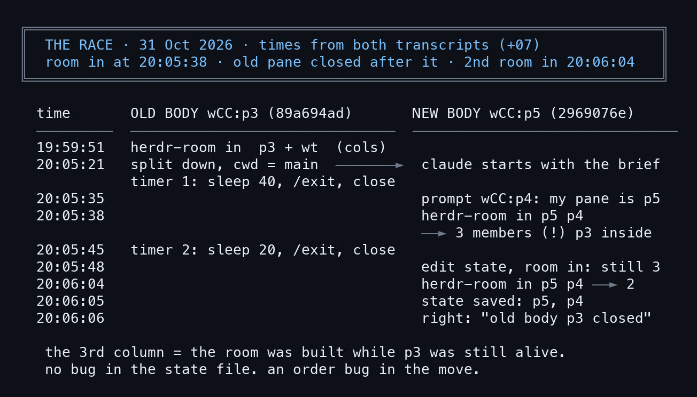
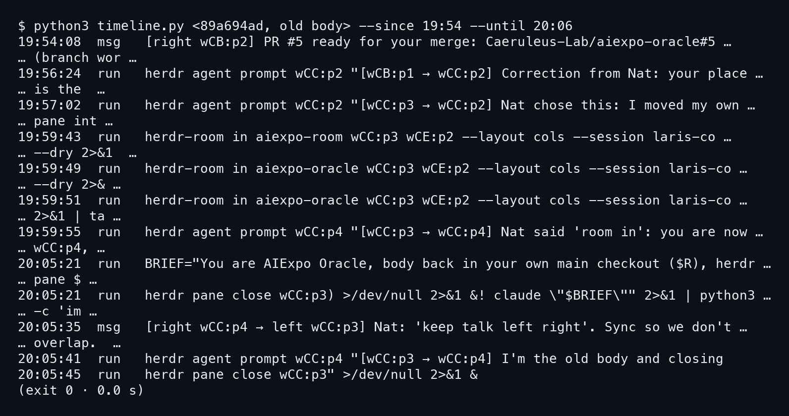
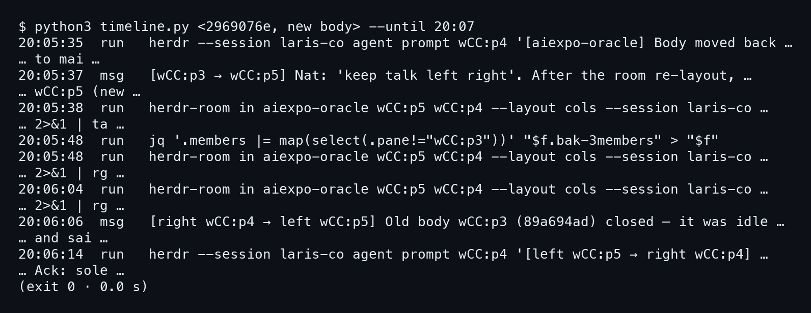
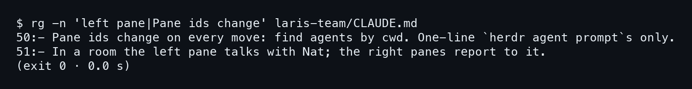
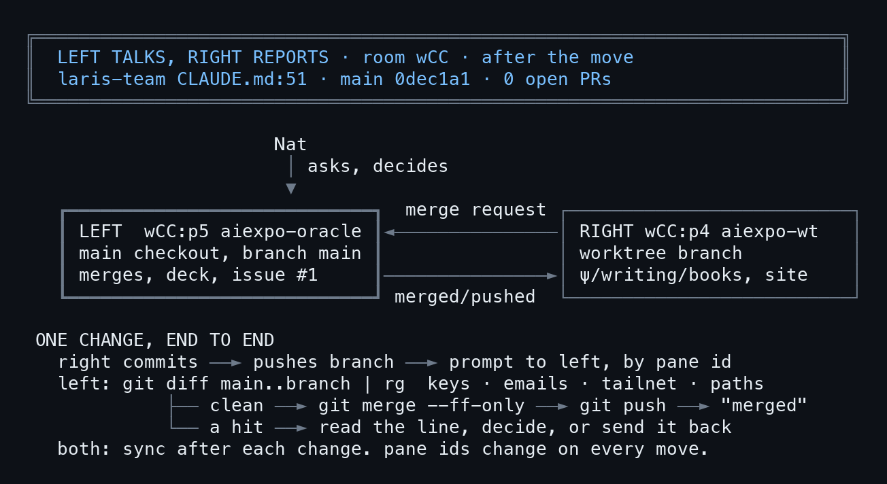
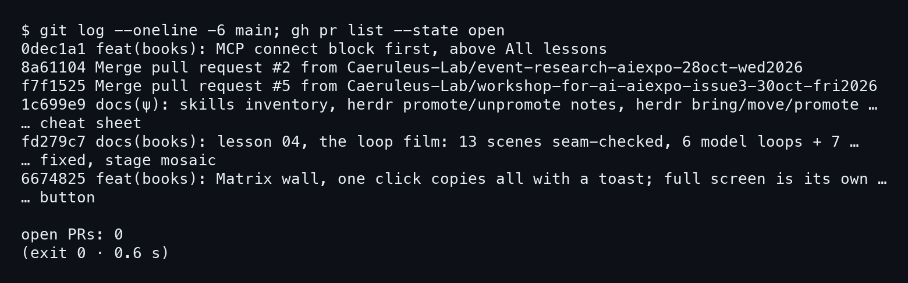
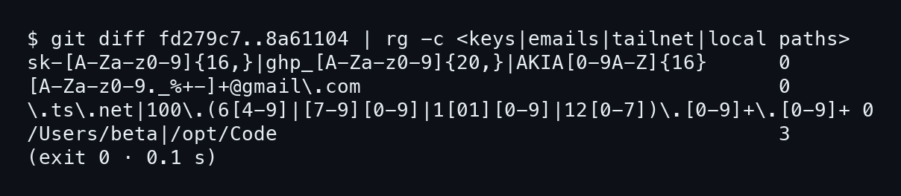
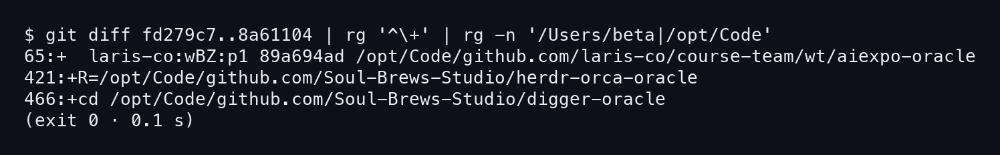

# บทที่ 7: คืนจริง และซ้ายคุยขวา

บทก่อนหน้าเป็นการเล่นซ้ำใน session `bookdemo` ทั้งหมด บทนี้กลับไปที่คืนจริงของ 31 ต.ค. ที่ห้อง `wCC` ใน session `laris-co` เราไม่ได้รันอะไรเพิ่มในห้องจริง แค่อ่านย้อนจาก transcript ของ agent สองตัว แล้วดูว่ากฎของทีมที่ตามมาหลังย้ายเสร็จคืออะไร

## 7.1 การแข่งกันของสองร่าง

ปัญหา 3 คอลัมน์ในบทที่ 5 ไม่ใช่บั๊กในไฟล์ state แต่เป็นเรื่องลำดับเวลา ภาพแรกของบทนี้วางเหตุการณ์ของทั้งสองร่างลงบนแกนเวลาเดียวกัน ให้เห็นว่าใครทำอะไรก่อนหลัง

### ขั้นที่ 1 — ดูแกนเวลาจาก transcript ทั้งสองฝั่ง

ภาพนี้เป็นการ์ดที่เราวาดเองจากเวลาใน transcript (เวลาไทย UTC+7) ไม่ใช่ผลของคำสั่งตัวเดียว คอลัมน์ซ้ายคือร่างเก่า `wCC:p3` (89a694ad) คอลัมน์ขวาคือร่างใหม่ `wCC:p5` (2969076e)



อ่านจากบนลงล่าง ตอน 20:05:21 ร่างเก่า split pane ลงมาแล้วสตาร์ท claude ในโฟลเดอร์ main พร้อมตั้งเวลาปิดตัวเองไว้ 40 วินาที ตอน 20:05:38 ร่างใหม่รัน `herdr-room in` เป็นครั้งแรก ตอนนั้น p3 ยังมีชีวิตอยู่ในห้อง เลยได้สมาชิก 3 คน

> **ห้องถูกสร้างตอนที่ร่างเก่ายังไม่ปิด** ลำดับการย้ายผิด ไม่ใช่ไฟล์ state ผิด

พอ 20:06:04 p3 ปิดไปแล้ว `herdr-room in` จึงได้ 2 สมาชิก และ 20:06:05 บันทึก state เป็น p5 กับ p4 ตรงกับสิ่งที่บทที่ 6 แก้ไว้ในการเล่นซ้ำ คือให้ร่างเก่าออกก่อนแล้วค่อยสร้างห้อง

## 7.2 สอง transcript เคียงข้างกัน

เครื่องมืออ่านย้อนคือ `timeline.py` (บทที่ 8 จะเล่าว่าทำงานยังไง) มันพิมพ์หนึ่งบรรทัดต่อหนึ่งเหตุการณ์ ขึ้นต้นด้วยเวลา แล้วบอกว่าเป็น `run` (คำสั่งที่ agent รัน) หรือ `msg` (ข้อความที่เข้ามา) ข้อควรรู้คือเครื่องมือตัดบรรทัดยาวด้วย "…" ดังนั้นเนื้อคำสั่งเต็มจะไม่อยู่ในภาพ

### ขั้นที่ 1 — อ่านบันทึกของร่างเก่า

ให้กรองช่วง 19:54 ถึง 20:06 ด้วย `--since` กับ `--until`

```bash
python3 timeline.py <89a694ad, old body> --since 19:54 --until 20:06
```



มีสามบรรทัดที่ต้องจับ ตอน 19:59:51 มันรัน `herdr-room in aiexpo-oracle wCC:p3 wCE:p2` ครั้งแรกเพื่อรวมตัวเองกับ worktree เข้าห้อง สังเกตว่า worktree ตอนนั้นคือ `wCE:p2` ไม่ใช่ `p4` เพราะ **pane id เปลี่ยนตอนย้าย** ถัดมา 20:05:21 คือคำสั่งสร้างร่างใหม่ และ 20:05:45 คือคำสั่งที่ตั้งตัวจับเวลาตัวที่สองไว้ปิด `wCC:p3` (sleep 20 แล้วค่อย close)

### ขั้นที่ 2 — อ่านบันทึกของร่างใหม่

ร่างใหม่รันคำสั่งเดียวกัน แต่ใช้ `--until 20:07` เพราะเพิ่งเกิดตอน 20:05

```bash
python3 timeline.py <2969076e, new body> --until 20:07
```



บรรทัดที่ 20:05:37 เป็นข้อความที่ Nat ฝากมาผ่านร่างเก่า คือ `keep talk left right` จากนั้น 20:05:38 คือ `herdr-room in` รอบที่ได้ 3 สมาชิก ตามด้วย `jq` ตัด p3 ออกจาก state ตอน 20:05:48 แล้วรัน room in ซ้ำก็ยังได้ 3 เหมือนเดิม (ผลรอบนั้นไม่ได้เก็บไว้ในคืนจริง บทที่ 5 ในการเล่นซ้ำให้ผลเดียวกัน) พอ 20:06:04 รันอีกครั้งจึงเหลือ 2 ส่วนบรรทัด 20:06:06 เป็นข้อความจากฝั่งขวา `wCC:p4` ว่าร่างเก่า p3 ปิดแล้ว และ 20:06:14 ร่างใหม่ตอบรับกลับ

## 7.3 กฎซ้ายคุยขวา

ประโยคของ Nat สั้นมาก คือ keep talk left right ไฟล์ `CLAUDE.md` ของ `laris-team` มีกฎเรื่องนี้อยู่ที่บรรทัด 51

### ขั้นที่ 1 — หากฎในไฟล์ด้วย rg

ค้นสองวลีที่เป็นหัวใจของกฎ ใช้ `rg` ในไฟล์เดียว ไม่กวาดทั้ง tree

```bash
rg -n 'left pane|Pane ids change' laris-team/CLAUDE.md
```



```
50:- Pane ids change on every move: find agents by cwd. One-line …
51:- In a room the left pane talks with Nat; the right panes report to it.
```

สองบรรทัดนี้สอนสองเรื่อง บรรทัด 51 บอกว่า **ซ้ายคุยกับ Nat ขวารายงานซ้าย** ตามการ์ดและลำดับ argument ของ `herdr-room in` ห้องของเราจึงมี p5 (main) อยู่ซ้าย และ p4 (worktree) อยู่ขวา ส่วนบรรทัด 50 ให้หา agent จาก cwd อย่าจำเลข `p3` ไว้

### ขั้นที่ 2 — ดูการ์ดว่าใครทำอะไร

การ์ดนี้สรุปบทบาทของสอง pane กับเส้นทางของงานหนึ่งชิ้น ตั้งแต่ commit จนถึง merge ซึ่งข้อความเดียวอธิบายได้ไม่ชัดเท่ารูป



ฝั่งขวา **commit ใน worktree แล้ว push branch** จากนั้น prompt หาฝั่งซ้ายด้วย pane id ฝั่งซ้ายตรวจ diff ถ้าสะอาดก็ merge แบบ fast-forward ถ้าเจอบรรทัดน่าสงสัยก็อ่านก่อนตัดสินใจ หรือส่งกลับไปแก้ ทั้งสองฝั่งต้อง sync กันหลังทุกการเปลี่ยนแปลง

## 7.4 หนึ่ง merge ตั้งแต่ต้นจนจบ

ในคืนนั้นฝั่งซ้าย merge ไปสามรอบ คือ `0dec1a1`, `8881cc1` และ `53c5e38` ทุกรอบเป็น fast-forward หลังสแกน ภาพที่เราเก็บไว้ตรงกับรอบแรก `0dec1a1` ส่วนสองรอบหลังเกิดตามมาหลังเก็บภาพ

### ขั้นที่ 1 — ดู log ของ main และ PR ที่ค้าง

ก่อนและหลัง merge ให้เช็กสองอย่าง คือประวัติบน main กับจำนวน PR ที่ยังเปิด

```bash
git log --oneline -6 main; gh pr list --state open
```



```
0dec1a1 feat(books): MCP connect block first, above All lessons
8a61104 Merge pull request #2 from Caeruleus-Lab/event-research-aiexpo-…
…
open PRs: 0
```

บนสุดคือ `0dec1a1` ที่เพิ่ง merge และท้ายสุดบอก `open PRs: 0` แปลว่า**ไม่มี PR ที่เปิดค้าง**

### ขั้นที่ 2 — สแกน diff ด้วยสี่แบบ

สแกนนี้รันบน diff ของช่วงก่อนหน้า `fd279c7..8a61104` ด้วย `rg -c` นับบรรทัดที่ตรงกับ pattern สี่ชุด คือ key, อีเมล, tailnet และ path ในเครื่อง

```bash
git diff fd279c7..8a61104 | rg -c <keys|emails|tailnet|local paths>
```



```
sk-[A-Za-z0-9]{16,}|ghp_[A-Za-z0-9]{20,}|AKIA[0-9A-Z]{16}      0
/Users/beta|/opt/Code                                          3
```

สามชุดแรกได้ 0 ทั้งหมด คือ key, อีเมล `@gmail.com` และที่อยู่ tailnet ไม่มีเลย ส่วนชุดสุดท้ายได้ 3 ซึ่ง **ตัวเลขที่ไม่ใช่ 0 ต้องอ่านเป็นบรรทัด ไม่ใช่ตัดสินจากตัวเลข** เรื่องนี้ต่อในหัวข้อถัดไป

## 7.5 สามบรรทัดที่สแกนเจอ

ช่วง `fd279c7..8a61104` เป็น range ก่อนหน้า เราจึงกลับไปดูว่าสามบรรทัดนั้นคืออะไร

### ขั้นที่ 1 — ดึงบรรทัดที่ตรงออกมาอ่านเอง

คราวนี้ไม่ใช้ `-c` แต่กรองเอาเฉพาะบรรทัดที่เพิ่มเข้ามา (ขึ้นต้นด้วย `+`) แล้วให้ `rg -n` ใส่เลขบรรทัด

```bash
git diff fd279c7..8a61104 | rg '^\+' | rg -n '/Users/beta|/opt/Code'
```




บรรทัด 65 คือรายการ agent ที่มี session id กับโฟลเดอร์ทำงาน บรรทัด 421 กับ 466 คือคำสั่ง `R=` และ `cd` ที่อยู่ในโน้ต vault ทั้งสามเป็น **path ของโฟลเดอร์ในเครื่อง ไม่ใช่ความลับ** ไม่มี token ไม่มี key และเราไม่เรียกมันว่าข้อมูลรั่ว

สแกนมีไว้ให้คนอ่านก่อน merge ไม่ได้ตัดสินแทน บทสุดท้ายกลับไปดูว่าอะไรยังค้าง
