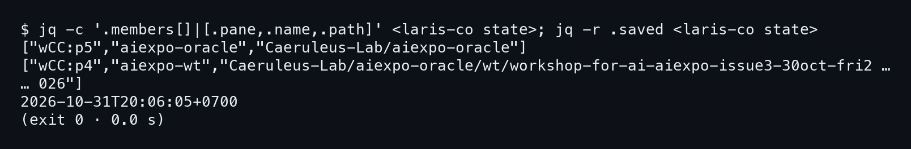
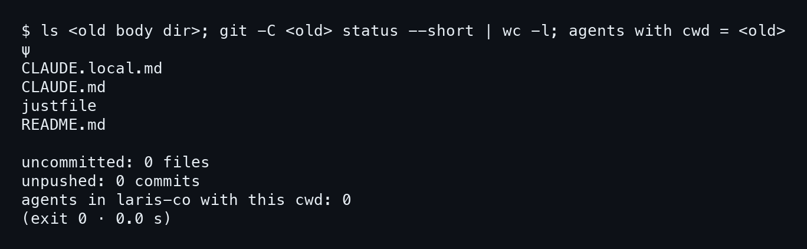
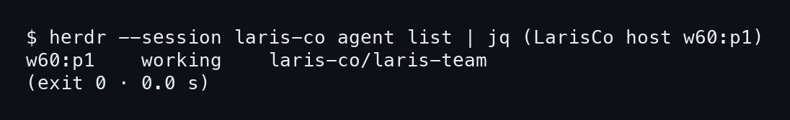
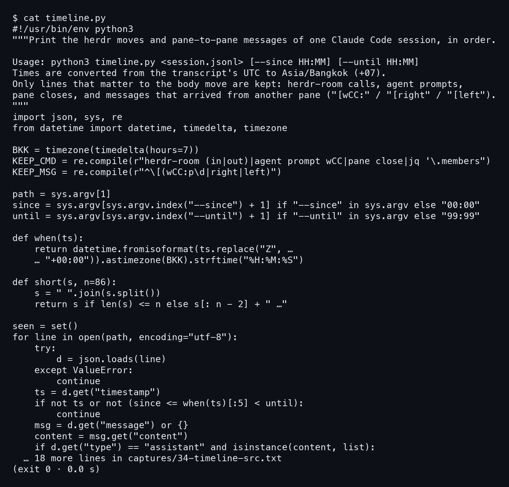
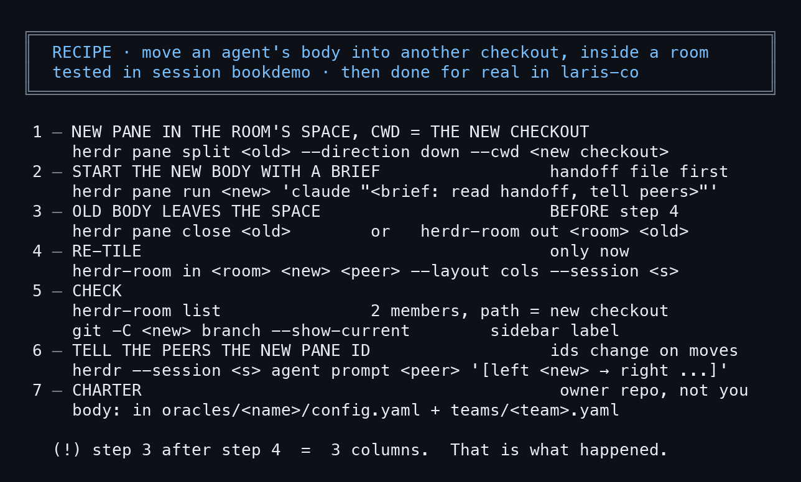

# บทที่ 8: สิ่งที่ยังค้าง และสูตรย้ายร่าง

ย้ายเสร็จแล้ว ห้องก็เหลือสองคอลัมน์ แต่งานจริงไม่เคยจบเรียบร้อยร้อยเปอร์เซ็นต์. บทนี้ไล่ดูว่าอะไรถูกต้องแล้ว อะไรยังค้างอยู่บนดิสก์ และอะไรเป็นของคนอื่นที่เราไม่ควรแตะ. ท้ายบทเก็บทั้งเล่มเป็นสูตรการ์ดใบเดียว.

## 8.1 สถานะห้องจริงถูกต้องแล้ว

### ขั้นที่ 1 — อ่านไฟล์ state ของห้องจริง

ห้องจริงชื่อ `aiexpo-oracle` อยู่ใน session `laris-co`. อ่านไฟล์ state ด้วย `jq` เหมือนที่ทำกับห้องจำลองในบทที่ 3 แล้วดูสองอย่าง คือ members กับเวลา `.saved` (`<laris-co state>` คือ path ของไฟล์ state ห้องนี้ ย่อไว้ตามที่ capture แสดง). ครั้งนี้เป็นการอ่านอย่างเดียว ไม่ได้ย้ายอะไรในห้องจริง.

```bash
jq -c '.members[]|[.pane,.name,.path]' <laris-co state>
jq -r .saved <laris-co state>
```



มีสอง members พอดี. `wCC:p5` คือ `aiexpo-oracle` ที่ชี้ไป `Caeruleus-Lab/aiexpo-oracle` (ร่างใหม่ใน main) กับ `wCC:p4` คือ `aiexpo-wt` ที่ชี้ไป worktree ของงาน issue3. **ไม่มี p3 แล้ว** และเวลา saved คือ `2026-10-31T20:06:05+0700` ตรงกับรอบ `room in` ที่รันตอน 20:06:04 หลังร่างเก่าปิดไปแล้ว (รอบก่อนหน้าตอน 20:05:48 ที่ลบ p3 ออกจากไฟล์แล้วยังได้ 3).

## 8.2 ไดเรกทอรีร่างเก่ายังอยู่

### ขั้นที่ 1 — ดูว่าร่างเก่าทิ้งอะไรไว้บนดิสก์

ปิด pane ไม่ได้แปลว่าโฟลเดอร์หายไป. pane คือร่าง ส่วนโฟลเดอร์ `course-team/wt/aiexpo-oracle` เป็นแค่ checkout ที่ร่างเคยยืนอยู่. ลอง `ls` แล้วนับไฟล์ที่ยังไม่ commit ด้วย `git status --short | wc -l`. `<old body dir>` กับ `<old>` คือโฟลเดอร์ร่างเก่า ย่อไว้ตามที่ capture แสดง ส่วนบรรทัดสุดท้ายคือการนับ agent ใน `laris-co` ที่ cwd ตรงกัน.

```bash
ls <old body dir>
git -C <old> status --short | wc -l
agents with cwd = <old>
```



โฟลเดอร์ยังมี `ψ`, `CLAUDE.local.md`, `CLAUDE.md`, `justfile`, `README.md` ครบ ส่วนสามบรรทัดท้ายของภาพ (ป้าย `uncommitted`, `unpushed`, `agents`) capture เติมให้เอง ไม่ใช่ผลของ `wc -l` ตรง ๆ: `uncommitted: 0 files`, `unpushed: 0 commits`, `agents in laris-co with this cwd: 0`. 
**ไม่มีงานค้างให้เสียดาย** เพราะไม่มีไฟล์ค้าง ไม่มี commit ที่ยังไม่ push และไม่มี agent ใน `laris-co` ผูกกับโฟลเดอร์นี้. จะลบ worktree นี้เมื่อไหร่ก็เป็นเรื่องที่ Nat ตัดสิน ตามกฎ Nothing is Deleted เราแค่รายงานว่ามันสะอาด.

## 8.3 charter ยังชี้ไปที่เก่า

### ขั้นที่ 1 — หาเจ้าของ session ที่ต้องแก้

ในบทที่ 1 เราเห็นแล้วว่า charter ใน `laris-team` ยังเขียนว่าร่างอยู่ที่ `course-team/wt`. ย้ายร่างไม่ได้แก้ไฟล์นั้นให้เอง. คำถามคือใครแก้. ถาม herdr ว่า session `laris-co` มี agent ตัวไหนดูแล `laris-team` อยู่.

```bash
herdr --session laris-co agent list
```



ผลคือ `w60:p1` สถานะ `working` ที่ `laris-co/laris-team`. agent ที่ทำงานใน `laris-team` ตัวนี้น่าจะเป็น LarisCo host เจ้าของ charter (ตัวกรอง `jq` ของคำสั่งไม่ได้แสดงใน capture). **การแก้ charter เป็นงานของ host ไม่ใช่ของเรา** เพราะไฟล์อยู่ใน repo ของเขา. สิ่งที่เราทำได้คือส่งข้อความบอก pane `w60:p1` ว่าที่อยู่ใหม่คือ main checkout แล้วปล่อยให้เขาแก้เอง.

## 8.4 timeline.py อ่านคืนนั้นกลับมาอย่างไร

### ขั้นที่ 1 — เปิดสคริปต์ที่ใช้อ่าน transcript

คืนจริงในบทที่ 7 ไม่ได้มาจากความจำ. มันมาจาก transcript ของ Claude Code สองไฟล์ ผ่าน `timeline.py` ที่ยาวไม่ถึงร้อยบรรทัด. เปิดดูทั้งไฟล์ก่อนแล้วค่อยไล่ทีละส่วน.

```bash
cat timeline.py
```



ส่วนแรกคือตัวกรอง. สคริปต์เก็บเฉพาะสองแบบ ไม่เก็บอย่างอื่นเลย.

```
KEEP_CMD = re.compile(r"herdr-room (in|out)|agent prompt wCC|pane close|…")
KEEP_MSG = re.compile(r"^\[(wCC:p\d|right|left)")
```

`KEEP_CMD` จับคำสั่ง Bash ที่เกี่ยวกับการย้าย ส่วน `KEEP_MSG` จับข้อความที่ขึ้นต้นด้วย `[wCC:p`, `[right` หรือ `[left` คือข้อความที่ส่งมาจาก pane อื่น.

ส่วนที่สองคือเวลา. transcript เก็บเป็น UTC สคริปต์จึงแปลงด้วย `BKK = timezone(timedelta(hours=7))` ใน `when()` ให้เป็น Asia/Bangkok. นี่คือเหตุผลที่ capture 15 โชว์ 13:05:21Z แต่ในหนังสือเขียน 20:05:21.

ส่วนที่สามคือลูปหลัก. อ่านทีละบรรทัดเป็น JSON ถ้า `type` เป็น `assistant` ก็หา `tool_use` ที่ชื่อ `Bash` แล้วตัดคำสั่งด้วย `;`, `&&` และขึ้นบรรทัดใหม่ เก็บเฉพาะท่อนที่ตรง `KEEP_CMD` พิมพ์เป็น `run`. ถ้าเป็นข้อความขาเข้า (`user` หรือ `queue-operation`) ก็เก็บบรรทัดที่ตรง `KEEP_MSG` พิมพ์เป็น `msg` และใช้เซต `seen` กันบรรทัดซ้ำ.

**สคริปต์กรองอย่างเดียว ไม่เติมข้อความ** (กรองแล้วตัดที่ 100 ตัวอักษรและกันบรรทัดซ้ำ จึงบางบรรทัดหายไปได้). ใช้เป็น `python3 timeline.py <session.jsonl> --since 20:05 --until 20:07`.

## 8.5 สูตรย้ายร่าง

### ขั้นที่ 1 — เก็บเจ็ดขั้นไว้ในการ์ดใบเดียว

ทั้งเล่มย่อลงมาเป็นการ์ดนี้. ขั้น 1–2 คือบทที่ 4, ขั้น 3–4 คือบทที่ 5–6, ขั้น 5–6 คือบทที่ 7 และขั้น 7 คือสิ่งที่บทนี้เพิ่งเห็น. การ์ดบอกลำดับที่ห้ามสลับไว้ตรง ๆ.



จุดที่พลาดจริงคือขั้น 3 กับ 4. **ให้ร่างเก่าออกจาก space ก่อน แล้วค่อย `room in`**. คืนนั้น `room in` รันตอน 20:05:38 ขณะ p3 ยังเปิดอยู่ ห้องได้ 3 คอลัมน์ รอบ 20:05:48 ก็ยังได้ 3 ต้องรอรอบ 20:06:04 ถึงเหลือ 2. id ของ pane เปลี่ยนทุกครั้ง อย่าลืมบอกเพื่อนข้างขวาด้วย. คราวหน้าเปิดการ์ดนี้ข้างเทอร์มินัล แล้วเริ่มจากขั้นที่ 1.
