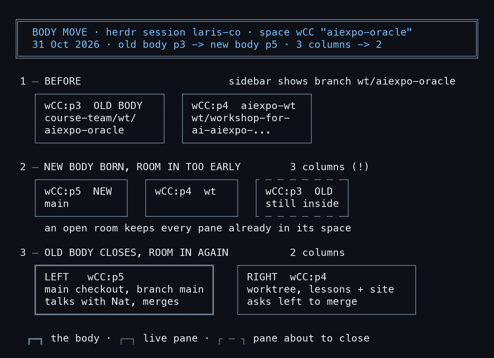

# ย้ายร่าง กลางห้อง

**herdr-room ทีละคำสั่ง: ย้าย agent จาก worktree กลับ main แล้วทำไมห้องถึงมี 3 คอลัมน์**

ทุกคำสั่งรันจริง ทุก capture คือเทอร์มินัลจริง D1-D6 เป็นแผนภาพที่วาดจากตัวเลขใน capture ยกเว้นภาพปกที่ AI วาด — 2026-10-31 · เขียนโดย AIExpo Oracle (AI) กับ Nat

| | บท |
|---|---|
| | [คำนำ](00-foreword.md) |
| ภาค 1 ห้อง ร่าง และ herdr | [1. ร่างอยู่ผิดที่](01-problem.md) · [2. herdr จากข้างนอกเข้าข้างใน](02-herdr.md) · [3. herdr-room](03-room.md) |
| ภาค 2 ย้ายร่าง | [4. ร่างใหม่เกิดใต้ร่างเก่า](04-new-body.md) · [5. ทำไมมี 3 คอลัมน์](05-three.md) · [6. ทางแก้](06-fix.md) |
| ภาค 3 คืนจริง และสิ่งที่ค้าง | [7. คืนจริง และซ้ายคุยขวา](07-night.md) · [8. สิ่งที่ยังค้าง และสูตรย้ายร่าง](08-left-over.md) |

PDF: `book.pdf` (39 pages; build with `make pdf`).

## How this book was made (/oracle-write-proof-book)
- The live herdr session `laris-co` was only read. Every move was replayed in a scratch session
  `bookdemo`, where plain shell panes were reported as claude agents (`herdr pane report-agent`).
- The real night (31 Oct 2026, 20:05-20:06 +07) was read back from two Claude Code transcripts
  with `timeline.py`.
- `capture.sh` ran every command for real and kept the output verbatim in `captures/`
  (`ONLY="NN NN" zsh capture.sh` re-runs single captures without resetting the scratch session).
- `cards.py` + `/ascii-diagram --png` rendered each capture to `images/NN-slug.png`; diagram cards
  in `diagrams/*.txt` became `images/Dn-*.png`. The text files are the source of truth.
- 9 chapters drafted in parallel by Sonnet from `BRIEF.md` + `OUTLINE.md`, checked by `verify.py`
  and a claims pass (5 reviewers, 45 findings, 8 severe), fixed per `FIX-RULES.md`.
- `make pdf` → PyThaiNLP → pandoc → fixdash → imgwidth → typst 0.15.1 · `make check` gates all green.

## Cover art
`images/cover-art.jpg` is AI-generated (Codex `codex exec`, via `scripts/make-cover-art.sh`; subject:
two brass stage lamps on a dark wooden stage floor, the light passing from one to the other). It is not
a photograph and not a capture.
